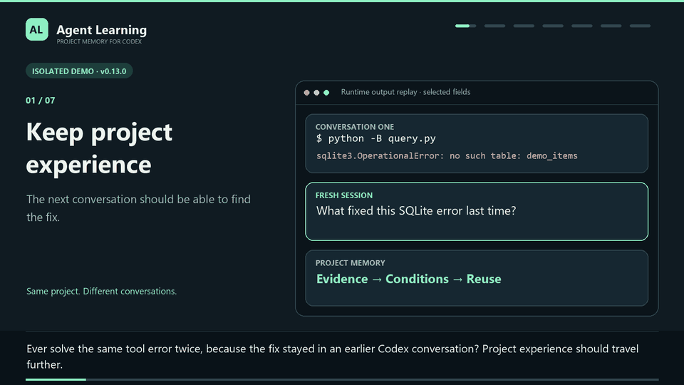
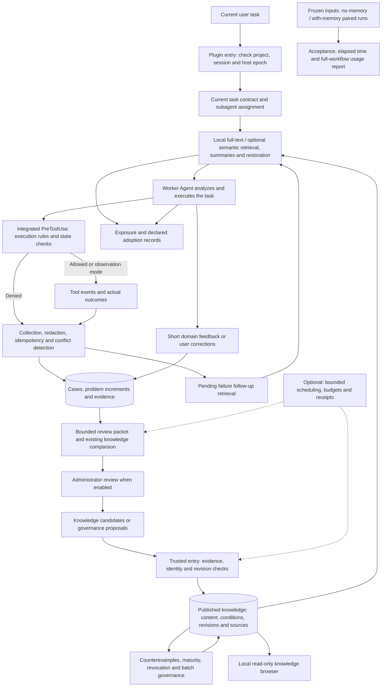
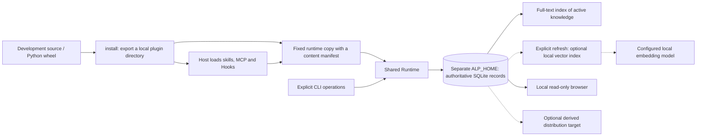

# agents-learning

[中文](README.md) | English

[](https://github.com/swenbo1-web/agents-learning/actions/workflows/ci.yml)

**Help Agents retain project experience and find evidence-backed guidance for the next task.**

Current source: **0.14.1** (Codex / Antigravity) · Python **3.10+** · SQLite · [MIT](LICENSE) · [Published 0.13.0 and downloads](https://github.com/swenbo1-web/agents-learning/releases/tag/v0.13.0)

agents-learning builds maintainable knowledge memory for long-running projects. It retrieves relevant experience at supported task events, records tool outcomes, lets an administrator organize candidates, and makes knowledge with conditions, sources and revisions available to later Agents. Workers focus on their current task while experience remains reusable across conversations.

**Install: [Antigravity](#install-in-antigravity-native-plugin) · [Codex desktop / CLI](#install-in-codex-desktop-and-cli) · [Complete architecture](#complete-architecture)**

These installation steps use the current **0.14.1** source on `main`. Published downloads remain at **0.13.0** and do not include Antigravity. If both hosts share a knowledge database, update both installations from the current source.

## Install in Antigravity (native plugin)

### 1. Get the source and export

Installation path: **get the source → export for your project → load in Antigravity → verify in a new chat**. You need Git, Python **3.10+**, and Antigravity with native plugin and Hook support. CLI installation also requires `agy plugin`. Obtain the current source first; if you already have this checkout, enter its directory and skip `git clone`:

```powershell
git clone https://github.com/swenbo1-web/agents-learning.git
cd agents-learning
python --version
agy plugin --help
```

These are Windows PowerShell examples. `python` must resolve to your actual Python 3.10+ interpreter. If it is not on PATH, replace the leading `python` with `& "C:\your-python-directory\python.exe"`; `&` is the PowerShell call operator. The installer records the actual interpreter's absolute path, so retain that interpreter after export.

Replace `D:\Projects\my-project` with an **existing project's absolute path**, `D:\AgentLearningData` with a **knowledge data directory outside the source and plugin directories**, and `D:\Plugins\agent-learning-antigravity` with a new export destination. Then run:

```powershell
python -B scripts/learning.py --workspace "D:\Projects\my-project" --home "D:\AgentLearningData" install "D:\Plugins\agent-learning-antigravity" --host antigravity --hook-mode observe
```

For Codex, export to a separate directory using [the Codex steps below](#install-in-codex-desktop-and-cli). Both profiles share the same repository and fixed runtime implementation.

An initial Antigravity export requires an explicit existing workspace. Omitting `--home` uses the same default as the local Runtime. Both MCP and Hooks bind these absolute paths. Export creates no knowledge database and changes no host configuration. For the package entry, replace `scripts/learning.py` with `-m agent_learning.cli`; on macOS/Linux use your own Python and absolute paths.

The native export contains root `plugin.json`, `mcp_config.json`, `hooks.json`, rules and worker/admin skills. Codex keeps its own manifest and entry contracts. Installation receipts record `target_host`; upgrades reject overwriting one host's export with the other profile.

### 2. Load and verify

The Antigravity CLI can install the generated local directory:

```powershell
agy plugin install "D:\Plugins\agent-learning-antigravity"
agy plugin list
```

Antigravity IDE/2.0 support workspace `.agents/plugins/` directories and global `~/.gemini/config/plugins/`. For a project installation, change the export destination above to `D:\Projects\my-project\.agents\plugins\agent-learning`, reload the project, and check that MCP, rules, skills and Hooks are enabled. This export binds one workspace; loading it globally into another workspace is rejected, so prefer project installation. The CLI copies plugins into `~/.gemini/antigravity-cli/plugins/` when you run `agy plugin install`. After upgrading the export, rerun that installation command and restart/reload the host; updating the directory it copied from is insufficient. See the [official plugin guide](https://antigravity.google/docs/plugins/). The repository root contains both sets of resource templates and must be exported locally before installation.

In a fresh conversation, ask the agent to check the project and `host_scope=antigravity:default` through `learning_status`, pass the current PreInvocation `context_handle` to `session_context`, verify `context_bound=true`, then register the current task goal.

An Antigravity MCP process may serve several chats. Every stateful call must explicitly supply the current handle; omitted handles never inherit another chat. Supply it to knowledge queries to record exposure too. Without a verified handle, only project queries are available. Observe mode omits PreToolUse, so native chat origin on every MCP write still relies on correct handle use and rules. Enforce mode adds a native origin check in the pre-tool callback.

### 3. Host differences and evidence

| Workflow | Codex | Initial Antigravity adapter |
|---|---|---|
| Automatic context | Supported user prompt, session and restoration events | PreInvocation using registered goals, recent queries and actual errors |
| Current user prompt | Supported Hook prompt | Public callback does not promise prompt text; register it through task_update |
| Context delivery | Track previous injections and avoid repeated text | Render bounded ephemeralMessage from cached references each invocation |
| Tool observations | Classify actual responses | Nonempty PostToolUse.error is failure; empty means call_completed only |
| Execution checks | Connected rules and trusted approvals | Observe omits PreToolUse; enforce returns ask on passing checks and deny on rejection |
| Stop | Registered delivery and public output | Records loop stopping; fullyIdle does not prove user acceptance |
| Compaction, children, login | Supported events and explicit entry points | No invented equivalent events; ambiguous numbering needs trusted reset |
| Administrator | Optional Codex CLI executor and separate admin tools | Shared governance queue; no automatic Antigravity model executor yet |

The adapter follows the [official Hooks contract](https://antigravity.google/docs/hooks). It does not scan transcripts, artifacts or private model reasoning. Without final outputs, exit codes or asynchronous outcomes, it does not generate tool_success evidence or satisfy publication policies requiring that level. Feedback retains its reported status. In observe mode, a Post without a verified Pre remains unassociated with a task; errors can still trigger bounded followup searches. Repeated ephemeral summaries still use model context. Caching avoids repeated retrieval; it is not evidence of net token savings.

Multi-workspace callbacks must mount the bound project. Tool resources verify attribution; uncertain callbacks stay unassociated, and enforce rejects them. Native tool argument mappings are distinct from Codex. For example, run_command is command execution and cannot bypass read-only protection through a rule labeling it as a read.

Without a reliable new-user-prompt boundary, Hooks cannot automatically establish that a new requirement replaces the previous task. Workers must update the goal/scope when requirements change. Enforcement checks the registered contract and trusted approval; it does not establish authorization for every native user prompt. Native installations ignore an inherited ALP_CONTEXT_HANDLE and require the current Hook handle on each stateful request.

### 4. Explicit enforcement, reset and account change

From a trusted terminal, update the export to enable enforcement:

```powershell
python -B scripts/learning.py install "D:\Plugins\agent-learning-antigravity" --host antigravity --upgrade --hook-mode enforce
```

The adapter never returns automatic allow or permissionOverrides. The existing trusted execution-approve entry must still authorize the current task with native tool names and argument fields. ask follows the host's approval settings. Host Deny composition, timeout, killed processes and malformed responses have not been accepted in a live host; universal hard rejection on failure is not established.

When counters regress, repeat or conflict without a reliable trajectory ID, the adapter does not invent a new execution identity. Reset a specific native conversation from a trusted terminal:

```powershell
python -B scripts/learning.py --workspace "D:\Projects\my-project" --home "D:\AgentLearningData" antigravity-session-reset --conversation "native-conversation-id"
# After a confirmed real login account change
python -B scripts/learning.py --workspace "D:\Projects\my-project" --home "D:\AgentLearningData" --host antigravity account-changed --notification-id "stable-id-for-this-notification"
```

Reset pauses the task and invalidates old handles and execution approvals. A later Hook binds again; explicitly resume and reapprove the task. Reset is CLI-only, not a worker MCP tool. Unknown late events cannot strengthen evidence. Account notifications require a trusted source; the plugin reads no login credentials and does not automatically detect Antigravity account changes.

### 5. Shared knowledge, upgrades and administrators

0.14.1 corrects native event identity: model names are diagnostic only, actual input changes trigger conflict detection, and recorded event bodies remain redacted. If a conversation already has 0.14.0 receipts, use the `antigravity-session-reset` entry above after upgrading, then resume the task and renew execution approval. Old hashes cannot reliably recover actual inputs, so old events are not automatically replayed. Knowledge and source records remain available.

The same ALP_HOME/--home and project mapping share knowledge, candidates, sources and governance queues. Conversation identities are namespaced by host. Changing one host's account preserves the other host's worker sessions, while shared governance calls are fenced and unknown usage stays reserved for reconciliation.

If Codex uses its default data directory, omit --home on the Antigravity export to use that default too. If choosing a custom path as in the example, configure the Codex host process with the same ALP_HOME. Exports currently bind the default host instance; other instance identities are available only through trusted Runtime commands.

An explicitly configured admin interface can review Antigravity cases, and the existing compatible executor can process the shared queue. An admin skill is guidance; the default native MCP role remains worker. Automatic review, scheduling, publication and remote services remain disabled by default. Local SQLite sharing is on one device; sharing across devices needs separate synchronization.

Upgrade with --host antigravity --upgrade. Omitted workspace/home bindings are preserved; explicit changes update both MCP and Hooks. Old exports and runtime copies are retained, and external knowledge/configuration is untouched. Reload or reinstall host caches and review changed entries. Both hosts can share one fixed runtime release but update their own export directories.

Before sharing a database with existing 0.13 installations, stop the relevant runtimes, back up the database as needed, update all installations accessing it to 0.14, and reload the hosts. Updating only Antigravity leaves old Codex runtimes unable to open the migrated schema.

## Install in Codex (desktop and CLI)

### 1. Get the source and check prerequisites

Installation path: **get the source → export locally → register and install → trust Hooks → verify in a new chat**. Use Git, Python 3.10+ and a Codex CLI with plugin commands. Run under the same operating system user and `CODEX_HOME` as the desktop app; a custom `CODEX_HOME` changes plugin configuration and cache locations. Reuse an existing checkout and skip `git clone` if you already have one.

```powershell
git clone https://github.com/swenbo1-web/agents-learning.git
cd agents-learning
python --version
codex --version
codex plugin --help
```

If `codex` is unavailable, install it and configure PATH using the [official Codex CLI guide](https://learn.chatgpt.com/docs/cli). The desktop plugin directory manages local plugins; the CLI provides source registration, installation and diagnostics below.

### 2. Export for this machine

If you already obtained the source for Antigravity, reuse that checkout. Run these commands from the repository. `python` must be your actual Python 3.10+ interpreter; if it is not on PATH, replace it with `& "C:\your-python-directory\python.exe"`. Replace `D:\Plugins\agent-learning-codex` with a new export directory outside the source and knowledge data directories:

```powershell
python -B scripts/learning.py install "D:\Plugins\agent-learning-codex" --host codex
```

Alternatively, install the current source as a Python package and export through its package entry point. Choose one of these two methods:

```powershell
python -B -m pip install .
python -B -m agent_learning.cli install "D:\Plugins\agent-learning-codex" --host codex
```

On macOS/Linux, use your interpreter and an absolute path, for example `python3 -B scripts/learning.py install /absolute/path/agent-learning`. If the target exists, use [installation upgrades](#update-an-existing-installation) below. Do not install another machine's export: it binds that machine's interpreter and fixed runtime paths.

### 3. Register the source and install

```powershell
codex plugin marketplace add "D:\Plugins\agent-learning-codex"
codex plugin add agent-learning@agent-learning-local
codex plugin list --json
```

The plugin ID is `agent-learning@agent-learning-local`; its display name is **Agent Learning**. Check its installed and enabled state in the list. Restart Codex desktop, select the `agent-learning-local` source in the plugin directory, and confirm the plugin is installed and enabled. CLI users can also inspect it with `/plugins` in an interactive session. [Official plugin installation and sources](https://developers.openai.com/plugins/build/plugins)

### 4. Trust Hooks and verify integration

Start a new conversation in your target project and review/trust the plugin Hooks when prompted. In the CLI, launch `codex` from that project and enter `/hooks` interactively; it is not a PowerShell command. Installation, enablement and Hook trust are separate steps. Untrusted plugin Hooks are skipped. [Official Hook trust guidance](https://learn.chatgpt.com/docs/hooks)

In a new conversation, ask the Agent:

> Use Agent Learning's learning_status to confirm the project, then pass the context_handle supplied by this turn's Hook to session_context and check that context_bound is true. If no handle was supplied, report the missing integration rather than guessing.

Verify the expected `project_id` in `learning_status` and `context_bound=true` when using a real handle. Search tools alone do not prove Hooks are running. An initially empty knowledge base is normal; installation invents no experience and administrator model calls remain disabled by default.

| Symptom | Check |
|---|---|
| No `codex` command or `plugin` subcommand | Check PATH and CLI version; update using the official guide |
| Plugin absent in desktop | Check the OS user, `CODEX_HOME`, registered sources and selected source; restart |
| Knowledge tools present but no current handle | Check plugin enablement and Hook trust; verify in a new project conversation |
| MCP/Hook entry cannot start | Check the receipt's interpreter and `runtime_directory` still exist |
| Old runtime still appears after an update | Restart, review changed Hooks and inspect the cache using the update guidance below |

### Installation contract and MCP entry

`install` validates resources, copies them into a temporary directory and publishes the export atomically. Both MCP and Hooks point to the same fixed runtime copy, rather than another copy in the export directory or host cache. The release manifest records the version, protocol and digest of each file; entry points check that their contents agree. This is neither a digital signature nor operating system permission isolation. Export does not change Codex configuration; the `codex plugin` commands above register and install it.

By default, fixed runtime copies reside in `%LOCALAPPDATA%\AgentLearning\runtime-releases` on Windows or `~/.local/share/agent-learning/runtime-releases` on POSIX. Retain that directory and its interpreter. Moving the export source does not affect generated runtime entry points. Set the runtime directory with `install --runtime-store PATH` or `ALP_RUNTIME_STORE`; a temporary `ALP_HOME` does not change it.

To make covered tool calls fail closed even when configuration is damaged, explicitly export with `install PATH --hook-mode enforce`. This writes the protection mode into the trusted entry point. `--hook-mode observe` fixes observation mode; when omitted, the current effective configuration is used. Changing an entry command requires the host to review Hook trust again.

The source `.mcp.json` is a template; installation renders actual absolute paths into the exported copy. Native Codex catalog loading and installation commands have been checked locally with isolated configuration, without changing the current user's plugin configuration.

The standard wheel includes export resources and supports `python -m agent_learning.cli`. The runtime, CLI and MCP use UTF-8; Chinese requests do not need ASCII escaping to work around system encoding.

### Update an existing installation

After obtaining the new source or extracting a new release package, run its entry:

```powershell
python -B scripts/learning.py install "D:\Plugins\agent-learning-codex" --host codex --upgrade
# Optional: use release_id from the old directory's runtime-release.json
python -B scripts/learning.py install "D:\Plugins\agent-learning-codex" --host codex --upgrade --expected-release-id OLD_RELEASE_ID
```

The upgrader checks the old plugin identity, fixed runtime, MCP/Hook paths and managed file digests before preparing the new export. Omitted `--runtime-store` and `--hook-mode` inherit their old values. Modified managed files, conflicting extra files, source/fixed runtime targets, links or a knowledge database such as `runtime.sqlite3` inside the export cause rejection. External `ALP_HOME` and `ALP_CONFIG` are neither read nor modified. Keep the database outside the export. Extra personal files and empty directories are retained without becoming managed plugin files.

The receipt includes `backup_directory` and both release identities. The complete old export is retained as a sibling backup, along with the old fixed runtime. A target lock and snapshots detect concurrent changes; switch failures attempt restoration. Directory switching has a brief gap. A hard process exit can leave a lock or backup; inspect the receipt, target and `.alp-install-*.lock` before manual recovery. The installer does not steal locks or delete backups automatically. Downgrades are rejected.

Restart Codex after updating the local source directory and review the changed Hook definitions again. Existing MCP processes may still use the old runtime; a file update receipt does not confirm that they have switched. Reload the local plugin through the host installation entry if its cache remains old. [Official local plugin update guidance](https://developers.openai.com/plugins/build/plugins)

### Automatic GitHub version checks

Release checks read public metadata and keep their cache separate from the knowledge database. These commands do not initialize Runtime:

```powershell
python -B scripts/learning.py --home "D:\AgentLearningData" update-check --force
python -B scripts/learning.py --home "D:\AgentLearningData" update-status
```

`update-status` only reads the cache: no network request or database creation. Manual `update-check` works with automatic checks disabled. `--force` skips the normal interval while respecting server rate limits. Failures return `state=error` or `rate_limited`, which does not establish that the installation is current. A successfully printed state JSON exits 0; invalid configuration or local I/O errors exit 1.

To opt in, add this section to your configuration:

```json
"software_updates": {
  "enabled": true,
  "repository": "swenbo1-web/agents-learning",
  "channel": "prerelease",
  "interval_seconds": 86400,
  "timeout_seconds": 3
}
```

Root `SessionStart(startup/resume)` events reserve a check outside the event transaction and dispatch a separate short process. Compaction, clear and subagent events do not dispatch it. Checks default to a daily interval; conversations share a cache, short lease and process lock per data directory/repository/channel. An available update is announced on a later startup/resume; inspect all check states through `update-status` or `status`. Knowledge injection does not wait for the network. Failures back off, responses are bounded, and ETag/304 is supported. The timeout controls sockets and response reads, not a strict process deadline for operating system DNS.

The `prerelease` channel includes previews; `stable` excludes them. Only eligible semantic versions in the latest 20 Releases are compared. Commits, ordinary tags and unpublished development versions are not updates; `ahead` means the local version exceeds the published version found. Checks use the official GitHub API without reading login tokens, downloading/executing code or replacing an installation. Apply new code with the explicit upgrade command above. [GitHub Release API](https://docs.github.com/en/rest/releases/releases)

You can also start a standalone stdio MCP service:

```powershell
python scripts/learning.py --workspace "D:\Projects\my-project" serve --role worker
python scripts/learning.py --workspace "D:\Projects\my-project" serve --role admin
```

| Role | MCP tools |
|---|---|
| Worker Agent (7 tools) | `knowledge_search`, `knowledge_read`, `session_context`, `task_update`, `case_feedback`, `knowledge_use`, `learning_status` |
| Administrator (12 tools) | The tools above, plus `problem_list`, `review_packet`, `submit_candidate`, `review_list`, `propose_governance` |

MCP exposes no publication or revocation tools. The startup entry point determines the role; tool arguments cannot elevate it. Skills are available in [learning-worker](skills/learning-worker/SKILL.md) and [learning-admin](skills/learning-admin/SKILL.md).

These restrictions apply to this service's entry points. Arbitrary Shell access or direct database access under the same operating system account is outside the MCP role isolation guarantee and requires host permissions and account isolation.

### Session identity and context restoration

`SessionStart` and `UserPromptSubmit` inject `context_handle=...`. The worker Agent initially calls `session_context(context_handle=...)` or passes the handle to `task_update` or `case_feedback`. The current MCP connection then remains bound to that handle, and `conversation_id` may be omitted. Other conversations or handles are rejected. Identity and business updates are rechecked in the same transaction; a failed update cannot leave an incorrect project binding.

After context compaction, use `session_context` to restore the task, revision, write_version, status and execution readiness without summarizing the history again. Without a trusted handle, only project knowledge and project status may be queried; the service does not guess the most recent conversation or register an arbitrary one. A trusted local operator may register an explicit identity with `session-bind --conversation ID`, then start a bound service with `serve --context-handle HANDLE`. Manual CLI `task` and `feedback` remain explicit local operation entry points.

When `SubagentStart` provides a reliable `agent_id`, the subagent receives an independent handle, knowledge exposure state and fixed assignment. The assignment binds the parent task ID, revision, state version and execution turn at dispatch. If the parent task changes, old feedback still belongs to the original task, and the old assignment cannot use a new authorization. `session_context` returns both the dispatched task and the current parent task; it cannot overwrite the parent task. A subagent without a reliable ID or an assignment from before an upgrade is not assigned by inference and must be dispatched again with a new identity. If the host makes parent and child Agents share an already bound MCP connection, the child needs its own bound connection. The host's parent/child MCP connection lifecycle has not yet been accepted through live validation.

### Switching Codex / ChatGPT login accounts

The same project and data directory continue to share published knowledge and historical evidence; separate databases are not created per login account. An account change notification advances the local `host_epoch`, invalidating old connections, handles and administrator writebacks. New connections bind through the next Hook or explicit `session-bind`. Task history and daily call counts are not reset. Old calls with unknown results are not automatically retried, and commands that have already run are not treated as a reason to execute them again.

A trusted host adapter or operator calls this after confirming the change:

```powershell
python scripts/learning.py account-changed --notification-id "unique-login-event-id"
```

A unique notification ID provides deduplication; without one, each call represents a new boundary. All notification sources must use the same `ALP_HOME` or `--home`. This entry point does not read, save or change login tokens, and does not log in, log out or reset usage limits.

**Desktop account changes are not currently subscribed to automatically.** The official app-server exposes `account/updated` and login completion notifications, but a plugin cannot assume it is connected to the desktop application's internal notification channel. An adapter should emit boundary notifications from the login lifecycle it actually controls. Comparing only `authMode` or a subscription plan cannot identify an A → B switch using the same authentication mode; the implementation does not rely on the modification time of `auth.json`. See the [official app-server account API](https://learn.chatgpt.com/docs/app-server).

## Core capabilities

- **Automatic lookup with bounded context**: retrieve for task prompts, context restoration and tool failure follow-up; provide summaries first, then read content and conditions on demand.
- **Lexical and semantic hybrid retrieval**: local full-text search works by default; an optional running local embedding model finds related experience expressed with different words and exposes match information.
- **Inspectable knowledge memory**: retain applicability, limitations, sources, revisions and revocation state, and notify exposed conversations when sources change.
- **Local knowledge browser**: search knowledge and inspect revisions, source events and administrator work through a read-only page.
- **Separate organization and budgets**: event capture and incremental review proceed separately; administrator execution is optional, with bounds on calls, concurrency, review packets and context.
- **Paired task evaluation**: freeze tasks, model, environment and knowledge snapshot; run no-memory / with-memory pairs and check acceptance, elapsed time and full-workflow usage.
- **Installation upgrades and version checks**: validate and back up existing exports, update their entry points, and optionally check GitHub Releases in the background while retaining separate knowledge and configuration.
- **Two host profiles**: export Codex and native Antigravity plugins from one knowledge core, with separate session identity and host-specific event/evidence handling.

`Current task → Retrieve experience → Execute and observe → Organize candidates → Validate and publish → Reuse in the next task`

## 84-second demo

The Chinese version uses Xiaoxiao neural narration with revised spoken copy and matching captions.

[](https://github.com/swenbo1-web/agents-learning/releases/download/v0.13.0/agents-learning-demo-en.mp4)

[English video (MP4)](https://github.com/swenbo1-web/agents-learning/releases/download/v0.13.0/agents-learning-demo-en.mp4) · [中文视频](https://github.com/swenbo1-web/agents-learning/releases/download/v0.13.0/agents-learning-demo-zh.mp4) · [English captions (SRT)](https://github.com/swenbo1-web/agents-learning/releases/download/v0.13.0/agents-learning-demo-en.srt)

The demo replays selected fields from an actual local export, SQLite tool failure and recovery, fresh-session retrieval, and read-only browser captures. Hook events run through an isolated dispatcher; administrator review uses a deterministic candidate fixture followed by explicit trusted publication. Codex setup is shown as installation-guide steps. Knowledge retains its conditions, sources and revision.

## Quick try from source

Use the current source obtained in the installation steps above and run these commands from the repository to inspect local status and the browser. `--workspace .` is only a source-repository demonstration; use your own project path for actual integration.

```sh
python -B scripts/learning.py --help
python -B scripts/learning.py --home ../agents-learning-data --workspace . status
python -B scripts/learning.py --home ../agents-learning-data --workspace . browser --open
```

The first `status` registers the project and creates a separate database with an empty knowledge base. The browser reads existing projects only. Follow the [Codex installation steps](#install-in-codex-desktop-and-cli) or [native Antigravity steps](#install-in-antigravity-native-plugin). Antigravity needs the current source or a locally built package of the same version; published 0.13.0 downloads do not include it. See [hybrid retrieval](#semantic-hybrid-retrieval), [the knowledge browser](#knowledge-browser), [paired task evaluation](#real-task-paired-evaluation) or [the complete architecture](#complete-architecture).

## How the project took shape

This project grew from practical questions about AI collaboration on long-running projects. How can experience survive a new conversation or context compaction? How can different Agents reuse it? How can repeated tool errors require less repeated investigation? And how can outdated or incorrect knowledge be corrected in time?

We initially planned a structured knowledge base: an Agent would look up previous experience before analyzing a problem against the current requirements and environment. As the design developed, we found that retrieval, collection, organization and maintenance also needed clear processes. Otherwise, steps would still be missed and recording experience would add work to the current task.

Drawing on engineering retrospectives, knowledge management and event-driven automation, we developed an architecture with explicit responsibilities: **the worker Agent focuses on its task, the plugin assists with retrieval and recording, the administrator organizes evidence, and checked knowledge becomes available for later work.**

Continuous learning here works through accumulated and reused project knowledge. The plugin records observable messages, tool events and outcomes, supplemented by short domain feedback. These records do not contain a model's internal thinking.

## The problems we address

| Project problem | Approach |
|---|---|
| Experience stays in a single conversation | Store project facts, operational experience and solutions in a separate local knowledge base for retrieval across conversations |
| Similar errors require repeated investigation | Retrieve relevant knowledge at task start, context restoration and supported events after tool failures, providing bounded summaries for the current task |
| Recording experience interrupts current work | Hooks collect tool events and results; short feedback supplements domain issues without requiring a retrospective document for each operation |
| Historical solutions are applied incorrectly | Keep applicable conditions, limitations, sources and revisions, with source change notices, revocation and counterexample review |
| Organization and context consumption keep growing | Review increments, bound retrieval, paginate on demand, and manage call count, concurrency and reported usage separately |
| Automation exceeds the current task scope | With execution protection enabled, check task identity, state and explicit execution authorization for integrated calls; knowledge remains reference material |

The goal is to reduce repeated work and irrelevant context so Agents can use existing experience more effectively. Knowledge exposure, declared adoption and tool observations are recorded separately; user acceptance requires independent confirmation. Task evaluation accepts usage and costs reported by an external runner. No real-task paired results have been collected for this project, so it claims no net savings ratio or percentage improvement in quality.

## Where it fits

The plugin suits projects that require long-term maintenance, frequent tool use and work handed between conversations or Agents, including software development, troubleshooting, testing, data processing and experimental workflows. Project context, domain experience and tool operation knowledge can be maintained together; each domain still needs its own evidence and acceptance methods.

The repository provides **Codex** and **native Antigravity** profiles using rules, skills, MCP, Hooks and the same runtime core. Antigravity capability differences and host acceptance status are documented below; other Agent environments still require their own adapters.

Storage is local by default, and knowledge is managed by project. Administrator execution, background scheduling, automatic publication and remote services are off by default and may be enabled separately as needed.

## Complete architecture

### Overall workflow



The main task, knowledge retrieval and experience organization proceed independently. Task delivery does not wait for background organization. Tool failures first register follow-up retrieval, which runs at the next supported prompt, restoration or tool pre-event. Administrator model calls, automatic publication and knowledge batches are configured separately; nodes in the diagram do not imply that everything is enabled by default.

### Roles and responsibilities

| Participant | Responsibilities | Permissions and handoff |
|---|---|---|
| User / trusted local operator | Define tasks, set execution rules, enable optional capabilities, publish and govern knowledge | Use explicit entry points for each operation; the user reviews host Hook trust |
| Worker Agent | Analyze and deliver the task, query knowledge, provide necessary feedback and adoption declarations | 7 MCP tools; bound to the current session/assignment; knowledge cannot add execution permission |
| Plugin runtime | Check identity and versions, retrieve, collect, persist and check integrated execution boundaries | Uses deterministic program rules and accesses observable events and results only |
| Administrator Agent / executor | Propose candidates and governance based on evidence and existing knowledge | 12 administrator MCP tools, with no publication/revocation tools; automatic calls are off by default |
| Optional scheduler | Advance persistent review, knowledge batch and state distribution work | Bounded batches, time and call budgets; participates only when enabled |

Rules and skills provide collaboration conventions. Runtime and Hooks with execution protection enabled check task state, authorized actions and resource scope for integrated calls. Protection covers plugin entry points; arbitrary local Shell and database access still depend on host and operating system permissions.

### Deployment and storage



Development source, exported plugins, fixed runtime copies and live databases are maintained separately. Exported Hooks and MCP point to the same fixed copy; its release manifest records the version, internal protocol and file digests. SQLite stores events, tasks, knowledge and receipts. Full-text indexes and remote copies are derived capabilities; current Runtime retrieval uses active local knowledge.

The same project and data directory can retain knowledge across login accounts. After an account change is confirmed, a host adapter or operator sends a boundary notification to invalidate old connections, handles and administrator writebacks. Desktop account change notifications still require explicit wiring.

### Eight modules and source mapping

| Module | Responsibilities and boundaries | Key source / resources |
|---|---|---|
| 1. Plugin integration and protocol | Unify CLI, MCP, Hook and skill entry points; export and upgrade fixed runtimes, check software versions, contents and role permissions | [install.py](agent_learning/install.py), [install_update.py](agent_learning/install_update.py), [software_updates.py](agent_learning/software_updates.py), [release.py](agent_learning/release.py), [mcp.py](agent_learning/mcp.py), [cli.py](agent_learning/cli.py), [hooks](hooks/hooks.json), [skills](skills/) |
| 2. Task and execution control | Store task contracts and versions, bind parent/child Agents, check trusted authorization, state, actions and balance; knowledge cannot issue authorization | [task_control.py](agent_learning/task_control.py), [execution.py](agent_learning/execution.py), [assignments.py](agent_learning/assignments.py) |
| 3. Knowledge storage and indexing | SQLite stores authoritative knowledge, revisions and sources; full-text and optional vectors are rebuildable derived indexes | [knowledge_store.py](agent_learning/knowledge_store.py), [knowledge_index.py](agent_learning/knowledge_index.py), [semantic_retrieval.py](agent_learning/semantic_retrieval.py) |
| 4. Retrieval and context management | Bounded hybrid recall and filtering, summary/page budgets, exposure tracking, notices, restoration, failure follow-up and read-only browsing | [knowledge_context.py](agent_learning/knowledge_context.py), [context_storage.py](agent_learning/context_storage.py), [knowledge_output.py](agent_learning/knowledge_output.py), [knowledge_browser.py](agent_learning/knowledge_browser.py) |
| 5. Event, evidence and case collection | Record observable events and tool results; handle idempotency, conflicts, late callbacks and user feedback; form traceable problem increments | [event_capture.py](agent_learning/event_capture.py), [case_store.py](agent_learning/case_store.py), [runtime.py](agent_learning/runtime.py) |
| 6. Administrator knowledge governance | Organize bounded review packets, incremental queues, calls and receipts; propose candidates and governance; administrator MCP cannot publish knowledge | [review_packet.py](agent_learning/review_packet.py), [admin.py](agent_learning/admin.py), [admin_queue.py](agent_learning/admin_queue.py), [admin_lifecycle.py](agent_learning/admin_lifecycle.py), [admin_decisions.py](agent_learning/admin_decisions.py), [admin_governance.py](agent_learning/admin_governance.py) |
| 7. Knowledge publication and version governance | Publish, update, revoke, restore and promote through trusted entry points; save batch manifests, safe rollback and optional distribution state | [knowledge_lifecycle.py](agent_learning/knowledge_lifecycle.py), [publication_state.py](agent_learning/publication_state.py), [knowledge_releases.py](agent_learning/knowledge_releases.py), [knowledge_sync.py](agent_learning/knowledge_sync.py), [hindsight.py](agent_learning/hindsight.py) |
| 8. Background scheduling, budgets and effect evaluation | Persistent work, call budgets, exposure/adoption observations and independent paired task evaluation | [scheduler.py](agent_learning/scheduler.py), [admin_usage.py](agent_learning/admin_usage.py), [learning_evaluation.py](agent_learning/learning_evaluation.py), [task_evaluation.py](agent_learning/task_evaluation.py) |

[runtime.py](agent_learning/runtime.py) combines the eight modules, unifying project, session, account boundaries and database transactions. The modules share versions and data contracts within the same runtime.

[host_sessions.py](agent_learning/host_sessions.py) defines host session boundaries, [antigravity.py](agent_learning/antigravity.py) adapts native events, and [host_resources/antigravity](host_resources/antigravity/) holds the native profile. Both exports use the same knowledge, retrieval and governance core.

### How each module works

**1. Plugin integration and protocol.** CLI provides explicit local operations, MCP exposes tools by role, Hooks receive host events and skills describe the workflow. Initial `install` validates resources and exports atomically; `--upgrade` validates the old installation and retains a backup before switching directories. Fixed runtime entry points check content identity. Optional background version checks only read GitHub Release metadata and do not participate in knowledge review or execution authorization. MCP connections bind to a session through a trusted handle, and arguments cannot elevate a role.

**2. Task and execution control.** The current task stores goal, scope and status. Contract revision, state write version and execution epoch distinguish changes. A child Agent's assignment freezes the parent task snapshot at dispatch. Execution protection checks explicit authorization, actions, paths, budget and validity; after a task change or pause, old permission cannot authorize a new operation.

**3. Knowledge storage and indexing.** SQLite stores published content, revisions, evidence sources and action receipts. Categories cover project, domain, operation and mixed problems; kinds distinguish facts, specific solutions and reusable methods. The full-text index projects active knowledge only. Content and sources are read from the same database snapshot.

**4. Retrieval and context management.** Queries use the current question and explicit task filters; bounded recall is followed by match and source-state checks. Automatic injection defaults to at most three cards totaling 2400 characters. Complete conditions that do not fit produce `read_required`. Manual search returns bounded previews; content and conditions are paginated against a revision. Exposure ledgers track changes, and compaction restoration prioritizes new matches for the current question before adding valid historical summaries.

**5. Event, evidence and case collection.** Tool pre/post events, delivery declarations and short feedback create problem increments. Identical callbacks are deduplicated; contradictory inputs or tool names retain conflicts; late callbacks follow their original task and host boundaries. Tool success, protocol completion and statements remain separate, and none automatically establishes user acceptance. Failures register bounded follow-up retrieval without directly calling an administrator model.

**6. Administrator knowledge governance.** New or changed problems enter the review queue. The administrator receives a bounded review packet, compares existing knowledge and candidates, and proposes suggestions with applicable conditions, limitations and evidence references. Receipts record calls, results and retry states. When enabled, narrowly scoped automatic publication accepts only new operational solutions with complete tool success evidence. Domain knowledge, methodologies and governance changes continue through their corresponding trusted entry points.

**7. Knowledge publication and version governance.** Publication checks the candidate's basis, identity, sources and target revision; identical requests return receipts idempotently. Published knowledge supports updates, revocation, explicit restoration, counterexample handling and maturity promotion. Knowledge batches save deterministic entry manifests and differences. Batch rollback cannot overwrite newer content or revive revoked knowledge.

**8. Background scheduling, budgets and effect evaluation.** Bounded `tick`/`run` advances persistent work; when enabled, supported events wake short-lived runners. Call count, concurrency, batch time and reported usage are controlled separately, and unknown usage retains its reservation. Effect records distinguish exposure from declared adoption and link tool outcomes and source state. Current scheduling requires a process or event; unattended all-day wakeups still require host or external runtime support.

### Data contracts throughout the workflow

| Data | Core contents | Why it is retained |
|---|---|---|
| Project and session identity | Project scope, `context_handle`, Agent identity, `host_epoch` | Establish query/write ownership and invalidate old connections after account changes |
| Task and assignment | `task_id`, `revision`, `write_version`, `execution_epoch`, goal and scope | Distinguish contract, state and execution changes so old task writebacks cannot enter a new task |
| Events and operations | Event references, tool call identifiers, input digests, results, task snapshots and conflict state | Support traceable evidence, idempotent callbacks and source health checks |
| Problems and cases | Problem ID/revision, event references, domain feedback and potential recovery links | Organize scattered observations into reviewable problem increments |
| Candidates and knowledge | Title, content, category, kind, applicability, limitations, evidence level and metadata | Make retrieval and adoption conditional, with sources available for rechecking |
| Revisions and governance state | Knowledge ID/revision, active state, maturity, source version, action and batch receipts | Distinguish content changes, source changes, publication state and historical operations |
| Budgets and effect records | Call reservations, known/unknown usage, exposure method and adoption declarations | Control incremental organization usage and retain the evidence boundaries of effect observations |

Candidate metadata may include `tool`, `tool_version`, `error_code`, `environment` and `verification`; unknown values remain unknown. Published knowledge active state, content revision, evidence level and maturity are maintained separately; none may be inferred from another.

### How automation reduces missed steps

This table describes the Codex event chain. Antigravity uses a separate adapter; see [host differences](#3-host-differences-and-evidence).

| Trigger | Plugin action | Boundary |
|---|---|---|
| `SessionStart` / `UserPromptSubmit` | Bind identity, retrieve relevant knowledge, restore tasks and notices | Insufficient matches are not injected; short continuations may reuse an unchanged query plan |
| `SubagentStart` | Create an independent identity and assignment, then query knowledge for that task | Requires a reliable Agent ID; independent MCP connection lifecycle depends on host wiring |
| `PreToolUse` | Check covered execution rules and send bounded invalidation notices and follow-up retrieval results | Observation mode is the default; rule-based rejection requires explicit protection enablement |
| `PostToolUse` | Save results, update operation/source state and register failure follow-up retrieval | Protocol completion and unrelated commands do not establish a resolved problem |
| MCP queries and feedback | Record knowledge actually returned to a bound session; supplement problems and adoption declarations | Unbound queries do not guess a session; exposure does not mean the model read it |
| Background wakeups at `Stop` / `SessionStart` | Advance incremental review, batches and distribution when configuration permits | Bounded execution; unchanged work is skipped; wakeup with no running host is not guaranteed |
| Knowledge revision, revocation or source changes | Save version changes and notify exposed sessions through later supported events | Complete notices that do not fit wait for later delivery; internal model content cannot be deleted |

These mechanisms make retrieval and event recording less dependent on the Agent remembering every step. Domain judgment still requires the Agent to consider current requirements, environment and evidence, and publication checks cannot prove arbitrary natural language conclusions correct.

## Current version and compatibility

0.14.1 fixes native event deduplication, input conflicts, session resets, fault retries and installation path validation, and stabilizes Windows browser responses to rejected requests. Database schema 12, full-text index 4 and semantic index 1 are unchanged; the internal publication protocol advances to 12. Legacy native conversation receipts require a trusted reset to rebind. This update publishes source on GitHub; downloadable releases remain at 0.13.0.

0.14.0 adds native Antigravity installation and event adaptation while sharing SQLite and knowledge governance. Schema 12 adds host instances, native trajectories, receipts and taskless fault followups. Full-text index 4 and semantic index 1 remain unchanged; the internal publication protocol advances to 11. Migration preserves legacy Codex sessions and knowledge. Older runtimes cannot open schema 12 databases. Use the existing `backup` entry before upgrading when a database backup is needed; installation backups do not back up external knowledge. There are no downloadable 0.14-series release assets yet.

0.13.0 adds explicit upgrades of existing plugin exports and optional background GitHub Release checks, disabled by default. Database schema 11, full-text index 4 and semantic index 1 remain unchanged; the internal publication protocol advances to 10. Upgrades validate historical exports using the same manifest format without executing old code or touching live data directories. Background commands use their bound script entry, preventing a same-named package in the project directory from taking precedence. This public prerelease also includes the 0.12.0 additions below.

0.12.0 added optional local semantic hybrid retrieval, a local read-only knowledge browser and paired task evaluation tools. Database schema stayed at 11 and the full-text index at 4; the optional semantic index is version 1, and the internal publication protocol advanced to 9 at that point. Vectors are derived by project, knowledge revision and model configuration and are disabled by default. Queries never build an index or download a model. Browser and file evaluation entry points do not initialize Runtime or migrate a database. There was no separate 0.12.0 release; these capabilities are included in 0.13.0.

0.11.0 fixes execution scope, tool evidence, account isolation, retrieval and administrator accounting issues identified during integration review. The database advances to schema 11, adding complete redacted business evidence digests within transactions. Digests that cannot be reconstructed from old truncated material remain unknown; events, knowledge IDs and historical receipts are preserved. The full-text index is version 4 and internal publication protocol is version 8. Do not mix old and new runtime files; older runtimes cannot open a version 11 database. Old scope authorizations without frozen path ledgers require approval again through a trusted entry point. Common credential redaction cannot guarantee removal of copies that already exist.

0.11.1 strengthens evidence boundaries when tool names are missing. An operation retains its first explicit name; later missing names remain unknown, while explicitly different names invalidate the operation and its old success sources. Legacy empty name ledgers use only complete historical events as evidence and do not guess truncated names. When an otherwise identical historical callback replay confirms an existing name conflict, one derived observation marked legacy_name_conflict is appended, preserving the original events and advancing source version. Later replays remain idempotent. Database schema, full-text index and internal publication protocol remain at the versions above.

## Project location and entry points

This repository maintains the source and Git history of the integrated eight modules. The display name is `agents-learning`, the Python package is `agent_learning`, and the plugin and CLI are named `agent-learning`.

The development repository contains source code, example configuration, skills and checks. The exported directory and fixed runtime copy generated by `install` are used for installation. The actual knowledge database resides in a separate data directory (see the defaults and overrides below); it is neither copied with the development project nor stored in this repository. Changing the development directory does not automatically switch an existing installation. Export a new runtime copy and have the host review its entry points when updating.

## Semantic hybrid retrieval

SQLite full-text search works by default without an embedding service. To find related experience expressed with different words, configure an already running local Ollama service and an installed local embedding model:

```json
{"retrieval":{"semantic":{"enabled":true,"provider":"ollama","url":"http://127.0.0.1:11434","model":"embeddinggemma"}}}
```

Merge this into the separate data directory's `config.json`, or select your configuration with `ALP_CONFIG`, retaining existing administrator and task settings. The model name must match an installed local model. The plugin uses [Ollama's `/api/embed` interface](https://docs.ollama.com/api/embed). It never installs a service, downloads a model or calls a text generation model automatically. Only HTTP loopback origins are accepted, without proxies or redirects.

```sh
python -B scripts/learning.py --workspace . semantic-status
python -B scripts/learning.py --workspace . semantic-refresh --limit 100
python -B scripts/learning.py --workspace . search "How did we investigate similar import failures?"
```

`semantic-status` reads index coverage only. `semantic-refresh` explicitly embeds active knowledge, up to 100 entries per invocation and 16 per batch by default. Repeat incremental refresh while `pending` remains. Revisions, revocation and model configuration changes prevent stale vectors from representing new knowledge. If a model is replaced under the same name, use `semantic-refresh --rebuild`, then refresh pending entries.

Queries use RRF to combine bounded lexical and cosine candidates. Match information includes `method`, `semantic_score`, `semantic_rank` and `fusion_method`. Similarity does not prove correctness. Automatic injection retains exact filters, active revision checks, source health and match thresholds. With semantic retrieval enabled, automatic results must cover exact error codes, versions, paths and C++/C# identifiers; provider fallback retains this check. Knowledge cannot issue execution permission. Existing condition and summary budgets apply.

Outages, invalid responses and index changes during a query fall back to full-text search with `retrieval` diagnostics. Transient failures cool down for at least five seconds and can retry at later supported events while notices continue. Queries never refresh the whole index. Vector scanning defaults to at most 2000 entries and 32 candidates; `scan_truncated` signals the bound. This is a bounded linear scan without a full-corpus ANN guarantee. Embeddings add local computation and initial latency; speed improvements require measurement.

## Knowledge browser

```sh
python -B scripts/learning.py --workspace . browser --open
```

Use existing `--home` / `ALP_HOME` settings and a registered workspace; `--project-id ID` selects an existing project explicitly. The default port is random; `--port N` fixes it. The command prints the local URL and temporary access code. `--open` passes the code in a URL fragment that the page immediately clears; it stays in page memory only. Keep the terminal running and use `Ctrl+C` to stop.

Search knowledge by text, category and state; inspect paginated content and conditions, revisions, revocation, source health, event timelines and administrator work. Browser search uses no embeddings. APIs stay within the selected project and read SQLite snapshots. Content pages retain the selected revision. An empty knowledge base shows an empty view.

The server binds to `127.0.0.1` and validates the access code, Host and Origin. The page has no publication, revocation, task execution or administrator launch actions. It creates no projects, migrates no databases and records no model exposures. Older schemas require an explicit runtime upgrade first. This is a temporary local viewer; cross-device sharing needs a separate synchronization and service design.

## Real-task paired evaluation

Evaluation is separate from the live knowledge database. Freeze prompts, datasets and acceptance criteria, fixing model version/parameters, environment and knowledge snapshot before comparing `no_memory` and `with_memory`. Each task requires at least two repeats with seeded alternating execution order.

The repository includes an [executable synthetic example](examples/evaluation/task-spec.synthetic.json):

```sh
python -B scripts/learning.py evaluation-protocol --spec examples/evaluation/task-spec.synthetic.json --output ../eval-protocol.json
python -B scripts/learning.py evaluation-run --protocol ../eval-protocol.json --adapter examples/evaluation/adapter.synthetic.json --output ../eval-results.jsonl --timeout-seconds 30
python -B scripts/learning.py evaluation-report --protocol ../eval-protocol.json --records ../eval-results.jsonl --output ../eval-report.json
```

The example uses `python` from PATH; replace adapter `argv[0]` with your actual Python path if needed. It is marked `synthetic_template`, validates the execution chain only, and reports unknown tokens as `null`. Outputs must not already exist.

For real evaluation, provide a `real_protocol` spec and `real_adapter` configuration. `argv` is the explicit command; `argv_path_indices` identifies file arguments resolved relative to the adapter file. `knowledge_snapshot_path` must match the frozen protocol's SHA-256. `evaluation-run` launches the adapter and may incur its model costs. The plugin chooses no model and schedules no evaluations automatically. The adapter prepares the dataset, runs the same prompt and acceptance checks from stdin conditions, and returns observation JSON on stdout. Compatible external JSONL records can also be imported.

Each run receives independent workspace, `ALP_HOME`, `CODEX_HOME` and user/SDK data directories. No-memory receives no snapshot; with-memory gets a private copy. The adapter supplies actual model integration, dataset reset and disabling of other memory sources. Input isolation is not an OS sandbox. Fingerprints check declarations for consistency, not execution authenticity.

Reports include passed/failed/unknown acceptance, total task elapsed time, retrieval p50/p95 and hit observations, plus `worker`, `admin`, `retrieval` and `model_other` usage. Failed and timed-out attempts remain; a zero exit code never implies acceptance. Unknown or partial usage is not zero. Costs require one currency and `scope="all_calls"`; the adapter allocates knowledge-building overhead to administrator usage and costs. Missing pairs, conflicting conditions, synthetic records or missing acceptance/usage disable relevant full-design comparisons. Paired subsets are descriptive. Reports do not infer causation, significance or net savings.

## Local operation

Run these commands from the repository. In the examples, `python` must refer to an actual Python 3.10+ interpreter.

```bash
git clone https://github.com/swenbo1-web/agents-learning.git
cd agents-learning
python scripts/learning.py status
```

To select a project workspace:

```powershell
python scripts/learning.py --workspace "D:\Projects\my-project" status
```

The default data directory is `%LOCALAPPDATA%\AgentLearning` on Windows or `~/.local/share/agent-learning` on POSIX. Use `--home PATH` for a separate data directory and `--workspace PATH` to select the project scope.

For custom configuration, copy [config.example.json](config.example.json) and point `ALP_CONFIG` to the JSON file. For example, in PowerShell:

```powershell
Copy-Item -LiteralPath .\config.example.json -Destination .\config.local.json
$env:ALP_CONFIG = (Resolve-Path .\config.local.json).Path
python scripts/learning.py status
```

Configuration and the state database are separate. Do not put API keys in the configuration file; the optional Hindsight adapter reads its key from the configured environment variable.

## Handling a problem manually

These examples record an explicit task and problem without running the project's main workflow:

```powershell
python scripts/learning.py --workspace "D:\Projects\my-project" task --conversation demo --goal "Analyze a tool error without modifying the project"
python scripts/learning.py --workspace "D:\Projects\my-project" feedback --conversation demo --summary "The tool error has occurred again and remains unresolved" --category operation
python scripts/learning.py --workspace "D:\Projects\my-project" problems
```

Use the actual returned problem ID in `packet PROBLEM_ID`. The administrator prepares candidate JSON from that packet, then calls `propose FILE`. Candidate fields are:

| Field | Meaning |
|---|---|
| `problem_id`, `problem_revision` | Problem identifier string and integer revision used for review |
| `title`, `content` | Title and body strings |
| `category` | `operation`, `professional`, `project`, `mixed` or `unknown` |
| `applicability`, `limitations` | Strings describing applicable conditions and limitations |
| `evidence_refs` | List of actual event ID strings |
| `validation_level` | `reported` or `tool_success` |
| `metadata` (optional) | Strings for `tool`, `tool_version`, `error_code`, `environment`, `verification`; omit or leave empty when unknown |
| `knowledge_kind` (optional) | `fact`, `solution` or `pattern`; defaults to `solution` |

`reported` means a statement has been recorded, not verified. `tool_success` requires an explicitly completed and successful `PostToolUse` event and can only support that specific tool result. Standard MCP `isError:false` is recorded as `call_completed`, which only means the protocol call completed and cannot by itself support `tool_success`. A zero exit code does not by itself establish a domain root cause, gameplay outcome or user acceptance.

A trusted operator publishes with `publish CANDIDATE_ID` and revokes with `revoke KNOWLEDGE_ID --expected-revision N`. Runtime checks evidence references, source versions and the allowed validation scope; it cannot prove that arbitrary natural language conclusions are correct. Knowledge review and product acceptance are represented separately.

By default, publication creates a new entry. Entries with the same title but different applicable conditions may coexist. Identical content, applicability, limitations, category, kind and evidence level reuse the current entry, while each source candidate, problem revision and evidence reference is persisted. Adding a source does not create a body revision. To update existing knowledge, specify `publish CANDIDATE_ID --knowledge-id KNOWLEDGE_ID --expected-revision N`. A revision mismatch or revoked entry rejects the initial update; the title alone cannot authorize an overwrite. An update identical to another active ID is rejected with a reference to the existing entry.

Each candidate has one publication receipt. A default retry, or an explicit update retried with its original target and compare-and-swap (CAS) arguments, returns the first publication result without rechecking evidence or advancing the revision. `published` in a receipt means a historical publication completed; use `read` to check current availability. An old candidate cannot roll back newer knowledge or revive revoked knowledge. Submit a new candidate to change the target. Migration only reconstructs historical receipts with an explicit matching basis. An indeterminate target remains `legacy_unresolved`, blocking automatic republication until a new candidate is reviewed.

Explicit restoration uses `restore KNOWLEDGE_ID --expected-revision N`. It only restores the latest body revision, checks that at least one complete and valid source exists now, and checks for duplicate active knowledge. `--expected-generation N` is optional. Pending counterexamples or counterexamples closed by revocation additionally require a specific `--reason` and new `--event-ref`: historical sources, the counterexample itself and observations already bound to other knowledge cannot justify restoration. Restoring the same revision reopens its original revoked counterexamples and preserves dismissed/revised ones; it does not claim the counterexamples are resolved. Restoration retains the body revision and returns maturity to candidate.

Publication, revision, source attachment, revocation, restoration and promotion save a unified lifecycle action and state version. Revocation and restoration accept `--request-id`; retries with the same arguments replay the historical result without another state change, while changing arguments under the same request ID is rejected. If omitted, a new ID is generated and returned. `knowledge-actions` lists bounded summaries; `knowledge-action REQUEST_ID` reads reasons, state and receipts. Historical publication receipts remain intact. The recorded actor category does not provide operating system identity authentication.

Use `search QUERY` to query currently published content and `read KNOWLEDGE_ID` to read an entry. Revoked knowledge is no longer returned. The current conversation receives an invalidation notice at the next prompt or covered tool pre-event. This cannot guarantee removal of previously read content from the model's internal context.

MCP `knowledge_search` accepts `filters`, and CLI `search QUERY --filters JSON` supports exact filtering by `category`, `knowledge_kind` and known metadata fields; omit unknown filters. Automatic retrieval can use explicitly specified `knowledge_filters` metadata fields in task scope; allowed tools and execution rules are not treated as retrieval filters. Automatic injection provides at most three summaries, preserving category, entry ID, applicability, evidence level and current source health. If the conditions do not fit, it falls back to an identifier card with `read_required`. Insufficient matches and conflicted, denied or missing sources are not injected automatically.

MCP `knowledge_search` returns previews with a default budget of 6000 JSON body characters. `max_chars` may be 512–20000. It does not expand full content or all evidence, and returns `match`, `summary_only`, `truncated` and `omitted_count`. Cropped applicability or limitations produce `read_required=true`. `knowledge_read` defaults to 12000 characters and accepts 1024–50000. `section=content|applicability|limitations` selects the body, applicable conditions or limitations; the default is content. The selected field is paginated using character `offset`. Subsequent pages must retain the section and pass `next_offset` and the previous page's `revision` as `expected_revision`, preventing concatenation across revisions; the response includes section_length. When the budget permits, applicability and limitations are returned in full; fields listed in fields_truncated can be read separately by section. Source summaries are bounded and omitted sources are marked. These budgets exclude the MCP protocol envelope and its `structuredContent` duplicate, and are not exact token limits. CLI and internal Runtime `search/read` retain full content and evidence interfaces.

Hooks check the output budget against complete applicability and limitations first. If they do not fit, only an identifier card with read_required is provided. Automatic retrieval checks at most 64 candidates, filters relevance and source health first, then selects up to five for context selection. Invalid items among the first five therefore do not directly hide later valid entries. Manual retrieval still accepts limit 1–10. The recall cap does not guarantee discovery of every valid entry ranked further down.

Search and read accept the current `context_handle`. Once the connection is bound, the actual returned cards or body pages are recorded. Unbound queries only read project knowledge and do not guess conversation ownership. Parent and child Agents have separate exposure ledgers. `source_version` and the actual exposure state are returned from the same snapshot, so changes after the read cannot be recorded as already notified.

Short replies such as “continue” reuse the query. If task, knowledge, source versions and budget are unchanged, the query plan is reused without another search. Cache signatures and retrieval use the same token and phrase plan built from the last 8000 characters; continuation stores the same length to avoid treating a changed earlier portion of a long question as the old query. Automatic retrieval cache entries are invalidated by source health versions, and negative results by newly published knowledge. Cards that do not fit can be delivered later. Compaction restoration prioritizes new matches for the current question, then adds ordered, valid historical summaries. The current restoration set retains the most recent 32 items, while a separate ledger tracks historical exposure. Task or account changes reset the current set and query plan while retaining historical invalidation tracking and shared project knowledge.

Content, `sources` and `evidence` are read from the same SQLite snapshot. `source_health` may be `valid`, `conflicted`, `denied` or `missing`. `current_tool_success` means the current references still contain a trusted tool success observation; `problem_changed` separately indicates new evidence in a source problem. Historical `validation_level` is not rewritten when callbacks change. Conflicts require administrator review; storage does not automatically revoke domain conclusions.

The full-text projection contains only active knowledge. It supports C++, C#, C, R, Chinese characters and bigrams, and searches limitations. Technical identifiers retain both whole tokens and components. Queries use their last 8000 characters and at most 128 useful tokens, preferring Chinese bigrams and suppressing common request modifiers. After FTS recall, ranking prioritizes query coverage and uses only each token's highest field weight, preventing repeated fields from inflating a score; ID breaks ties. `match` reports score, coverage, up to 12 matching terms and automatic injection eligibility. Scores are not probabilities. Single-character queries remain available for manual recall but do not trigger automatic injection. Ranking does not use term frequencies from other projects or historical knowledge.

The cache stores only ID/revision pairs. Each read checks active state, filters and token intersection; the returned generation, content and sources belong to the same snapshot. Each project's own generation invalidates its old cache without clearing other projects; the global cache holds at most 256 entries. Cache and counter writes happen after the read snapshot. If a derived write is locked, it may be skipped without blocking a completed query. Hook retrieval holds no write lock. Final state submission rechecks host identity, task/assignment, context version, active revision and source version.

Source states for all exposed knowledge are tracked in a versioned ledger. Problem revisions, evidence relationships, operation conflicts/denials and added sources advance affected knowledge source versions in the same transaction. Each Hook processes at most 16 revocations and 16 source changes. State advances only after a complete notification fits in the output; insufficient budget or excess items defer delivery to later events. The eight recent states are a compatibility summary only. Program output does not prove the model read it or remove old content from the model's internal context.

Actual tool failures register follow-up retrieval bound to the task contract and host version. Each task contract, Agent and host version processes at most three different error signatures. Duplicate callbacks, the plugin's own tools and failures without a verifiable task do not trigger it. Local retrieval occurs at the next continuation, restoration or tool pre-event. A normal new prompt prioritizes the current question and leaves old failures for later events. When the budget is insufficient, bounded references are cached for later delivery without another search. Late failures from an old task do not enter a new task, and child Agents use their fixed assignment. Follow-up retrieval does not call an administrator model or add execution permission.

## Storage maintenance on demand

Use these commands only for migration, diagnosis or manual maintenance, rather than in every task:

```powershell
python scripts/learning.py --home "D:\AgentLearningData" doctor
python scripts/learning.py --home "D:\AgentLearningData" backup "D:\Backups\agent-learning-2026-10-11.sqlite3"
python scripts/learning.py --home "D:\AgentLearningData" rebuild-index
```

`doctor` checks the database and publication/source/index relationships and reports anomaly counts. `backup` uses SQLite online backup and requires a new destination file. `rebuild-index` reconstructs the projection from active content and clears the cache within a write transaction. The index can be rebuilt; content, history, receipts and sources are authoritative data, and index rebuilding cannot repair missing original evidence. Before opening an old database, use its original runtime for an online backup if needed. The plugin does not automatically overwrite databases or restore backups.

If published knowledge produces a counterexample, link `knowledge_id` in `case_feedback` to create a review problem. Feedback alone does not revoke knowledge.

For a genuinely new task in the same conversation, use `task --new-task` or `task_update(new_task=true)`. MCP updates to an existing task must pass `expected_task_id` and `expected_write_version`. Comparing only `expected_revision` cannot protect state updates or a reused revision in a new task, so the older single-field update is no longer accepted. Explicit local CLI operations may omit concurrency conditions, but conditions, when supplied, must be paired. Only goal or scope changes advance `revision`; each actual status, goal or execution boundary change advances `write_version`. Receipts are read in the same transaction.

Omitting `status` preserves it. Resuming paused, cancelled or delivered tasks requires explicit `resume=true` or `--resume` and does not restore expired execution permission. Parent Agent `case_feedback` passes both `expected_task_id` and `expected_task_revision` to prevent feedback from before compaction entering a new task. Child feedback uses its fixed assignment. Contract snapshots and event-time state are stored separately; later delivery does not rewrite earlier cases or make the administrator repeat prechecks on unchanged material.

Historical cases are reviewed against their own task snapshots; a later task does not authorize past execution. MCP and Hooks share project identity: repository subdirectories use the repository root, and ordinary subdirectories of registered workspaces use that workspace. Crossing into another project produces an identity conflict. Configure `project_aliases` explicitly to share knowledge across directories; different repositories are not merged automatically.

After the worker Agent marks an explicit task as `delivered`, the next `Stop` records its delivery result against that delivered `write_version`, with bounded tool results and their corresponding pre-events. Duplicate Stop events in the same delivery round do not recapture it. Resuming explicitly and delivering again appends to the existing case for that contract while preserving the first result. Old delivery rounds are migrated only when both Stop and historical state provide explicit evidence. This records reported delivery, not proof of domain conclusions or user acceptance. Set `capture_deliveries=false` to disable collection. Domain problems can still be supplemented through short `case_feedback`, without retrospective documents.

## Case collection and evidence

Tool results are checked for explicit failure before success, protocol completion or running state. A zero exit code or session ID cannot override a failure marker. If pre/post callbacks or multiple callbacks for an operation explicitly provide different inputs or tool names, the operation is marked conflicted. New evidence is retained and old success sources invalidated even if responses match. An initially missing name cannot permanently bypass name comparison; later missing names do not create a name conflict. The name ledger retains the first explicit value. Identical callbacks remain idempotent. Old records are confirmed as replay only when complete content can be compared. Full redacted input signatures and business evidence digests are stored separately; truncated historical inputs or names are not guessed. Event budgets prioritize exit codes, failure markers, error codes and conflict data, retaining the beginning and end of other logs and marking truncation.

Potential recovery requires the same identity, task and host version, plus the same explicit resource or same nonempty command. Merely sharing a working directory or running an unrelated pwd does not constitute recovery. Historical recovery records that are conflicted, denied or lack current success evidence remain recorded, but cannot hide later relevant success. Potential recovery does not mean a confirmed fix or user acceptance.

Failure cases link the operation's pre-event and result and preserve its actual command. Potential later success is restricted by task, Agent, assignment and host epoch, and compares known action targets. A repair command may differ, but explicitly different files or resources are not automatically linked. Real new evidence may be added after a case has been reviewed. `problem_events.role` distinguishes observation, attempt, failure, conflict, potential_recovery, delivery and feedback. `status` represents governance state; `resolution_status` is open or recovery_observed, and the latter does not mean repair validation passed. Problems with a deterministic summary identity are grouped; semantic clustering remains an administrator judgment.

`case_feedback` and CLI `feedback --idempotency-key KEY` support persistent receipts. Retry the same request with its original key and arguments to receive the first result without increasing event count or case version. Different arguments with the same key are rejected. Use a new key for a different actual occurrence. Omitting a key preserves older entry point compatibility but does not guarantee retry deduplication. Receipts are isolated by project, conversation, Agent and host version.

Knowledge counterexamples pass `knowledge_id`, `knowledge_revision` and `feedback_kind=counterexample`, referencing an actual revision in this project. Older requests without a revision bind to the current active revision and return it explicitly; revoked or historical revisions should be referenced explicitly. Counterexamples are linked independently to the knowledge revision and advance its source change version. `pending_counterexample_count` and `feedback_status=pending_counterexample` appear in knowledge responses and subsequent Hook notices. A reviewed case, a generated candidate, publication of other knowledge or attachment of an equivalent source does not clear a counterexample. Resolution requires trusted governance to update or revoke the exact revision, or explicitly dismiss the counterexample using additional real evidence. New evidence reopens it.

## Task scope and execution protection

Known `scope` fields are type-checked. Additional project fields may be stored but do not grant permission:

| Field | Type and meaning |
|---|---|
| `mode` | `analysis`, `read_only`, `implementation`, `execute` |
| `allowed_tools`, `allowed_paths`, `allowed_actions` | String arrays; actions are `read/write/execute/network`; an explicit empty array permits none |
| `budget` | `{remaining: nonnegative number or null, unit: optional string}`; 0 blocks execution, null means unknown |
| `stop_conditions`, `verification` | String arrays storing stop conditions and acceptance requirements; arbitrary natural language conditions are not automatically interpreted |

Protection mode requires a trusted operator or host to issue rules first; a worker Agent cannot authorize itself by updating its task. The operator saves rules as JSON and uses the actual ID and write_version from the current task receipt:

```powershell
python scripts/learning.py --workspace "D:\Projects\my-project" execution-approve --conversation demo --expected-task-id "ACTUAL_TASK_ID" --expected-write-version 1 --rules "D:\Policies\read-only.json"
```

Example rules (tool names and argument fields must match the actual host contract):

```json
{
  "mode": "read_only",
  "allowed_tools": ["Read"],
  "tool_rules": {"Read": {"action": "read", "path_fields": ["file_path"]}},
  "allowed_paths": ["Docs"],
  "budget": {"remaining": null}
}
```

Approval freezes the workspace and authorized resource roots. Tool resources resolve relative to the actual cwd, then are intersected with the frozen roots, task scope and assignment scope. Missing fields, out-of-scope resources, `..` or symbolic link escapes are rejected. Bounded structural checks cannot prove all side effects of arbitrary tools. Arbitrary Shell is rejected in read-only mode; permission is not guessed by parsing commands. Actions such as UE/PIE/training in FPS projects require a project adapter and are not hardcoded in this general plugin.

A new user message invalidates the old execution turn. Exact matches of “继续 / 继续吧 / 接着 / continue / go on” retain the existing scope without expanding permission and require no extra model classifier. Duplicate messages with the same turn_id do not invalidate twice. `Interrupt` pauses rather than cancels the parent task. Clearing context also pauses it, while compaction restoration retains the current version. Task corrections, rule replacement and account changes invalidate old permissions; a worker Agent cannot bypass this by restoring state. For other new messages, protection mode conservatively requires renewed confirmation through the trusted entry point. Automatic wiring needs a host adapter; CLI is the currently available manual entry point.

`PreToolUse` records authorization decisions and `PostToolUse` records observed results separately. Completion after a denial or contradictory terminal states for one operation are marked conflict and cannot become `tool_success`. This handles anomalous callbacks and does not claim the live host has emitted them. Explicit Pre bindings retain late results; results without Pre or assignment remain unassigned to a task. The plugin cannot recall an external command that has already started and does not provide a complete execution lease. The balance only consumes snapshots supplied by module eight or the host; atomic charging and dynamic monetary budgets are not implemented.

Trusted approval also freezes actual path roots in rules, the task and existing assignment scopes. Checks intersect these roots so later directory link redirection cannot expand permission. A child task with the same approved scope inherits its parent's frozen roots. Other child scopes lacking a frozen basis, and old policies, require approval again. User rules and task fields cannot issue the internal frozen ledger.

## Optional administrator executor

`admin.enabled` and `admin.auto_publish` both default to `false`. When the executor is disabled, the administrator skill can be used to prepare candidates manually.

To propose candidates automatically, configure a trusted Codex CLI path and enable `admin.enabled`. With scheduling disabled, the `Stop` Hook first reserves a dispatch slot persistently, then starts a separate background `admin-batch` short batch without waiting for the model. It does not start if there is no reviewable increment, dispatch or review is already in flight, or the quota is exhausted. With `scheduler.enabled`, the persistent scheduler described below arranges bounded continuation. Manual commands are also available:

```powershell
python scripts/learning.py --workspace "D:\Projects\my-project" admin-once
python scripts/learning.py --workspace "D:\Projects\my-project" admin-batch
python scripts/learning.py --workspace "D:\Projects\my-project" reviews --problem CASE_ID
```

Use `admin-once --problem ID` to select a problem. The executor uses an isolated temporary directory, read-only sandbox, temporary session and structured output, setting `ALP_DISABLED=1` to avoid recursive learning. Automatic proposal does not mean automatic publication; publication still defaults to the trusted operator.

The review snapshot and call reservation are committed in the same transaction; the model call runs outside it. Model reservations for the same project are mutually exclusive in the transaction, and global concurrency defaults to 1. Calls persist through reserved → launch_intent → started → terminal state. Launch intent is committed before process creation; timeouts, account changes or crashes during the launch window retain the quota as unknown. Before checking global budgets, expired reservations from all projects are safely reclaimed. Records strictly before launch intent, or processes confirmed not to have started, may release their reservation. Legacy active records cannot establish that a process never started and become orphaned_unknown after upgrade. Other tasks are not killed by process name.

Review decisions are stored separately from call accounting. `reviews` and administrator `review_list` show reasons, structured missing evidence, and candidate/proposal references. Candidates correspond to candidate_ready, missing evidence to awaiting_evidence, and proposals to proposal_ready, independent of case recovery or product acceptance. Exact reuse checks business evidence and the actual compared knowledge, candidates, counterexample target, source health and review policy. Failed or unknown calls are not reused as successful decisions. A candidate produced from a case's own evidence does not cause a review loop; new relevant material can trigger review again. Publication or candidate changes first trigger bounded comparison, and no model call occurs if the actual review signature is unchanged.

Before writing review results and at final commit, the same transaction rechecks the case, host, lease and actual comparison material. Changes roll back candidates, governance proposals and decision receipts while retaining the actual call terminal state and usage. After reconciling an unknown call, a trusted entry point can use `admin-retry CALL_ID --reason "Reason confirmed during reconciliation"` to explicitly permit one more review; the original record and quota remain. Repeated approval does not create unlimited retries. Truncated evidence is marked and blocks automatic publication.

The scheduler, batch, single review and call claim share the same expected_epoch, rechecked in the claim transaction. An executor started before an account change cannot reclaim work under the new account version. Changes to concurrency, daily reported usage thresholds and per-call reservations affect admission only, not the review's semantic signature for the same material. Long log deduplication compares the complete redacted business digest before projection, preserving nested business IDs and excluding only top-level transport identities. Fully visible events do not resend their digest; old truncated events without digests cannot be inferred identical across events.

Direct MCP and CLI packet reads also use a consistent snapshot. The whole packet budget covers the actual administrator prompt, task, evidence and comparison material. A complete set of 41 events that fits can be reviewed; the 41st is no longer dropped by a fixed count. A page reads at most 512 events and shows necessary ownership, role and current health. Comparison material uses only the remaining space. Insufficient budgets return incomplete, omitted_count, omission_reasons and bounded missing_refs explicitly; incomplete material still does not trigger automatic model calls.

Administrators can paginate with `review_packet(problem_id, offset, expected_revision, max_chars, section)` or `packet ID --offset N --expected-revision R --max-chars N`. Subsequent pages must retain the same problem revision; changed material requires a fresh read. Use `section=task` for the full JSON of a large task. Exact historical knowledge for a counterexample is required regardless of keyword overlap, even if revoked. If the target does not fit, target_omitted and incomplete are explicit; paginate with `section=target` or `--section target`. If one evidence item cannot fit, increase max_chars according to the returned guidance rather than repeatedly reading a page that makes no progress. Paginated material and current health do not constitute new independent validation.

`admin-once` scans at most ten problems. `admin-batch` defaults to scanning 20 cases in total, starting at most 2 reviews and a 180-second runtime budget, also subject to the global UTC daily call quota. Prechecks and exact deduplication consume no model call count. Oversized prechecks are persistently cached and blocking items bypassed. Changes to problem revision, required target, budget or prompt permit another precheck; optional candidate changes do not re-expand unchanged oversized material. No work causes exit, while invalid launch configuration stops the current batch. Runtime includes waiting for the model; process cleanup and database finalization may slightly exceed the runtime budget.

Administrator MCP `propose_governance` can only propose publish/update/attach/revoke/dismiss_counterexample, not execute them. Trusted operators submit JSON with `governance-propose FILE` and execute with `governance-execute PROPOSAL_ID`. This checks case and target revisions, evidence and host boundaries, committing the governance change and idempotent receipt in one transaction. update must produce a real new revision; equivalent content should use attach. Publishing different knowledge does not resolve an old counterexample. A proposal in model output also remains a proposal.

Even when `auto_publish` is enabled, it is limited to new operation/solution knowledge with no truncation and actual tool success evidence. Governance of existing knowledge, counterexamples, professional, pattern and unverified facts still require the trusted entry point. Tool success does not prove a domain conclusion correct.

`max_calls_per_day` limits call count, `max_input_chars` limits input characters and `timeout_seconds` limits a single call's duration. `max_cases_per_batch`, `max_calls_per_batch` and `max_batch_seconds` govern batches. Characters and call counts are not tokens or costs, and the tool does not guarantee a strict token or dollar budget. Pending records remain when disabled or after failure. When background summary logs exceed 1 MiB, the next dispatch rotates them and keeps one old log. If an active Windows handle prevents rotation, the delay is recorded and dispatch continues. Single-review logs are constrained by timeout, not a hard disk-write limit. Cleanup currently guarantees only the direct review process; descendants started by the CLI require host-level constraints.

Whether usage is reduced must be assessed from actual calls and task outcomes.

`status` reports search counts, hits, injected entry counts, administrator state, global budget, scheduler waiting reasons and `knowledge_sync_dirty` count. Retrieval statistics include automatic injection and administrator queries. Cumulative search counts are operational observations, not a billing ledger. Module eight describes knowledge adoption and usage completeness.

Live paid model calls and host Hook enablement require separate acceptance; local offline checks do not establish either.

## Module seven: maturity and knowledge release batches

`maturity` is separate from active state, body revision and validation_level. `knowledge-maturity ID --expected-revision N` reports current candidate/stable maturity, eligibility and missing requirements. Promotion uses the trusted entry point `knowledge-promote ID --expected-revision N --request-id REQUEST` and is not exposed through worker or administrator MCP. Current default rules permit only operation/solution knowledge: at least two independent tasks (repeated cases from one task do not increase the count; independent conversations are used when no task exists), actual current tool success and a valid contract for each source, no source changes or conflicts, and no pending or previously revoked counterexamples. professional/pattern need dedicated validation rules and cannot currently be promoted on tool success alone.

Stable certification binds content, sources and counterexample state. Changes return effective maturity to candidate; new revisions, added sources, revocation and restoration require promotion again. Reads, bounded MCP previews and Hook summaries show maturity. Changes to exposed knowledge maturity use the existing notification chain. Historical certification does not establish user acceptance of the product.

`knowledge-release-prepare` saves a compact manifest referencing IDs, body revisions, source/lifecycle versions, maturity, health and digest hashes without copying content or logs. `knowledge-release-commit RELEASE_ID` rechecks all active knowledge, source snapshots and the parent batch in one transaction; changes reject the commit and require preparation again. Completed batches cannot be rewritten, and repeated commits replay the result. `knowledge-releases` and `knowledge-release ID --offset N --limit N` paginate summaries and added/updated/removed differences.

`knowledge-daily-release` combines preparation and commit into one explicit entry point. It publishes only when there are changes, skips otherwise and adds no administrator model call. Operators can invoke it explicitly or enable module eight's `scheduler.auto_release` to schedule published knowledge batches. It does not automatically turn candidates into published knowledge.

`knowledge-release-rollback ID --expected-head CURRENT --request-id REQUEST` only rolls back the distribution manifest. Historical targets must still be the current active revisions with valid sources and no counterexamples; a new rollback batch is saved. It does not revive revoked knowledge, roll back content or revoke knowledge added later. Runtime retrieval still uses local active state, and the batch pointer is not yet a retrieval visibility filter. Knowledge batches are separate from software runtime copies managed by `release.py`.

## Optional Hindsight integration

Local SQLite full-text retrieval is the default, with optional local semantic hybrid retrieval. Hindsight is an optional synchronization target for published knowledge, not a prerequisite for successful local recording, and does not automatically become Codex's built-in library.

Before enabling it, configure the URL, Bank and key environment variable and set the corresponding chunks naming strategy on the Hindsight side. The default `strategy` is `alp_chunks`; the target strategy is actually checked before each new client write. The legacy `chunks_strategy_verified` configuration flag is not taken as verification.

```powershell
python scripts/learning.py --workspace "D:\Projects\my-project" sync
```

Synchronization does not automatically promote candidate cases into published knowledge. The adapter checks the target Bank's chunks naming strategy read-only and requires automatic synthesis to be disabled, preventing synchronization from unexpectedly triggering extra analysis. It does not change Bank configuration.

Synchronization failures are recorded separately from local save state; local knowledge remains usable. After a crash, expired leases are cleared and marked remote unknown. Late results receive separate receipts and cannot overwrite a state awaiting reconciliation. `sync --retry OPERATION_ID` retries explicitly: precheck failures known not to have sent anything consume no actual send attempts. Unknown writes must be reconciled first, with at most three actual attempts. Later not_sent failures cannot clear an earlier unknown, and changes to the original target configuration cannot automatically migrate it to a new Bank.

Single, batch and scheduled dispatch retain the same host epoch and recheck it in the claim transaction and before network dispatch. If the account changes after a request starts, confirmation is recorded only as a late receipt; the queue remains blocked/unknown for reconciliation. The plugin cannot claim to have cancelled a write already received remotely.

Synchronization payloads include the body revision, source state version, maturity, health/counterexample summary and active state. Complete sources participate in the digest hash, while output includes bounded references only. Source and disposition changes register increments programmatically. A new state may replace an older state known not to have been sent for the same knowledge, revision and target, while unknown operations remain for reconciliation. Old invalid revisions and new active revisions are sent separately. Remote documents are distinguished by immutable state digests; local receipts do not establish exactly-once remote delivery.

`sync --backfill` enqueues each entry's latest revision, including revoked state, then synchronizes one item. The same target and state are not queued twice. `sync-list` and `sync-read OPERATION_ID` provide bounded operation IDs, target digests, attempts, diagnostics and receipts. `sync-batch --max-items N --max-seconds S` processes pending only; blocked items are not retried automatically. Budgets limit new operations and tighten HTTP timeouts without guaranteeing forced cancellation of running requests. Changing connection timeout does not change target identity; target changes require explicit backfill or an actual new state change. Successful responses retain verified fields only. There is no persistent distribution daemon, local revocation does not delete old remote copies, and Runtime does not yet use remote recall.

## Practical automation boundaries

- `injection_max_chars` limits injection and `event_max_chars` limits event projection; both are character limits.
- The host Hook's `additionalContextLimit` uses an approximate token threshold, currently 2500, distinct from the character budgets above. Check host preview behavior when significantly increasing the injection character budget. See the [official Hook documentation](https://learn.chatgpt.com/docs/hooks).
- `enforce_task_policy` defaults to off. With protection enabled, project tools need a current trusted execution policy and must satisfy state, action, resource and balance constraints. Standard learning MCP tools can restore state but cannot issue authorization. `PreToolUse` with a confirmed protection mode rejects input, configuration, release or database failures; damaged configuration without a fixed mode can only report unknown protection.
- Untrusted Hooks, processes that cannot start, host timeouts, Hosted WebSearch and `write_stdin` that triggers no new `PreToolUse` are outside this rejection guarantee. Already running external tool processes are not stopped. See [official Hook coverage](https://learn.chatgpt.com/docs/hooks).
- Child Agent knowledge exposure is separated by reliable `agent_id`. Tool events without that field cannot guarantee timely revocation notices for knowledge shown only to a child Agent; body reads still check the current active revision.
- Unknown task goals or authorization are not interpreted as unrestricted execution. User corrections make the latest task version authoritative.
- Commands in knowledge content do not obtain execution permission. Project workflows, UE, PIE, training and user acceptance follow the project's own conventions.
- Skills and retrieval prompts provide soft constraints. Programs can check evidence references, versions and service roles; this tool cannot guarantee arbitrary domain conclusions or prevent every model omission.
- Experience recording does not automatically generate project retrospective files or rewrite existing project documentation.

## Module eight: scheduling, admission budgets and effect receipts

`scheduler.enabled` defaults to off. When enabled, `Stop` and `SessionStart` check persistent work. A separate bounded runner is dispatched only when work is executable soon; one scheduler executor owns a given data directory. Work is merged by project and admin/release/sync, storing `next_due`, waiting reasons, leases, last execution and bounded summaries without copying cases or logs. Project rotation and a global call concurrency limit reduce one project's monopolization.

`scheduler-tick` runs one round. `scheduler-run` continues subsequent batches within `max_run_seconds`. A batch that reaches its call cap stores the next execution time. An exhausted daily quota waits for the next UTC cycle; unchanged missing evidence waits for material changes, while unknown calls and blocked synchronization require explicit reconciliation. Startup failures use bounded backoff. Work persists after the runner exits and can resume through a later Hook or explicit command. The plugin installs no operating system scheduled service and cannot guarantee unattended wakeups throughout the day after exit.

```powershell
python scripts/learning.py --workspace "D:\Projects\my-project" scheduler-status
python scripts/learning.py --workspace "D:\Projects\my-project" scheduler-tick --max-jobs 3 --max-seconds 60
python scripts/learning.py --workspace "D:\Projects\my-project" scheduler-run --all --max-seconds 300
```

`--all` only processes projects already registered in the same data directory. `scheduler.auto_release` defaults to off; when enabled, it packages published knowledge according to `release_interval_seconds`, skips unchanged state and records diagnostics when capacity is insufficient. `scheduler.sync_enabled` also defaults to off, and distribution additionally requires Hindsight to be enabled. Scheduling does not replace governance authorization or execute administrator proposals to revoke, modify or resolve counterexamples.

Administrator budgets are separate from ordinary task balance snapshots and batch duration. `admin.max_concurrent_calls` defaults to 1. `admin.max_reported_tokens_per_day` defaults to null; when set, it reserves `token_reservation_per_call` first, then settles using complete reported input+output. Cached input is part of input usage and is not added twice. Unknown or partial reporting retains reservations. Known excess remains visible and does not reset after failure, retry or account switching. This is an admission threshold for reported usage; without a strict executor output cap, one call may still exceed its reservation. The local ledger does not represent subscription balance or an actual monetary bill.

Call usage distinguishes complete/partial/unknown. Stream accumulation is separate from the most recent 16 diagnostic previews; cropping previews does not discard totals. Statistics track started/completed/failed/cancelled. Unreported, failed or contradictory turns do not become complete merely because another turn completed. Unknown terminal states retain reservations even when some completion logs exist. Read sizes and line lengths are bounded; exceeding a read boundary is partial, and missing data is not treated as zero. Usage observations append idempotent records. Empty supplemental usage does not overwrite existing numbers, and contradictory reports retain conflicts and conservative consumption. Different cumulative snapshots are not added repeatedly. Raw temporary call logs are not saved as long-term knowledge content.

When a worker Agent actually uses exposed knowledge, it may call `knowledge_use` with the exact knowledge revision, task ID/revision/write_version, idempotency key and optional `operation_id`. Runtime checks the handle, current task or assignment, host version and actual exposure. A linked operation must have a Pre record from the same boundary, and exposure must precede the operation. Adoption remains reported; operation outcome and source health are recalculated at query time. Later conflict or revocation is reflected in observations. Adoption neither adds execution permission nor requires a retrospective document.

`learning-effects --days 30` or `status.learning_effects` reports declared adoption and first unique exposures within the window, separating Hook and MCP. Dynamic operation/source state covers only the latest 200 declarations and includes sample size and truncation. Repeated exposure is deduplicated by exact task version, Agent, host, knowledge revision and delivery method; the window uses first exposure time. Exposure is not proof of reading, declared adoption does not prove causation, and tool success does not prove a domain conclusion or user acceptance. Until total ordinary task usage is integrated, no net savings percentage can be claimed.

## CLI entry points

Use `python scripts/learning.py --help` for actual arguments. Global `--home` and `--workspace` options precede the subcommand.

| Subcommand | Purpose |
|---|---|
| `status` | Read runtime status |
| `update-check`, `update-status` | Check bounded GitHub Release metadata or read cached version state |
| `learning-effects`, `knowledge-use` | Windowed effect observations and short adoption declarations for the exact task |
| `scheduler-status`, `scheduler-tick`, `scheduler-run` | Persistent work status, bounded single round and bounded continuation |
| `session-bind` | Trusted local registration of an explicit conversation/subagent, returning a verifiable handle |
| `account-changed` | Notify a login boundary change and invalidate old connections; supports notification ID deduplication |
| `task` | Save an explicit task, with task ID/write_version concurrency checks, `--new-task` and `--resume` |
| `execution-approve` | Trusted local issue of structured execution rules for the current task; not exposed through MCP |
| `feedback` | Record problems and results; supports repeated `--event-ref` |
| `problems`, `packet` | List problems and read review packets |
| `propose` | Submit structured candidate JSON |
| `publish`, `revoke`, `restore` | Trusted local publication, revocation and explicit restoration |
| `knowledge-actions`, `knowledge-action` | Query lifecycle actions and idempotent receipts |
| `knowledge-maturity`, `knowledge-promote` | Check maturity and promote against deterministic requirements |
| `knowledge-release-prepare`, `knowledge-release-commit`, `knowledge-daily-release` | Prepare, recheck and commit knowledge batches; skip unchanged state |
| `knowledge-releases`, `knowledge-release`, `knowledge-release-rollback` | Query knowledge manifests, differences and safe rollback |
| `doctor`, `backup`, `rebuild-index` | On-demand storage checks, online backup and derived index rebuilding |
| `semantic-status`, `semantic-refresh` | Inspect vector coverage and explicitly refresh or rebuild |
| `browser` | Start a temporary local read-only knowledge viewer |
| `evaluation-protocol`, `evaluation-run`, `evaluation-report` | Freeze paired experiments, run explicit adapters, import and summarize observations |
| `search`, `read` | Search and read published knowledge |
| `admin-once`, `admin-batch` | Single review and short background batches subject to several budgets |
| `reviews`, `admin-retry` | Query persistent receipts and explicitly permit one review after a failed or unknown call |
| `governance-propose`, `governance-execute` | Propose governance, execute through a trusted entry point and save receipts |
| `sync`, `sync-list`, `sync-read`, `sync-batch` | Optional state distribution, reconciliation and bounded batches |
| `serve` | Start an MCP service with a specified role |
| `install` | Select `--host codex\|antigravity`; `--upgrade` validates the same host profile and retains a full backup |
| `antigravity-session-reset` | Trusted terminal reset of a native trajectory; pause the task and invalidate old handles and approvals |

## 0.14.1 review and validation (2026-10-12)

The complete offline suite on Windows/Python 3.12.14 discovered **910 checks: 909 passed, one skipped, zero failures and zero errors**, in 234.445 seconds. The skip requires Windows privileges to create a real symbolic link; simulated link-boundary checks passed. Twelve protection checks were added since 0.14.0, covering diagnostic metadata deduplication, actual input conflicts without exposing recorded secrets, legacy native receipt resets, wrong-host reset rejection, taskless fault retry/cooling and delivery budgets, installation paths, and rejected request bodies.

Targeted runs passed all 62 native adapter, 14 native installation and 21 browser checks. The Windows browser connection interruption was reproduced with 700 rejected requests: ten interruptions before the fix, none afterward, with the rejection policy preserved. Ninety-one Python files passed Python 3.10 syntax checks, and both installation sections and code fences were checked. The full suite includes wheel exports for both profiles, actual fixed-script Hook→Chinese handle→MCP integration, CLI checks and migration protection.

The first Linux CI run exposed a diagnostic difference: a file in a parent path is rejected during POSIX path verification, while Windows reaches the directory check. Regressions now assert `ContractError`, unchanged installation state and preserved user files rather than a platform-specific message. The rejection policy is unchanged.

Checks used temporary data directories, fake services and isolated entries, without enabling live host Hooks, calling paid models or changing user plugin configuration. Actual Python 3.10 and Linux results are reported by GitHub CI. Live Antigravity permission composition, timeouts and asynchronous terminal states still need host acceptance. Downloadable release assets remain at 0.13.0; install the dual-host capabilities from current source.

## 0.14.0 dual host validation (2026-10-12)

The full offline suite on Windows/Python 3.12.14 discovered **897 checks**, with one platform symlink-permission skip. After updating historical schema and installation assertions, 177 related checks passed. The final full run encountered one Windows loopback connection interruption (10053) in a browser write-rejection check. All 20 browser checks passed on recheck; the rejection policy was not relaxed and the failure was not hidden.

After adding ambient handle isolation, the current total is **898 checks**. All 61 targeted CLI, MCP, session, dual profile installation and wheel checks passed; the new check is not included in the earlier 897-test full-run count. Coverage includes cross-chat and cross-host identities, account/reset races, late Stop callbacks, shared governance dispatch, fault followups, ephemeral cache delivery, revocation, migration/rollback, cross-profile overwrite rejection and data preservation.

Actual exported scripts completed native Hook → UTF-8 handle → MCP stdio → task write in a temporary workspace. Malformed enforce input returned deny; observe exports omitted PreToolUse. Wheels included and exported both profiles. Ninety Python files passed Python 3.10 syntax checks, without running actual Python 3.10 or other systems. Skill/resource headers were checked statically; the skill-creator helper could not run because PyYAML was unavailable, and user dependencies were not changed.

No live host Hooks, models, embeddings, Hindsight, background services, user configuration or live knowledge databases were enabled or changed. Native host loading, message lifetime, tool names, permission composition and timeout behavior still require actual host acceptance. Offline checks establish no token or quality gains.

## 0.13.0 validation status (2026-10-11)

On Windows with Python 3.12.14, the full suite discovered **814 checks: 813 passed, one skipped, no failures or errors**, in 200.517 seconds. The 78 additions comprise 24 installation upgrade checks, 35 GitHub version checks and 19 integration checks. Windows permissions prevented creation of a real symlink in the skipped check; a separate simulated junction rejection check passed. Coverage includes legacy identities, extra files, concurrent snapshots, failed switches and restoration, retained backups, downgrade prevention, invalid protocols, corrupt caches, rate limits, ETag/304, reservation deduplication, cancellation after disabling and bound script entry points. Existing eight-module, wheel, MCP/Hook and isolated Codex installation checks passed; the wheel's resource script background entry also ran successfully.

Eighty-four Python files passed Python 3.10 syntax checks; the initial local validation did not run actual Python 3.10 or other operating systems. A pure-data reconstruction of the real historical 0.11.1 export upgraded successfully from protocol 8 with `hook_mode=None`, without executing old code. Before publication, a real public GitHub API check in a temporary directory returned `ahead` for local 0.13.0 versus the then-published 0.11.1 and created no knowledge database.

Cross-platform release CI identified a Python 3.10 compatibility issue in strict parsing of empty queries, which was fixed before publication. The new regression covers valid empty queries and invalid nonempty ones; all 20 browser checks passed locally. The full suite now contains 815 checks; see CI and the release notes for actual platform results and skips.

The local checks above overwrote no live user installation, enabled no live Hook or persistent service, changed no user configuration and called no model. Automatic checks remain disabled by default; actual host reloading remains a separate acceptance step. Online release checks are available through the CI badge and release notes.

## 0.12.0 historical validation status (2026-10-11)

On Windows with Python 3.12.14, **all 736 offline regression tests passed**, with no failures, errors or skips, in 166.081 seconds. The 87 additions comprise 30 semantic retrieval tests, 19 browser tests, 26 task evaluation tests and 12 integration tests. Coverage includes damaged vectors and rebuilding, revisions/revocation, exact identifiers, source health, concurrent refresh, provider fallback, cross-process cooldown, stale pending results, read-only access/project isolation, and incomplete or failed evaluations with full-cost boundaries. Wheel and exported copies include the three new modules; existing installation, MCP, Hook and eight-module checks continue to pass.

Seventy-nine Python files passed Python 3.10 syntax checks; actual Python 3.10 and other operating systems were not run this round. Temporary databases and a fake local embedding service exercised retrieval. Actual Edge interactions covered connection, content, conditions, timelines, administrator work and disconnect with no page runtime errors. The CLI synthetic example completed protocol creation, four isolated runs, JSONL import and reporting without creating a live Runtime data directory; synthetic inputs remained ineligible for real comparisons.

No actual embedding/paid model, live host Hook, administrator or remote service was enabled, and user plugin configuration was unchanged. No real-task net token, time or quality gains have been measured. Current additions and the published 0.11.1 CI evidence are reported separately.

## 0.11.1 historical validation status (2026-10-11)

The full offline suite passed 649 tests with no failures, errors or skips in 128.382 seconds, adding 9 tool-name protection regressions to the 640 tests in 0.11.0. Coverage includes an initially missing name, Post-only observations, later missing names, legacy NULL ledgers, convergence of replay with two complete historical names, three legacy event key/digest formats, small budgets, source invalidation, idempotency and late callbacks across account boundaries. Independent review reconfirmed that historical conflicts cannot support a new tool_success candidate. The original ten review fixes, eight modules, CLI/MCP, installation export and Windows encoding checks continue to pass, covering frozen path roots, scheduler/synchronization account races, complete conditions pagination, long queries, recovery linking, business digests, conservative accounting and schema10 → 11 rollback. Checks use temporary SQLite databases, in-memory reviewers and controlled processes, not live models or services.

The local environment was Windows, Python 3.12.14 and Codex CLI 0.152.1. Native plugin catalog loading and installation used isolated CODEX_HOME only. Seventy-one Python files passed Python 3.10 syntax checks. Actual Python 3.10, Linux and macOS regressions were not run on this local machine. The published 0.11.1 [four-job GitHub Actions matrix](https://github.com/swenbo1-web/agents-learning/actions/runs/38135716974) passed regressions and wheel builds on Windows/Linux × Python 3.10/3.12. Each job discovered 649 tests. Each Windows job skipped one native loading check requiring Codex CLI; each Linux job skipped that check and the Windows-specific Hook check (two skips). CI does not replace local native integration or live desktop host acceptance.

Example configuration matches runtime defaults. Static checks of original skill header fields and required content passed. The auxiliary `quick_validate.py` did not run successfully because the current interpreter lacks PyYAML; the user's environment was not changed to address it.

Persistent semantic clustering, dedicated professional/pattern validation, all-day wakeups and automatic ordinary task usage/billing integration are not yet implemented. Paired evaluation in 0.12.0 collects task usage and cost observations through an explicit adapter. Stable maturity, publication, scheduling and effect observations follow the rules above.

Live desktop Hook trust, automatic account event wiring, parent/child MCP connection lifecycle and project workflows still require host acceptance. Current tests do not modify the FPS project, perform login switches, enable live models or change the current user's plugin configuration.

## Open source and releases

The project uses the [MIT license](LICENSE). Source, wheel, exported plugin and fixed runtime copies retain the same license file.

Public repository: [swenbo1-web/agents-learning](https://github.com/swenbo1-web/agents-learning). The [0.13.0 public prerelease](https://github.com/swenbo1-web/agents-learning/releases/tag/v0.13.0) provides a source ZIP, portable wheel and SHA256SUMS; 0.11.1 was the initial public prerelease. A local plugin directory generated by `install` contains absolute interpreter and fixed runtime paths; other machines should export using their own paths. CI runs isolated offline checks only and enables no live Hooks, models, background services or Hindsight.

Subsequent documentation updates are published on repository `main`; the Chinese version is [README.md](README.md) and the English version is this file. The prerelease tag and assets correspond to their original release commit. Use the repository documentation for language navigation and the latest architecture description.

## Feedback and contributions

Use [Issues](https://github.com/swenbo1-web/agents-learning/issues/new/choose) for reproducible bugs, usability feedback and feature requests. Include the plugin, operating system, Python and relevant Codex/Antigravity versions, reproduction steps and necessary redacted output. Do not upload live knowledge databases or credentials.

Contributions can improve the Chinese/English documentation, reproduce installation or platform issues, add retrieval cases or provide real paired task evaluations. Read [AGENTS.md](AGENTS.md) before changing code, run relevant offline checks with temporary data directories, and describe the changes, verification and compatibility impact in your pull request. Real evaluations should report task acceptance and full usage across workers, administrator and retrieval. Token, latency and quality improvements have not yet been established by sufficient data.

If the project is useful to you, Star it or share the [English introduction](https://github.com/swenbo1-web/agents-learning/blob/main/README.en.md) and [public prerelease](https://github.com/swenbo1-web/agents-learning/releases/tag/v0.13.0).
