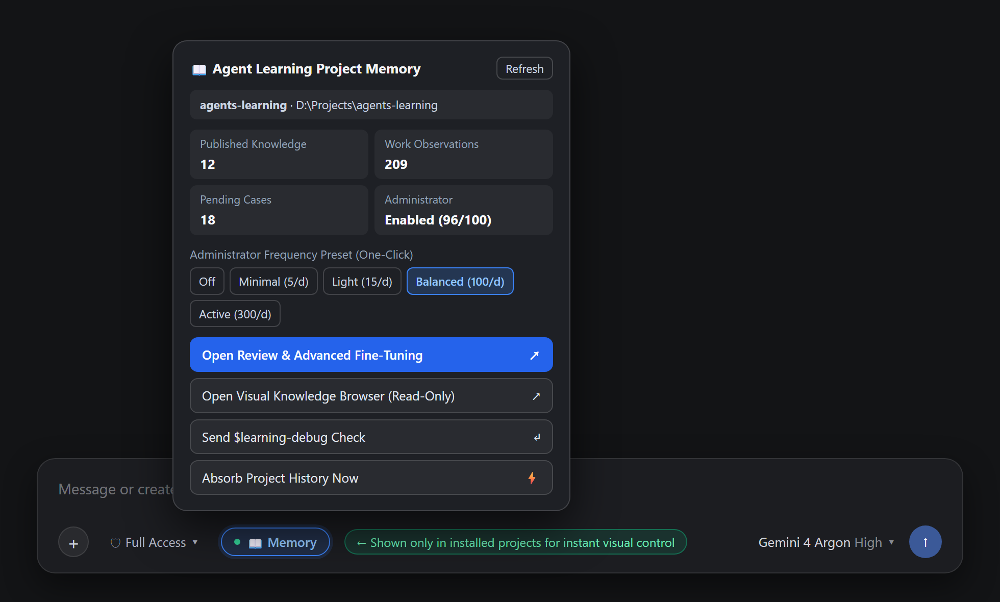
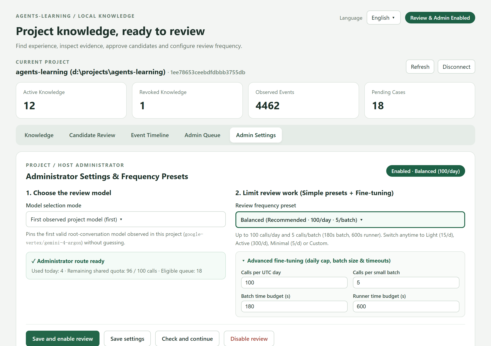
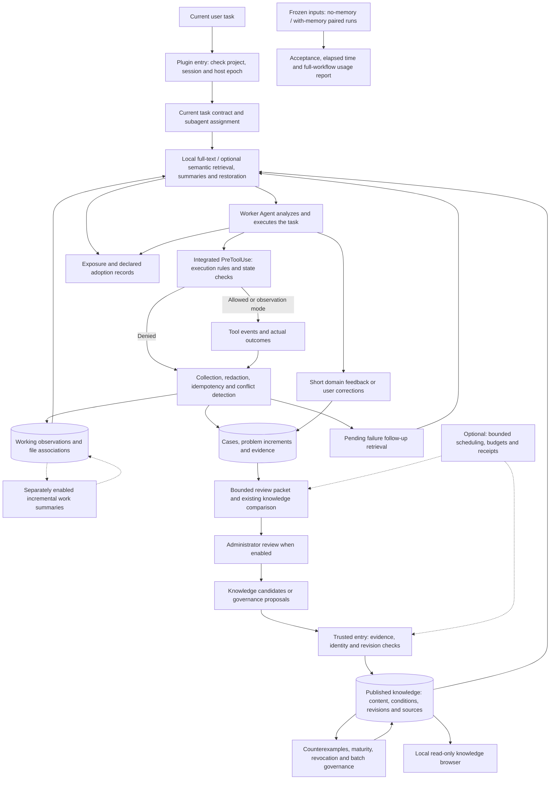
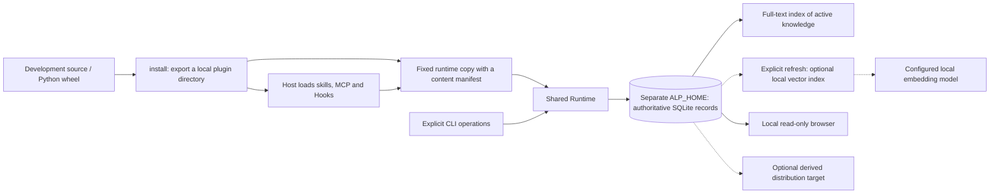

# agents-learning

[中文](https://github.com/swenbo1-web/agents-learning/blob/main/README.md) | English

[](https://github.com/swenbo1-web/agents-learning/actions/workflows/ci.yml)

**Project memory and a visual knowledge browser for Codex, Antigravity and DSH (DeepSeek Harness).**

Python **3.10+** · SQLite · [MIT](LICENSE) · First stable release **1.0.0**

[Core capabilities](#core-capabilities) · [Visual control](#visual-control-and-the-knowledge-button) · [84-second demo](#84-second-demo) · [Codex installation](#install-in-codex-desktop-and-cli) · [Antigravity installation](#install-in-antigravity-native-plugin) · [DSH installation](#install-in-dsh-deepseek-harness) · [Architecture](#complete-architecture) · [Detailed reference](#installation-and-maintenance-reference)

Keep experience across conversations: supported Hooks record tool results and public work notes, then retrieve relevant project knowledge and file history for later tasks. Read a small index first, expand useful evidence on demand, and optionally enable an administrator to organize knowledge.

**These steps use `main`; the original v1.0.0 distribution lacks some newer capabilities. Existing users should read [compatibility and shared-database upgrades](#current-version-and-compatibility) first.**

## Core capabilities

| Capability | What you get |
|---|---|
| Project memory and working history | Reuse public requirements, analysis, work observations and file history without publication approval; long public replies retain searchable segments, sources and partial/truncation markers |
| Search, injection and progressive reading | Local full-text search, optional semantic matching, bounded automatic context, and index → details → evidence reading; the working Agent checks applicability |
| Direct visual control and knowledge browser | A DSH composer button, Codex conversation card and Antigravity App side panel offer installation-scoped status, administrator presets and history archival; detailed knowledge and batch approval use the shared local WebUI |
| Explicit historical ingestion | Absorb selected documents, source and exported conversations from an existing project, with source versions retained |
| Optional administrator and frequency presets | Switch between simple presets (**Light 15/day, Balanced 100/day, Active 300/day, Minimal 5/day**) or expand advanced fine-tuning (daily cap, batch size and timeouts), pinning the first valid project model |
| Evidence and governance | Track conditions, limitations, sources and revisions; compare counterexamples and explicitly publish, replace or withdraw knowledge |
| Budgets and evaluation | Bound context, review calls and reported usage; compare task acceptance, time and full-workflow usage with paired evaluation tools |
| Upgrades and update notices | Preserve external data/configuration during validated upgrades; optionally check GitHub Releases and ask about updates |
| Task and account boundaries | Check task scope and session identity, invalidate old handles after account changes, and share mapped project knowledge between hosts on one machine |

No real-task net token, speed or quality gains have been established by paired evaluation.

**Local capture and full-text retrieval make no extra generative-model call by default. Knowledge included in the host model input still uses context and input tokens.** Administrator calls, AI summaries, semantic models, background scheduling, automatic publication, update checks and remote services require separate configuration. A new knowledge base starts empty. Working history becomes searchable before separate knowledge review and publication.

## Visual control and the knowledge button

You can inspect and control project memory visually without memorizing CLI flags:

| Visual Entry | Host & Location | What You Can Control Directly |
|---|---|---|
| **Composer “📖 Memory / 知识库” Button** | **DSH (DeepSeek Harness)**: automatically shown at the bottom-left of the chat input bar **only** in bound/installed projects (hidden in other projects) | Click to open the floating control panel: view the project name/path, published knowledge count, 1.0.0 work observations and pending cases; **one-click switch administrator frequency presets (Off / Minimal 5/d / Light 15/d / Balanced 100/d / Active 300/d)**; open the review console, read-only browser or absorb project history |
| **Codex direct console and card** | **Codex**: run `codex-connect`, then open **Agent Learning** from the conversation side panel's new-tab menu on MCP Apps hosts, or launch the project console from a terminal. `$learning-panel` remains a compatibility entry | The menu name is discovered globally; actionable controls require the current project's verified installation and connection. Open, debug and reconnect without sending chat messages. Settings and history archival still require confirmation |
| **Conversation side panel** | **Antigravity App 2.22+ with UI Extension support**: register and enable the global UI bridge below, then open **⋮ → Extensions → Agent Learning** | Sidecar buttons check the connection and provide the same controls; only explicitly registered project installations can connect. Unregistered or ambiguous workspaces and expired sessions have no actionable content |
| **Local Visual WebUI Control Center** | **Shared across Codex, Antigravity and DSH** (loopback `127.0.0.1` only, offline English / 简体中文 switcher) | Displays readable project name and path (`name (path) · ID`); tabs for **Knowledge, Candidate review, Event timeline, Administrator queue, and Administrator settings**; batch approve/reject/defer candidates and choose **4 simple frequency presets** or expand **4 advanced fine-tuning parameters** |

**Actionable controls and knowledge require a matching project installation; existing knowledge records are not installation evidence.** The Codex menu name may be globally visible. `codex-connect` wires the host's read-only entrypoint descriptor separately from the current project's tool connection; unconnected projects show setup guidance without other projects' knowledge or controls. Antigravity keeps the core in each project and registers only explicit installation locations in its global UI bridge. Account changes, uninstall and installation replacement invalidate old panels. Ordinary five-minute expiry offers a direct Reconnect button without replaying previous mutations.

Codex side-panel and project Actions launches run the UI locally, without a model turn, automatic chat messages or model-context updates; direct UI results stay in UI metadata. Skill launches still use a model tool call. Project controls grant no task execution permissions and show the current Hook binding as unknown unless verified. Enabling the administrator uses platform allowance. **Usage and frequency limits are separate for each project; Codex, Antigravity and DSH share that project's ledger.** An independently displayed `ALP_HOME` safeguard can still stop new calls when the combined limit is reached. **History buttons only archive default project sources: they make no model calls and neither generate nor publish knowledge.** Detailed approval stays in the separate local WebUI.

The panels passed isolated regressions, fixed-runtime checks and Edge checks with simulated host bridges. Real Codex App Server checks also cover host-catalog discovery, routing to two projects and cross-project rejection without model turns. Desktop menus and rendering still require Codex / Antigravity host acceptance. Reload connections after upgrading and reopen old pages.

### 1. Composer “📖 Memory” Button & Quick Control Popover (DSH)



### 2. Local Visual Knowledge Browser, Candidate Review & Frequency Presets (All Hosts)



### Open the visual knowledge base

Invoke `$learning-browser` (or click **Open Visual Knowledge Browser (Read-Only)** in the DSH **📖 Memory** button popover) for the local read-only knowledge base. Search published knowledge and inspect sources, conditions, limitations and revisions using the installed project's data directory. [Terminal entry and reference](#knowledge-browser)

### Visual knowledge review (main)

Invoke `$learning-review` (or click **Open Review & Advanced Fine-Tuning** in the DSH **📖 Memory** button popover) for candidate approval or administrator settings. **Opening the page approves nothing and starts no model.** The user separately confirms publication or Save and enable in the page. Choose from **Light (15/day), Balanced (100/day), Active (300/day) or Minimal (5/day)** presets or expand advanced fine-tuning. English and Simplified Chinese interfaces retain original knowledge and evidence text. [Review and administrator settings](#optional-administrator-executor)

## How it works

1. **Retrieve.** Register the task goal. At supported events, the plugin supplies relevant knowledge cards and small working-history indices; read details by revision and section as needed.
2. **Work and observe.** The Agent completes the task while Hooks build observations for file changes, failures, verification and public work notes. Ordinary reads help file associations without a model call per read. Errors queue follow-up retrieval.
3. **Organize when enabled.** An administrator receives a bounded evidence packet and proposes knowledge candidates or governance changes.
4. **Publish and reuse.** A trusted operator or explicitly enabled publication policy admits eligible knowledge. Later tasks retrieve its conditions, evidence and current revision.

Knowledge is reference material; it does not grant execution permission. Tool completion, observed success and user acceptance remain separate.

## 84-second demo

The Chinese version uses Xiaoxiao neural narration with revised spoken copy and matching captions.

[](https://github.com/swenbo1-web/agents-learning/releases/download/v0.13.0/agents-learning-demo-en.mp4)

[English video (MP4)](https://github.com/swenbo1-web/agents-learning/releases/download/v0.13.0/agents-learning-demo-en.mp4) · [中文视频](https://github.com/swenbo1-web/agents-learning/releases/download/v0.13.0/agents-learning-demo-zh.mp4) · [English captions (SRT)](https://github.com/swenbo1-web/agents-learning/releases/download/v0.13.0/agents-learning-demo-en.srt)

The demo replays selected fields from an actual local export, SQLite tool failure and recovery, fresh-session retrieval, and read-only browser captures. Hook events run through an isolated dispatcher; administrator review uses a deterministic candidate fixture followed by explicit trusted publication. Codex setup is shown as installation-guide steps. Knowledge retains its conditions, sources and revision.

## Before installing

You need **Git**, **Python 3.10+**, and your chosen host with native plugin support. This default source installation requires no `pip install` or model API key. Obtain the `main` source once:

```powershell
git clone --branch main --depth 1 https://github.com/swenbo1-web/agents-learning.git
cd agents-learning
```

Already cloned it? Use that directory, check its version and skip `git clone`. Run the commands below from the repository, installing each host into its own export directory. These are **Windows PowerShell** examples; [macOS / Linux commands](#macos--linux) are below. To pin the stable distribution, replace `main` with `v1.0.0` and use only the Codex or Antigravity instructions.

**All three hosts share one codebase and project knowledge database.** Keep the same `ALP_HOME`, configuration and project path, but install separate `--host codex|antigravity|dsh` entry points into separate directories. Three host integrations do not require three knowledge databases.

The [1.0.0 stable release](https://github.com/swenbo1-web/agents-learning/releases/tag/v1.0.0) also includes source, wheel and checksums. **Export the plugin before installing it:** export binds interpreter and runtime paths to this machine. For an existing shared database, [update all its runtimes together](#shared-knowledge-upgrades-and-administrators).

## Install in Codex (desktop and CLI)

Use a [Codex CLI](https://learn.chatgpt.com/docs/cli) with `codex plugin` commands, under the same operating-system user and `CODEX_HOME` as your desktop app.

These steps use the **default knowledge directory**. If you use `ALP_HOME` or `ALP_CONFIG`, first complete the [custom-directory wiring](#custom-knowledge-directory-in-codex). Setting variables only in the installation terminal does not ensure that Hooks and MCP tools use the same database.

```powershell
$learningProject = "D:\Projects\my-project"
$learningPlugin = Join-Path $env:USERPROFILE "agent-learning-plugins/codex"
python -B scripts/learning.py --workspace "$learningProject" install "$learningPlugin" --host codex --hook-mode observe
codex plugin marketplace add "$learningPlugin"
codex plugin add agent-learning@agent-learning-local
python -B scripts/learning.py --workspace "$learningProject" codex-connect --installation "$learningPlugin"
```

**Restart Codex → enable Agent Learning and review/trust its Hooks → start a new project conversation.** [Official CLI plugin commands](https://learn.chatgpt.com/docs/cli/reference#codex-plugin)

Replace `$learningProject` with your existing project's absolute path. `codex-connect` updates the relevant MCP fields in the project's `.codex/config.toml` and `CODEX_HOME/config.toml`, preserves unrelated configuration, and backs up originals under `CODEX_HOME/agent-learning-backups/`. It does not change Hook trust or enable an administrator. After upgrading an existing export, run `codex-connect` again. Use a separate export and connection for each project.

### Codex: click to open without a skill message

**Native side panel:** after updating, connecting and reloading MCP, select **Agent Learning** in the conversation side panel's new-tab menu on supported desktop hosts. The global connection advertises an entrypoint; actual calls use the current thread's verified project connection. It never guesses the latest conversation. When the five-minute connection expires, click Reconnect in the panel.

**Read-only connection check:** if the entry is absent, check configuration first. Correct wiring does not establish that the desktop has rendered it.

```powershell
python -B scripts/learning.py --workspace "$learningProject" codex-connect --installation "$learningPlugin" --check
```

**Direct terminal launch:** when the desktop has no menu, run the fixed runtime in the project terminal without a chat message or model call:

```powershell
$learningReceipt = Get-Content (Join-Path $learningPlugin "runtime-release.json") -Raw | ConvertFrom-Json
& $learningReceipt.python -B (Join-Path $learningReceipt.runtime_directory "scripts/learning.py") --workspace "$learningProject" codex-panel --installation "$learningPlugin"
```

**Optional Actions:** register only if your host provides local Environment / Actions support:

```powershell
python -B scripts/learning.py --workspace "$learningProject" codex-action --installation "$learningPlugin"
```

Registration creates only `.codex/environments/agent-learning.toml` and its managed manifest, preserving existing environments, Setup and Actions. It does not select an environment automatically or add a top-bar button to hosts that lack this feature. Where supported, select this environment or add the returned `manual_command` to an existing environment. [Official Actions guide](https://learn.chatgpt.com/docs/environments/local-environment)

For custom data locations, register under the same `ALP_HOME` and `ALP_CONFIG`, or explicitly supply `--home` and `codex-action --config`, matching Hooks and MCP; registration pins those paths. **Repeat registration after a core update.** Add `--remove` to unregister without deleting knowledge or existing environment configuration.

The Actions console listens only on `127.0.0.1`; a private access code goes directly to the browser and is not printed into chat. Closing its integrated terminal stops the page server. Opening, refreshing and inspecting settings make no generative-model call; enabling the administrator still requires user confirmation. Native side-panel visibility depends on desktop support. CLI users can run the returned command or use the existing skills.

## Install in Antigravity (native plugin)

Replace `D:\Projects\my-project` with your **existing project's absolute path**:

```powershell
$learningProject = "D:\Projects\my-project"
$learningPlugin = Join-Path $learningProject ".agents/plugins/agent-learning"
python -B scripts/learning.py --workspace "$learningProject" install "$learningPlugin" --host antigravity --hook-mode observe
```

**Reload the project in Antigravity IDE / 2.0 → enable the plugin components → start a new conversation.** The IDE loads this project's export without the `agy` CLI. [Official plugin guide](https://antigravity.google/docs/plugins/)

### Antigravity App: add the visual panel

The App discovers Sidecars from **global directories**; installing the project core alone does not make its sidebar discoverable. For an existing core, add `--upgrade` to the installation command above first; old cores without bridge support cannot be registered. Then run:

```powershell
$learningUI = Join-Path $env:USERPROFILE ".gemini/config/plugins/agent-learning-ui"
python -B scripts/learning.py install-ui "$learningUI" --installation "$learningPlugin"
```

**Enable `agent-learning-ui/control` in App customizations, reload, then open ⋮ → Extensions → Agent Learning.** Sidecars start disabled; this command changes no host settings and enables no administrator. If configuring manually, set `sidecars.agent-learning-ui/control.enabled` to `true`, preserving existing settings. [Official discovery and activation guide](https://antigravity.google/docs/sidecars/)

The UI bridge starts no model, scans no projects and opens no knowledge database on startup. It connects to a fixed project runtime only when the current workspace exactly matches a registered installation. Workspace, project identity and access checks enforce isolation; the installation directory alone does not. **Check connection** inspects installation, directories, versions and administrator budgets. A working UI pipe does not verify the current conversation's Hook/MCP connections; use `learning-debug` for those checks.

For an existing bridge, use `install-ui "$learningUI" --installation "$learningPlugin" --upgrade` to add a project or refresh its fingerprint after a core update; multiple `--installation` arguments are supported. Add `--remove` to unregister without uninstalling the project core or deleting knowledge. Staging and old backups stay outside plugin discovery, under `config/agent-learning-ui-installations/`, avoiding duplicate loading. Unsupported IDE/CLI surfaces use the browser skills.

<details>
<summary>Using Antigravity CLI instead?</summary>

After exporting, run:

```powershell
agy plugin install "$learningPlugin"
```

Restart the CLI and use the same bound project. The CLI copies the plugin into its own directory; after upgrades, repeat `agy plugin install` and restart. Do not install the repository root directly: its entries are templates, and export renders this machine's paths.

</details>

## Install in DSH (DeepSeek Harness)

Use DSH with plugin Bundle support and **pnpm** available on PATH. Export, then install into the profile you actually use. This example selects Web; change the first line for another profile such as TUI:

```powershell
$learningProfile = "web"
$learningProject = "D:\Projects\my-project"
$learningPlugin = Join-Path $env:USERPROFILE "agent-learning-plugins/dsh"
python -B scripts/learning.py --workspace "$learningProject" install "$learningPlugin" --host dsh --hook-mode observe
dsh plugin --profile "$learningProfile" add "$learningPlugin"
```

**Restart that DSH profile → open a conversation in the target project.** The full Bundle loads the host bridge, the project-scoped **📖 Memory / 知识库** button in the composer toolbar, skills, commands, Hooks and MCP. Attaching only MCP/Hooks does not load all native components. To upgrade, update the export with matching-host `install --upgrade`, then update the plugin in that profile. [DSH CLI](https://github.com/deepseek-ai/deepseek-harness/tree/main/apps/cli)

<details>
<summary>Optional DSH compatibility and delegation settings (off by default)</summary>

The standard Bundle includes all four optional host modules and loads them through its main entry. If needed, set the following **config value** on the `agent-learning` entry in your active DSH profile, then reload that plugin. This is not a new plugin entry or Python `config.json`; do not edit the exported files or pinned runtime:

```yaml
extensions:
  googleThinking: true       # Adapt legacy budget fields for the selected Google / Vertex Gemini 4 request
  messagesCompat: false      # Remove empty text blocks beside DeepSeek Messages tool calls
  netTune: false             # Per-request transport ceilings; no global dispatcher changes
  thinkingLanguage: 'off'    # Optional zh-CN guidance for identified DeepSeek routes only
  delegation:
    enabled: false
    provider: ''             # Empty means inherit; otherwise model is also required
    model: ''
    maxAgents: 2
```

All switches default to off and do not enable the administrator or call models. Prompt guidance and request patches apply only to projects explicitly bound in the installation receipt. Unknown projects or request origins pass through unchanged; unbound dynamic installations cannot use these patches. Delegation remains subject to user authorization and host tool permissions, with no fixed vendor. Wire edits require a recognized JSON POST. Transport tuning preserves proxy, TLS, explicit dispatchers and cancellation; it does not extend model-call budgets or disable SDK idle watchdogs. Unload or hot reload stops the old patches.

If older configurations mounted these modules separately, switch to the main entry's `extensions` to avoid duplicate mounting. Upgrades can adopt byte-identical or recognized previous host scripts, report them in `adopted_extra_files`, and retain a complete backup. Unknown custom scripts stop the upgrade and remain intact; compare and explicitly resolve those conflicts without deleting knowledge data.

</details>

## Check the installation

In a new target-project conversation, click the DSH **📖 Memory / 知识库** button, select **Agent Learning 调试** from the Codex input skill menu, or send:

> Use `$learning-debug` to check this project's plugin integration.

Check the expected project, host, data directory and current handle binding. If no handle is available, follow the Hook diagnostic; never guess another session.

<details>
<summary>If the skill is not visible, check manually</summary>

Send: “Use learning_status to check my project, host and knowledge data directory. Pass this turn's Hook context_handle to session_context and confirm context_bound=true. Report a missing handle or failed binding without guessing another session.”

</details>

Success means the expected project/host and `context_bound=true` for the current Hook handle. Tools appearing in the list alone do not confirm Hook integration; an empty knowledge base is normal.

The default knowledge directory is `%LOCALAPPDATA%\AgentLearning` on Windows and `~/.local/share/agent-learning` on macOS / Linux. Hosts share project knowledge on the same machine when they use the same OS user, data directory and project mapping. Antigravity binds the exported project; Codex follows project events, and DSH supports fixed or dynamic project selection. Hooks and MCP must use the same custom directory. See [shared knowledge](#shared-knowledge-upgrades-and-administrators).

## Use it in your project

In a new project conversation, use the visual button, select a skill, or send one of these requests:

| I want to… | Use |
|---|---|
| Open project quick controls | In Codex, open the conversation plugin side panel or **Actions → Agent Learning** directly; `$learning-panel` is the compatibility entry. In Antigravity App, open **Extensions → Agent Learning**; in DSH, click **📖 Memory**. Actionable controls require a matching project installation |
| Check integration, task and administrator status | Click **📖 Memory / 知识库** in DSH; select **Agent Learning 调试** in the Codex input skill menu, or say “Use `$learning-debug` to check this project” |
| Reuse project experience during a task | Describe the task; supported events retrieve and record observations, and the Agent can search further |
| Browse detailed knowledge | Click **Open Visual Knowledge Browser (Read-Only)** in the DSH **📖 Memory** button popover, or say “Use `$learning-browser` to open this project's knowledge base” |
| Review candidates | Click **Open Review & Advanced Fine-Tuning** in the DSH **📖 Memory** button popover, or say “Use `$learning-review` to open candidate approval”; inspect evidence, then approve, reject or defer in the page |
| Set up the administrator and frequency | Pick a frequency preset (**Light / Balanced / Active / Minimal**) directly in the DSH **📖 Memory** popover, or use `$learning-review` to open **Administrator settings** for model selection, presets and advanced fine-tuning |
| Absorb an existing project's history | Click **Absorb Project History Now** in the DSH **📖 Memory** popover, or say “Use `$learning-history` for my selected project sources; explain scope and review limits first” |

Installation makes no administrator call and starts no historical scan. Observations, candidates and publication are separate; an initially empty knowledge base is normal. [Administrator usage](#optional-administrator-executor) · [Historical ingestion](#absorb-history-from-an-existing-project)

**Conversation continuity:** Public requirements and final replies become searchable working history without publication approval. Long replies retain bounded segments. New conversations can receive a recent same-project, same-checkout handoff index without restoring old execution permissions. In Administrator settings, explicitly select **Organize conversation summaries** to review bounded windows using the shared model budget; an explicit task is no longer required. Summaries remain `model_reported` and do not publish formal knowledge. Partial output is not a completed delivery.

**When review does not start:** Check the administrator diagnostic reason and phase: no increment, waiting for tools, unavailable CLI/model, shared budget, startup cooldown or an unknown prior call. A dispatch reservation is distinct from a started worker or model. Review currently launches the platform CLI; Antigravity's ordinary plugin works without `agy`, but its automatic administrator requires an available `agy` CLI.

## After installation

Use it for a real project task: register the goal, search existing knowledge, read applicable details, and report useful outcomes. [Manual problem workflow](#handling-a-problem-manually) explains the tools.

| I want to… | Reference |
|---|---|
| Browse the knowledge base | [Knowledge browser](#knowledge-browser) |
| Review candidates in a page | [Visual knowledge review](#visual-knowledge-review-main), or invoke `$learning-review` |
| Add semantic matching | [Semantic hybrid retrieval](#semantic-hybrid-retrieval) |
| Enable an administrator | [Optional administrator executor](#optional-administrator-executor) |
| Update the plugin | [Update an existing installation](#update-an-existing-installation) |
| Absorb an existing project's documents and history | [Explicit historical ingestion](#absorb-history-from-an-existing-project) |
| Understand the design | [Complete architecture](#complete-architecture) |

## Common questions

**Why is there no knowledge yet?** Installation connects the plugin; it creates no project experience. Events and feedback need to be organized and eligible knowledge published before normal knowledge retrieval can find it.

**Does it need another model API?** Default full-text retrieval does not. Optional administrator execution or semantic embeddings need their own configuration and may consume model resources.

**Can different devices share one database?** Default SQLite storage is local. Hosts on one device can share a project and data directory; cross-device synchronization is not implemented.

**The tools appear, but there is no current handle.** Check plugin enablement, Hook trust and the bound interpreter/runtime paths, then start a fresh project conversation. See [installation troubleshooting](#installation-troubleshooting).

<details>
<summary>macOS / Linux installation commands</summary>

## macOS / Linux

Clone the source as above, use `python3` for your Python 3.10+ interpreter, and select the commands for your host. Install each host separately if using more than one; custom paths require matching Hook and MCP settings.

Antigravity: replace this with an existing project path, then reload it in the IDE.

```sh
learning_project="/absolute/path/to/my-project"
python3 -B scripts/learning.py --workspace "$learning_project" install "$learning_project/.agents/plugins/agent-learning" --host antigravity --hook-mode observe
```

Codex: run these only when installing the Codex profile.

```sh
learning_plugin="$HOME/agent-learning-plugins/codex"
python3 -B scripts/learning.py install "$learning_plugin" --host codex --hook-mode observe
codex plugin marketplace add "$learning_plugin"
codex plugin add agent-learning@agent-learning-local
```

DSH (`main` source):

```sh
learning_profile="web" # Change to the DSH profile you use.
learning_project="/absolute/path/to/my-project"
learning_plugin="$HOME/agent-learning-plugins/dsh"
python3 -B scripts/learning.py --workspace "$learning_project" install "$learning_plugin" --host dsh --hook-mode observe
dsh plugin --profile "$learning_profile" add "$learning_plugin"
```

Then restart/reload the host, review its Hook trust settings and use the [installation check](#check-the-installation). Antigravity CLI users additionally install the exported directory with `agy plugin install`.

</details>

## How the project took shape

This project grew from practical questions about AI collaboration on long-running projects. How can experience survive a new conversation or context compaction? How can different Agents reuse it? How can repeated tool errors require less repeated investigation? And how can outdated or incorrect knowledge be corrected in time?

We initially planned a structured knowledge base: an Agent would look up previous experience before analyzing a problem against the current requirements and environment. As the design developed, we found that retrieval, collection, organization and maintenance also needed clear processes. Otherwise, steps would still be missed and recording experience would add work to the current task.

Drawing on engineering retrospectives, knowledge management and event-driven automation, we developed an architecture with explicit responsibilities: **the worker Agent focuses on its task, the plugin assists with retrieval and recording, the administrator organizes evidence, and checked knowledge becomes available for later work.**

Continuous learning here works through accumulated and reused project knowledge. The plugin records observable messages, tool events and outcomes, supplemented by short domain feedback. These records do not contain a model's internal thinking.

## The problems we address

| Project problem | Approach |
|---|---|
| Experience stays in a single conversation | Store project facts, operational experience and solutions in a separate local knowledge base for retrieval across conversations |
| Similar errors require repeated investigation | Retrieve relevant knowledge at task start, context restoration and supported events after tool failures, providing bounded summaries for the current task |
| Recording experience interrupts current work | Hooks collect tool events and results; short feedback supplements domain issues without requiring a retrospective document for each operation |
| Historical solutions are applied incorrectly | Keep applicable conditions, limitations, sources and revisions, with source change notices, revocation and counterexample review |
| Organization and context consumption keep growing | Review increments, bound retrieval, paginate on demand, and manage call count, concurrency and reported usage separately |
| Automation exceeds the current task scope | With execution protection enabled, check task identity, state and explicit execution authorization for integrated calls; knowledge remains reference material |

The goal is to reduce repeated work and irrelevant context so Agents can use existing experience more effectively. Knowledge exposure, declared adoption and tool observations are recorded separately; user acceptance requires independent confirmation. Task evaluation accepts usage and costs reported by an external runner. No real-task paired results have been collected for this project, so it claims no net savings ratio or percentage improvement in quality.

## Where it fits

The plugin suits projects that require long-term maintenance, frequent tool use and work handed between conversations or Agents, including software development, troubleshooting, testing, data processing and experimental workflows. Project context, domain experience and tool operation knowledge can be maintained together; each domain still needs its own evidence and acceptance methods.

The source provides **Codex, Antigravity and DSH** profiles using rules, skills, MCP, Hooks and the same runtime core. The v1.0.0 distribution includes the first two; DSH requires `main`. Check event capabilities and acceptance for each host separately. Antigravity differences are documented below; other Agent environments still require their own adapters.

Storage is local by default, and knowledge is managed by project. Administrator execution, background scheduling, automatic publication and remote services are off by default and may be enabled separately as needed.

## Complete architecture

### Overall workflow



The main task, knowledge retrieval and experience organization proceed independently. Task delivery does not wait for background organization. Tool failures first register follow-up retrieval, which runs at the next supported prompt, restoration or tool pre-event. Administrator model calls, automatic publication and knowledge batches are configured separately; nodes in the diagram do not imply that everything is enabled by default.

### Roles and responsibilities

| Participant | Responsibilities | Permissions and handoff |
|---|---|---|
| User / trusted local operator | Define tasks, set execution rules, enable optional capabilities, publish and govern knowledge | Use explicit entry points for each operation; the user reviews host Hook trust |
| Worker Agent | Analyze and deliver the task, query knowledge and work history, provide necessary feedback and adoption declarations | 9 MCP tools; bound to the current session/assignment; references cannot add execution permission |
| Plugin runtime | Check identity and versions, retrieve, collect, persist and check integrated execution boundaries | Uses deterministic program rules and accesses observable events and results only |
| Administrator Agent / executor | Propose candidates and governance suggestions; optionally organize work summaries | 14 administrator MCP tools, with no publication/revocation tools; automatic calls are off by default |
| Optional scheduler | Advance persistent review, knowledge batch and state distribution work | Bounded batches, time and call budgets; participates only when enabled |

Rules and skills provide collaboration conventions. Runtime and Hooks with execution protection enabled check task state, authorized actions and resource scope for integrated calls. Protection covers plugin entry points; arbitrary local Shell and database access still depend on host and operating system permissions.

### Deployment and storage



Development source, exported plugins, fixed runtime copies and live databases are maintained separately. Exported Hooks and MCP point to the same fixed copy; its manifest records version, protocol and file digests. SQLite stores events, tasks, working observations, published knowledge and receipts. Knowledge and work indices are maintained separately, remote copies are derived capabilities, and Runtime uses local reference material.

The same project and data directory can retain knowledge across login accounts. After an account change is confirmed, a host adapter or operator sends a boundary notification to invalidate old connections, handles and administrator writebacks. Desktop account change notifications still require explicit wiring.

### Eight modules and source mapping

| Module | Responsibilities and boundaries | Key source / resources |
|---|---|---|
| 1. Plugin integration and protocol | Unify CLI, MCP, Hook and skill entry points; export and upgrade fixed runtimes, check software versions, contents and role permissions | [install.py](agent_learning/install.py), [install_update.py](agent_learning/install_update.py), [software_updates.py](agent_learning/software_updates.py), [release.py](agent_learning/release.py), [mcp.py](agent_learning/mcp.py), [cli.py](agent_learning/cli.py), [hooks](hooks/hooks.json), [skills](skills/) |
| 2. Task and execution control | Store task contracts and versions, bind parent/child Agents, check trusted authorization, state, actions and balance; knowledge cannot issue authorization | [task_control.py](agent_learning/task_control.py), [execution.py](agent_learning/execution.py), [assignments.py](agent_learning/assignments.py) |
| 3. Knowledge storage and indexing | SQLite stores authoritative knowledge, revisions and sources; full-text and optional vectors are rebuildable derived indexes | [knowledge_store.py](agent_learning/knowledge_store.py), [knowledge_index.py](agent_learning/knowledge_index.py), [semantic_retrieval.py](agent_learning/semantic_retrieval.py) |
| 4. Retrieval and context management | Search published knowledge and work indices separately; share context budgets, page details, track exposure, notify changes, restore and follow up failures | [knowledge_context.py](agent_learning/knowledge_context.py), [context_storage.py](agent_learning/context_storage.py), [knowledge_output.py](agent_learning/knowledge_output.py), [work_memory.py](agent_learning/work_memory.py), [knowledge_browser.py](agent_learning/knowledge_browser.py) |
| 5. Event, evidence and case collection | Record observable events, project working observations and file relations; explicitly selected historical jobs retain versioned sources and isolated cases | [event_capture.py](agent_learning/event_capture.py), [work_memory.py](agent_learning/work_memory.py), [work_files.py](agent_learning/work_files.py), [case_store.py](agent_learning/case_store.py), [history_sources.py](agent_learning/history_sources.py), [history_import.py](agent_learning/history_import.py), [runtime.py](agent_learning/runtime.py) |
| 6. Administrator knowledge governance | Bounded review packets, model routing, calls and receipts; optional work summaries reuse executors and budgets separately from candidates and governance | [review_packet.py](agent_learning/review_packet.py), [admin.py](agent_learning/admin.py), [work_summaries.py](agent_learning/work_summaries.py), [admin_routing.py](agent_learning/admin_routing.py), [admin_providers.py](agent_learning/admin_providers.py), [admin_queue.py](agent_learning/admin_queue.py), [admin_lifecycle.py](agent_learning/admin_lifecycle.py), [admin_decisions.py](agent_learning/admin_decisions.py), [admin_governance.py](agent_learning/admin_governance.py) |
| 7. Knowledge publication and version governance | Publish, update, revoke, restore and promote through trusted entry points; save batch manifests, safe rollback and optional distribution state | [knowledge_lifecycle.py](agent_learning/knowledge_lifecycle.py), [publication_state.py](agent_learning/publication_state.py), [knowledge_releases.py](agent_learning/knowledge_releases.py), [knowledge_sync.py](agent_learning/knowledge_sync.py), [hindsight.py](agent_learning/hindsight.py) |
| 8. Background scheduling, budgets and effect evaluation | Persistent work, call budgets, exposure/adoption observations and independent paired task evaluation | [scheduler.py](agent_learning/scheduler.py), [admin_usage.py](agent_learning/admin_usage.py), [learning_evaluation.py](agent_learning/learning_evaluation.py), [task_evaluation.py](agent_learning/task_evaluation.py) |

[runtime.py](agent_learning/runtime.py) combines the eight modules, unifying project, session, account boundaries and database transactions. The modules share versions and data contracts within the same runtime.

[host_sessions.py](agent_learning/host_sessions.py) defines host session boundaries, [antigravity.py](agent_learning/antigravity.py) and [dsh.py](agent_learning/dsh.py) adapt native events, and [host_resources/antigravity](host_resources/antigravity/) and [host_resources/dsh](host_resources/dsh/) hold the native profiles. All three exports use the same knowledge, retrieval and governance core.

### How each module works

**1. Plugin integration and protocol.** CLI provides explicit local operations, MCP exposes tools by role, Hooks receive host events and skills describe the workflow. Initial `install` validates resources and exports atomically; `--upgrade` validates the old installation and retains a backup before switching directories. Fixed runtime entry points check content identity. Optional background version checks only read GitHub Release metadata and do not participate in knowledge review or execution authorization. MCP connections bind to a session through a trusted handle, and arguments cannot elevate a role.

**2. Task and execution control.** The current task stores goal, scope and status. Contract revision, state write version and execution epoch distinguish changes. A child Agent's assignment freezes the parent task snapshot at dispatch. Execution protection checks explicit authorization, actions, paths, budget and validity; after a task change or pause, old permission cannot authorize a new operation.

**3. Knowledge storage and indexing.** SQLite stores published content, revisions, evidence sources and action receipts. Categories cover project, domain, operation and mixed problems; kinds distinguish facts, specific solutions and reusable methods. The full-text index projects active knowledge only. Content and sources are read from the same database snapshot.

**4. Retrieval and context management.** Queries use the current question and explicit task filters; bounded recall checks matches and source state. The default shared budget is 2400 characters: up to three published knowledge cards have priority, while up to three working-history indices use at most 600 of the remaining characters. Incomplete conditions produce `read_required`; identifier cards retain file-change warnings. MCP search and read check recorded size/mtime metadata in the same checkout, which is not content verification. Knowledge sections and working summaries/evidence have separate revision-bound pages. Exposure ledgers track changes; compaction prioritizes current matches before restoring relevant history.

**5. Event, evidence and case collection.** Tool events, public delivery notes and feedback create problem increments. Valuable visible events also become working observations with file associations; ordinary reads only assist those associations. Duplicate callbacks are deduplicated, conflicts retained, and late callbacks follow original boundaries. Recovery associations require explicit complete script/test targets; a shared runner, script basename or partial word overlap cannot establish the relationship. Tool success, completion and statements remain separate from user acceptance. Deterministic indexing makes no model calls.

**6. Administrator knowledge governance.** New or changed problems enter the review queue. The administrator receives a bounded review packet, compares existing knowledge and candidates, and proposes suggestions with applicable conditions, limitations and evidence references. Receipts record calls, results and retry states. Explicitly enabled automatic publication can create operational solutions or update/attach sources to operational solutions associated through a source case or a write to the same checkout file. Candidates must cite current healthy success evidence. Domain knowledge, patterns, counterexample dispositions and other governance retain their trusted entry points.

**7. Knowledge publication and version governance.** Publication checks the candidate's basis, identity, sources and target revision; identical requests return receipts idempotently. Published knowledge supports updates, revocation, explicit restoration, counterexample handling and maturity promotion. Knowledge batches save deterministic entry manifests and differences. Batch rollback cannot overwrite newer content or revive revoked knowledge.

**8. Background scheduling, budgets and effect evaluation.** Bounded `tick`/`run` advances persistent work; when enabled, supported events wake short-lived runners. Call count, concurrency, batch time and reported usage are controlled separately, and unknown usage retains its reservation. Effect records distinguish exposure from declared adoption and link tool outcomes and source state. Current scheduling requires a process or event; unattended all-day wakeups still require host or external runtime support.

### Data contracts throughout the workflow

| Data | Core contents | Why it is retained |
|---|---|---|
| Project and session identity | Project scope, `context_handle`, Agent identity, `host_epoch` | Establish query/write ownership and invalidate old connections after account changes |
| Task and assignment | `task_id`, `revision`, `write_version`, `execution_epoch`, goal and scope | Distinguish contract, state and execution changes so old task writebacks cannot enter a new task |
| Events and operations | Event references, tool call identifiers, input digests, results, task snapshots and conflict state | Support traceable evidence, idempotent callbacks and source health checks |
| Working observations and file relations | `memory_id`, revision, source version, checkout, relative path, relation and visible coverage | Find unpublished work while keeping file hints, summaries and execution ownership separate |
| Problems and cases | Problem ID/revision, event references, domain feedback and potential recovery links | Organize scattered observations into reviewable problem increments |
| Candidates and knowledge | Title, content, category, kind, applicability, limitations, evidence level and metadata | Make retrieval and adoption conditional, with sources available for rechecking |
| Revisions and governance state | Knowledge ID/revision, active state, maturity, source version, action and batch receipts | Distinguish content changes, source changes, publication state and historical operations |
| Budgets and effect records | Call reservations, known/unknown usage, exposure method and adoption declarations | Control incremental organization usage and retain the evidence boundaries of effect observations |

Candidate metadata may include `tool`, `tool_version`, `error_code`, `environment` and `verification`; unknown values remain unknown. Published knowledge active state, content revision, evidence level and maturity are maintained separately; none may be inferred from another.

### How automation reduces missed steps

This table describes the Codex event chain. Antigravity uses a separate adapter; see [host differences](#host-differences-and-evidence).

| Trigger | Plugin action | Boundary |
|---|---|---|
| `SessionStart` / `UserPromptSubmit` | Bind identity, retrieve relevant knowledge, restore tasks and notices | Insufficient matches are not injected; short continuations may reuse an unchanged query plan |
| `SubagentStart` | Create an independent identity and assignment, then query knowledge for that task | Requires a reliable Agent ID; independent MCP connection lifecycle depends on host wiring |
| `PreToolUse` | Check covered rules, send invalidation/failure follow-ups and small indices for explicit file targets | Observation mode is the default; file references grant no permissions and arbitrary shell targets are not guessed |
| `PostToolUse` | Save results/source state, build observations and file associations, queue failure retrieval | Completion is separate from problem resolution; indexing calls no model by default |
| MCP queries and feedback | Record knowledge actually returned to a bound session; supplement problems and adoption declarations | Unbound queries do not guess a session; exposure does not mean the model read it |
| Background wakeups at `Stop` / `SessionStart` | Advance incremental review, batches and distribution when configuration permits | Bounded execution; unchanged work is skipped; wakeup with no running host is not guaranteed |
| Knowledge revision, revocation or source changes | Save version changes and notify exposed sessions through later supported events | Complete notices that do not fit wait for later delivery; internal model content cannot be deleted |

These mechanisms make retrieval and event recording less dependent on the Agent remembering every step. Domain judgment still requires the Agent to consider current requirements, environment and evidence, and publication checks cannot prove arbitrary natural language conclusions correct.

## Installation and maintenance reference

The short installation steps above use observation mode and the default local data directory. This section covers project bindings, host differences, custom paths and explicit maintenance operations.

### Antigravity bindings and loading

Initial export requires an explicit existing workspace. MCP and Hooks bind the workspace and data directory by absolute path. Export may create the home container and its `runtime-releases` directory to install code. It creates no SQLite database or configuration file, reads or writes no existing knowledge database/configuration, and changes no host configuration.

The native export contains root `plugin.json`, `mcp_config.json`, `hooks.json`, rules and worker/admin skills. Codex has its own manifest and entries. Receipts record `target_host`; upgrades cannot replace one host profile with another.

Antigravity IDE / 2.0 can load project `.agents/plugins/` or global `~/.gemini/config/plugins/` directories. Prefer project loading: the plugin is bound to one workspace, and loading that export into other workspaces is rejected. Antigravity CLI copies installed exports into `~/.gemini/antigravity-cli/plugins/`; upgrading the export alone does not update that copy. [Official plugin guide](https://antigravity.google/docs/plugins/)

Every Antigravity stateful MCP request must explicitly supply the current Hook handle. An MCP process can serve several chats; an omitted handle does not inherit another chat. Supply the handle on queries to register knowledge exposure too. Without it, only project queries are available. Observe mode omits PreToolUse, so correct handle use and rules still establish correspondence for MCP writes; enforce adds a native pre-tool origin check.

<a id="3-host-differences-and-evidence"></a>

### Host differences and evidence

| Workflow | Codex | Initial Antigravity adapter |
|---|---|---|
| Automatic context | Supported user prompt, session and restoration events | PreInvocation using registered goals, recent queries and actual errors |
| Current user prompt | Supported Hook prompt | Public callback does not promise prompt text; register it through task_update |
| Context delivery | Track previous injections and avoid repeated text | Render bounded ephemeralMessage from cached references each invocation |
| Tool observations | Classify actual responses | Nonempty PostToolUse.error is failure; empty means call_completed only |
| Execution checks | Connected rules and trusted approvals | Observe omits PreToolUse; enforce returns ask on passing checks and deny on rejection |
| Stop | Registered delivery and public output | Records loop stopping; fullyIdle does not prove user acceptance |
| Compaction, children, login | Supported events and explicit entry points | No invented equivalent events; ambiguous numbering needs trusted reset |
| Administrator | Optional Codex CLI review executor and separate admin tools | Optional Antigravity CLI review executor sharing governance queues and budgets; automatic calls are off by default on both hosts |

The adapter follows the [official Hooks contract](https://antigravity.google/docs/hooks). It does not scan transcripts, artifacts or private model reasoning. Without final outputs, exit codes or asynchronous outcomes, it does not generate tool_success evidence or satisfy publication policies requiring that level. Feedback retains its reported status. In observe mode, a Post without a verified Pre remains unassociated with a task; errors can still trigger bounded followup searches. Repeated ephemeral summaries still use model context. Caching avoids repeated retrieval; it is not evidence of net token savings.

Multi-workspace callbacks must mount the bound project. Tool resources verify attribution; uncertain callbacks stay unassociated, and enforce rejects them. Native tool argument mappings are distinct from Codex. For example, run_command is command execution and cannot bypass read-only protection through a rule labeling it as a read.

Without a reliable new-user-prompt boundary, Hooks cannot automatically establish that a new requirement replaces the previous task. Workers must update the goal/scope when requirements change. Enforcement checks the registered contract and trusted approval; it does not establish authorization for every native user prompt. Native installations ignore an inherited ALP_CONTEXT_HANDLE and require the current Hook handle on each stateful request.

<a id="4-explicit-enforcement-reset-and-account-change"></a>

### Explicit Antigravity enforcement, reset and account change

From a trusted terminal, update the export to enable enforcement:

```powershell
$learningProject = "D:\Projects\my-project"
$learningPlugin = Join-Path $learningProject ".agents/plugins/agent-learning"
python -B scripts/learning.py install "$learningPlugin" --host antigravity --upgrade --hook-mode enforce
```

The adapter never returns automatic allow or permissionOverrides. The existing trusted execution-approve entry must still authorize the current task with native tool names and argument fields. ask follows the host's approval settings. Host Deny composition, timeout, killed processes and malformed responses have not been accepted in a live host; universal hard rejection on failure is not established.

For native approvals, put the global `--host antigravity` option **before** the `execution-approve` subcommand. Use the real task ID and write version from the current task receipt; `1` below is only an example:

```powershell
python -B scripts/learning.py --workspace "D:\Projects\my-project" --host antigravity execution-approve --conversation "native-conversation-id" --expected-task-id "ACTUAL_TASK_ID" --expected-write-version 1 --rules "D:\Policies\antigravity-rules.json"
```

Pass the raw native `conversationId`, not the database's prefixed identity. The CLI adds the Antigravity host namespace. Rule tool names and argument fields must match the actual native call; Codex rule examples are not interchangeable.

When counters regress, repeat or conflict without a reliable trajectory ID, the adapter does not invent a new execution identity. Reset a specific native conversation from a trusted terminal:

```powershell
python -B scripts/learning.py --workspace "D:\Projects\my-project" antigravity-session-reset --conversation "native-conversation-id"
# After a confirmed real login account change
python -B scripts/learning.py --workspace "D:\Projects\my-project" --host antigravity account-changed --notification-id "stable-id-for-this-notification"
```

Reset pauses the task and invalidates old handles and execution approvals. A later Hook binds again; explicitly resume and reapprove the task. Reset is CLI-only, not a worker MCP tool. Unknown late events cannot strengthen evidence. Account notifications require a trusted source; the plugin reads no login credentials and does not automatically detect Antigravity account changes.

<a id="5-shared-knowledge-upgrades-and-administrators"></a>

### Shared knowledge, upgrades and administrators

0.14.1 corrects native event identity: model names are diagnostic only, actual input changes trigger conflict detection, and recorded event bodies remain redacted. If a conversation already has 0.14.0 receipts, use the `antigravity-session-reset` entry above after upgrading, then resume the task and renew execution approval. Old hashes cannot reliably recover actual inputs, so old events are not automatically replayed. Knowledge and source records remain available.

The same ALP_HOME/--home and project mapping share knowledge, candidates, sources and governance queues. Conversation identities are namespaced by host. Changing one host's account preserves the other host's worker sessions, while shared governance calls are fenced and unknown usage stays reserved for reconciliation.

Default installations can share the same default directory. For a custom directory, export Antigravity or DSH with explicit `--home PATH` and follow the [Codex wiring](#custom-knowledge-directory-in-codex) for both its host and MCP process. Browser, administrator and trusted CLI commands must use that directory too. If using `ALP_CONFIG`, all relevant processes must select the same configuration file. Exports currently bind the default host instance; other instance identities are available only through trusted Runtime commands.

Review cases manually through a separate administrator interface, or configure a CLI knowledge reviewer for the corresponding host; DSH requires the `main` source. An admin skill is guidance; the default native MCP role remains worker. See [administrator setup](#optional-administrator-executor). Automatic review, scheduling, publication and remote services remain disabled by default. Local SQLite sharing is on one device; sharing across devices needs separate synchronization.

Current `main` uses database schema **18** and internal publication protocol **18**; work index **1**, knowledge full-text index **4** and optional semantic index **1** are unchanged. The original v1.0.0 distribution retains schema/protocol 15. Back up the external database before upgrading, then update and reload every shared-database host runtime. Older runtimes cannot open schema 18.

Upgrade Antigravity or DSH with its matching `--host` and `--upgrade`. Omitted workspace/home bindings are preserved; explicit changes update both MCP and Hooks. Update a custom Codex MCP entry's runtime paths as described below. Old exports and runtime copies are retained, and external knowledge/configuration is untouched. Reload or reinstall host caches and review changed entries. Hosts can share one fixed runtime release but update their own export directories.

Before sharing a database with older installations, stop the relevant runtimes, back up the database, update every installation to the same compatible source version, and reload the hosts. Updating only part of the installations to current `main` leaves original v1.0.0 and older runtimes unable to open schema 18.

### Custom knowledge directory in Codex

<details>
<summary>Expand if using a custom ALP_HOME or ALP_CONFIG</summary>

**Codex exports currently do not bind `--home` or automatically forward `ALP_HOME` / `ALP_CONFIG` to MCP.** Default-directory installations need no configuration below. Custom directories require both Hooks and the tool process to use the same path. [Official Codex MCP configuration](https://learn.chatgpt.com/docs/extend/mcp)

1. Set `ALP_HOME` in the environment that launches Codex. Windows PowerShell example, replacing the path:

   ```powershell
   $learningHome = "D:\AgentLearning"
   [Environment]::SetEnvironmentVariable("ALP_HOME", $learningHome, "User")
   $env:ALP_HOME = $learningHome
   ```

   On macOS / Linux, set the same variable in the environment that launches the host. An `export` in one terminal does not change a running desktop process. Configure `ALP_CONFIG` the same way if using a separate configuration file.

2. After export, connect the project installation using the same knowledge directory:

   ```powershell
   python -B scripts/learning.py --home "$learningHome" --workspace "$learningProject" codex-connect --installation "$learningPlugin"
   ```

   This passes matching `ALP_HOME` / `ALP_CONFIG` values to both MCP process environments without globally binding one project's panel. For a custom Codex configuration directory, add `--codex-home PATH`. Inline configurations that cannot be safely merged and unrelated servers using the same name are preserved and reported as errors. Keep knowledge outside source, exports and fixed runtime copies.

3. Fully quit and restart Codex, open a new project conversation, and run the [connection check](#check-the-installation). After upgrades, update interpreter/script paths from the new receipt and reload; retain the knowledge directory.

</details>

### Installation contract and MCP entry

`install` validates resources, copies them into a temporary directory and publishes the export atomically. Both MCP and Hooks point to the same fixed runtime copy, rather than another copy in the export directory or host cache. The release manifest records the version, protocol and digest of each file; entry points check that their contents agree. This is neither a digital signature nor operating system permission isolation. Export does not change Codex configuration; the `codex plugin` commands above register and install it.

By default, fixed runtime copies reside in `%LOCALAPPDATA%\AgentLearning\runtime-releases` on Windows or `~/.local/share/agent-learning/runtime-releases` on POSIX. Retain that directory and its interpreter. Moving the export source does not affect generated runtime entry points. Set the runtime directory with `install --runtime-store PATH` or `ALP_RUNTIME_STORE`; a temporary `ALP_HOME` does not change it.

For Antigravity, the default knowledge home can contain its direct reserved `runtime-releases` directory. This is a narrow path exception: arbitrary overlaps with runtime storage, the source or export remain rejected. Export preserves the external knowledge database and configuration. A validated fixed release can be exported again using its existing runtime store or an external `--runtime-store PATH`; the destination must still stay outside the source and fixed release.

To make covered tool calls fail closed even when configuration is damaged, explicitly export with `install PATH --hook-mode enforce`. This writes the protection mode into the trusted entry point. `--hook-mode observe` fixes observation mode; when omitted, the current effective configuration is used. Changing an entry command requires the host to review Hook trust again.

The source `.mcp.json` is a template; installation renders actual absolute paths into the exported copy. Native Codex catalog loading and installation commands have been checked locally with isolated configuration, without changing the current user's plugin configuration.

The standard wheel includes export resources and supports `python -m agent_learning.cli`. The runtime, CLI and MCP use UTF-8; Chinese requests do not need ASCII escaping to work around system encoding.

### Update an existing installation

After obtaining the new source or extracting a new release package, run its entry:

```powershell
$learningPlugin = Join-Path $env:USERPROFILE "agent-learning-plugins/codex"
python -B scripts/learning.py install "$learningPlugin" --host codex --upgrade
# Optional: use release_id from the old directory's runtime-release.json
python -B scripts/learning.py install "$learningPlugin" --host codex --upgrade --expected-release-id OLD_RELEASE_ID
```

The upgrader checks the old plugin identity, fixed runtime, MCP/Hook paths and managed file digests before preparing the new export. Omitted `--runtime-store` and `--hook-mode` inherit their old values. Modified managed files, conflicting extra files, source/fixed runtime targets, links or a knowledge database such as `runtime.sqlite3` inside the export cause rejection. External `ALP_HOME` and `ALP_CONFIG` are neither read nor modified. Keep the database outside the export. Extra personal files and empty directories are retained without becoming managed plugin files.

The receipt includes `backup_directory` and both release identities. The complete old export is retained as a sibling backup, along with the old fixed runtime. A target lock and snapshots detect concurrent changes; switch failures attempt restoration. Directory switching has a brief gap. A hard process exit can leave a lock or backup; inspect the receipt, target and `.alp-install-*.lock` before manual recovery. The installer does not steal locks or delete backups automatically. Downgrades are rejected.

Restart Codex after updating the local source directory and review the changed Hook definitions again. Existing MCP processes may still use the old runtime; a file update receipt does not confirm that they have switched. Reload the local plugin through the host installation entry if its cache remains old. [Official local plugin update guidance](https://developers.openai.com/plugins/build/plugins)

### Automatic GitHub version checks

Release checks read public metadata and keep their cache separate from the knowledge database. These commands do not initialize Runtime:

```powershell
python -B scripts/learning.py update-check --force
python -B scripts/learning.py update-status
```

These commands use the default data directory from the quick install. If you configured a custom directory, pass the same `--home PATH` to both commands.

`update-status` only reads the cache: no network request or database creation. Manual `update-check` works with automatic checks disabled. `--force` skips the normal interval while respecting server rate limits. Failures return `state=error` or `rate_limited`, which does not establish that the installation is current. A successfully printed state JSON exits 0; invalid configuration or local I/O errors exit 1.

To opt in, add this section to your configuration:

```json
"software_updates": {
  "enabled": true,
  "repository": "swenbo1-web/agents-learning",
  "channel": "stable",
  "interval_seconds": 86400,
  "timeout_seconds": 3
}
```

Codex root `SessionStart(startup/resume)` events dispatch a separate short process; later startup/resume or fresh user-prompt events read cached notices. Antigravity fresh `PreInvocation` events check local intervals and notification state and dispatch bounded background checks. Compaction, clear and subagent events do not dispatch them. Conversations share network caches and locks; checks default to a daily interval. Knowledge injection does not wait for network requests. Failures back off, responses are bounded and ETag/304 is supported. The timeout controls sockets and response reads, not a strict process deadline for operating system DNS.

Notices include bounded release titles and notes and ask whether to update. Delivery is deduplicated by version and channel: Codex uses `systemMessage`; Antigravity supplies an `ephemeralMessage` for the agent to relay. The latter is model context, not a native user popup. Delivery does not prove reading or approval. Results from an initial background check appear at a later supported event; the plugin does not notify while the host is closed.

```powershell
python -B scripts/learning.py update-notice
python -B scripts/learning.py update-choice snooze --snooze-seconds 86400
python -B scripts/learning.py update-choice ignore --version 0.16.0
python -B scripts/learning.py update-choice reset
```

Use an actual cached new version; `0.16.0` is only an example. Snooze/ignore decisions are shared across hosts for that exact version. These commands do not install code, start historical ingestion or initialize the knowledge database. Automatic checks remain disabled by default; users who never enabled them cannot be remotely forced to receive notices.

The `prerelease` channel includes previews; `stable` excludes them. Only eligible semantic versions in the latest 20 Releases are compared. Commits, ordinary tags and unpublished development versions are not updates; `ahead` means the local version exceeds the published version found. Checks use the official GitHub API without reading login tokens, downloading/executing code or replacing an installation. Apply new code with the explicit upgrade command above. [GitHub Release API](https://docs.github.com/en/rest/releases/releases)

### MCP tools and roles

You can also start a standalone stdio MCP service:

```powershell
python scripts/learning.py --workspace "D:\Projects\my-project" serve --role worker
python scripts/learning.py --workspace "D:\Projects\my-project" serve --role admin
```

| Role | MCP tools |
|---|---|
| Worker Agent (9 tools) | `knowledge_search`, `knowledge_read`, `work_memory_search`, `work_memory_read`, `session_context`, `task_update`, `case_feedback`, `knowledge_use`, `learning_status` |
| Administrator (14 tools) | The tools above, plus `problem_list`, `review_packet`, `submit_candidate`, `review_list`, `propose_governance` |

MCP exposes no publication or revocation tools. The startup entry point determines the role; tool arguments cannot elevate it. Skills are available in [learning-worker](skills/learning-worker/SKILL.md) and [learning-admin](skills/learning-admin/SKILL.md).

These restrictions apply to this service's entry points. Arbitrary Shell access or direct database access under the same operating system account is outside the MCP role isolation guarantee and requires host permissions and account isolation.

### Session identity and context restoration

The connection binding below applies to Codex. Antigravity requests must explicitly carry the current handle on every stateful call, as described above.

`SessionStart` and `UserPromptSubmit` inject `context_handle=...`. The worker Agent initially calls `session_context(context_handle=...)` or passes the handle to `task_update` or `case_feedback`. The current MCP connection then remains bound to that handle, and `conversation_id` may be omitted. Other conversations or handles are rejected. Identity and business updates are rechecked in the same transaction; a failed update cannot leave an incorrect project binding.

After context compaction, use `session_context` to restore the task, revision, write_version, status and execution readiness without summarizing the history again. Without a trusted handle, only project knowledge and project status may be queried; the service does not guess the most recent conversation or register an arbitrary one. A trusted local operator may register an explicit identity with `session-bind --conversation ID`, then start a bound service with `serve --context-handle HANDLE`. Manual CLI `task` and `feedback` remain explicit local operation entry points.

When `SubagentStart` provides a reliable `agent_id`, the subagent receives an independent handle, knowledge exposure state and fixed assignment. The assignment binds the parent task ID, revision, state version and execution turn at dispatch. If the parent task changes, old feedback still belongs to the original task, and the old assignment cannot use a new authorization. `session_context` returns both the dispatched task and the current parent task; it cannot overwrite the parent task. A subagent without a reliable ID or an assignment from before an upgrade is not assigned by inference and must be dispatched again with a new identity. If the host makes parent and child Agents share an already bound MCP connection, the child needs its own bound connection. The host's parent/child MCP connection lifecycle has not yet been accepted through live validation.

### Switching Codex / ChatGPT login accounts

The same project and data directory continue to share published knowledge and historical evidence; separate databases are not created per login account. An account change notification advances the local `host_epoch`, invalidating old connections, handles and administrator writebacks. New connections bind through the next Hook or explicit `session-bind`. Task history and daily call counts are not reset. Old calls with unknown results are not automatically retried, and commands that have already run are not treated as a reason to execute them again.

A trusted host adapter or operator calls this after confirming the change:

```powershell
python scripts/learning.py account-changed --notification-id "unique-login-event-id"
```

A unique notification ID provides deduplication; without one, each call represents a new boundary. All notification sources must use the same `ALP_HOME` or `--home`. This entry point does not read, save or change login tokens, and does not log in, log out or reset usage limits.

**Desktop account changes are not currently subscribed to automatically.** The official app-server exposes `account/updated` and login completion notifications, but a plugin cannot assume it is connected to the desktop application's internal notification channel. An adapter should emit boundary notifications from the login lifecycle it actually controls. Comparing only `authMode` or a subscription plan cannot identify an A → B switch using the same authentication mode; the implementation does not rely on the modification time of `auth.json`. See the [official app-server account API](https://learn.chatgpt.com/docs/app-server).

### Installation troubleshooting

| Symptom | Check |
|---|---|
| No `python`, `codex` or `agy` command | Check PATH and the required host version; Antigravity IDE loading does not require `agy` |
| Plugin absent in Codex desktop | Check the OS user, `CODEX_HOME`, registered source and selected source; restart |
| Knowledge tools present but no current handle | Check plugin enablement and Hook trust, then verify in a new project conversation |
| Missing knowledge or failed binding with a custom directory | Match `ALP_HOME` and any `ALP_CONFIG` for Hooks and MCP; complete the [Codex wiring](#custom-knowledge-directory-in-codex), restart and open a new conversation |
| DSH export is not recognized | Use the `main` source; the v1.0.0 distribution contains only Codex and Antigravity |
| MCP or Hook entry cannot start | Check that the export receipt's interpreter and `runtime_directory` still exist |
| Existing export directory is rejected | Use the explicit upgrade command; exports for different hosts cannot overwrite each other |
| Old runtime after an update | Reinstall copied Antigravity CLI plugins, reload/restart the host and review changed Hooks |

The installer binds the actual Python interpreter and fixed runtime by absolute path. Keep both after export. On PowerShell, if Python is not on PATH, replace `python` with `& "C:\your-python-directory\python.exe"`.

### Package entry and source-only trial

As an alternative to the source script, install the current source as a Python package and export through its package entry. Choose one method:

```powershell
python -B -m pip install .
python -B -m agent_learning.cli install "$learningPlugin" --host codex --hook-mode observe
```

For Antigravity, retain the explicit `--workspace` and select `--host antigravity`. Do not install an export made on another machine; export with that machine's own interpreter and paths.

### Quick try from source

Use the current source obtained in the installation steps above and run these commands from the repository to inspect local status and the browser. `--workspace .` is only a source-repository demonstration; use your own project path for actual integration.

```sh
python -B scripts/learning.py --help
python -B scripts/learning.py --home build/local/demo-data --workspace . status
python -B scripts/learning.py --home build/local/demo-data --workspace . browser --open
```

The first `status` registers the project and creates a separate database with an empty knowledge base. The browser reads existing projects only. Follow your host's installation steps above: Codex and Antigravity can use the v1.0.0 source or wheel; DSH requires `main`. See [work history](#working-observations-file-context-and-progressive-reading), [hybrid retrieval](#semantic-hybrid-retrieval), [the knowledge browser](#knowledge-browser), [paired task evaluation](#real-task-paired-evaluation) or [the complete architecture](#complete-architecture).

## Working observations, file context and progressive reading

**Find past work before deciding whether it should become published knowledge.** Deterministic indexing is enabled by default for file modifications, tool failures, verification, public work notes and user corrections. Ordinary reads help file relations without a model call for each read. Observations, candidates and published knowledge are separate records; tool success does not establish domain correctness or user acceptance.

### Index, details, visible evidence

| Entry | Response | Boundary |
|---|---|---|
| `work_memory_search` | Title, bounded summary, ID/revision, source state and file relations | Default 3000 JSON body characters; unbound calls query project indices without guessing a conversation |
| `work_memory_read` | Paginated `summary` or `evidence` | MCP needs a verified `context_handle`; continuation keeps `expected_revision`, section and offset |
| Automatic context | Small relevant work or explicit file-target indices | Shares the knowledge budget; exposure does not establish reading, adoption or permission |

Complete invalidation notices, task boundaries and relevant published knowledge have priority. The default total remains **2400 characters**. Work indices use **at most 600 remaining characters and three items** within that total. `read_required` points to details when needed. Codex deduplicates against task, subagent assignment, context epoch and source state, and restores after compaction. Antigravity renders its ephemeral indices again in later invocations.

Trusted local CLI queries are available too. Run these from the source directory with your actual project and the returned memory ID/revision:

```powershell
python -B scripts/learning.py --workspace "D:\Projects\my-project" work-search "import error"
python -B scripts/learning.py --workspace "D:\Projects\my-project" work-search --file-path "src/example.py" --max-chars 3000
python -B scripts/learning.py --workspace "D:\Projects\my-project" work-read MEMORY_ID --section summary
python -B scripts/learning.py --workspace "D:\Projects\my-project" work-read MEMORY_ID --section evidence --expected-revision 1 --max-chars 6000
```

For Antigravity add `--host antigravity` before the subcommand and retain the installation's data home. Continue pages with the returned `next_offset` and actual revision. Source and file-state changes remain pending until a later context has room. Evidence is the saved, sanitized visible projection: truncated originals cannot be reconstructed, and internal model reasoning is not read.

### File identity and host timing

File identity includes project, checkout and normalized relative path. Read targets, write targets and other explicit relations are distinct. Structured tool arguments, `apply_patch` file headers and a limited set of single-file read commands are supported; arbitrary shell commands do not establish complete file coverage. Paths respect actual cwd/subdirectories, and directory links cannot expand the workspace boundary.

Codex can supply indices at `PreToolUse` when target arguments are explicit. Antigravity saves targets after fresh tool events and can inject their history in a later `PreInvocation`. These hints carry **`task_affinity=context_only`**: they constrain context retrieval without upgrading an unassigned operation into task execution evidence. Task changes, account changes and native resets invalidate old hints. Injection before the first read is not guaranteed.

Observed file stat/version clues retain uncertainty: **mtime is not a content hash**. Changes since the last exposure are reported, including returns to an earlier observed state. File changes do not directly revoke related general knowledge.

### Defaults and optional AI work summaries

Merge these defaults into your external configuration as needed. Administrators, automatic publication and background scheduling remain off:

```json
{
  "work_memory": {
    "enabled": true,
    "automatic_context": true,
    "max_context_chars": 600,
    "max_items": 3,
    "summary_enabled": false,
    "summary_min_events": 2,
    "summary_max_events": 12
  }
}
```

`automatic_context=false` disables work-index injection while retaining manual queries. AI work summaries require an explicit project/host **Organize conversation summaries** setting (or `summary_enabled=true`) and an enabled [administrator executor](#optional-administrator-executor). Installation alone makes no model call. By default, two new work records start a frozen window of at most twelve records. An explicit task is optional; unbound tools retain their original identity. Accepted or skipped windows locally queue one next window, including a final single record. Calls still follow project limits, global safeguards and runtime limits; remaining work persists when limits are reached. Policy or account changes recheck unstarted windows without automatically retrying unknown calls. Original working records remain searchable before AI organization.

AI summaries are marked `model_reported` and describe visible attempts, results, public notes and unresolved questions. They create no knowledge candidates or governance actions. Published solutions still use the separate review/publication workflow.

### Rebuild indices from already saved records

```powershell
python -B scripts/learning.py --workspace "D:\Projects\my-project" work-rebuild --limit 100
```

This explicit, paginated operation rebuilds existing tool/public-message observations and saved administrator work-summary indices in phases. It returns `scanned`, `indexed` and `next_cursor`; pass the cursor unchanged with `--cursor` for the next page. Older event cursors remain compatible. An explicit workspace is required, and old events with unknown checkout identity are skipped. It scans no project files or unselected conversation directories, calls no models and restores no historical permissions. Materials from before installation use the separately invoked historical ingestion below.

## Absorb history from an existing project

Installation receipts offer an optional start/later entry without scanning. Explicitly invoke `$learning-history` or use the local operator CLI. Every historical command requires `--workspace`; reading and processing also require `--confirm`. Worker and administrator MCP interfaces do not expose start/approval tools.

```powershell
python -B scripts/learning.py --workspace "D:\Projects\your-project" history-prepare --confirm
# Replace JOB_ID with the prepare receipt. Default execution archives reported cases without a model.
python -B scripts/learning.py --workspace "D:\Projects\your-project" history-run JOB_ID --confirm
python -B scripts/learning.py --workspace "D:\Projects\your-project" history-status --job-id JOB_ID
python -B scripts/learning.py --workspace "D:\Projects\your-project" history-sources JOB_ID --section pending
python -B scripts/learning.py --workspace "D:\Projects\your-project" history-cases JOB_ID --limit 20
```

For Antigravity or DSH add global `--host antigravity` or `--host dsh` and retain the installation's data home. Project documents, agent summaries, source, configuration and uncommitted text are included. Supported text is read in full and segmented; documents receive priority. Default limits are 2000 files, 2 MiB per file, 32 MiB total and 16384 chunks, shared by extra sources. Credentials, dependencies, builds, caches and plugin copies are excluded; binaries and unknown formats are reported as unparsed. Reading coverage, actual review and publication are separate states.

Select extra sources with repeatable `--conversation-file PATH` and `--artifact-dir DIR`. Standard messages JSON/JSONL and recognized public native records use versioned parsers; unknown structures stay pending. Transcript paths cannot guarantee every old conversation. Internal reasoning/thinking/analysis is excluded. Historical instructions and code are data, not execution authorization.

```powershell
python -B scripts/learning.py --workspace "D:\Projects\your-project" history-prepare --confirm --conversation-file "D:\Exports\history.json" --artifact-dir "D:\Exports\project-artifacts"
# Only with explicit permission to use the configured and authenticated CLI reviewer:
python -B scripts/learning.py --workspace "D:\Projects\your-project" history-run JOB_ID --confirm --allow-review --max-calls 2 --max-seconds 180
python -B scripts/learning.py --workspace "D:\Projects\your-project" history-pause JOB_ID
python -B scripts/learning.py --workspace "D:\Projects\your-project" history-cancel JOB_ID
python -B scripts/learning.py --workspace "D:\Projects\your-project" history-skip
```

Scanning and content deduplication make no model calls. Explicit `--allow-review` admits this bounded run without enabling everyday administrators and remains subject to global usage and concurrency budgets. Codex, Antigravity and DSH support their own CLI reviewer or manual administration. See [model selection](#optional-administrator-executor). Historical jobs have no explicit source conversation: `current` needs one unambiguous active root-model identifier for that project and host. Different models or missing observations stop the review until the user chooses `fixed` or `default`. Use `history-cases JOB_ID` to page through exact case IDs and propose candidates from existing packets. Publication uses its separate trusted entry; historical jobs never auto-publish.

Enabling the daily administrator, increasing shared limits or running `admin-drain` does not start historical jobs. Current `main` defaults to at most **10 calls/600 seconds** for each explicit historical run; explain that budget before starting or resuming. The `--max-calls 2 --max-seconds 180` example above explicitly selects a smaller budget and remains respected. Users can adjust it; all historical calls remain subject to project admission and global safeguards. Default `first` can use the first valid model already bound to this project, host instance and account epoch; missing observations wait without guessing.

**Historical review enhancements on `main`, absent from the original v1.0.0 distribution:** prioritize project descriptions, agent summaries and handover notes while retaining source order. Primary review can include bounded related material from the already approved archive; original evidence has first claim on the input budget. Each historical model call may return up to **5** independent candidates with their own references, conditions and limitations. This is a limit rather than a promised yield. Everyday administrator and work-summary output contracts remain unchanged. Historical evidence remains `reported`, without automatic publication.

Archive coverage, primary reviews, untouched units, units awaiting evidence, candidates and publication are counted separately. **Archival completion does not establish review completion or publication.** Material supplied only as a related reference does not count as reviewed, and several candidates from one primary review still count as one review. Manual candidate creation does not fabricate a completed-review receipt. None of these counts prove complete source understanding or problem resolution. Invoke `$learning-review` to inspect full candidates and evidence in the [visual console](#visual-knowledge-review-main), then choose approve-and-publish, reject or defer.

Immutable sanitized source versions, locations and receipts live in the independent data home. Unchanged material reuses archival and valid review receipts. Pausing, cancellation, exhausted budgets, restarts, ordinary continuation and a new budget day do not resume jobs automatically. Explicitly repeat `history-run JOB_ID --confirm --allow-review --max-calls N --max-seconds S` to continue remaining reviews within that run's authorized budget; unchanged material needs no new prepare, while cancelled jobs do. Cancellation does not revoke published knowledge. `history-status`/`history-jobs` report coverage, cases, candidates, calls and publication separately.

`--confirm` expresses an explicit operation choice, not independent human authentication. Unrestricted shell/database access still depends on host and OS permissions. Updating the plugin does not authorize historical reading.

## Current version and compatibility

**1.0.0 is the first stable release; its original distribution uses schema/internal protocol 15.** Current `main` adds visual administrator settings, first valid project-model binding, independent project limits, global safeguards and bounded continuous organization, advancing schema/internal publication protocol to **18** without a new downloadable Release. Work index **1**, knowledge full-text index **4** and optional semantic index **1** are unchanged. Migration preserves knowledge, sources and usage; unknown old events do not become complete histories. Back up the database before updating and reloading all shared-database installations. Older runtimes reject schema 18; export backups do not replace database backups.

The following entries describe changes and release status at the time of each historical version:

0.16.0 adds automatic knowledge reviewers for both host CLIs, project/host enablement policies, current-model observations and immutable execution plans. Database schema advances to **14** and internal publication protocol to **14**; full-text index **4** and semantic index **1** are unchanged. Model calls and automatic publication remain off by default. Knowledge review does not establish product acceptance. Update and reload every installation sharing the database. Historical sources, published knowledge and conservative usage records remain. Updated source does not imply a new GitHub Release.

0.15.0 adds explicit project-wide historical ingestion, versioned sources and isolated jobs shared by both hosts, with manual or bounded administrator review. Cross-host release notices gain bounded notes, snooze/ignore and delivery-channel deduplication. Database schema advances to **13** and internal publication protocol to **13**; full-text index **4** and semantic index **1** are unchanged. Existing knowledge is preserved. Older runtimes cannot open schema 13; installation backups do not replace external database backups. This source update has not created a downloadable Release; checks only recognize actual GitHub Releases.

0.14.2 fixes installation path checks when the default knowledge home contains its reserved `runtime-releases` directory. Only that direct reserved-child relationship is permitted; source, export and other runtime/data overlaps remain protected. Existing knowledge databases and configuration are preserved. A validated fixed release can be re-exported using its current store or a separate external runtime store. Database schema **12**, full-text index **4**, semantic index **1** and internal publication protocol **12** are unchanged. Four protection regressions were added, bringing the suite to 915 checks. Focused and full 0.14.2 results are below; 0.14.1 results remain historical evidence.

0.14.1 fixes native event deduplication, input conflicts, session resets, fault retries and installation path validation, and stabilizes Windows browser responses to rejected requests. Database schema 12, full-text index 4 and semantic index 1 are unchanged; the internal publication protocol advances to 12. Legacy native conversation receipts require a trusted reset to rebind. This update publishes source on GitHub; downloadable releases remain at 0.13.0.

0.14.0 adds native Antigravity installation and event adaptation while sharing SQLite and knowledge governance. Schema 12 adds host instances, native trajectories, receipts and taskless fault followups. Full-text index 4 and semantic index 1 remain unchanged; the internal publication protocol advances to 11. Migration preserves legacy Codex sessions and knowledge. Older runtimes cannot open schema 12 databases. Use the existing `backup` entry before upgrading when a database backup is needed; installation backups do not back up external knowledge. There are no downloadable 0.14-series release assets yet.

0.13.0 adds explicit upgrades of existing plugin exports and optional background GitHub Release checks, disabled by default. Database schema 11, full-text index 4 and semantic index 1 remain unchanged; the internal publication protocol advances to 10. Upgrades validate historical exports using the same manifest format without executing old code or touching live data directories. Background commands use their bound script entry, preventing a same-named package in the project directory from taking precedence. This public prerelease also includes the 0.12.0 additions below.

0.12.0 added optional local semantic hybrid retrieval, a local read-only knowledge browser and paired task evaluation tools. Database schema stayed at 11 and the full-text index at 4; the optional semantic index is version 1, and the internal publication protocol advanced to 9 at that point. Vectors are derived by project, knowledge revision and model configuration and are disabled by default. Queries never build an index or download a model. Browser and file evaluation entry points do not initialize Runtime or migrate a database. There was no separate 0.12.0 release; these capabilities are included in 0.13.0.

0.11.0 fixes execution scope, tool evidence, account isolation, retrieval and administrator accounting issues identified during integration review. The database advances to schema 11, adding complete redacted business evidence digests within transactions. Digests that cannot be reconstructed from old truncated material remain unknown; events, knowledge IDs and historical receipts are preserved. The full-text index is version 4 and internal publication protocol is version 8. Do not mix old and new runtime files; older runtimes cannot open a version 11 database. Old scope authorizations without frozen path ledgers require approval again through a trusted entry point. Common credential redaction cannot guarantee removal of copies that already exist.

0.11.1 strengthens evidence boundaries when tool names are missing. An operation retains its first explicit name; later missing names remain unknown, while explicitly different names invalidate the operation and its old success sources. Legacy empty name ledgers use only complete historical events as evidence and do not guess truncated names. When an otherwise identical historical callback replay confirms an existing name conflict, one derived observation marked legacy_name_conflict is appended, preserving the original events and advancing source version. Later replays remain idempotent. Database schema, full-text index and internal publication protocol remain at the versions above.

## Project location and entry points

This repository maintains the source and Git history of the integrated eight modules. The display name is `agents-learning`, the Python package is `agent_learning`, and the plugin and CLI are named `agent-learning`.

The development repository contains source code, example configuration, skills and checks. The exported directory and fixed runtime copy generated by `install` are used for installation. The actual knowledge database resides in a separate data directory (see the defaults and overrides below); it is neither copied with the development project nor stored in this repository. Changing the development directory does not automatically switch an existing installation. Export a new runtime copy and have the host review its entry points when updating.

Keep this project's development outputs inside this repository: temporary sources, acceptance fixtures and demo data under `build/local/`, and release packages under `dist/`. Both directories are Git-ignored and excluded from historical ingestion; do not create external development copies for older versions. Installation checks must use isolated source and sibling output directories as specified in [AGENTS.md](AGENTS.md), retaining installer path protections. This convention covers plugin development outputs; users' actual knowledge databases and host installations keep their configured locations.

## Semantic hybrid retrieval

SQLite full-text search works by default without an embedding service. To find related experience expressed with different words, configure an already running local Ollama service and an installed local embedding model:

```json
{"retrieval":{"semantic":{"enabled":true,"provider":"ollama","url":"http://127.0.0.1:11434","model":"embeddinggemma"}}}
```

Merge this into the separate data directory's `config.json`, or select your configuration with `ALP_CONFIG`, retaining existing administrator and task settings. The model name must match an installed local model. The plugin uses [Ollama's `/api/embed` interface](https://docs.ollama.com/api/embed). It never installs a service, downloads a model or calls a text generation model automatically. Only HTTP loopback origins are accepted, without proxies or redirects.

```sh
python -B scripts/learning.py --workspace . semantic-status
python -B scripts/learning.py --workspace . semantic-refresh --limit 100
python -B scripts/learning.py --workspace . search "How did we investigate similar import failures?"
```

`semantic-status` reads index coverage only. `semantic-refresh` explicitly embeds active knowledge, up to 100 entries per invocation and 16 per batch by default. Repeat incremental refresh while `pending` remains. Revisions, revocation and model configuration changes prevent stale vectors from representing new knowledge. If a model is replaced under the same name, use `semantic-refresh --rebuild`, then refresh pending entries.

Queries use RRF to combine bounded lexical and cosine candidates. Match information includes `method`, `semantic_score`, `semantic_rank` and `fusion_method`. Similarity does not prove correctness. Automatic injection retains exact filters, active revision checks, source health and match thresholds. With semantic retrieval enabled, automatic results must cover exact error codes, versions, paths and C++/C# identifiers; provider fallback retains this check. Knowledge cannot issue execution permission. Existing condition and summary budgets apply.

Outages, invalid responses and index changes during a query fall back to full-text search with `retrieval` diagnostics. Transient failures cool down for at least five seconds and can retry at later supported events while notices continue. Queries never refresh the whole index. Vector scanning defaults to at most 2000 entries and 32 candidates; `scan_truncated` signals the bound. This is a bounded linear scan without a full-corpus ANN guarantee. Embeddings add local computation and initial latency; speed improvements require measurement.

## Knowledge browser

Skill entries: `$learning-browser` for read-only viewing; `$learning-review` for candidate approval or administrator settings. Terminal users select the actual project, data directory and host:

```powershell
python -B scripts/learning.py --workspace "D:\Projects\my-project" --home "D:\AgentLearning" --host codex browser --review --open --language en
```

Use `--admin-control` for settings, optionally with `--review`; choose the matching Antigravity/DSH `--host` and `--language zh-CN` for Simplified Chinese. Installed users invoke the fixed installed entry through the skill. Interface dictionaries are bundled offline. [translate.js offline mode](https://translate.zvo.cn/4076.html) can send uncovered dynamic text to translation services, so this version loads no external translation script and sends no knowledge content.

```sh
python -B scripts/learning.py --workspace . browser --open
```

Use existing `--home` / `ALP_HOME` settings and a registered workspace; `--project-id ID` selects an existing project explicitly. The default port is random; `--port N` fixes it. The command prints the local URL and temporary access code. `--open` passes the code in a URL fragment that the page immediately clears; it stays in page memory only. Keep the terminal running and use `Ctrl+C` to stop.

Search knowledge by text, category and state; inspect paginated content and conditions, revisions, revocation, source health, event timelines and administrator work. Browser queries use no embeddings, stay within the selected project and read SQLite snapshots. Content pages retain the selected revision. An empty knowledge base shows an empty view.

The server binds to `127.0.0.1` and validates the access code, Host and Origin. The default page is read-only, with no publication, revocation, task execution or administrator launch actions. It creates no projects, migrates no databases and records no model exposures. Older schemas require an explicit runtime upgrade first. This is a temporary local viewer; cross-device sharing needs a separate synchronization and service design.

On `main`, explicit `browser --review` opens [visual knowledge review](#visual-knowledge-review-main): inspect full candidate content, conditions, limitations, evidence and publication checks; then approve and publish, reject or defer one entry or a fixed selected batch. Actions recheck candidate and source versions and return per-item receipts. Repeated clicks do not republish knowledge. A model-call budget pause does not prevent explicit approval of existing historical candidates; cancellation and invalid identity retain their separate checks. Review starts no model, resumes no historical processing and grants no task execution permission.

Separate `browser --admin-control` enables administrator settings and can accompany review mode. Only the user's Save and enable permits model work; reading the page or changing limits makes no model call. Distinct access codes scope browsing, approval and administration and are not written to the database or logs. See [administrator settings](#optional-administrator-executor) for models, pending work and shared limits.

## Real-task paired evaluation

Evaluation is separate from the live knowledge database. Freeze prompts, datasets and acceptance criteria, fixing model version/parameters, environment and knowledge snapshot before comparing `no_memory` and `with_memory`. Each task requires at least two repeats with seeded alternating execution order.

The repository includes an [executable synthetic example](examples/evaluation/task-spec.synthetic.json):

```sh
python -B -c "from pathlib import Path; Path('build/local/evaluation').mkdir(parents=True, exist_ok=True)"
python -B scripts/learning.py evaluation-protocol --spec examples/evaluation/task-spec.synthetic.json --output build/local/evaluation/protocol.json
python -B scripts/learning.py evaluation-run --protocol build/local/evaluation/protocol.json --adapter examples/evaluation/adapter.synthetic.json --output build/local/evaluation/results.jsonl --timeout-seconds 30
python -B scripts/learning.py evaluation-report --protocol build/local/evaluation/protocol.json --records build/local/evaluation/results.jsonl --output build/local/evaluation/report.json
```

The example uses `python` from PATH; replace adapter `argv[0]` with your actual Python path if needed. It is marked `synthetic_template`, validates the execution chain only, and reports unknown tokens as `null`. Outputs must not already exist.

For real evaluation, provide a `real_protocol` spec and `real_adapter` configuration. `argv` is the explicit command; `argv_path_indices` identifies file arguments resolved relative to the adapter file. `knowledge_snapshot_path` must match the frozen protocol's SHA-256. `evaluation-run` launches the adapter and may incur its model costs. The plugin chooses no model and schedules no evaluations automatically. The adapter prepares the dataset, runs the same prompt and acceptance checks from stdin conditions, and returns observation JSON on stdout. Compatible external JSONL records can also be imported.

Each run receives independent workspace, `ALP_HOME`, `CODEX_HOME` and user/SDK data directories. No-memory receives no snapshot; with-memory gets a private copy. The adapter supplies actual model integration, dataset reset and disabling of other memory sources. Input isolation is not an OS sandbox. Fingerprints check declarations for consistency, not execution authenticity.

Reports include passed/failed/unknown acceptance, total task elapsed time, retrieval p50/p95 and hit observations, plus `worker`, `admin`, `retrieval` and `model_other` usage. Failed and timed-out attempts remain; a zero exit code never implies acceptance. Unknown or partial usage is not zero. Costs require one currency and `scope="all_calls"`; the adapter allocates knowledge-building overhead to administrator usage and costs. Missing pairs, conflicting conditions, synthetic records or missing acceptance/usage disable relevant full-design comparisons. Paired subsets are descriptive. Reports do not infer causation, significance or net savings.

## Local operation

Run these commands from the repository. In the examples, `python` must refer to an actual Python 3.10+ interpreter.

```bash
git clone https://github.com/swenbo1-web/agents-learning.git
cd agents-learning
python scripts/learning.py status
```

To select a project workspace:

```powershell
python scripts/learning.py --workspace "D:\Projects\my-project" status
```

The default data directory is `%LOCALAPPDATA%\AgentLearning` on Windows or `~/.local/share/agent-learning` on POSIX. Use `--home PATH` for a separate data directory and `--workspace PATH` to select the project scope.

For custom configuration, copy [config.example.json](config.example.json) and point `ALP_CONFIG` to the JSON file. For example, in PowerShell:

```powershell
Copy-Item -LiteralPath .\config.example.json -Destination .\config.local.json
$env:ALP_CONFIG = (Resolve-Path .\config.local.json).Path
python scripts/learning.py status
```

Configuration and the state database are separate. Do not put API keys in the configuration file; the optional Hindsight adapter reads its key from the configured environment variable.

## Handling a problem manually

These examples record an explicit task and problem without running the project's main workflow:

```powershell
python scripts/learning.py --workspace "D:\Projects\my-project" task --conversation demo --goal "Analyze a tool error without modifying the project"
python scripts/learning.py --workspace "D:\Projects\my-project" feedback --conversation demo --summary "The tool error has occurred again and remains unresolved" --category operation
python scripts/learning.py --workspace "D:\Projects\my-project" problems
```

Use the actual returned problem ID in `packet PROBLEM_ID`. The administrator prepares candidate JSON from that packet, then calls `propose FILE`. Candidate fields are:

| Field | Meaning |
|---|---|
| `problem_id`, `problem_revision` | Problem identifier string and integer revision used for review |
| `title`, `content` | Title and body strings |
| `category` | `operation`, `professional`, `project`, `mixed` or `unknown` |
| `applicability`, `limitations` | Strings describing applicable conditions and limitations |
| `evidence_refs` | List of actual event ID strings |
| `validation_level` | `reported` or `tool_success` |
| `metadata` (optional) | Strings for `tool`, `tool_version`, `error_code`, `environment`, `verification`; omit or leave empty when unknown |
| `knowledge_kind` (optional) | `fact`, `solution` or `pattern`; defaults to `solution` |

`reported` means a statement has been recorded, not verified. `tool_success` requires an explicitly completed and successful `PostToolUse` event and can only support that specific tool result. Standard MCP `isError:false` is recorded as `call_completed`, which only means the protocol call completed and cannot by itself support `tool_success`. A zero exit code does not by itself establish a domain root cause, gameplay outcome or user acceptance.

A trusted operator publishes with `publish CANDIDATE_ID` and revokes with `revoke KNOWLEDGE_ID --expected-revision N`. Runtime checks evidence references, source versions and the allowed validation scope; it cannot prove that arbitrary natural language conclusions are correct. Knowledge review and product acceptance are represented separately.

By default, publication creates a new entry. Entries with the same title but different applicable conditions may coexist. Identical content, applicability, limitations, category, kind and evidence level reuse the current entry, while each source candidate, problem revision and evidence reference is persisted. Adding a source does not create a body revision. To update existing knowledge, specify `publish CANDIDATE_ID --knowledge-id KNOWLEDGE_ID --expected-revision N`. A revision mismatch or revoked entry rejects the initial update; the title alone cannot authorize an overwrite. An update identical to another active ID is rejected with a reference to the existing entry.

Each candidate has one publication receipt. A default retry, or an explicit update retried with its original target and compare-and-swap (CAS) arguments, returns the first publication result without rechecking evidence or advancing the revision. `published` in a receipt means a historical publication completed; use `read` to check current availability. An old candidate cannot roll back newer knowledge or revive revoked knowledge. Submit a new candidate to change the target. Migration only reconstructs historical receipts with an explicit matching basis. An indeterminate target remains `legacy_unresolved`, blocking automatic republication until a new candidate is reviewed.

Explicit restoration uses `restore KNOWLEDGE_ID --expected-revision N`. It only restores the latest body revision, checks that at least one complete and valid source exists now, and checks for duplicate active knowledge. `--expected-generation N` is optional. Pending counterexamples or counterexamples closed by revocation additionally require a specific `--reason` and new `--event-ref`: historical sources, the counterexample itself and observations already bound to other knowledge cannot justify restoration. Restoring the same revision reopens its original revoked counterexamples and preserves dismissed/revised ones; it does not claim the counterexamples are resolved. Restoration retains the body revision and returns maturity to candidate.

Publication, revision, source attachment, revocation, restoration and promotion save a unified lifecycle action and state version. Revocation and restoration accept `--request-id`; retries with the same arguments replay the historical result without another state change, while changing arguments under the same request ID is rejected. If omitted, a new ID is generated and returned. `knowledge-actions` lists bounded summaries; `knowledge-action REQUEST_ID` reads reasons, state and receipts. Historical publication receipts remain intact. The recorded actor category does not provide operating system identity authentication.

Use `search QUERY` to query currently published content and `read KNOWLEDGE_ID` to read an entry. Revoked knowledge is no longer returned. The current conversation receives an invalidation notice at the next prompt or covered tool pre-event. This cannot guarantee removal of previously read content from the model's internal context.

MCP `knowledge_search` accepts `filters`, and CLI `search QUERY --filters JSON` supports exact filtering by `category`, `knowledge_kind` and known metadata fields; omit unknown filters. Automatic retrieval can use explicitly specified `knowledge_filters` metadata fields in task scope; allowed tools and execution rules are not treated as retrieval filters. Automatic injection provides at most three summaries, preserving category, entry ID, applicability, evidence level and current source health. If the conditions do not fit, it falls back to an identifier card with `read_required`. Insufficient matches and conflicted, denied or missing sources are not injected automatically.

MCP `knowledge_search` returns previews with a default budget of 6000 JSON body characters. `max_chars` may be 512–20000. It does not expand full content or all evidence, and returns `match`, `summary_only`, `truncated` and `omitted_count`. Cropped applicability or limitations produce `read_required=true`. `knowledge_read` defaults to 12000 characters and accepts 1024–50000. `section=content|applicability|limitations` selects the body, applicable conditions or limitations; the default is content. The selected field is paginated using character `offset`. Subsequent pages must retain the section and pass `next_offset` and the previous page's `revision` as `expected_revision`, preventing concatenation across revisions; the response includes section_length. When the budget permits, applicability and limitations are returned in full; fields listed in fields_truncated can be read separately by section. Source summaries are bounded and omitted sources are marked. These budgets exclude the MCP protocol envelope and its `structuredContent` duplicate, and are not exact token limits. CLI and internal Runtime `search/read` retain full content and evidence interfaces.

Hooks check the output budget against complete applicability and limitations first. If they do not fit, only an identifier card with read_required is provided. Automatic retrieval checks at most 64 candidates, filters relevance and source health first, then selects up to five for context selection. Invalid items among the first five therefore do not directly hide later valid entries. Manual retrieval still accepts limit 1–10. The recall cap does not guarantee discovery of every valid entry ranked further down.

Search and read accept the current `context_handle`. Once the connection is bound, the actual returned cards or body pages are recorded. Unbound queries only read project knowledge and do not guess conversation ownership. Parent and child Agents have separate exposure ledgers. `source_version` and the actual exposure state are returned from the same snapshot, so changes after the read cannot be recorded as already notified.

Short replies such as “continue” reuse the query. If task, knowledge, source versions and budget are unchanged, the query plan is reused without another search. Cache signatures and retrieval use the same token and phrase plan built from the last 8000 characters; continuation stores the same length to avoid treating a changed earlier portion of a long question as the old query. Automatic retrieval cache entries are invalidated by source health versions, and negative results by newly published knowledge. Cards that do not fit can be delivered later. Compaction restoration prioritizes new matches for the current question, then adds ordered, valid historical summaries. The current restoration set retains the most recent 32 items, while a separate ledger tracks historical exposure. Task or account changes reset the current set and query plan while retaining historical invalidation tracking and shared project knowledge.

Content, `sources` and `evidence` are read from the same SQLite snapshot. `source_health` may be `valid`, `conflicted`, `denied` or `missing`. `current_tool_success` means the current references still contain a trusted tool success observation; `problem_changed` separately indicates new evidence in a source problem. Historical `validation_level` is not rewritten when callbacks change. Conflicts require administrator review; storage does not automatically revoke domain conclusions.

The full-text projection contains only active knowledge. It supports C++, C#, C, R, Chinese characters and bigrams, and searches limitations. Technical identifiers retain both whole tokens and components. Queries use their last 8000 characters and at most 128 useful tokens, preferring Chinese bigrams and suppressing common request modifiers. After FTS recall, ranking prioritizes query coverage and uses only each token's highest field weight, preventing repeated fields from inflating a score; ID breaks ties. `match` reports score, coverage, up to 12 matching terms and automatic injection eligibility. Scores are not probabilities. Single-character queries remain available for manual recall but do not trigger automatic injection. Ranking does not use term frequencies from other projects or historical knowledge.

The cache stores only ID/revision pairs. Each read checks active state, filters and token intersection; the returned generation, content and sources belong to the same snapshot. Each project's own generation invalidates its old cache without clearing other projects; the global cache holds at most 256 entries. Cache and counter writes happen after the read snapshot. If a derived write is locked, it may be skipped without blocking a completed query. Hook retrieval holds no write lock. Final state submission rechecks host identity, task/assignment, context version, active revision and source version.

Source states for all exposed knowledge are tracked in a versioned ledger. Problem revisions, evidence relationships, operation conflicts/denials and added sources advance affected knowledge source versions in the same transaction. Each Hook processes at most 16 revocations and 16 source changes. State advances only after a complete notification fits in the output; insufficient budget or excess items defer delivery to later events. The eight recent states are a compatibility summary only. Program output does not prove the model read it or remove old content from the model's internal context.

Actual tool failures register follow-up retrieval bound to the task contract and host version. Each task contract, Agent and host version processes at most three different error signatures. Duplicate callbacks, the plugin's own tools and failures without a verifiable task do not trigger it. Local retrieval occurs at the next continuation, restoration or tool pre-event. A normal new prompt prioritizes the current question and leaves old failures for later events. When the budget is insufficient, bounded references are cached for later delivery without another search. Late failures from an old task do not enter a new task, and child Agents use their fixed assignment. Follow-up retrieval does not call an administrator model or add execution permission.

## Storage maintenance on demand

Use these commands only for migration, diagnosis or manual maintenance, rather than in every task:

```powershell
python -B scripts/learning.py doctor
python -B scripts/learning.py backup "D:\Backups\agent-learning-2026-10-12.sqlite3"
python -B scripts/learning.py rebuild-index
```

These commands maintain the default data directory used in the quick install. If your installation uses a custom directory, pass that same `--home PATH`; do not choose a new directory just for maintenance.

`doctor` checks the database and publication/source/index relationships and reports anomaly counts. `backup` uses SQLite online backup and requires a new destination file. `rebuild-index` reconstructs the projection from active content and clears the cache within a write transaction. The index can be rebuilt; content, history, receipts and sources are authoritative data, and index rebuilding cannot repair missing original evidence. Before opening an old database, use its original runtime for an online backup if needed. The plugin does not automatically overwrite databases or restore backups.

If published knowledge produces a counterexample, link `knowledge_id` in `case_feedback` to create a review problem. Feedback alone does not revoke knowledge.

For a genuinely new task in the same conversation, use `task --new-task` or `task_update(new_task=true)`. MCP updates to an existing task must pass `expected_task_id` and `expected_write_version`. Comparing only `expected_revision` cannot protect state updates or a reused revision in a new task, so the older single-field update is no longer accepted. Explicit local CLI operations may omit concurrency conditions, but conditions, when supplied, must be paired. Only goal or scope changes advance `revision`; each actual status, goal or execution boundary change advances `write_version`. Receipts are read in the same transaction.

Omitting `status` preserves it. Resuming paused, cancelled or delivered tasks requires explicit `resume=true` or `--resume` and does not restore expired execution permission. Parent Agent `case_feedback` passes both `expected_task_id` and `expected_task_revision` to prevent feedback from before compaction entering a new task. Child feedback uses its fixed assignment. Contract snapshots and event-time state are stored separately; later delivery does not rewrite earlier cases or make the administrator repeat prechecks on unchanged material.

Historical cases are reviewed against their own task snapshots; a later task does not authorize past execution. MCP and Hooks share project identity: repository subdirectories use the repository root, and ordinary subdirectories of registered workspaces use that workspace. Crossing into another project produces an identity conflict. Configure `project_aliases` explicitly to share knowledge across directories; different repositories are not merged automatically.

After the worker Agent marks an explicit task as `delivered`, the next `Stop` records its delivery result against that delivered `write_version`, with bounded tool results and their corresponding pre-events. Duplicate Stop events in the same delivery round do not recapture it. Resuming explicitly and delivering again appends to the existing case for that contract while preserving the first result. Old delivery rounds are migrated only when both Stop and historical state provide explicit evidence. This records reported delivery, not proof of domain conclusions or user acceptance. Set `capture_deliveries=false` to disable collection. Domain problems can still be supplemented through short `case_feedback`, without retrospective documents.

## Case collection and evidence

Tool results are checked for explicit failure before success, protocol completion or running state. A zero exit code or session ID cannot override a failure marker. If pre/post callbacks or multiple callbacks for an operation explicitly provide different inputs or tool names, the operation is marked conflicted. New evidence is retained and old success sources invalidated even if responses match. An initially missing name cannot permanently bypass name comparison; later missing names do not create a name conflict. The name ledger retains the first explicit value. Identical callbacks remain idempotent. Old records are confirmed as replay only when complete content can be compared. Full redacted input signatures and business evidence digests are stored separately; truncated historical inputs or names are not guessed. Event budgets prioritize exit codes, failure markers, error codes and conflict data, retaining the beginning and end of other logs and marking truncation.

Potential recovery requires the same identity, task and host version, plus the same explicit resource or same nonempty command. Merely sharing a working directory or running an unrelated pwd does not constitute recovery. Historical recovery records that are conflicted, denied or lack current success evidence remain recorded, but cannot hide later relevant success. Potential recovery does not mean a confirmed fix or user acceptance.

Failure cases link the operation's pre-event and result and preserve its actual command. Potential later success is restricted by task, Agent, assignment and host epoch, and compares known action targets. A repair command may differ, but explicitly different files or resources are not automatically linked. Real new evidence may be added after a case has been reviewed. `problem_events.role` distinguishes observation, attempt, failure, conflict, potential_recovery, delivery and feedback. `status` represents governance state; `resolution_status` is open or recovery_observed, and the latter does not mean repair validation passed. Problems with a deterministic summary identity are grouped; semantic clustering remains an administrator judgment.

`case_feedback` and CLI `feedback --idempotency-key KEY` support persistent receipts. Retry the same request with its original key and arguments to receive the first result without increasing event count or case version. Different arguments with the same key are rejected. Use a new key for a different actual occurrence. Omitting a key preserves older entry point compatibility but does not guarantee retry deduplication. Receipts are isolated by project, conversation, Agent and host version.

Knowledge counterexamples pass `knowledge_id`, `knowledge_revision` and `feedback_kind=counterexample`, referencing an actual revision in this project. Older requests without a revision bind to the current active revision and return it explicitly; revoked or historical revisions should be referenced explicitly. Counterexamples are linked independently to the knowledge revision and advance its source change version. `pending_counterexample_count` and `feedback_status=pending_counterexample` appear in knowledge responses and subsequent Hook notices. A reviewed case, a generated candidate, publication of other knowledge or attachment of an equivalent source does not clear a counterexample. Resolution requires trusted governance to update or revoke the exact revision, or explicitly dismiss the counterexample using additional real evidence. New evidence reopens it.

## Task scope and execution protection

Known `scope` fields are type-checked. Additional project fields may be stored but do not grant permission:

| Field | Type and meaning |
|---|---|
| `mode` | `analysis`, `read_only`, `implementation`, `execute` |
| `allowed_tools`, `allowed_paths`, `allowed_actions` | String arrays; actions are `read/write/execute/network`; an explicit empty array permits none |
| `budget` | `{remaining: nonnegative number or null, unit: optional string}`; 0 blocks execution, null means unknown |
| `stop_conditions`, `verification` | String arrays storing stop conditions and acceptance requirements; arbitrary natural language conditions are not automatically interpreted |

Protection mode requires a trusted operator or host to issue rules first; a worker Agent cannot authorize itself by updating its task. The operator saves rules as JSON and uses the actual ID and write_version from the current task receipt:

```powershell
python scripts/learning.py --workspace "D:\Projects\my-project" execution-approve --conversation demo --expected-task-id "ACTUAL_TASK_ID" --expected-write-version 1 --rules "D:\Policies\read-only.json"
```

Example rules (tool names and argument fields must match the actual host contract):

```json
{
  "mode": "read_only",
  "allowed_tools": ["Read"],
  "tool_rules": {"Read": {"action": "read", "path_fields": ["file_path"]}},
  "allowed_paths": ["Docs"],
  "budget": {"remaining": null}
}
```

Approval freezes the workspace and authorized resource roots. Tool resources resolve relative to the actual cwd, then are intersected with the frozen roots, task scope and assignment scope. Missing fields, out-of-scope resources, `..` or symbolic link escapes are rejected. Bounded structural checks cannot prove all side effects of arbitrary tools. Arbitrary Shell is rejected in read-only mode; permission is not guessed by parsing commands. Actions such as UE/PIE/training in FPS projects require a project adapter and are not hardcoded in this general plugin.

A new user message invalidates the old execution turn. Exact matches of “继续 / 继续吧 / 接着 / continue / go on” retain the existing scope without expanding permission and require no extra model classifier. Duplicate messages with the same turn_id do not invalidate twice. `Interrupt` pauses rather than cancels the parent task. Clearing context also pauses it, while compaction restoration retains the current version. Task corrections, rule replacement and account changes invalidate old permissions; a worker Agent cannot bypass this by restoring state. For other new messages, protection mode conservatively requires renewed confirmation through the trusted entry point. Automatic wiring needs a host adapter; CLI is the currently available manual entry point.

`PreToolUse` records authorization decisions and `PostToolUse` records observed results separately. Completion after a denial or contradictory terminal states for one operation are marked conflict and cannot become `tool_success`. This handles anomalous callbacks and does not claim the live host has emitted them. Explicit Pre bindings retain late results; results without Pre or assignment remain unassigned to a task. The plugin cannot recall an external command that has already started and does not provide a complete execution lease. The balance only consumes snapshots supplied by module eight or the host; atomic charging and dynamic monetary budgets are not implemented.

Trusted approval also freezes actual path roots in rules, the task and existing assignment scopes. Checks intersect these roots so later directory link redirection cannot expand permission. A child task with the same approved scope inherits its parent's frozen roots. Other child scopes lacking a frozen basis, and old policies, require approval again. User rules and task fields cannot issue the internal frozen ledger.

## Optional administrator executor

**Off by default; users enable it themselves.** The administrator reviews knowledge sources, conditions and candidates. It does not run project tasks or perform product acceptance. Reviews run in separate processes: Codex/Antigravity use their platform CLI; DSH uses a restricted platform SDK entry point. No permanent administrator conversation is required. Manual review can still use a separate administrator MCP interface.

On `main`, invoke `$learning-review` for administrator settings, or run:

```powershell
python -B scripts/learning.py --workspace "D:\Projects\my-project" --host codex browser --admin-control --open --language en
```

Retain the installation's `--home` and select the actual Antigravity or DSH `--host` as needed. Opening the page makes no model call. The user chooses settings and clicks Save and enable to permit daily work for that project/host. Add `--review` to include candidate approval; those decisions remain separate. Settings persist across reopening. Disabling through the page prevents new calls while retaining the current call's result handling. Model changes wait for in-flight review to complete.

The CLI can also explicitly configure the administrator. `--provider host` selects that host's review entry point. The first configuration defaults to **`first`**; subsequent omitted routing arguments preserve the chosen model and command:

```powershell
# Codex
python -B scripts/learning.py --workspace "D:\Projects\my-project" --host codex admin-configure --enabled on --provider host --model-mode first
python -B scripts/learning.py --workspace "D:\Projects\my-project" --host codex admin-status
# Antigravity
python -B scripts/learning.py --workspace "D:\Projects\my-project" --host antigravity admin-configure --enabled on --provider host --model-mode first
python -B scripts/learning.py --workspace "D:\Projects\my-project" --host antigravity admin-status
# DSH (main source)
python -B scripts/learning.py --workspace "D:\Projects\my-project" --host dsh admin-configure --enabled on --provider host --model-mode first
python -B scripts/learning.py --workspace "D:\Projects\my-project" --host dsh admin-status
```

`admin-status` makes no model call. It reports the effective policy, readiness, waiting reason and recent calls. Add `--conversation "NATIVE_CONVERSATION_ID"` to check a specific root conversation. Retain the installation's custom `--home PATH` and any corresponding `--host-instance`. To disable reviews, change `--enabled on` to `off` in the configuration command.

| Model mode | Selection | When unavailable |
|---|---|---|
| `first` (new default) | Atomically pins the first valid root-model observation in this project, host instance and account epoch; later conversations retain it | Wait for a valid observation; an account change requires the new epoch's observation, without guessing |
| `current` | Codex Hook `model`, Antigravity `modelName` or DSH `requestContext/model`, from root observations in the same project, host, instance and epoch | Missing observations, ambiguity or a provider from another host prevent the call; no guessed fallback |
| `fixed` | Explicit `--model MODEL_ID` | A model unavailable on that platform fails without silent substitution |
| `default` | The independent CLI's default selection; DSH uses the SDK's explicitly saved default provider/model | It need not match the desktop selection; Codex review skips user config, and DSH refuses calls without a saved default |

`first` keeps its selection across later conversations; Codex, Antigravity and DSH bind their own host identifiers separately. With `current`, background work still identifies the source conversation and historical jobs need one unambiguous active model. Use `--model-mode fixed --model "AVAILABLE_MODEL_ID"` for an explicit model or `--model-mode default` for the CLI default. Retain the explicit project and host. Direct CLI route changes keep existing in-flight invalidation rules; the page waits for completion first.

The platform must already be authenticated. Desktop login does not establish CLI/SDK authentication. The Python Runtime does not handle credentials. DSH's platform SDK reads local platform settings and authentication; the reviewer blocks credential saving, deletion and refresh writeback, and does not sign users in. Calls use that platform account; quotas and charges follow its terms. DSH's `first/current/fixed` modes require an exact `PROVIDER/MODEL` identifier; missing identifiers cause a wait or explicit diagnosis. A trusted custom command can be supplied as a JSON argument array through `--command-file FILE`, without credentials or model flags. [Codex non-interactive mode](https://learn.chatgpt.com/docs/non-interactive-mode) · [Antigravity Headless](https://antigravity.google/docs/cli/headless/)

Once enabled, Codex/DSH `Stop` or Antigravity `fullyIdle=true` events reserve dispatch without making worker delivery wait. The default bounded `admin-drain` advances daily pending work in small batches; installations using the optional scheduler retain its bounded scheduling. Empty queues, unavailable model observations, work in flight, unknown results or exhausted limits stop processing. Later supported events can resume eligible daily work; this is not an always-running service while the application is closed. Manual commands retain the project and host:

```powershell
python -B scripts/learning.py --workspace "D:\Projects\my-project" --host codex admin-once
python -B scripts/learning.py --workspace "D:\Projects\my-project" --host codex admin-batch
python -B scripts/learning.py --workspace "D:\Projects\my-project" --host codex admin-drain
python -B scripts/learning.py --workspace "D:\Projects\my-project" --host codex reviews --problem CASE_ID
```

For Antigravity, replace `--host codex` with `--host antigravity` (or `--host dsh` for DSH). Use `admin-once --problem ID` to select a problem. Historical review still requires its separate `history-run --confirm --allow-review`; enabling everyday review never starts historical ingestion.

Reviewers receive bounded packets in temporary directories and return structured candidates, with `ALP_DISABLED=1` to avoid plugin recursion. Codex skips user configuration and execpolicy rules, disables supported Hook, app, plugin, command and multi-agent capabilities, and uses a read-only sandbox. Read-only does not mean zero tools. Antigravity selects an empty-tool agent and sends evidence only after confirming `init.tools=[]` and `permission_mode=request-review`; it checks terminal ordering and discards thinking and intermediate text streams. DSH uses a fixed SDK module allowlist for one model request with no tools. It creates no Agent and loads no project Hooks, skills, rules or dynamic plugins. Its `--probe` checks SDK interfaces without initializing settings, authentication or a model.

**DSH profile configuration:** The updated native bridge captures the active host's merged, allowlisted model settings and passes them through a dedicated child-process environment. It never guesses Desktop/Web profiles or puts configuration contents into knowledge or review evidence. Execution freezes the directory and digest and rechecks the same snapshot before startup. Independent terminals and old bridges without that environment report `dsh_profile_unavailable`: upgrade/reload the native plugin or set `admin.dsh_profile` in trusted configuration to an absolute private JSON snapshot path. Project `first/current/fixed/default` policy still selects the model. Later host reloads require a new bridge event; already running workers do not track subsequent in-memory changes.

The reviewer removes only known empty dictionary defaults from route, `models` and `modelOverrides` compatibility settings. Explicit switches and nonempty or unknown fields remain intact. Invalid configurations fail without deleting complete compatibility blocks or remounting adapters to change request semantics. Source profiles and platform settings are unchanged.

When one project uses multiple DSH profiles, native conversations receive an immutable origin binding from trusted configuration. Everyday SDK review checks that origin before queue selection and startup; identical model names cannot select another profile's service settings. Legacy DSH cases without a binding report `dsh_profile_source_unbound` until a subsequent trusted native event supplies it; mismatches report `dsh_profile_source_mismatch`. Ordinary capture and retrieval do not require administrator configuration to be ready. Explicit historical jobs and cross-provider policies for non-DSH source conversations retain their existing entry points.

<details>
<summary>Explicit DSH snapshot for independent terminals</summary>

Keep the private JSON outside the source repository and verify it against actual host settings:

```json
{
  "version": 1,
  "profile_directory": "C:/Users/you/.dsh/profiles/web",
  "entries": [
    {"name": "@deepseek-ai/dsh-agent-default-model", "config": {"provider": "deepseek-official", "model": "YOUR_MODEL_ID"}},
    {"name": "@deepseek-ai/dsh-llm-deepseek", "config": {}}
  ]
}
```

Set `admin.dsh_profile` in your existing `ALP_CONFIG` to that file's absolute path. The default empty string uses the native bridge environment. Any settings/credentials `path` or `dshHome` in an explicit snapshot must be absolute; the native bridge resolves them against the original host working directory so the reviewer cannot read the wrong temporary directory. Environment snapshots are limited to 16000 characters and explicit files to 1 MiB; oversized configurations are rejected rather than truncated. Only the fixed SDK module allowlist is accepted; the file cannot request dynamic plugins or code execution.

</details>

Antigravity CLI may still load trusted global Hooks, rules or plugins. Empty-tool initialization does not prove that those components did not execute. These CLI options do not provide full OS isolation. Use a separate controlled environment for stronger boundaries. Actual `agy` loading and model calls remain unverified.

`admin.auto_publish` remains `false` by default; administrator configuration does not change it. Successful review produces candidates or governance suggestions. Publication uses its separate trusted entry point.

### Capture coverage and review recovery

Open **Administrator settings → Capture coverage and recovery** to inspect recorded conversations, the latest event, blocked attempts and historical batches. Counts do not verify the current chat. Reload existing host conversations after installation or updates and check their next supported event. File imports do not include unselected chat history.

- **Allow one retry** explicitly grants one new review opportunity while retaining the original failure, unknown usage and daily allowance record. The button starts no model; a later event or explicit wake can consume platform quota.
- **Reconfirm access only** reauthorizes an already archived, completed or budget-paused batch in the current account context. It does not scan files, start historical model review or approve publication. User-paused and cancelled batches retain their original resume requirements. Historical review budgets remain separate from the project's daily allowance.
- The default bare `codex` command prefers the host-provided `CODEX_CLI_PATH`; an explicitly configured executable path remains authoritative. Execution snapshots also check the actual launcher. CLI/model readiness does not prove account-level model access. Structured failures retain fixed reason codes without provider error text or credentials.

The review snapshot and call reservation are committed in the same transaction; the model call runs outside it. Model reservations for the same project are mutually exclusive in the transaction, and global concurrency defaults to 1. Calls persist through reserved → launch_intent → started → terminal state. Launch intent is committed before process creation; timeouts, account changes or crashes during the launch window retain the quota as unknown. Before checking global budgets, expired reservations from all projects are safely reclaimed. Records strictly before launch intent, or processes confirmed not to have started, may release their reservation. Legacy active records cannot establish that a process never started and become orphaned_unknown after upgrade. Other tasks are not killed by process name.

Review decisions are stored separately from call accounting. `reviews` and administrator `review_list` show reasons, structured missing evidence, and candidate/proposal references. Candidates correspond to candidate_ready, missing evidence to awaiting_evidence, and proposals to proposal_ready, independent of case recovery or product acceptance. Exact reuse checks business evidence and the actual compared knowledge, candidates, counterexample target, source health and review policy. Failed or unknown calls are not reused as successful decisions. A candidate produced from a case's own evidence does not cause a review loop; new relevant material can trigger review again. Publication or candidate changes first trigger bounded comparison, and no model call occurs if the actual review signature is unchanged.

Before writing results and at final commit, the same transaction rechecks the case, host, lease, material and frozen executor/model policy. Disabling through the page only closes admission and leaves the current call's route unchanged. Direct CLI model/route enablement changes and account changes retain the existing stale-writeback checks, preserving terminal state and usage. After reconciling an unknown call, a trusted entry point can use `admin-retry CALL_ID --reason "Reason confirmed during reconciliation"` to permit one more review; original records and quota remain. Repeated approval does not create unlimited retries. Truncated evidence is marked and blocks automatic publication.

The scheduler, batch, single review and call claim share the same expected_epoch, rechecked in the claim transaction. An executor started before an account change cannot reclaim work under the new account version. Changes to concurrency, daily reported usage thresholds and per-call reservations affect admission only, not the review's semantic signature for the same material. Long log deduplication compares the complete redacted business digest before projection, preserving nested business IDs and excluding only top-level transport identities. Fully visible events do not resend their digest; old truncated events without digests cannot be inferred identical across events.

Direct MCP and CLI packet reads also use a consistent snapshot. The whole packet budget covers the actual administrator prompt, task, evidence and comparison material. A complete set of 41 events that fits can be reviewed; the 41st is no longer dropped by a fixed count. A page reads at most 512 events and shows necessary ownership, role and current health. Comparison material uses only the remaining space. Insufficient budgets return incomplete, omitted_count, omission_reasons and bounded missing_refs explicitly; incomplete material still does not trigger automatic model calls.

Administrators can paginate with `review_packet(problem_id, offset, expected_revision, max_chars, section)` or `packet ID --offset N --expected-revision R --max-chars N`. Subsequent pages must retain the same problem revision; changed material requires a fresh read. Use `section=task` for the full JSON of a large task. Exact historical knowledge for a counterexample is required regardless of keyword overlap, even if revoked. If the target does not fit, target_omitted and incomplete are explicit; paginate with `section=target` or `--section target`. If one evidence item cannot fit, increase max_chars according to the returned guidance rather than repeatedly reading a page that makes no progress. Paginated material and current health do not constitute new independent validation.

Administrator usage is counted independently for each project. Codex, Antigravity, DSH, explicit historical review and optional work summaries share that project's allowance; changing chats, hosts or accounts does not reset it. The default project limit is **100 calls per day**, inherited from administrator configuration until configured for that project; an explicit older five-call default still inherits as five. Existing `ALP_HOME` limits remain global safeguards and are not copied into each project's policy. Both scopes reset at the next UTC day (08:00 in Beijing). Admission checks project allowance, global safeguards and shared concurrency together.

Frequency presets, daily calls, batch calls, batch time and runner time on a project's settings page affect that project only. Expand **Global protection for all projects** to confirm a separate daily combined cap, with its own scope and version; saving does not enable an administrator or start reviews. Processes reread effective values at admission and batch boundaries. Lowering limits neither erases usage nor cancels a started call or invalidates its accepted result. Prechecks and exact reuse consume no call count. Confirmed unstarted attempts are excluded; started failures and unknown outcomes retain their conservative accounting and are not automatically refunded or retried.

Project cards show the project's budget occupancy, valid review decisions, failed attempts and remaining allowance. Combined usage appears separately and is never substituted for project usage. A started process does not prove a successful model request. Missing token reports remain unknown; multiple candidates from one review are not multiple calls. Existing records already identify their project and need no regeneration or reimport.

The first schema 18 upgrade invalidates older host connections and governance executors. Reload every shared-database host and bind again through a new session event. Knowledge, project attribution and recorded usage remain intact. Reviews whose completion was not confirmed at upgrade retain an unknown outcome and are not automatically retried.

`admin-once` scans at most ten problems; `admin-batch` defaults to **40 cases**, at most **5 calls/180 seconds**. `admin-drain` retains one lease across small batches for at most **600 seconds**, with shared concurrency **1**. Empty queues, unknown calls, errors or either exhausted budget stop it. Initialization, execution and protocol failures after process startup also trigger executor cooldown; the scheduler does not treat an internally failed batch as a successful batch to resume immediately. Counts are limits, not a promise of five completed calls per batch. Runtime includes model waiting; cleanup and database finalization may slightly exceed the allowance.

Administrator MCP `propose_governance` can only propose publish/update/attach/revoke/dismiss_counterexample, not execute them. Trusted operators submit JSON with `governance-propose FILE` and execute with `governance-execute PROPOSAL_ID`. This checks case and target revisions, evidence and host boundaries, committing the governance change and idempotent receipt in one transaction. update must produce a real new revision; equivalent content should use attach. Publishing different knowledge does not resolve an old counterexample. A proposal in model output also remains a proposal.

`auto_publish` is off by default. When enabled, untruncated everyday `operation/solution` candidates with actual tool success evidence may create knowledge. Updates and source attachments additionally require an existing `operation/solution` target, a shared source case or a write to the same file in the same checkout, and no unresolved counterexample. The candidate must cite a healthy success after the latest failure and no earlier than the latest linked write; an uncited newer success cannot validate an old citation. A shared file still requires the administrator to judge whether the solution is the same. Tool success does not establish domain correctness. Historical absorption, work summaries, professional knowledge, patterns, counterexample dispositions and other governance retain explicit confirmation.

Publication lineage stays in `knowledge_sources`, without changing a case's original feedback target. New evidence can support another update of current knowledge, while explicit feedback and counterexamples retain their exact historical revision. Previously backfilled publication targets are interpreted through source lineage without moving counterexample targets or rewriting original evidence.

`max_calls_per_day` limits call count, `max_input_chars` limits input characters and `timeout_seconds` limits one call. `max_cases_per_batch`, `max_calls_per_batch` and `max_batch_seconds` govern batches; `max_run_seconds` bounds the continuous runner. Characters and counts are not tokens or costs; the tool guarantees no strict token or dollar cap. Pending records remain when disabled or after failure. The next dispatch rotates background logs exceeding 1 MiB and keeps one old log; an active Windows handle records a rotation delay without blocking dispatch. Antigravity streams reject excessive total reads, events or structured results. Codex logs have a timeout rather than a hard disk-write limit. Cleanup guarantees the direct process; CLI descendants need host-level constraints.

Whether usage is reduced must be assessed from actual calls and task outcomes.

`status` reports search counts, hits, injected entry counts, administrator state, global budget, scheduler waiting reasons and `knowledge_sync_dirty` count. Retrieval statistics include automatic injection and administrator queries. Cumulative search counts are operational observations, not a billing ledger. Module eight describes knowledge adoption and usage completeness.

Live paid model calls and host Hook enablement require separate acceptance; local offline checks do not establish either.

## Module seven: maturity and knowledge release batches

`maturity` is separate from active state, body revision and validation_level. `knowledge-maturity ID --expected-revision N` reports current candidate/stable maturity, eligibility and missing requirements. Promotion uses the trusted entry point `knowledge-promote ID --expected-revision N --request-id REQUEST` and is not exposed through worker or administrator MCP. Current default rules permit only operation/solution knowledge: at least two independent tasks (repeated cases from one task do not increase the count; independent conversations are used when no task exists), actual current tool success and a valid contract for each source, no source changes or conflicts, and no pending or previously revoked counterexamples. professional/pattern need dedicated validation rules and cannot currently be promoted on tool success alone.

Stable certification binds content, sources and counterexample state. Changes return effective maturity to candidate; new revisions, added sources, revocation and restoration require promotion again. Reads, bounded MCP previews and Hook summaries show maturity. Changes to exposed knowledge maturity use the existing notification chain. Historical certification does not establish user acceptance of the product.

`knowledge-release-prepare` saves a compact manifest referencing IDs, body revisions, source/lifecycle versions, maturity, health and digest hashes without copying content or logs. `knowledge-release-commit RELEASE_ID` rechecks all active knowledge, source snapshots and the parent batch in one transaction; changes reject the commit and require preparation again. Completed batches cannot be rewritten, and repeated commits replay the result. `knowledge-releases` and `knowledge-release ID --offset N --limit N` paginate summaries and added/updated/removed differences.

`knowledge-daily-release` combines preparation and commit into one explicit entry point. It publishes only when there are changes, skips otherwise and adds no administrator model call. Operators can invoke it explicitly or enable module eight's `scheduler.auto_release` to schedule published knowledge batches. It does not automatically turn candidates into published knowledge.

`knowledge-release-rollback ID --expected-head CURRENT --request-id REQUEST` only rolls back the distribution manifest. Historical targets must still be the current active revisions with valid sources and no counterexamples; a new rollback batch is saved. It does not revive revoked knowledge, roll back content or revoke knowledge added later. Runtime retrieval still uses local active state, and the batch pointer is not yet a retrieval visibility filter. Knowledge batches are separate from software runtime copies managed by `release.py`.

## Optional Hindsight integration

Local SQLite full-text retrieval is the default, with optional local semantic hybrid retrieval. Hindsight is an optional synchronization target for published knowledge, not a prerequisite for successful local recording, and does not automatically become Codex's built-in library.

Before enabling it, configure the URL, Bank and key environment variable and set the corresponding chunks naming strategy on the Hindsight side. The default `strategy` is `alp_chunks`; the target strategy is actually checked before each new client write. The legacy `chunks_strategy_verified` configuration flag is not taken as verification.

```powershell
python scripts/learning.py --workspace "D:\Projects\my-project" sync
```

Synchronization does not automatically promote candidate cases into published knowledge. The adapter checks the target Bank's chunks naming strategy read-only and requires automatic synthesis to be disabled, preventing synchronization from unexpectedly triggering extra analysis. It does not change Bank configuration.

Synchronization failures are recorded separately from local save state; local knowledge remains usable. After a crash, expired leases are cleared and marked remote unknown. Late results receive separate receipts and cannot overwrite a state awaiting reconciliation. `sync --retry OPERATION_ID` retries explicitly: precheck failures known not to have sent anything consume no actual send attempts. Unknown writes must be reconciled first, with at most three actual attempts. Later not_sent failures cannot clear an earlier unknown, and changes to the original target configuration cannot automatically migrate it to a new Bank.

Single, batch and scheduled dispatch retain the same host epoch and recheck it in the claim transaction and before network dispatch. If the account changes after a request starts, confirmation is recorded only as a late receipt; the queue remains blocked/unknown for reconciliation. The plugin cannot claim to have cancelled a write already received remotely.

Synchronization payloads include the body revision, source state version, maturity, health/counterexample summary and active state. Complete sources participate in the digest hash, while output includes bounded references only. Source and disposition changes register increments programmatically. A new state may replace an older state known not to have been sent for the same knowledge, revision and target, while unknown operations remain for reconciliation. Old invalid revisions and new active revisions are sent separately. Remote documents are distinguished by immutable state digests; local receipts do not establish exactly-once remote delivery.

`sync --backfill` enqueues each entry's latest revision, including revoked state, then synchronizes one item. The same target and state are not queued twice. `sync-list` and `sync-read OPERATION_ID` provide bounded operation IDs, target digests, attempts, diagnostics and receipts. `sync-batch --max-items N --max-seconds S` processes pending only; blocked items are not retried automatically. Budgets limit new operations and tighten HTTP timeouts without guaranteeing forced cancellation of running requests. Changing connection timeout does not change target identity; target changes require explicit backfill or an actual new state change. Successful responses retain verified fields only. There is no persistent distribution daemon, local revocation does not delete old remote copies, and Runtime does not yet use remote recall.

## Practical automation boundaries

- `injection_max_chars` limits injection and `event_max_chars` limits event projection; both are character limits.
- The host Hook's `additionalContextLimit` uses an approximate token threshold, currently 2500, distinct from the character budgets above. Check host preview behavior when significantly increasing the injection character budget. See the [official Hook documentation](https://learn.chatgpt.com/docs/hooks).
- `enforce_task_policy` defaults to off. With protection enabled, project tools need a current trusted execution policy and must satisfy state, action, resource and balance constraints. Standard learning MCP tools can restore state but cannot issue authorization. `PreToolUse` with a confirmed protection mode rejects input, configuration, release or database failures; damaged configuration without a fixed mode can only report unknown protection.
- Untrusted Hooks, processes that cannot start, host timeouts, Hosted WebSearch and `write_stdin` that triggers no new `PreToolUse` are outside this rejection guarantee. Already running external tool processes are not stopped. See [official Hook coverage](https://learn.chatgpt.com/docs/hooks).
- Child Agent knowledge exposure is separated by reliable `agent_id`. Tool events without that field cannot guarantee timely revocation notices for knowledge shown only to a child Agent; body reads still check the current active revision.
- Unknown task goals or authorization are not interpreted as unrestricted execution. User corrections make the latest task version authoritative.
- Commands in knowledge content do not obtain execution permission. Project workflows, UE, PIE, training and user acceptance follow the project's own conventions.
- Skills and retrieval prompts provide soft constraints. Programs can check evidence references, versions and service roles; this tool cannot guarantee arbitrary domain conclusions or prevent every model omission.
- Experience recording does not automatically generate project retrospective files or rewrite existing project documentation.

## Module eight: scheduling, admission budgets and effect receipts

`scheduler.enabled` defaults to off. When enabled, `Stop` and `SessionStart` check persistent work. A separate bounded runner is dispatched only when work is executable soon; one scheduler executor owns a given data directory. Work is merged by project and admin/release/sync, storing `next_due`, waiting reasons, leases, last execution and bounded summaries without copying cases or logs. Project rotation and a global call concurrency limit reduce one project's monopolization.

`scheduler-tick` runs one round. `scheduler-run` continues subsequent batches within `max_run_seconds`. A batch that reaches its call cap stores the next execution time. An exhausted daily quota waits for the next UTC cycle; unchanged missing evidence waits for material changes, while unknown calls and blocked synchronization require explicit reconciliation. Startup failures use bounded backoff. Work persists after the runner exits and can resume through a later Hook or explicit command. The plugin installs no operating system scheduled service and cannot guarantee unattended wakeups throughout the day after exit.

```powershell
python scripts/learning.py --workspace "D:\Projects\my-project" scheduler-status
python scripts/learning.py --workspace "D:\Projects\my-project" scheduler-tick --max-jobs 3 --max-seconds 60
python scripts/learning.py --workspace "D:\Projects\my-project" scheduler-run --all --max-seconds 300
```

`--all` only processes projects already registered in the same data directory. `scheduler.auto_release` defaults to off; when enabled, it packages published knowledge according to `release_interval_seconds`, skips unchanged state and records diagnostics when capacity is insufficient. `scheduler.sync_enabled` also defaults to off, and distribution additionally requires Hindsight to be enabled. Scheduling does not replace governance authorization or execute administrator proposals to revoke, modify or resolve counterexamples.

Administrator budgets are separate from ordinary task balance snapshots and batch duration. `admin.max_concurrent_calls` defaults to 1. `admin.max_reported_tokens_per_day` defaults to null; when set, it reserves `token_reservation_per_call` first, then settles using complete reported input+output. Cached input is part of input usage and is not added twice. Unknown or partial reporting retains reservations. Known excess remains visible and does not reset after failure, retry or account switching. This is an admission threshold for reported usage; without a strict executor output cap, one call may still exceed its reservation. The local ledger does not represent subscription balance or an actual monetary bill.

Call usage distinguishes complete/partial/unknown. Stream accumulation is separate from the most recent 16 diagnostic previews; cropping previews does not discard totals. Statistics track started/completed/failed/cancelled. Unreported, failed or contradictory turns do not become complete merely because another turn completed. Unknown terminal states retain reservations even when some completion logs exist. Read sizes and line lengths are bounded; exceeding a read boundary is partial, and missing data is not treated as zero. Usage observations append idempotent records. Empty supplemental usage does not overwrite existing numbers, and contradictory reports retain conflicts and conservative consumption. Different cumulative snapshots are not added repeatedly. Raw temporary call logs are not saved as long-term knowledge content.

When a worker Agent actually uses exposed knowledge, it may call `knowledge_use` with the exact knowledge revision, task ID/revision/write_version, idempotency key and optional `operation_id`. Runtime checks the handle, current task or assignment, host version and actual exposure. A linked operation must have a Pre record from the same boundary, and exposure must precede the operation. Adoption remains reported; operation outcome and source health are recalculated at query time. Later conflict or revocation is reflected in observations. Adoption neither adds execution permission nor requires a retrospective document.

`learning-effects --days 30` or `status.learning_effects` reports declared adoption and first unique exposures within the window, separating Hook and MCP. Dynamic operation/source state covers only the latest 200 declarations and includes sample size and truncation. Repeated exposure is deduplicated by exact task version, Agent, host, knowledge revision and delivery method; the window uses first exposure time. Exposure is not proof of reading, declared adoption does not prove causation, and tool success does not prove a domain conclusion or user acceptance. Until total ordinary task usage is integrated, no net savings percentage can be claimed.

## CLI entry points

Use `python scripts/learning.py --help` for actual arguments. Global `--home` and `--workspace` options precede the subcommand.

| Subcommand | Purpose |
|---|---|
| `status` | Read runtime status |
| `update-check`, `update-status` | Check bounded GitHub Release metadata or read cached version state |
| `update-notice`, `update-choice` | Read notification state or explicitly snooze, ignore or reset a version notice |
| `history-prepare`, `history-run` | Explicitly select sources and archive or review a bounded historical job; never auto-publish |
| `history-status`, `history-jobs`, `history-sources`, `history-cases` | Inspect progress and page through source or case lists without starting ingestion |
| `history-pause`, `history-cancel`, `history-skip` | Pause, cancel or record the initial later choice |
| `learning-effects`, `knowledge-use` | Windowed effect observations and short adoption declarations for the exact task |
| `scheduler-status`, `scheduler-tick`, `scheduler-run` | Persistent work status, bounded single round and bounded continuation |
| `session-bind` | Trusted local registration of an explicit conversation/subagent, returning a verifiable handle |
| `account-changed` | Notify a login boundary change and invalidate old connections; supports notification ID deduplication |
| `task` | Save an explicit task, with task ID/write_version concurrency checks, `--new-task` and `--resume` |
| `execution-approve` | Trusted local issue of structured execution rules for the current task; not exposed through MCP |
| `feedback` | Record problems and results; supports repeated `--event-ref` |
| `problems`, `packet` | List problems and read review packets |
| `propose` | Submit structured candidate JSON |
| `publish`, `revoke`, `restore` | Trusted local publication, revocation and explicit restoration |
| `knowledge-actions`, `knowledge-action` | Query lifecycle actions and idempotent receipts |
| `knowledge-maturity`, `knowledge-promote` | Check maturity and promote against deterministic requirements |
| `knowledge-release-prepare`, `knowledge-release-commit`, `knowledge-daily-release` | Prepare, recheck and commit knowledge batches; skip unchanged state |
| `knowledge-releases`, `knowledge-release`, `knowledge-release-rollback` | Query knowledge manifests, differences and safe rollback |
| `doctor`, `backup`, `rebuild-index` | On-demand storage checks, online backup and derived index rebuilding |
| `semantic-status`, `semantic-refresh` | Inspect vector coverage and explicitly refresh or rebuild |
| `browser` | Read-only by default; `--review` enables candidate approval, `--admin-control` enables administrator settings, and `--language zh-CN\|en` chooses the UI language (main) |
| `evaluation-protocol`, `evaluation-run`, `evaluation-report` | Freeze paired experiments, run explicit adapters, import and summarize observations |
| `search`, `read` | Search and read published knowledge |
| `work-search`, `work-read` | Search bounded work indices and read summaries or visible evidence by revision and page |
| `work-rebuild` | Explicit, bounded rebuild from saved events and summaries; requires workspace, scans no project files |
| `admin-once`, `admin-batch`, `admin-drain` | One review, a bounded small batch, or a finite runner for daily pending work |
| `admin-configure`, `admin-status` | Explicit project/host review policy or inspection of executor/model readiness and recent calls |
| `reviews`, `admin-retry` | Query persistent receipts and explicitly permit one review after a failed or unknown call |
| `governance-propose`, `governance-execute` | Propose governance, execute through a trusted entry point and save receipts |
| `sync`, `sync-list`, `sync-read`, `sync-batch` | Optional state distribution, reconciliation and bounded batches |
| `serve` | Start an MCP service with a specified role |
| `install` | Select `--host codex\|antigravity\|dsh`; `--upgrade` validates the same host profile and retains a full backup |
| `antigravity-session-reset`, `dsh-session-reset` | Trusted terminal reset of a native trajectory; pause the task and invalidate old handles and approvals |

## main evidence association and review recovery fixes (2026-10-17)

Code cleanup removes unused imports, intermediate assignments and shadowed UI translations. Retrieval reuses body matching within each request, excerpts lowercase the body once, and administrator scans derive review/preflight signatures from one state read. Results, signature contents, permissions and compatibility versions remain unchanged; no overall task-speed or token gains are claimed. Repeated wheel builds replace only the generated resource subtree so deleted skills cannot leak into the next package.

Visual installation now accepts Linux Python/virtualenv interpreter symlinks while preserving their invocation path; installation and workspace link protections remain in place. Windows checks compare normalized paths and allow bounded process-startup time on shared CI. The full isolated suite ran **1721 checks: 1717 passed, four platform skips, no failures or errors**. All **90 final UI, package and console checks passed**, and 168 Python files parsed with Python 3.10 syntax. No live installation, knowledge database or model call was used.

The DSH reviewer applies request-local compatibility for Gemini 4 Google routes after platform settings merge, omitting unsupported legacy thinking parameters only for the selected model. Platform configuration, other models, and first/current/fixed routing remain intact. Bounded error diagnostics preserve the observed phase, reason and usage. Confirmed parameter incompatibility waits for configuration changes instead of repeatedly failing other cases. `reported_turns=0` means no token report was parsed; it does not establish that no request was sent or no quota was consumed.

Budget waits and executor cooldowns are recalculated independently. Raising a limit or selecting a healthy executor no longer inherits an old next-day wait. A finite runner shares each project's time allowance across batches and hosts. Schema 17→18 preserves current-account model bindings and valid unfinished summary windows while fencing old executors. Strictly unstarted reservations become `not_started`; ambiguous in-flight outcomes remain unknown.

The DSH panel requires an explicitly bound installation and rejects nested checkouts or other logical projects. Settings carry displayed versions, a stable request ID and installation identity; stale pages must refresh, and interrupted responses can query the original receipt. Initial Codex/Antigravity panel activation waits for the project's first valid model.

**Upgrading does not automatically clear failed calls.** After correcting and updating the actual runtime, inspect each case's current revision, review purpose, model and budgets. Use `admin-retry CALL_ID --reason "verified failure correction"` to allow one new attempt while preserving the original record and allowance. Verify one case before bounded recovery of the remainder. Historical imports retain their original batch entry; work summaries require a valid window. Creating a replacement case must not bypass unknown-outcome protection.

These administrator and DSH fixes passed **1,635 isolated checks: 1,632 passed, 3 platform-related skips, zero failures or errors** in 432.103 seconds. All 160 Python files parsed with Python 3.10 syntax, and all three DSH JavaScript entries passed syntax checks. An additional check used the installed DSH SDK with synthetic configuration to verify Gemini 4 settings merge and safe initialization, stopping before a model request and leaving configuration unchanged. Real host reload, model verification and old-call recovery remain separate steps; this run did not modify actual installations or knowledge databases or call paid models.

Fixes cover false recovery associations through script basenames/shared command words, operational solutions overwriting other knowledge kinds, stale success citations supporting new revisions, and publication backfills changing historical review fingerprints. Publication lineage is separate from original feedback targets: an existing source case can update current knowledge while counterexamples retain exact historical targets.

Full awaiting-evidence windows reserve space for new material, freeze observations in chronological order and report omitted prior sources. Cross-host scheduling freezes, rechecks and executes the selected host. Root stop/resume preserves child operations and confirmed background runs. DSH terminal signals precede background IDs; compact cards and manual reads retain current-checkout file-change warnings.

The isolated integration snapshot ran **1542 checks: 1539 passed, 3 Windows symlink-condition skips, no failures or errors**, in 432.173 seconds. Later boundary changes passed **244 targeted checks**, including installation/MCP wiring. Subsequent profile-origin and Windows path fixes passed **241 incremental checks**. All 152 Python files passed Python 3.10 syntax parsing; both DSH entry points passed Node.js syntax checks. The 8.3 short/long-path mismatch found by Windows CI was reproduced and covered by a regression. Process-startup integration checks retain a bounded wait that accommodates shared-CI startup delays. Reviewers were fakes; the official SDK was only probed. No live Hooks, real knowledge changes or paid model calls were enabled.

Version, database schema and internal protocol remain `1.0.0` / `18` / `18`, with defaults unchanged. A source push does not update installed copies: perform a same-host upgrade from `main` and reload connections. Upgrade the DSH native bridge together so it supplies the active profile configuration.

## main conversation continuity and administrator fixes (2026-10-16)

Public requests and long final replies become working history with bounded message segments. Retrieval prioritizes relevance before presenting a limited index. Codex handles fork startup; Antigravity captures optional public fields with completion coverage; DSH captures user turns and final public text. Private reasoning is not read, and partial output is not treated as delivery.

Optional AI summaries no longer require an explicit task. Accepted or skipped windows locally queue one next window under the shared budget. Fixes cover stale unstarted windows after policy changes, duplicate workers releasing dispatches, and Windows npm launchers. The UI separates reservations, worker claims and model-process startup, with startup backoff. DSH uses a fixed SDK module allowlist instead of unsupported CLI flags.

The complete isolated Windows/Python 3.12 suite ran **1493 checks: 1490 passed, 3 platform-condition skips, no failures or errors**, in 420.115 seconds, treating `ResourceWarning` as an error. Another 11 actual Edge/local-server/isolated-SQLite UI checks passed; 145 Python files passed Python 3.10 syntax parsing. The real DSH SDK was used only for interface probing. These checks enable no live Hooks, call no paid models and modify no real project knowledge. Desktop loading and real model execution still require separate acceptance for each host.

## 1.0.0 checks (2026-10-13)

The complete isolated Windows/Python 3.12.14 suite discovered **1194 checks: 1191 passed, 3 platform-dependent skips, no failures or errors**, in 284.893 seconds, with `ResourceWarning` treated as an error. **109 Python files** passed Python 3.10 syntax parsing.

Offline regression covers wheel resources for both profiles, fixed-runtime entries, MCP/Hook wiring and installation upgrades. Schema 14→15 preserves existing knowledge, tasks and review records. Failure-isolation regressions retain authoritative records, knowledge notifications and execution denials when derived capture, work context or summary queuing fails.

The v1.0.0 [Windows/Linux × Python 3.10/3.12 CI](https://github.com/swenbo1-web/agents-learning/actions/runs/38414895022) passed all four jobs. Each ran 1194 checks and built a wheel; Windows skipped one check per job, Linux two. This local run enabled no live Hooks, actual models, persistent services, user configuration changes or live knowledge-database writes.

New acceptance coverage includes observations, previews, identity-bound paging, shared budgets, source/file changes, compaction, subagent boundaries, Antigravity file hints, administrator summaries and migration compatibility. Live host loading, model calls and authentication require separate acceptance. Offline results establish no token, latency or quality gains.

### DSH (DeepSeek Harness) host adapter and 1.0.0 review

With the DSH (`--host dsh`) adapter added on `main`, the complete isolated Windows suite discovered **1207 checks: 1203 passed, 4 platform-dependent skips, no failures or errors**, in 292.822 seconds, with `ResourceWarning` treated as an error. **114 Python files** passed Python 3.10 syntax parsing, and the DSH Host bridge entry passed Node.js ESM syntax checking.

Added regression coverage includes DSH Bundle/Hook/MCP exports and upgrades, shared fixed-runtime releases across all three hosts, cross-host overwrite rejection, DSH 1.0.0 working observations (`file_change`, `tool_failure`, `user_correction`, `public_summary`), `pwsh` exit-code and background-job recognition, orphan `PostToolUse` file hints (`task_affinity=context_only`) and `dsh-session-reset`, DSH administrator model routing (`current`/`fixed`/`default`) and incremental work summaries (`work_summaries`), plus `dsh-session-jsonl` historical ingestion with `ReasoningBlock` exclusion. All checks ran in isolated `build/local/` directories without modifying live user configuration.

### Introduction and usability review

The current isolated review ran 82 checks: 81 passed, one skipped for Windows symlink permissions, no failures. Four additional CLI smoke checks passed. Coverage included the knowledge browser, both installation protocols, wheels, fixed MCP/Hook entries and upgrades. After the documentation and display metadata changes, another 52 packaging/installation/upgrade checks ran: 51 passed, one skipped, no failures. Both READMEs passed anchor, code-fence and disclosure-tag checks.

This update changes documentation and display metadata only. Runtime logic, storage and feature switches are unchanged. Live host callbacks and model use were not exercised in this review.

<details>
<summary>Historical validation records: 0.16.0–0.11.1</summary>

## 0.16.0 checks (2026-10-13)

The full isolated Windows/Python 3.12.14 suite discovered **1109 checks: 1107 passed, 2 platform-dependent skips, no failures or errors**, in 267.923 seconds, with ResourceWarning treated as an error. Ninety-nine Python files passed Python 3.10 syntax parsing. Wheel and source-distribution resources include both profiles and the new administrator modules; fixed-runtime entries, upgrades and MCP/Hook integration checks passed.

New coverage includes project/host policies, model observations and login epochs, reuse across conversations with the same model, unknown calls surviving model changes, stale-result rejection, explicit historical review, missing-CLI admission, background host identity, AG initialization before input, unique terminal output and cumulative usage, model invalidation after trajectory resets, and no idle scheduling while unready. Tests used temporary data and fake executors, without enabling real administrators, Hooks or paid models or changing user configuration. Real Codex/Antigravity model calls, authentication and Antigravity host loading require separate acceptance. Syntax parsing does not replace actual Python 3.10 or other operating-system runs.

## 0.15.0 checks (2026-10-13)

The complete local Windows regression run discovered **1028 checks: 1026 passed, two skipped for platform conditions, no failures or errors**. All Python modules passed Python 3.10 syntax parsing. Both host exports/upgrades, fixed entries, wheel and source-distribution resources were checked, and both explicit historical skills passed structural validation.

A representative isolated workflow covered source selection, sanitized snapshots, reported archival, manual administrator candidates, trusted publication and retrieval from the other host. Protection checks cover everyday queue exclusion, pause/cancel/account writeback fences, global and per-run budgets, unknown calls, paginated source/case lists, timestamps, consistent text and locations, redaction marker boundaries, schema 12→13 rollback and Windows long-path installation.

Update notice checks used simulated Releases and isolated caches, covering both channels, initial-result delay, repeated events, choices and concurrency. Check/choice commands do not initialize the knowledge database. Windows resource long paths and a concurrent test Mock leak found in the first full run were fixed; the counts above are from the final complete run.

No real project history, knowledge database or model was used; live user Hooks, login/plugin settings and persistent services were not changed. This version has no online CI or live host notification/native Antigravity model acceptance result yet. The 0.14-series CI below is historical baseline evidence. Delivery is a local source commit; no GitHub Release has been published.

## 0.14.2 usability checks (2026-10-12)

All four [Windows / Linux × Python 3.10 / 3.12 CI combinations](https://github.com/swenbo1-web/agents-learning/actions/runs/38265866100) passed the complete regression suite and wheel build. Each job discovered **915 checks**; Windows skipped one and Linux skipped two, with no failures or errors.

Focused Antigravity/Codex installation and integration checks discovered **79 checks: 78 passed, one skipped, no failures or errors**. The skip requires Windows privileges to create a real symbolic link. This run includes four new regressions for the default data/runtime layout, preservation of existing database/configuration during export and upgrade, re-export of a fixed release with a separate runtime store, and rejection of other overlapping paths.

Checks used temporary data directories and isolated entries. They enabled no live host Hooks, called no models and changed no user plugin configuration or real knowledge database. Live Antigravity loading, permission composition, timeout behavior and asynchronous terminal states still require host acceptance. The [published four-job CI with 911 checks](https://github.com/swenbo1-web/agents-learning/actions/runs/38158096094) belongs to the 0.14.1 baseline, detailed below.

## 0.14.1 review and validation (2026-10-12)

The published 0.14.1 baseline passed the [four-job CI matrix](https://github.com/swenbo1-web/agents-learning/actions/runs/38158096094) on Windows/Linux × Python 3.10/3.12, with 911 checks discovered per job and platform-specific skips. Additional isolated baseline rechecks on 2026-10-12 passed all 23 Antigravity checks and discovered 52 Codex integration checks: 51 passed and one Windows symbolic-link privilege check was skipped. These results do not establish live host acceptance.

The complete offline suite on Windows/Python 3.12.14 discovered **910 checks: 909 passed, one skipped, zero failures and zero errors**, in 234.445 seconds. The skip requires Windows privileges to create a real symbolic link; simulated link-boundary checks passed. Twelve protection checks were added since 0.14.0, covering diagnostic metadata deduplication, actual input conflicts without exposing recorded secrets, legacy native receipt resets, wrong-host reset rejection, taskless fault retry/cooling and delivery budgets, installation paths, and rejected request bodies.

Targeted runs passed all 62 native adapter, 14 native installation and 21 browser checks. The Windows browser connection interruption was reproduced with 700 rejected requests: ten interruptions before the fix, none afterward, with the rejection policy preserved. Ninety-one Python files passed Python 3.10 syntax checks, and both installation sections and code fences were checked. The full suite includes wheel exports for both profiles, actual fixed-script Hook→Chinese handle→MCP integration, CLI checks and migration protection.

The first Linux CI run exposed a diagnostic difference: a file in a parent path is rejected during POSIX path verification, while Windows reaches the directory check. Regressions now assert `ContractError`, unchanged installation state and preserved user files rather than a platform-specific message. The rejection policy is unchanged.

A later Windows CI run exposed an old pagination fixture whose supposedly equal events had timestamps of different precision. A subsequent complete event can be slightly larger than the first; the runtime correctly reports `pagination_blocked` and `required_chars`. Equal-event timestamps are now fixed, and a new regression verifies lossless continuation after increasing the budget as instructed. All 13 review-packet checks passed; the complete suite now contains 911 checks. The pagination algorithm and evidence budget are unchanged.

Checks used temporary data directories, fake services and isolated entries, without enabling live host Hooks, calling paid models or changing user plugin configuration. Actual Python 3.10 and Linux results are reported by that version's GitHub CI. Live Antigravity permission composition, timeouts and asynchronous terminal states still need host acceptance. At that historical validation, downloads were at 0.13.0 and dual-host capabilities were installed from source.

## 0.14.0 dual host validation (2026-10-12)

The full offline suite on Windows/Python 3.12.14 discovered **897 checks**, with one platform symlink-permission skip. After updating historical schema and installation assertions, 177 related checks passed. The final full run encountered one Windows loopback connection interruption (10053) in a browser write-rejection check. All 20 browser checks passed on recheck; the rejection policy was not relaxed and the failure was not hidden.

After adding ambient handle isolation, the current total is **898 checks**. All 61 targeted CLI, MCP, session, dual profile installation and wheel checks passed; the new check is not included in the earlier 897-test full-run count. Coverage includes cross-chat and cross-host identities, account/reset races, late Stop callbacks, shared governance dispatch, fault followups, ephemeral cache delivery, revocation, migration/rollback, cross-profile overwrite rejection and data preservation.

Actual exported scripts completed native Hook → UTF-8 handle → MCP stdio → task write in a temporary workspace. Malformed enforce input returned deny; observe exports omitted PreToolUse. Wheels included and exported both profiles. Ninety Python files passed Python 3.10 syntax checks, without running actual Python 3.10 or other systems. Skill/resource headers were checked statically; the skill-creator helper could not run because PyYAML was unavailable, and user dependencies were not changed.

No live host Hooks, models, embeddings, Hindsight, background services, user configuration or live knowledge databases were enabled or changed. Native host loading, message lifetime, tool names, permission composition and timeout behavior still require actual host acceptance. Offline checks establish no token or quality gains.

## 0.13.0 validation status (2026-10-11)

On Windows with Python 3.12.14, the full suite discovered **814 checks: 813 passed, one skipped, no failures or errors**, in 200.517 seconds. The 78 additions comprise 24 installation upgrade checks, 35 GitHub version checks and 19 integration checks. Windows permissions prevented creation of a real symlink in the skipped check; a separate simulated junction rejection check passed. Coverage includes legacy identities, extra files, concurrent snapshots, failed switches and restoration, retained backups, downgrade prevention, invalid protocols, corrupt caches, rate limits, ETag/304, reservation deduplication, cancellation after disabling and bound script entry points. Existing eight-module, wheel, MCP/Hook and isolated Codex installation checks passed; the wheel's resource script background entry also ran successfully.

Eighty-four Python files passed Python 3.10 syntax checks; the initial local validation did not run actual Python 3.10 or other operating systems. A pure-data reconstruction of the real historical 0.11.1 export upgraded successfully from protocol 8 with `hook_mode=None`, without executing old code. Before publication, a real public GitHub API check in a temporary directory returned `ahead` for local 0.13.0 versus the then-published 0.11.1 and created no knowledge database.

Cross-platform release CI identified a Python 3.10 compatibility issue in strict parsing of empty queries, which was fixed before publication. The new regression covers valid empty queries and invalid nonempty ones; all 20 browser checks passed locally. The full suite now contains 815 checks; see CI and the release notes for actual platform results and skips.

The local checks above overwrote no live user installation, enabled no live Hook or persistent service, changed no user configuration and called no model. Automatic checks remain disabled by default; actual host reloading remains a separate acceptance step. Online release checks are available through the CI badge and release notes.

## 0.12.0 historical validation status (2026-10-11)

On Windows with Python 3.12.14, **all 736 offline regression tests passed**, with no failures, errors or skips, in 166.081 seconds. The 87 additions comprise 30 semantic retrieval tests, 19 browser tests, 26 task evaluation tests and 12 integration tests. Coverage includes damaged vectors and rebuilding, revisions/revocation, exact identifiers, source health, concurrent refresh, provider fallback, cross-process cooldown, stale pending results, read-only access/project isolation, and incomplete or failed evaluations with full-cost boundaries. Wheel and exported copies include the three new modules; existing installation, MCP, Hook and eight-module checks continue to pass.

Seventy-nine Python files passed Python 3.10 syntax checks; actual Python 3.10 and other operating systems were not run this round. Temporary databases and a fake local embedding service exercised retrieval. Actual Edge interactions covered connection, content, conditions, timelines, administrator work and disconnect with no page runtime errors. The CLI synthetic example completed protocol creation, four isolated runs, JSONL import and reporting without creating a live Runtime data directory; synthetic inputs remained ineligible for real comparisons.

No actual embedding/paid model, live host Hook, administrator or remote service was enabled, and user plugin configuration was unchanged. No real-task net token, time or quality gains have been measured. Current additions and the published 0.11.1 CI evidence are reported separately.

## 0.11.1 historical validation status (2026-10-11)

The full offline suite passed 649 tests with no failures, errors or skips in 128.382 seconds, adding 9 tool-name protection regressions to the 640 tests in 0.11.0. Coverage includes an initially missing name, Post-only observations, later missing names, legacy NULL ledgers, convergence of replay with two complete historical names, three legacy event key/digest formats, small budgets, source invalidation, idempotency and late callbacks across account boundaries. Independent review reconfirmed that historical conflicts cannot support a new tool_success candidate. The original ten review fixes, eight modules, CLI/MCP, installation export and Windows encoding checks continue to pass, covering frozen path roots, scheduler/synchronization account races, complete conditions pagination, long queries, recovery linking, business digests, conservative accounting and schema10 → 11 rollback. Checks use temporary SQLite databases, in-memory reviewers and controlled processes, not live models or services.

The local environment was Windows, Python 3.12.14 and Codex CLI 0.152.1. Native plugin catalog loading and installation used isolated CODEX_HOME only. Seventy-one Python files passed Python 3.10 syntax checks. Actual Python 3.10, Linux and macOS regressions were not run on this local machine. The published 0.11.1 [four-job GitHub Actions matrix](https://github.com/swenbo1-web/agents-learning/actions/runs/38135716974) passed regressions and wheel builds on Windows/Linux × Python 3.10/3.12. Each job discovered 649 tests. Each Windows job skipped one native loading check requiring Codex CLI; each Linux job skipped that check and the Windows-specific Hook check (two skips). CI does not replace local native integration or live desktop host acceptance.

Example configuration matches runtime defaults. Static checks of original skill header fields and required content passed. The auxiliary `quick_validate.py` did not run successfully because the current interpreter lacks PyYAML; the user's environment was not changed to address it.

Persistent semantic clustering, dedicated professional/pattern validation, all-day wakeups and automatic ordinary task usage/billing integration are not yet implemented. Paired evaluation in 0.12.0 collects task usage and cost observations through an explicit adapter. Stable maturity, publication, scheduling and effect observations follow the rules above.

Live desktop Hook trust, automatic account event wiring, parent/child MCP connection lifecycle and project workflows still require host acceptance. Current tests do not modify the FPS project, perform login switches, enable live models or change the current user's plugin configuration.

</details>

## Open source and releases

The project uses the [MIT license](LICENSE). Source, wheel, exported plugin and fixed runtime copies retain the same license file.

Public repository: [swenbo1-web/agents-learning](https://github.com/swenbo1-web/agents-learning). The [1.0.0 first stable release](https://github.com/swenbo1-web/agents-learning/releases/tag/v1.0.0) provides source, wheel and checksums. [0.13.0](https://github.com/swenbo1-web/agents-learning/releases/tag/v0.13.0) and the initial 0.11.1 remain historical prereleases. An exported local plugin contains absolute interpreter and fixed-runtime paths; each machine should export using its own paths. CI runs isolated offline checks and enables no live Hooks, models, background services or Hindsight.

Subsequent documentation updates are published on repository `main`; the Chinese version is [README.md](README.md) and the English version is this file. The prerelease tag and assets correspond to their original release commit. Use the repository documentation for language navigation and the latest architecture description.

## Feedback and contributions

Use [Issues](https://github.com/swenbo1-web/agents-learning/issues/new/choose) for reproducible bugs, usability feedback and feature requests. Include the plugin, operating system, Python and relevant Codex/Antigravity versions, reproduction steps and necessary redacted output. Do not upload live knowledge databases or credentials.

Contributions can improve the Chinese/English documentation, reproduce installation or platform issues, add retrieval cases or provide real paired task evaluations. Read [AGENTS.md](AGENTS.md) before changing code, run relevant offline checks with temporary data directories, and describe the changes, verification and compatibility impact in your pull request. Real evaluations should report task acceptance and full usage across workers, administrator and retrieval. Token, latency and quality improvements have not yet been established by sufficient data.

If the project is useful to you, Star it or share the [English introduction](https://github.com/swenbo1-web/agents-learning/blob/main/README.en.md) and [first stable release](https://github.com/swenbo1-web/agents-learning/releases/tag/v1.0.0).
