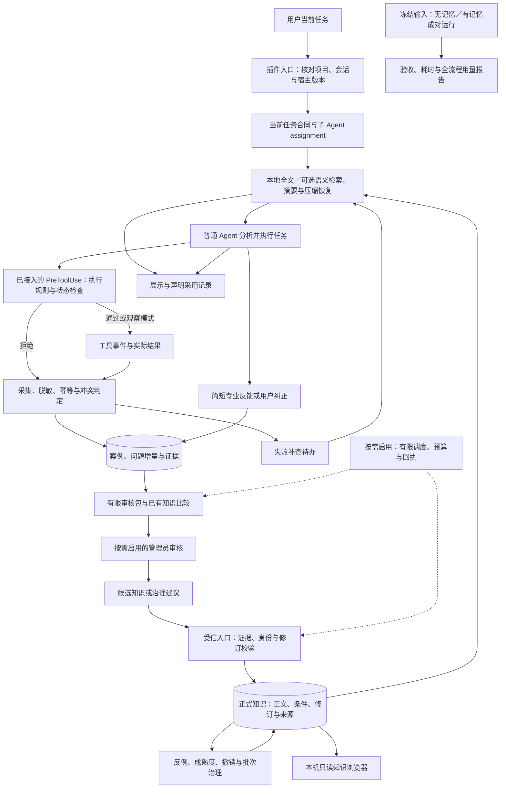
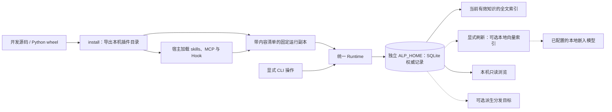

# agents-learning

[简体中文](README.md) | [English](https://github.com/swenbo1-web/agents-learning/blob/main/README.en.md)

**让 Agent 记住项目经验，在下一次任务中查到有依据的解决方法。**

开发版本：**0.13.0** · Python **3.10+** · SQLite · [MIT](LICENSE) · [已发布测试版 0.11.1](https://github.com/swenbo1-web/agents-learning/releases/tag/v0.11.1)

agents-learning 为长期项目建立可持续维护的知识记忆：在受支持的任务事件中检索相关经验，记录工具结果，由管理员整理候选，再把带有条件、来源和修订的知识交给后续 Agent。普通 Agent 专注当前任务，多次对话积累的经验可以继续使用。

## 核心能力

- **自动查阅与有限上下文**：任务提示、上下文恢复和工具失败补查按当前问题检索；先给摘要，正文与条件按需读取。
- **关键词与语义混合检索**：默认使用本地全文索引；可接入已运行的本地嵌入模型，补充用词不同的相关经验，并显示匹配依据。
- **可核查的知识记忆**：保存适用条件、限制、来源、正文修订和撤销状态；来源变化后通知已展示的会话。
- **本机知识浏览器**：搜索知识、查看修订、来源事件和管理员待办，使用只读页面了解知识库内容。
- **分工整理与预算控制**：事件采集和增量审核分开，管理员按需启用；调用、并发、审核包和上下文分别有预算。
- **任务对照评估**：冻结任务、模型、环境和知识快照，对“无记忆／有记忆”成对运行，核对验收、耗时和全流程用量。
- **覆盖安装与版本检查**：验证旧安装后保留备份并更新入口；可启用后台 GitHub Release 检查，知识库和配置独立保留。

`当前任务 → 查阅经验 → 执行与观察 → 整理候选 → 校验发布 → 下一次任务复用`

## 快速体验（源码）

```sh
python -B scripts/learning.py --help
python -B scripts/learning.py --home ../agents-learning-data --workspace . status
python -B scripts/learning.py --home ../agents-learning-data --workspace . browser --open
```

第一次 `status` 登记项目并创建独立数据库，初始知识为空；浏览器只读取已经存在的项目。接入 Agent 请继续阅读[本地运行](#本地运行)与安装说明。查看[语义混合检索](#语义混合检索)、[知识浏览界面](#知识浏览界面)、[真实任务对照评估](#真实任务对照评估)或[完整架构](#完整架构)。

## 项目是怎样形成的

这个项目源于我们对 AI 参与长期项目的一组实际问题的思考：更换对话、压缩上下文后，之前解决问题的经验怎样保留下来？不同 Agent 怎样复用这些经验？工具反复报错时，怎样减少重复排查？已经过时或存在错误的知识，又怎样及时纠正？

最初，我们希望建立一个结构化知识库，让 Agent 遇到问题时先查已有经验，再结合当前需求和环境进行分析。随着讨论深入，我们发现，知识的检索、采集、整理和维护也需要明确的流程，否则仍然容易遗漏，还会增加当前任务的负担。

因此，我们借鉴工程复盘、知识库管理和事件驱动自动化的思路，逐步形成了一套分工明确的架构：**普通 Agent 专注任务，插件辅助检索和记录，管理员负责整理，经过校验的知识再供后续任务使用。**

这里的持续学习通过项目知识的积累和复用实现。插件记录可观察的消息、工具事件和结果，结合简短专业反馈形成经验；这些记录不包含模型内部思考。

## 我们怎样解决关键问题

| 项目中的问题 | 处理方式 |
|---|---|
| 经验停留在单次对话里 | 在独立的本地知识库保存项目事实、操作经验和解决方案，跨对话继续检索 |
| 同类错误反复排查 | 在任务开始、上下文恢复和工具失败后的受支持事件中检索相关知识，结合当前任务提供有限摘要 |
| 经验记录干扰当前任务 | Hook 采集工具事件与结果，专业问题可用简短反馈补充，普通 Agent 无需为每次操作生成复盘文档 |
| 历史方案被错误套用 | 保存适用条件、限制、来源与修订，支持来源变化提醒、撤销和反例复核 |
| 整理和上下文消耗不断增加 | 管理员增量审核，有界检索、按需分页，并分别管理调用次数、并发和上报用量 |
| 自动化越过当前任务范围 | 启用执行保护后，对已接入的调用核对任务身份、状态和显式执行许可，知识只提供参考 |

目标是减少重复劳动和无关上下文，让 Agent 更有效地使用已有经验。知识展示、声明采用和工具观察分别记录，用户验收需要独立确认。任务评估工具可接收外部执行器上报的用量与成本；尚未取得本项目真实任务对照数据，因此不宣称净节省比例或质量提升百分比。

## 适用范围

适合需要长期维护、频繁使用工具，并由多个对话或多个 Agent 接力完成的项目，例如软件开发、故障排查、测试验证、数据处理和实验流程。项目上下文、专业经验和工具操作知识可以共同维护，各领域的有效性仍需要自己的证据与验收方法。

目前以 **Codex** 为主要接入环境，通过插件规则、技能、MCP、Hook 和运行时协同工作。框架可结合项目工具进行配置，接入其他 Agent 环境时需要相应的宿主适配。

本地存储优先，知识按项目管理。管理员、后台调度、自动发布和远端服务默认关闭，可按需要分别启用。

## 完整架构

### 总流程



主任务、知识检索和经验整理各自推进。普通任务交付不等待后台整理完成；工具失败先登记补查，在下一次受支持的提示、恢复或工具前置事件中检索。管理员模型调用、自动发布与知识批次分别配置，流程图中的节点不表示默认全部开启。

### 角色与职责

| 参与者 | 负责什么 | 权限与交接 |
|---|---|---|
| 用户／受信本地操作者 | 明确任务，设置执行规则，启用可选能力，发布和治理知识 | 通过各自显式入口执行；宿主 Hook 信任由用户审阅 |
| 普通 Agent | 分析与交付任务，查询知识，补充必要反馈和采用声明 | 7 个 MCP 工具；绑定当前会话／assignment，知识不能增加执行权限 |
| 插件运行时 | 核对身份与版本，检索、采集、持久化、检查已接入的执行边界 | 使用确定的程序规则；只访问可观察的事件与结果 |
| 管理员 Agent／执行器 | 根据证据与已有知识提出候选和治理建议 | 管理员 MCP 共 12 个工具，不提供发布／撤销工具；自动调用默认关闭 |
| 可选调度器 | 推进审核、知识批次和状态分发的持久待办 | 有限批次、时间和调用预算；启用后才参与流程 |

Rules 和 skills 提供协作约定，Runtime 与启用执行保护的 Hook 检查已接入调用的任务状态、授权动作和资源范围。保护覆盖插件入口，任意本地 Shell 和数据库访问仍取决于宿主与操作系统权限。

### 部署与存储关系



开发源码、导出插件、固定运行副本和真实数据库分别维护。导出的 Hook 与 MCP 指向同一固定副本；发布清单记录版本、内部协议和文件摘要。SQLite 保存事件、任务、知识和回执，全文索引与远端副本属于派生能力，当前 Runtime 检索使用本地有效知识。

同一项目、同一数据目录可跨登录账户保留知识。确认换号后，宿主适配器或操作者发送边界通知，使旧连接、句柄和管理员回写失效；当前桌面换号通知仍需要显式接线。

### 八个模块与代码映射

| 模块 | 职责与边界 | 关键源码／资源 |
|---|---|---|
| 1. 插件接入与协议 | 统一 CLI、MCP、Hook 和技能入口，导出与升级固定运行副本，检查软件版本，核对内容及角色权限 | [install.py](agent_learning/install.py)、[install_update.py](agent_learning/install_update.py)、[software_updates.py](agent_learning/software_updates.py)、[release.py](agent_learning/release.py)、[mcp.py](agent_learning/mcp.py)、[cli.py](agent_learning/cli.py)、[hooks](hooks/hooks.json)、[skills](skills/) |
| 2. 任务与执行控制 | 保存任务合同与版本，绑定父子 Agent，核对受信许可、状态、动作和余额；知识不能签发权限 | [task_control.py](agent_learning/task_control.py)、[execution.py](agent_learning/execution.py)、[assignments.py](agent_learning/assignments.py) |
| 3. 知识存储与索引 | SQLite 保存正式知识、修订与证据来源；全文与可选向量均为可重建派生索引 | [knowledge_store.py](agent_learning/knowledge_store.py)、[knowledge_index.py](agent_learning/knowledge_index.py)、[semantic_retrieval.py](agent_learning/semantic_retrieval.py) |
| 4. 检索与上下文管理 | 有限混合召回与筛选、摘要／分页预算、展示台账、失效通知、压缩恢复、失败补查与只读浏览 | [knowledge_context.py](agent_learning/knowledge_context.py)、[context_storage.py](agent_learning/context_storage.py)、[knowledge_output.py](agent_learning/knowledge_output.py)、[knowledge_browser.py](agent_learning/knowledge_browser.py) |
| 5. 事件、证据与案例采集 | 记录可观察事件与工具结果，处理幂等、冲突、迟到回调和用户反馈，形成可追溯的问题增量 | [event_capture.py](agent_learning/event_capture.py)、[case_store.py](agent_learning/case_store.py)、[runtime.py](agent_learning/runtime.py) |
| 6. 管理员知识治理 | 组织有限审核包，增量排队、调用及回执，提出候选和治理建议；管理员 MCP 不发布知识 | [review_packet.py](agent_learning/review_packet.py)、[admin.py](agent_learning/admin.py)、[admin_queue.py](agent_learning/admin_queue.py)、[admin_lifecycle.py](agent_learning/admin_lifecycle.py)、[admin_decisions.py](agent_learning/admin_decisions.py)、[admin_governance.py](agent_learning/admin_governance.py) |
| 7. 知识发布与版本治理 | 通过受信入口发布、更新、撤销、恢复和晋升；保存批次清单、安全回退与可选分发状态 | [knowledge_lifecycle.py](agent_learning/knowledge_lifecycle.py)、[publication_state.py](agent_learning/publication_state.py)、[knowledge_releases.py](agent_learning/knowledge_releases.py)、[knowledge_sync.py](agent_learning/knowledge_sync.py)、[hindsight.py](agent_learning/hindsight.py) |
| 8. 后台调度、预算与效果评估 | 持久待办、调用预算、知识展示与采用记录，以及独立的成对任务评估 | [scheduler.py](agent_learning/scheduler.py)、[admin_usage.py](agent_learning/admin_usage.py)、[learning_evaluation.py](agent_learning/learning_evaluation.py)、[task_evaluation.py](agent_learning/task_evaluation.py) |

[runtime.py](agent_learning/runtime.py) 组合八个模块，统一项目、会话、账户边界与数据库事务。模块共用版本和数据契约，在同一运行端协作。

### 各模块怎样运行

**1. 插件接入与协议。** CLI 提供显式本地操作，MCP 提供按角色划分的工具，Hook 接收宿主事件，skills 描述工作方式。首次 `install` 校验资源并原子导出；`--upgrade` 校验旧安装，保留备份后切换目录。固定运行副本在入口核对内容身份。可选后台版本检查只读取 GitHub Release 元数据，不参与知识审核或执行授权。MCP 连接通过可信句柄绑定会话，参数无法提升角色。

**2. 任务与执行控制。** 当前任务保存目标、范围和状态，以合同修订、状态写版本及执行轮次区分变化。子 Agent 的 assignment 固定派发时的父任务快照。执行保护核对显式许可、动作、路径、预算与时效；更换任务或暂停后，旧许可不能支持新操作。

**3. 知识存储与索引。** SQLite 保存正式正文、修订、证据来源和动作回执。知识分类涵盖项目、专业、操作及混合问题，用途区分事实、具体解法和可复用方法。全文索引只投影当前有效知识；读取正文和来源时使用同一数据库快照。

**4. 检索与上下文管理。** 根据当前问题和任务中的明确筛选条件规划查询，有界召回后检查匹配与来源状态。默认自动注入最多三张卡、总计 2400 字符；完整条件放不下时标记 `read_required`。手动检索返回有限预览，正文与条件按修订分页读取。展示台账跟踪变更，压缩恢复优先当前问题的新命中，再补充有效历史摘要。

**5. 事件、证据与案例采集。** 从工具前后事件、交付声明和简短反馈形成问题增量。相同回调去重，矛盾输入或工具名保留冲突，迟到回调按原任务与宿主边界归属。工具成功、协议完成和陈述分别表达，均不自动代表用户验收；失败登记有限补查，不直接调用管理员模型。

**6. 管理员知识治理。** 新增或变化的问题进入待审队列。管理员接收有限审核包，比较已有知识和候选，提出含适用条件、限制和证据引用的建议；回执记录调用、结果与重试状态。已启用的窄范围自动发布只接纳满足完整工具成功证据的操作解法新条目；专业知识、方法论和治理变更继续使用对应的受信入口。

**7. 知识发布与版本治理。** 发布前核对候选依据、身份、来源和目标修订，相同请求幂等返回回执。正式知识支持更新、撤销、显式恢复、反例处理和成熟度晋升。知识批次保存确定的条目清单与差异；批次回退不会覆盖较新正文或复活已撤销知识。

**8. 后台调度、预算与效果评估。** 持久待办由有界 `tick`／`run` 推进；启用后在受支持事件中唤醒短时运行器。调用次数、并发、批次时间和上报用量分别控制，未知用量保留预留。效果记录区分展示和声明采用，关联工具结果与来源状态。当前调度需要进程或事件驱动，全天离线定时唤醒仍需宿主或外部运行环境支持。

### 贯穿流程的数据契约

| 数据 | 核心内容 | 为什么保留 |
|---|---|---|
| 项目与会话身份 | 项目范围、`context_handle`、Agent 身份、`host_epoch` | 查询与写入归属明确，换号后旧连接失效 |
| 任务与 assignment | `task_id`、`revision`、`write_version`、`execution_epoch`、目标与范围 | 区分合同、状态和执行轮次，避免旧任务回写混入新任务 |
| 事件与操作 | 事件引用、工具调用标识、输入摘要、结果、任务快照与冲突状态 | 支持可追溯证据、幂等回调及来源健康检查 |
| 问题与案例 | 问题 ID／修订、事件引用、专业反馈及潜在恢复关联 | 把分散观察整理成可审核的问题增量 |
| 候选与知识 | 标题、正文、分类、用途、适用条件、限制、证据等级与 metadata | 让检索与采用依据条件，来源仍可复核 |
| 修订与治理状态 | 知识 ID／修订、有效状态、成熟度、来源版本、动作与批次回执 | 区分正文变化、来源变化、发布状态和历史操作 |
| 预算与效果记录 | 调用预留、已知／未知用量、展示方式与采用声明 | 控制增量整理消耗，保留效果观察的证据边界 |

候选字段中的 metadata 可记录 `tool`、`tool_version`、`error_code`、`environment` 和 `verification`；未知值保持未知。正式知识的有效状态、正文修订、证据等级和成熟度分别维护，不能用其中一个推断其他状态。

### 自动化怎样减少遗漏

| 触发点 | 插件处理 | 保留的边界 |
|---|---|---|
| `SessionStart`／`UserPromptSubmit` | 绑定身份、检索当前相关知识、恢复任务与通知 | 匹配不足不注入；短续聊可以复用未变化的查询计划 |
| `SubagentStart` | 创建独立身份与 assignment，查询对应任务知识 | 需要可靠 Agent ID；独立 MCP 连接生命周期依赖宿主接线 |
| `PreToolUse` | 检查已覆盖的执行规则，发送有限失效提醒与待补查结果 | 默认观察模式；显式启用保护才按规则拒绝调用 |
| `PostToolUse` | 保存结果、更新操作与来源状态、登记失败补查 | 不把协议完成或无关命令当成已解决问题 |
| MCP 查询与反馈 | 登记绑定会话实际返回的知识，补充问题和采用声明 | 未绑定查询不猜会话；展示不等于模型阅读 |
| `Stop`／`SessionStart` 的后台唤醒 | 配置允许时推进增量审核、批次与分发 | 有界运行，无变化跳过；不保证宿主未运行时自动唤醒 |
| 知识修订、撤销或来源变化 | 保存版本变化，在后续受支持事件中通知已展示会话 | 预算不足的完整提醒留待后续，不能删除模型内部旧内容 |

这些机制让检索和事件记录更少依赖 Agent 手动记住每一步。专业判断仍由 Agent 结合当前需求、环境和证据完成，发布校验也不能证明任意自然语言结论正确。

## 当前版本与兼容

0.13.0 增加已有导出目录的显式覆盖升级和可选 GitHub Release 后台版本检查，默认不启用网络检查。数据库 schema 11、全文索引 4、语义索引 1 不变；内部发布协议升至 10，安装更新生成新的固定运行副本。可验证并升级使用同类清单的历史导出，不执行旧代码，不覆盖真实数据目录。后台任务统一从绑定的脚本入口启动，避免当前项目的同名包抢先导入。GitHub 已发布标签及附件仍为 0.11.1，当前开发版本尚未发布。

0.12.0 增加可选本地语义混合检索、本机只读知识浏览器和任务对照评估工具。数据库 schema 仍为 11，全文索引仍为 4，可选语义索引为 1；内部发布协议升至 9，新版需要重新导出固定运行副本。向量索引按项目、知识修订及模型配置派生，默认关闭；查询不自动构建索引或下载模型。浏览器与文件评估入口不初始化 Runtime、不升级数据库。GitHub 已发布标签及附件仍对应 0.11.1。

0.11.0 修复整合审查发现的执行范围、工具证据、账户隔离、知识检索与管理员计量问题。数据库升级到 schema 11，在事务内增加全量脱敏业务证据摘要；旧截短资料无法恢复的摘要保持未知，保留事件、知识 ID 和历史回执。全文索引版本为 4，内部发布协议为 8，不能将新旧运行文件混用；旧运行端不能打开版本 11 数据库。旧 scope 执行许可缺少冻结路径台账时须通过受信入口重新审批。常见凭证脱敏不能保证抹除已经存在的副本。

0.11.1 补齐工具名称缺失时的证据边界：同一操作保存首次明确名称，后续缺名保持未知，明确不同名称使该操作及旧成功来源失效；旧空名称台账只使用完整历史事件补充依据，不猜截短名称。完全相同的历史回调重放若确认已有名称矛盾，追加一次标为 legacy_name_conflict 的派生观察，保留原事件并推进来源版本，后续重放保持幂等。数据库 schema、全文索引和内部发布协议保持上述版本。

## 项目入口与目录

本仓库维护八模块整合后的源码与 Git 历史。项目显示名称为 `agents-learning`，Python 包名为 `agent_learning`，插件和 CLI 名为 `agent-learning`。

开发仓库保存源码、配置示例、技能和检查代码；`install` 生成的导出目录与固定运行副本用于安装。实际知识库位于独立的数据目录（默认位置及覆盖方式见下节），不随开发项目复制，也不写入仓库。现有安装入口不会因开发目录改变而自动切换；更新运行副本须重新导出，并由宿主审阅对应入口。

## 语义混合检索

默认使用 SQLite 全文索引，不需要嵌入服务。需要补充同义表述和不同用词的经验时，可以配置本机已运行的 Ollama 与已安装的本地嵌入模型：

```json
{"retrieval":{"semantic":{"enabled":true,"provider":"ollama","url":"http://127.0.0.1:11434","model":"embeddinggemma"}}}
```

把配置合并到独立数据目录的 `config.json`，或通过 `ALP_CONFIG` 指定自己的文件，保留现有管理员和任务设置。模型名称须对应本机已有模型。插件使用 [Ollama 的 `/api/embed` 接口](https://docs.ollama.com/api/embed)，不自动安装服务、下载模型或调用文本生成模型。仅允许 HTTP 回环地址，不使用代理或跟随重定向。

```sh
python -B scripts/learning.py --workspace . semantic-status
python -B scripts/learning.py --workspace . semantic-refresh --limit 100
python -B scripts/learning.py --workspace . search "之前类似的导入故障是怎么排查的"
```

`semantic-status` 只看索引完整度。`semantic-refresh` 显式对当前有效知识生成向量，默认每次最多 100 条、每批 16 条；仍有 `pending` 时继续增量刷新。正文修订、撤销或模型配置变化后，旧向量不能支持对应的新知识。模型名称不变但本地模型被替换时，执行 `semantic-refresh --rebuild`，之后按 `pending` 继续刷新。

查询把有界全文候选与余弦相似候选用 RRF 融合，返回 `match.method`、`semantic_score`、`semantic_rank` 与 `fusion_method`。相似度不能证明结论正确。自动注入继续检查精确筛选、有效修订、来源健康和匹配门槛；启用语义后，自动结果须覆盖查询中的错误码、版本、路径及 C++／C# 等精确标识，服务降级也保留此检查。知识不能提供执行许可。完整条件和摘要预算沿用现有协议。

服务离线、响应异常或索引在查询间变化时回退到全文检索，返回 `retrieval` 诊断。临时故障最少冷却五秒，后续受支持事件可以重试，通知链继续运行。查询不隐式刷新整库。向量扫描默认最多 2000 条、候选最多 32 条，超出范围标记 `scan_truncated`；当前为有界线性扫描，没有全库 ANN 保证。启用嵌入增加本机计算和首次查询延迟，是否更快需要实测。

## 知识浏览界面

```sh
python -B scripts/learning.py --workspace . browser --open
```

按现有 `--home`／`ALP_HOME` 定位数据库，按已登记 workspace 选择项目；可用 `--project-id ID` 明确选择已有项目。默认随机端口，`--port N` 可指定端口。命令显示本机地址和临时访问码；`--open` 使用 URL fragment 传递访问码，页面立即清除 fragment，访问码仅留在页面内存。终端保持运行，`Ctrl+C` 结束服务。

界面提供知识文本搜索、分类与状态筛选、正文／条件分页、修订与撤销历史、来源健康、事件时间线和管理员待办。浏览查询不调用嵌入模型。所有 API 固定当前项目，以只读 SQLite 快照读取；正文续页固定修订，不混拼新版本。没有知识时显示空视图。

浏览器只监听 `127.0.0.1`，校验访问码、Host 和 Origin。页面不发布、撤销知识，不执行任务或启动管理员；不创建项目、迁移数据库或登记模型展示。旧 schema 数据库需先通过显式运行端操作升级。这是临时本机浏览入口，跨设备共享仍需独立的同步与服务设计。

## 真实任务对照评估

评估独立于真实知识数据库。先冻结任务提示、数据集和验收方法，固定模型版本／参数、环境与知识快照，再比较 `no_memory` 与 `with_memory`。每个任务至少两次重复，执行顺序按固定 seed 交替。

仓库提供[可执行测试示例](examples/evaluation/task-spec.synthetic.json)：

```sh
python -B scripts/learning.py evaluation-protocol --spec examples/evaluation/task-spec.synthetic.json --output ../eval-protocol.json
python -B scripts/learning.py evaluation-run --protocol ../eval-protocol.json --adapter examples/evaluation/adapter.synthetic.json --output ../eval-results.jsonl --timeout-seconds 30
python -B scripts/learning.py evaluation-report --protocol ../eval-protocol.json --records ../eval-results.jsonl --output ../eval-report.json
```

示例执行器使用 PATH 中的 `python`；按环境可把 adapter 的 `argv[0]` 改为实际 Python 路径。示例标记 `synthetic_template`，只验证执行链，不产生真实对照结论，未知 token 保持 `null`。输出文件必须不存在。

真实评估另写 `real_protocol` 任务说明和 `real_adapter` 配置。adapter 的 `argv` 是明确命令，`argv_path_indices` 指出相对 adapter 文件解析的文件参数，`knowledge_snapshot_path` 指定匹配协议 SHA-256 的冻结快照。`evaluation-run` 显式执行此命令，可能产生其中模型的费用；插件不选择模型，也不自动发起评估。执行器按 stdin 中的冻结条件初始化数据集、运行同一提示与验收检查，stdout 输出观测 JSON。也可从外部执行器导入兼容 JSONL 记录。

每次运行分配独立 workspace、`ALP_HOME`、`CODEX_HOME` 和用户／SDK 数据目录。无记忆组不提供快照，有记忆组接收私有副本；执行器负责实际模型接线、数据集重置和关闭其他记忆入口。这是输入隔离，执行器仍具有当前系统用户权限。声明指纹用于一致性检查，不认证执行真实性。

报告包含验收通过／失败／未知、完整任务耗时、检索 p50／p95 与命中观察，以及 `worker`、`admin`、`retrieval`、`model_other` 四项用量。失败与超时保留，退出码为零不代表验收。未知或部分用量不按零计算；费用须相同币种并声明 `scope="all_calls"`，建库开销由执行器分摊到管理员用量和成本。缺对、条件冲突、synthetic、验收或用量缺失禁用相应完整比较，成对子集只作描述。报告不自动证明因果、统计显著性或净节省。

## 本地运行

在仓库目录运行以下命令。示例中的 `python` 应指向实际的 Python 3.10+ 解释器。

```bash
git clone https://github.com/swenbo1-web/agents-learning.git
cd agents-learning
python scripts/learning.py status
```

需要指定项目工作区时：

```powershell
python scripts/learning.py --workspace "D:\Projects\my-project" status
```

默认数据位置为 Windows 的 `%LOCALAPPDATA%\AgentLearning`，或 POSIX 的 `~/.local/share/agent-learning`。使用 `--home PATH` 指定独立数据目录；使用 `--workspace PATH` 指定项目范围。

使用自定义配置时，复制 [config.example.json](config.example.json)，再通过 `ALP_CONFIG` 指向该 JSON 文件。例如在 PowerShell 中：

```powershell
Copy-Item -LiteralPath .\config.example.json -Destination .\config.local.json
$env:ALP_CONFIG = (Resolve-Path .\config.local.json).Path
python scripts/learning.py status
```

配置文件与状态库分离。不要在配置文件写入 API 密钥；可选 Hindsight 从配置指定的环境变量读取密钥。

## 接入插件与 MCP

```powershell
python scripts/learning.py install "D:\Plugins\agent-learning"
```

`install` 先验证资源，在临时目录完成复制后原子发布。MCP 和 Hook 均指向同一份固定运行副本，不依赖导出目录或宿主缓存中的另一份代码。发布清单记录版本、协议和逐文件摘要，入口核对内容一致性；这不是数字签名或操作系统权限隔离。它不更改既有 Codex 配置。导出副本含本地插件目录，随后运行：

```powershell
codex plugin marketplace add "D:\Plugins\agent-learning"
codex plugin add agent-learning@agent-learning-local
```

在 Codex 中开启新对话，审阅并信任 Hooks（CLI 可用 `/hooks`）。安装器不会代替用户设置 Hook 信任。固定运行副本默认位于 Windows 的 `%LOCALAPPDATA%\AgentLearning\runtime-releases` 或 POSIX 的 `~/.local/share/agent-learning/runtime-releases`。保留这个目录和对应解释器；移动导出源不影响已生成的运行入口。运行目录可通过 `install --runtime-store PATH` 或 `ALP_RUNTIME_STORE` 指定，不随临时 `ALP_HOME` 改变。Hook 的信任规则见 [官方插件说明](https://developers.openai.com/plugins/build/plugins)。

需要在配置损坏时也拒绝覆盖工具调用，导出时显式使用 `install PATH --hook-mode enforce`，将保护模式写入可信入口。`--hook-mode observe` 固定观察模式；省略时依据当前有效配置。更换入口命令后需由宿主重新审阅 Hook 信任。

源码中的 `.mcp.json` 是模板，安装副本会将路径渲染为实际绝对路径。本机已用隔离配置验证 Codex 原生加载与安装命令，未改当前用户的插件配置。

标准 wheel 包含导出资源，也支持 `python -m agent_learning.cli` 入口。运行时、CLI 和 MCP 均使用 UTF-8；无需把中文请求转义成 ASCII 来绕过系统编码。

### 覆盖更新已有安装

取得新版源码或解压新版发布包后，从新版入口执行：

```powershell
python -B scripts/learning.py install "D:\Plugins\agent-learning" --upgrade
# 可选：从原目录 runtime-release.json 取得 release_id，校验预期的旧安装
python -B scripts/learning.py install "D:\Plugins\agent-learning" --upgrade --expected-release-id OLD_RELEASE_ID
```

升级先核对原目录的插件身份、固定副本、MCP／Hook 路径和管理文件摘要，再准备完整新版。省略 `--runtime-store` 和 `--hook-mode` 时沿用旧值。管理文件已改动、额外文件与新版路径冲突、目标是源码／固定副本、出现链接或目录内含 `runtime.sqlite3` 等知识数据库时拒绝覆盖。外部 `ALP_HOME` 与 `ALP_CONFIG` 不被读取或修改；知识数据库应保持在导出目录之外。额外个人文件和空目录会保留，不纳入插件管理文件。

回执给出 `backup_directory` 和新旧 `release_id`；旧导出目录完整保留为同级备份，旧固定运行副本也保留。目标锁和快照检测并发改动，切换失败尝试恢复原目录。切换有短暂目录间隙；进程硬退出可能留锁或备份，需要人工核对回执、目标及 `.alp-install-*.lock` 后恢复，安装器不自动抢锁或删除备份。不支持通过此入口降级。

更新源目录后重启 Codex，使插件缓存重新加载，并重新审阅变化后的 Hook 信任。已运行的 MCP 仍可能使用旧副本，文件更新回执不代表当前进程已切换。若宿主仍沿用旧缓存，按宿主的插件安装入口重新加载该本地目录。[官方本地插件更新说明](https://developers.openai.com/plugins/build/plugins)

### 从 GitHub 自动检查版本

版本检查读取公开 Release 元数据，检查结果与知识数据库分开保存。显式命令不初始化 Runtime：

```powershell
python -B scripts/learning.py --home "D:\AgentLearningData" update-check --force
python -B scripts/learning.py --home "D:\AgentLearningData" update-status
```

`update-status` 只读缓存，不访问网络，也不创建数据库。`update-check` 可在自动检查关闭时手动运行；`--force` 跳过常规间隔，仍遵守服务端限流。请求失败会返回 `state=error` 或 `rate_limited`，不能据此判断已经是最新版；命令成功输出状态 JSON 时退出码为 0，配置或本地读写异常才退出 1。

要启用自动检查，在自己的配置中加入：

```json
"software_updates": {
  "enabled": true,
  "repository": "swenbo1-web/agents-learning",
  "channel": "prerelease",
  "interval_seconds": 86400,
  "timeout_seconds": 3
}
```

主会话 `SessionStart(startup/resume)` 在事件事务外预留检查，由独立短进程访问 GitHub；压缩、清空和子 Agent 不派发检查。默认每天按间隔检查，同一数据目录按仓库和通道共用缓存、短租约与进程锁，避免多个对话重复请求。检测到新版本后，在后续 `startup/resume` 提醒；完整检查状态通过 `update-status`／`status` 查看，不阻塞当前知识注入。失败会退避，响应大小受限，支持 ETag/304；超时约束 socket 与响应读取，操作系统 DNS 不属于严格进程总时长限制。

`prerelease` 通道包含测试版，`stable` 排除测试版。仅比较最近 20 条 Release 中的合格语义版本；不把提交、普通标签或尚未发布的开发版本当成更新。`ahead` 表示本地版本比检查到的发布版本新。检查只连接官方 GitHub API，不读登录令牌、不下载或执行代码、不自动替换安装；新版通过上面的显式覆盖命令安装。[GitHub Release API](https://docs.github.com/en/rest/releases/releases)

也可以单独启动 stdio MCP 服务：

```powershell
python scripts/learning.py --workspace "D:\Projects\my-project" serve --role worker
python scripts/learning.py --workspace "D:\Projects\my-project" serve --role admin
```

| 身份 | MCP 工具 |
|---|---|
| 普通 Agent（7 个） | `knowledge_search`、`knowledge_read`、`session_context`、`task_update`、`case_feedback`、`knowledge_use`、`learning_status` |
| 管理员（12 个） | 上述工具，以及 `problem_list`、`review_packet`、`submit_candidate`、`review_list`、`propose_governance` |

MCP 不暴露发布或撤销工具。角色由启动入口指定，工具参数不能提升角色。技能位于 [learning-worker](skills/learning-worker/SKILL.md) 和 [learning-admin](skills/learning-admin/SKILL.md)。

这些权限限制覆盖本服务的入口。同一操作系统账户下的任意 Shell 和本地数据库访问，不属于 MCP 角色隔离保证；需要宿主权限与账户隔离配合。

### 会话身份与压缩恢复

`SessionStart` 和 `UserPromptSubmit` 注入 `context_handle=...`。普通 Agent 首次调用 `session_context(context_handle=...)`，或直接在 `task_update`／`case_feedback` 传这个句柄；之后当前 MCP 连接固定绑定该句柄，`conversation_id` 可省略。传入其他会话或句柄会被拒绝。写入身份和业务更新在同一事务内复核，失败不会留下错误项目绑定。

压缩后用 `session_context` 恢复任务、revision、write_version、状态和执行准备情况，无需重新总结历史。没有可信句柄时只能查询项目知识和项目状态，不能猜最近会话或登记任意会话。受信本地操作者可使用 `session-bind --conversation ID` 登记明确身份，再用 `serve --context-handle HANDLE` 启动绑定服务。手动 CLI 的 `task`／`feedback` 仍是显式本地操作入口。

`SubagentStart` 有可靠 `agent_id` 时，子 Agent 获得独立句柄、知识展示状态和固定 assignment，绑定派发时的父任务 ID、revision、状态版本与执行轮次。父任务改变后，旧反馈仍记入原任务，旧 assignment 不能使用新许可；`session_context` 同时返回派发任务和当前父任务，不能覆盖父任务。无可靠 ID 或升级前无 assignment 的子身份不猜归属，需要新的子 Agent 身份重新派发。若宿主让父子 Agent 共用一个已绑定的 MCP 连接，子 Agent 需要单独的绑定连接；当前不声称已验收宿主的父子 MCP 连接生命周期。

### Codex／ChatGPT 登录账户切换

同一项目、同一数据目录继续共享正式知识和历史证据，不按登录账户分库。换号通知推进本地 `host_epoch`，旧连接、旧句柄和旧管理员回写失效；新连接通过下一次 Hook 或明确的 `session-bind` 重新绑定。任务历史和每日调用计数不会清零，未确定结果的旧调用不会自动重试，已运行的项目命令也不会被当作重新执行的理由。

受信宿主适配器或操作者在确认切换后调用：

```powershell
python scripts/learning.py account-changed --notification-id "unique-login-event-id"
```

可用唯一通知 ID 去重，省略时每次调用均视为一次新边界。所有通知方必须指向相同 `ALP_HOME`／`--home`。这个入口不读取、保存或修改登录 token，不执行登录、退出或额度重置。

**当前没有自动订阅桌面端换号。** 官方 app-server 提供 `account/updated` 和登录完成通知，但普通插件不能据此假定已经接入桌面应用的内部通知通道。适配器应依据自己拥有的登录生命周期发出边界通知；仅比较 `authMode`／套餐不能识别同模式下的 A→B 换号，也不依赖 `auth.json` 修改时间。[官方 app-server 账户接口](https://learn.chatgpt.com/docs/app-server)

## 手动处理一个问题

下面的示例只记录明确任务和问题，不运行项目主流程：

```powershell
python scripts/learning.py --workspace "D:\Projects\my-project" task --conversation demo --goal "分析某工具错误，不修改项目"
python scripts/learning.py --workspace "D:\Projects\my-project" feedback --conversation demo --summary "工具错误再次出现，尚未解决" --category operation
python scripts/learning.py --workspace "D:\Projects\my-project" problems
```

用返回的真实问题 ID 读取 `packet PROBLEM_ID`。管理员依据该包整理候选 JSON，再调用 `propose FILE`。候选字段如下：

| 字段 | 含义 |
|---|---|
| `problem_id`、`problem_revision` | 问题标识字符串及审核依据的整数版本 |
| `title`、`content` | 标题和正文字符串 |
| `category` | `operation`、`professional`、`project`、`mixed` 或 `unknown` |
| `applicability`、`limitations` | 适用条件与限制字符串 |
| `evidence_refs` | 实际事件 ID 字符串列表 |
| `validation_level` | `reported` 或 `tool_success` |
| `metadata`（可选） | `tool`、`tool_version`、`error_code`、`environment`、`verification` 字符串；未知时省略或留空 |
| `knowledge_kind`（可选） | `fact`（事实）、`solution`（具体解法）、`pattern`（可复用方法），默认 `solution` |

`reported` 表示有记录的陈述，不代表已经验证。`tool_success` 要求引用明确完成且成功的 `PostToolUse` 事件，只能支持具体工具的成功结果。标准 MCP 的 `isError:false` 记为 `call_completed`，仅表示调用协议完成，不能单独支持 `tool_success`。退出码为零不能单独证明专业根因、玩法结果或用户验收。

受信操作者使用 `publish CANDIDATE_ID` 发布，使用 `revoke KNOWLEDGE_ID --expected-revision N` 撤销。Runtime 检查证据引用、来源版本和允许的验证范围；它不能证明任意自然语言结论正确。知识审核状态与产品验收状态分别表达。

默认发布创建新条目，同名但适用范围不同的知识可以并存。相同正文、适用条件、限制、分类、用途和证据等级复用当前条目，并持久化每个来源候选、问题修订和证据引用；新增来源不制造正文修订。更新已有知识必须指定 `publish CANDIDATE_ID --knowledge-id KNOWLEDGE_ID --expected-revision N`；版本不符或条目已撤销时拒绝首次更新，不能仅凭标题覆盖。更新后若与另一个有效 ID 完全重复，会拒绝并提示已有条目。

每个候选只有一个发布回执。默认重试或使用原目标/CAS 参数重试显式更新时，直接返回第一次发布结果，不再次校验证据或推进版本；回执中的 `published` 表示历史发布已经完成，当前可用性用 `read` 核对。旧候选不能回滚较新知识，也不能复活已撤销知识。变更目标需提交新的候选。迁移仅恢复有明确对应依据的历史回执；对应目标无法确定时保留 `legacy_unresolved`，阻止自动重发并等待复核新候选。

显式恢复使用 `restore KNOWLEDGE_ID --expected-revision N`，只允许恢复末版、核对当前至少一份完整有效来源，并检查有效知识重复；可附 `--expected-generation N`。涉及未决或因撤销关闭的反例时，另需具体 `--reason` 与新的 `--event-ref` 支持：历史来源、反例自身、已绑定其他知识的观察不能作为恢复依据。恢复同版后重新打开原 revoked 反例，保留 dismissed/revised，不宣称反例已经解决。恢复保留原正文修订并降为 candidate。

发布、修订、附加来源、撤销、恢复和晋升保存统一生命周期动作及状态版本。撤销／恢复可传 `--request-id`，同一参数重试回放历史结果，不再次变更状态；原请求 ID 改参数会被拒绝。无请求 ID 会生成新 ID，响应给出该 ID。`knowledge-actions` 列有限摘要，`knowledge-action REQUEST_ID` 读取理由、状态和回执。历史发布回执继续保留；记录中的执行者类别不提供操作系统身份认证。

使用 `search QUERY` 查询当前已发布内容，使用 `read KNOWLEDGE_ID` 读取条目。撤销后不再返回该知识；当前对话在下一次提示或已覆盖的工具前置事件收到版本失效提示。这不能保证从模型内部删除已经读过的内容。

`knowledge_search` 的 `filters`、CLI 的 `search QUERY --filters JSON` 可按 `category`、`knowledge_kind` 及 metadata 中的已知字段精确筛选，未知筛选字段省略。自动检索可使用任务 scope 中明确的 `knowledge_filters` metadata 字段，不把允许工具或执行规则当成筛选依据。自动注入最多三条摘要，保留分类、条目 ID、适用条件、证据等级与当前来源状态；条件无法放入预算时退回 `read_required` 标识卡。匹配不足或来源冲突、拒绝、缺失时不自动注入。

MCP `knowledge_search` 默认返回最多 6000 个 JSON 正文字符的预览，`max_chars` 可设 512～20000，不展开完整正文或全部证据；返回 `match`、`summary_only`、`truncated` 和 `omitted_count`。条件或限制被裁剪时返回 `read_required=true`。`knowledge_read` 默认预算为 12000，可设 1024～50000；`section=content|applicability|limitations` 选择正文、适用条件或限制，默认 content。所选字段按字符 `offset` 分页，续页保持 section 并传 `next_offset` 与上一页 `revision` 作为 `expected_revision`，防止跨修订拼接；返回 section_length。预算足够时适用条件和限制完整返回，fields_truncated 中的字段可分别分页读取。来源只展示有限摘要，省略来源有标记。这些预算不包含 MCP 协议外壳及协议返回的 `structuredContent` 副本，不是精确 token 限制。CLI 与内部 Runtime 的 `search/read` 保留全文和证据接口。

Hook 先使用完整适用条件与限制核对输出预算，无法完整容纳时只给带 read_required 的标识卡。自动检索最多检查 64 个候选，先筛相关度与来源健康，再取最多五项供上下文选择；失效的前五条不会直接遮蔽后续有效条目。手动检索的 limit 仍为 1～10。这个召回上界不保证找出所有更后位置的有效知识。

搜索和读取可以传当前 `context_handle`，连接绑定后登记实际返回的知识卡或正文页；未绑定查询只读取项目知识，不猜会话归属。父/子 Agent 的展示台账分别保存。`source_version` 与实际展示状态同快照返回，读完后发生的变化不会被误记为已经通知。

“继续”等短回复沿用查询；任务、知识、来源版本及预算不变时复用查询计划，不重复检索。缓存签名与检索共用末尾 8000 字符形成的词元和短语计划，续聊保存同样长度，避免长问题前半段变化被误认成旧查询。自动检索缓存随来源健康版本失效；负结果随新知识发布失效，放不下的卡可以后续补发。压缩恢复优先当前问题的新命中，再补充有序的有效历史摘要；当前恢复集合保留最近 32 项，历史展示由独立台账追踪。切换任务或账户会重置当前集合和查询计划，同时保留历史失效追踪与项目共享知识。

正文与 `sources`、`evidence` 在同一 SQLite 快照中读取。`source_health` 可为 `valid`、`conflicted`、`denied` 或 `missing`；`current_tool_success` 表示当前引用中仍有可信的工具成功观察，`problem_changed` 单独提示来源问题已有新证据。历史 `validation_level` 不随回调变化改写，冲突由管理员复核，存储层不自动撤销专业结论。

全文投影只包含当前有效知识，支持 C++、C#、C、R、中文单字与二元片段，并检索限制条件。技术标识同时保留整体和组件；查询取末尾 8000 字符、最多 128 个有效词元，中文双字优先并抑制常见请求修饰词。FTS 召回后优先查询覆盖率，每个词只取最高字段权重，避免重复字段刷分，以 ID 打破并列。返回的 `match` 说明分数、覆盖率、最多 12 个命中词与自动注入资格；分数不是概率。单字符查询保留手动召回，不自动注入。排名不使用其他项目或历史知识的词频。

缓存仅保存 ID/修订组合，每次读取核对 active、筛选条件与词元交集；返回的 generation、正文与来源属于同一快照。项目变化通过自身 generation 失效旧缓存，不清空其他项目缓存；全局缓存最多保留 256 份。缓存和计数在读快照结束后写入，派生写入被锁住时可跳过，不阻断已完成的查询。Hook 检索不持写锁，最终状态提交重新核对宿主身份、任务/assignment、上下文版本、有效修订及来源版本。

全部已展示知识的来源状态由版本化台账追踪；问题版本、证据关联、操作冲突/拒绝或新增来源在同一事务内提升受影响知识的来源版本。Hook 每次最多处理 16 条撤销和 16 条来源变化，只有完整通知放入输出后才推进状态，预算不足或超批次数量留给后续事件；近期八份状态仅作兼容摘要。程序输出不等于模型已阅读，也不能清除模型内部旧内容。

实际工具失败会登记绑定任务合同与宿主版本的补查，每个任务合同、Agent 和宿主版本最多处理三个不同错误签名；重复回调、插件自身工具或无可验证任务不会触发。下一次续聊、恢复或工具前置事件进行本地检索；普通新提示优先查询当前问题，旧故障留到后续事件。预算不足时缓存有限引用，后续补发不重新搜索。晚到的旧任务失败不会混入新任务，子 Agent 按固定 assignment 处理。补查不调用管理员模型，也不新增执行权限。

## 按需存储维护

以下命令只在迁移、故障诊断或人工维护时使用，不加入每个任务的固定流程：

```powershell
python scripts/learning.py --home "D:\AgentLearningData" doctor
python scripts/learning.py --home "D:\AgentLearningData" backup "D:\Backups\agent-learning-2026-10-11.sqlite3"
python scripts/learning.py --home "D:\AgentLearningData" rebuild-index
```

`doctor` 检查数据库与发布/来源/索引关系，返回异常计数；`backup` 使用 SQLite 在线备份，目标必须是新文件；`rebuild-index` 在写事务内从有效正文重建投影并清缓存。索引可重建，正文、历史、回执和来源属于权威数据，重建索引不能修复缺失的原始证据。打开旧数据库前可先用原运行端做在线备份；本插件不自动覆盖数据库或执行备份还原。

使用正式知识后发现反例，可在 `case_feedback` 中关联 `knowledge_id`，形成待审问题；反馈本身不直接撤销知识。

同一对话开始真正的新任务时，使用 `task --new-task` 或 `task_update(new_task=true)`。已有任务的 MCP 更新必须传 `expected_task_id` 和 `expected_write_version`；仅比较 `expected_revision` 不能保护状态写入或新任务 revision 重用，因此不再接受旧的单字段更新。显式本地 CLI 可以省略并发条件；提供条件时也必须成对传入。目标或范围改变才增加 `revision`，每次实际状态/目标/执行边界变化增加 `write_version`，回执在同一事务内读取。

省略 `status` 保留状态；暂停、取消或已交付任务恢复需明确 `resume=true`／`--resume`，并不会恢复过期执行许可。父 Agent 的 `case_feedback` 同时传 `expected_task_id` 与 `expected_task_revision`，避免压缩前的反馈写进新任务。子反馈使用固定 assignment。合同快照与事件时点状态分别保存，后续交付不改写早期案例；管理员也不会因此重复预检未变的素材。

历史案例依据自己的任务快照审核，后续任务不提供历史执行权限。MCP 和 Hook 共用项目身份：仓库子目录使用仓库根目录，已登记工作区的普通子目录沿用该工作区；会话跨到不同项目时给出身份冲突。多目录共享知识可显式配置 `project_aliases`，不自动合并不同仓库。

普通 Agent 将明确任务更新为 `delivered` 后，下一次 `Stop` 按该次 delivered 的 `write_version` 保存交付结果，并附有限工具结果及对应前置记录。同轮重复 Stop 不重复采集；明确恢复后再次交付，追加到该合同已有案例，保留首次结果。旧交付轮次仅在 Stop 与历史状态均有明确依据时迁移。此记录只代表已报告交付，不证明专业结论或用户验收。`capture_deliveries=false` 可关闭该采集；专业问题继续用 `case_feedback` 简短补充，无需生成复盘文档。

## 案例采集与证据

工具返回先检查明确失败，再判断成功、协议完成或运行中；零退出码和会话 ID 不能覆盖失败标记。前后回调及同一操作的多份回调明确提供不同输入或工具名时记为冲突，即使响应相同也保存新证据并使旧成功来源失效。首次缺名不会永久绕过名称比较，后续缺名也不被当成名称矛盾；名称台账保存首次明确值。相同回调保持幂等，旧记录只有完整内容可比时才确认重放。完整脱敏输入签名和业务摘要独立存储，旧截短输入或名称不猜。事件预算优先保留退出码、失败标记、错误码和冲突信息，其余日志保留首尾并标记截短。

潜在恢复需要同一身份、任务和宿主版本，并有相同明确资源或相同非空命令；只共享工作目录或执行无关 pwd 不构成恢复。已冲突、拒绝或缺少当前成功依据的历史恢复仍保留记录，但不能遮蔽后续相关成功。潜在恢复不等于已确认修复或用户验收。

失败案例关联该操作的前置记录与结果，保留实际命令。潜在后续成功限定任务、Agent、assignment、宿主轮次，并比较已知动作目标；修复命令可以不同，明确不同文件或资源不自动串联。已有案例审核后仍可补充真实新证据。`problem_events.role` 区分 observation、attempt、failure、conflict、potential_recovery、delivery、feedback；`status` 表示治理状态，`resolution_status` 为 open 或 recovery_observed，后者不等于修复验证通过。同类问题按确定的摘要身份归并，语义聚类仍由管理员判断。

`case_feedback` / CLI `feedback --idempotency-key KEY` 支持持久回执。同一次请求重试沿用原键和参数，返回首次结果，不增加事件或案例版本；同键不同参数拒绝。不同实际发生使用新键，省略键兼容旧入口且不保证重试去重。回执按项目、会话、Agent 和宿主版本隔离。

知识反例传 `knowledge_id`、`knowledge_revision`、`feedback_kind=counterexample`，必须引用本项目真实修订；兼容旧请求未传修订时绑定当前有效版并返回明确修订，已撤销或历史版应显式引用。反例独立关联对应知识修订并推进来源变化版本；`pending_counterexample_count` / `feedback_status=pending_counterexample` 会出现在知识响应和后续 Hook 提醒中。案例 reviewed、生成候选、发布新知识或挂接等价来源都不清除反例。准确修订被受信治理更新、撤销或依据额外真实证据明确驳回后才处置；新证据会重新打开反例。

## 任务范围与执行保护

`scope` 的已知字段会检查类型；项目附加字段仍可保存，但不提供权限：

| 字段 | 类型与含义 |
|---|---|
| `mode` | `analysis`、`read_only`、`implementation`、`execute` |
| `allowed_tools`、`allowed_paths`、`allowed_actions` | 字符串数组；动作是 `read/write/execute/network`，显式空数组限制为零 |
| `budget` | `{remaining: 非负数或null, unit: 可选字符串}`，0 阻止执行，null 表示未知 |
| `stop_conditions`、`verification` | 字符串数组，保存停止条件和验收要求，尚不自动解释任意自然语言条件 |

保护模式要求受信操作者或宿主先签发规则；普通 Agent 更新任务不能给自己签发许可。操作者将规则保存为 JSON 文件，并用当前任务回执中的真实 ID 和 write_version 调用：

```powershell
python scripts/learning.py --workspace "D:\Projects\my-project" execution-approve --conversation demo --expected-task-id "真实任务ID" --expected-write-version 1 --rules "D:\Policies\read-only.json"
```

规则文件示例（工具名和参数字段必须对应接入宿主的真实契约）：

```json
{
  "mode": "read_only",
  "allowed_tools": ["Read"],
  "tool_rules": {"Read": {"action": "read", "path_fields": ["file_path"]}},
  "allowed_paths": ["Docs"],
  "budget": {"remaining": null}
}
```

审批时固定 workspace 和许可资源根；工具资源相对实际 cwd 解析，再与固定根、任务 scope 和 assignment 范围取交集。缺少字段、越界、含 `..` 或符号链接逃逸时拒绝。有限的结构字段检查不能证明任意工具的全部副作用；任意 Shell 在只读模式下拒绝，不靠解析命令猜权限。FPS 等项目的 UE/PIE/训练动作需要项目适配器声明，不硬编码进通用插件。

新用户消息使旧执行轮次失效，完全匹配的“继续／继续吧／接着／continue／go on”仅保留已有范围，不扩大许可；无需额外模型分类。重复带同一 turn_id 的消息不重复失效。`Interrupt` 暂停父任务而非取消；清空上下文也暂停，压缩恢复保留现有版本。任务修正、规则替换和换号会失效旧许可，普通 Agent 不能靠恢复状态绕过。保护模式对其他新消息保守要求受信入口重新确认；自动接线需宿主适配器支持，目前 CLI 是可用的手动入口。

`PreToolUse` 记录许可决定，`PostToolUse` 记录观察结果，二者分别保存。已拒绝却收到完成、同一操作有矛盾终态等回调标为 conflict，不能晋升为 `tool_success`；这是异常回调处理，不代表真实宿主已经出现这类回调。明确的 Pre 绑定保留晚到结果；无 Pre 且无 assignment 的结果保持无任务归属。当前仍不能撤回已运行的外部命令，也没有完整执行租约。余额仅消费第八模块/宿主提供的快照，尚未实现原子扣费或动态资金预算。

受信审批同时冻结规则、task 和已有 assignment 范围中的实际路径根；检查时按这些根取交集，目录链接后续重定向不能扩大权限。审批后同范围子任务继承父冻结根，缺少冻结依据的其他子范围和旧策略须重新审批。内部冻结台账不能通过用户规则或任务字段签发。

## 可选管理员执行器

默认 `admin.enabled` 和 `admin.auto_publish` 都为 `false`。未启用执行器时，可用管理员技能人工整理候选。

需要自动提出候选时，配置可信的 Codex CLI 路径并启用 `admin.enabled`。未启用调度时，`Stop` Hook 先持久预留派发位置，再启动一个独立后台 `admin-batch` 短批次，不等待模型完成。没有可审增量、已有派发或审核在途、额度耗尽时不启动。启用 `scheduler.enabled` 后由下述持久调度安排有界续跑。也可以手动运行：

```powershell
python scripts/learning.py --workspace "D:\Projects\my-project" admin-once
python scripts/learning.py --workspace "D:\Projects\my-project" admin-batch
python scripts/learning.py --workspace "D:\Projects\my-project" reviews --problem CASE_ID
```

可用 `admin-once --problem ID` 限定问题。执行器在隔离临时目录使用只读沙箱、临时会话和结构化输出，并设置 `ALP_DISABLED=1` 避免学习递归。自动提出候选不等于自动发布；默认仍由受信操作者发布。

审核快照与调用预留在同一事务完成，模型调用在事务外执行。同一项目的模型预留在事务内互斥，全局并发默认为 1。调用持久经历 reserved → launch_intent → started → 终态，启动意图在创建进程前提交；超时、换号或启动窗口崩溃按未知保留额度。判断全局预算之前安全回收全部项目的过期预留，严格启动意图前的记录或明确未启动的进程可以释放；遗留活动记录不能证明未启动，升级后按 orphaned_unknown 处理。不会按进程名称杀其他任务。

审核决定与调用计量分开保存：`reviews` / 管理员 `review_list` 可查看理由、结构化缺证项、候选和提议引用。候选对应 candidate_ready，缺证对应 awaiting_evidence，生成提议对应 proposal_ready；与案例是否恢复、产品是否验收独立。精确复用同时检查业务证据及实际比较知识、候选、反例目标、来源健康和审核策略；失败或未知调用不复用为成功决定。自身证据产生的候选不形成再次审核循环，新相关资料才可能复审。发布或候选变化先唤醒有界比较，实际审核签名不变则不调用模型。

审核结果写入前及最终提交边界，在同一事务重核案例、宿主、租约及实际比较资料；变化则回滚候选、治理提议和决定回执，保留实际调用终态与用量。未知调用核对后，可由受信入口运行 `admin-retry CALL_ID --reason "已核对的原因"` 明确允许一次再审，原记录和额度保留。重复许可不会产生无限重试。截短证据会标明限制并阻止自动发布。

调度器、批次、单次审核与调用认领贯穿同一个 expected_epoch，并在认领事务内复核；换号前启动的执行器不能在新账户版本下重新认领。并发数、每日上报用量门槛和单次预留的变化只影响准入，不改变同一资料的审核语义签名。长日志去重比较投影前的完整脱敏业务摘要，保留嵌套业务 ID；仅顶层传输身份被排除。完整可见事件不重复发送摘要，旧截短事件缺少摘要时不能跨事件推定相同。

直接 MCP / CLI 取包同样使用一致快照。整包按实际管理员提示、任务、证据与比较材料计算预算，完整可容纳的 41 条事件可审核，不再固定丢弃第 41 条。单页最多读取 512 条，事件展示必要归属、角色及当前 health；比较资料只使用剩余空间。预算不足明确返回 incomplete、omitted_count、omission_reasons 和有限 missing_refs，不完整材料仍不自动调用模型。

管理员可用 `review_packet(problem_id, offset, expected_revision, max_chars, section)` 或 `packet ID --offset N --expected-revision R --max-chars N` 分页；续页必须沿用同一问题 revision，素材变化则重读。大任务完整 JSON 使用 `section=task`；反例的准确历史知识必读，不依赖关键词重合，即使已撤销仍可查。目标放不下时明确 target_omitted 和 incomplete，可使用 `section=target` / `--section target` 分页。若单条证据本身放不下，按返回的预算提示增加 max_chars；不得反复读取无进展的页。分页材料及当前健康状态不等于新的独立验证。

`admin-once` 一次最多扫描十个问题；`admin-batch` 默认总共扫描 20 个案例、最多启动 2 次审核、运行预算 180 秒，同时受全局 UTC 每日调用额度限制。预检和精确去重不消耗模型调用数，超限预检持久缓存并绕过阻塞项。问题版本、必要目标、预算或提示改变后可重检；可选候选变化不重新展开未变超限素材。无工作退出，坏启动配置停止当前批次。执行时间包含模型等待，进程清理和数据库收尾可能略超运行预算。

管理员 MCP 的 `propose_governance` 只能提出 publish/update/attach/revoke/dismiss_counterexample，不能执行。受信操作者用 `governance-propose FILE` 提交 JSON、`governance-execute PROPOSAL_ID` 执行：校验案例及目标修订、证据和宿主边界，治理变更与幂等回执同事务提交。update 必须产生真实新修订，等价内容应 attach；发布不同知识不处置旧反例。模型输出中的 proposal 同样只作为提议。

即使开启 `auto_publish`，也仅限无截短、具备真实工具成功证据的 operation/solution 新知识。已有知识治理、反例、professional、pattern 和未验证事实仍交受信入口处理；工具成功不证明专业结论正确。

`max_calls_per_day` 限制调用次数，`max_input_chars` 限制输入字符，`timeout_seconds` 限制单次时间；`max_cases_per_batch`、`max_calls_per_batch`、`max_batch_seconds` 控制批次。字符和次数不是 token 或费用，本工具不保证严格的 token 或美元预算。关闭或失败时保留待处理记录。后台摘要日志超过 1 MiB 后在下次派发轮换，保留一份旧日志；Windows活动句柄导致轮换失败时记录延迟并继续派发。单次审核日志受超时约束，不是磁盘写入硬上限。当前清理只保证直属审核进程，CLI自行启动的后代进程仍需宿主级约束。

是否降低消耗，需要结合实际调用和任务结果衡量。

`status` 提供检索次数、命中次数、注入条目次数、管理员状态、全局预算、调度等待原因和 `knowledge_sync_dirty` 数量；检索统计含自动注入和管理员查询。累计检索计数是运行观察，不作为计费账本。知识采用与用量完整度见第八模块。

真实付费模型调用与宿主端 Hook 启用须单独验收；本地离线检查不代表这两项已通过。

## 第七模块：成熟度与知识发布批次

`maturity` 与 active、正文 revision、validation_level 分别表达。`knowledge-maturity ID --expected-revision N` 给出当前 candidate/stable、资格及缺项；`knowledge-promote ID --expected-revision N --request-id REQUEST` 由受信入口晋升，不暴露到普通或管理员 MCP。当前默认规则仅允许 operation/solution：至少两个独立任务（同任务的重复案例不增加次数；无任务时按独立对话）、每份来源仍有真实工具成功且合同有效、来源无变化或冲突、无未决或原撤销反例。professional/pattern 需要专门验证规则，当前不会仅凭工具成功晋升。

Stable 认证绑定正文、来源与反例状态，变化后 effective maturity 返回 candidate；新修订、附加来源、撤销／恢复需重新晋升。读取、MCP 有限预览与 Hook 摘要显示成熟度，已展示知识的成熟度变化通过现有通知链提示。历史认证不证明产品已由用户验收。

`knowledge-release-prepare` 保存紧凑清单，引用 ID、正文修订、来源／生命周期版本、成熟度、健康和摘要哈希，不复制正文或日志。`knowledge-release-commit RELEASE_ID` 在同一事务内重核有效知识全集、来源快照和父批次，变化则拒绝并要求重新准备。完成批次不可改写，重复提交回放结果；`knowledge-releases` 和 `knowledge-release ID --offset N --limit N` 分页读取摘要及 added/updated/removed 差异。

`knowledge-daily-release` 将准备／提交组合成显式的一步入口，有变化才发布，无变化跳过，也不新增管理员模型调用。操作者可显式调用，也可启用第八模块的 `scheduler.auto_release` 安排正式知识批次；不会将候选自动转为正式知识。

`knowledge-release-rollback ID --expected-head CURRENT --request-id REQUEST` 只回退分发清单：历史目标必须仍为当前有效修订、来源有效且无反例，保存新的回退批次；不会复活撤销知识、倒退正文或撤销后来新增知识。当前 Runtime 检索仍使用本地 active，批次指针尚未作为检索可见性过滤器。知识批次与 `release.py` 管理的软件运行副本分别维护。

## 可选 Hindsight

默认使用本地 SQLite 全文检索，可启用本地语义混合检索。Hindsight 是可选的已发布知识同步目标，不是本地记录成功的前提，也不会自动成为 Codex 内置资料库。

启用前须配置 URL、Bank 和密钥环境变量，并在 Hindsight 端预先设置相应的 chunks 命名策略。默认 `strategy` 为 `alp_chunks`；每次新客户端写入前实际核对目标策略。旧配置里的 `chunks_strategy_verified` 不作为验证依据。

```powershell
python scripts/learning.py --workspace "D:\Projects\my-project" sync
```

同步不将候选案例自动晋升为正式知识。适配器会只读核对目标 Bank 的 chunks 命名策略，并要求关闭自动综合，避免同步意外触发额外分析；它不修改 Bank 配置。

同步失败与本地保存状态分开记录；本地仍可使用。崩溃后过期租约清除并标为远端未知，迟到结果单独留回执，不能覆盖待核对状态。`sync --retry OPERATION_ID` 显式重试：确定尚未发送的预检失败不消耗实际发送次数；未知写入先对账，最多三次实际尝试。后续 not_sent 失败不能清除此前 unknown，原目标配置变化也不能自动迁到新 Bank。

单次、批次和调度分发保留同一个宿主 epoch，认领事务与网络派发前复核。请求已经运行时发生换号，确认只记为 late 回执，队列保持 blocked/unknown 待对账；不能声称取消了远端已接收的写入。

同步载荷含正文修订、来源状态版本、成熟度、健康／反例摘要和 active 状态；完整来源参与摘要哈希，输出只携带有限引用。来源／处置变化由程序登记增量，同一知识、修订和目标的确定未发送旧状态可被新状态替代，未知操作仍保留对账。旧版失效记录与新版有效记录分别发送。远端文档按不可变状态摘要区分，不使用本地回执声称远端恰好一次。

`sync --backfill` 补入各知识末版（含撤销状态）并同步一项，相同目标和状态不重复排队。`sync-list` / `sync-read OPERATION_ID` 提供有界操作 ID、目标摘要、次数、诊断和回执；`sync-batch --max-items N --max-seconds S` 只处理 pending，blocked 不自动重试。预算限制新操作并收紧 HTTP 超时，不保证强制取消已在运行的请求。调整连接超时不改变目标身份；目标变化须显式回填或实际新状态变更。成功响应只保留核实字段。当前没有常驻分发进程，本地撤销不删除远端旧副本，Runtime 尚未接入远端 recall。

## 自动化的实际边界

- 注入量由 `injection_max_chars` 限制，事件投影由 `event_max_chars` 限制；这些是字符限制。
- 宿主 Hook 的 `additionalContextLimit` 使用近似 token 阈值，当前设为 2500；它与上述字符预算单位不同。显著提高注入字符预算时应核对宿主预览行为，具体机制见 [官方 Hook 说明](https://learn.chatgpt.com/docs/hooks)。
- `enforce_task_policy` 默认关闭。启用保护时，项目工具必须有当前受信执行策略并满足状态、动作、资源与余额限制；普通学习 MCP 工具可用于恢复状态，不能签发许可。已确认保护模式的 `PreToolUse` 遇输入、配置、发布或数据库故障会拒绝；坏配置且未固定模式时只能报告保护未知。
- Hook 未被信任、进程无法启动、宿主超时、Hosted WebSearch 或未再触发 `PreToolUse` 的 `write_stdin`，不在上述拒绝保证内。当前不停止外部已运行的工具进程。[官方 Hook 覆盖说明](https://learn.chatgpt.com/docs/hooks)
- 子 Agent 知识展示按可靠 `agent_id` 分开；无该字段的工具事件不能保证及时通知仅对子 Agent 展示的知识撤销，读取正文仍核对当前有效版本。
- 任务目标或授权未知时，不推断为全权执行。用户修正后，以最新任务版本为准。
- 知识内容中的命令不能获得执行权限。项目主流程、UE、PIE、训练和用户验收遵守项目自身约定。
- 技能和检索提示属于软约束。证据引用、版本与服务角色可由程序校验；任意专业结论和全部模型遗漏不能由本工具保证。
- 不为经验留痕自动生成项目复盘文件，也不重写现有项目文档。

## 第八模块：调度、准入预算与效果回执

`scheduler.enabled` 默认关闭。启用后，`Stop` 和 `SessionStart` 检查持久待办；有近期可执行工作才派发独立有限 runner，同一数据目录只有一个所属调度执行器。待办按项目及 admin/release/sync 合并，保存 `next_due`、等待原因、租约、最近执行与有限摘要，不复制案例或日志。项目轮转和全局调用并发限制减少单项目挤占。

`scheduler-tick` 执行一轮，`scheduler-run` 在 `max_run_seconds` 内继续处理后续批次。单批达到调用上限后保存下一次执行时间；日额度不足等下一 UTC 周期，未变缺证等材料变化，未知调用及 blocked 同步仍待显式核对。启动失败采用有限退避。runner 退出后待办继续保留，后续 Hook 或显式命令可以续跑；本插件没有安装操作系统定时服务，不能保证退出后全天离线唤醒。

```powershell
python scripts/learning.py --workspace "D:\Projects\my-project" scheduler-status
python scripts/learning.py --workspace "D:\Projects\my-project" scheduler-tick --max-jobs 3 --max-seconds 60
python scripts/learning.py --workspace "D:\Projects\my-project" scheduler-run --all --max-seconds 300
```

`--all` 仅处理同一数据目录已经登记的项目。`scheduler.auto_release` 默认关闭，启用后按 `release_interval_seconds` 打包已正式知识；无变化跳过，容量不足保留诊断。`scheduler.sync_enabled` 默认关闭，并且必须同时启用 Hindsight 才分发。调度不替代治理授权，不执行管理员提出的撤销、修改或反例处置。

管理员预算独立于普通任务的余额快照和程序批次时长。`admin.max_concurrent_calls` 默认 1；`admin.max_reported_tokens_per_day` 默认 null，设置后按 `token_reservation_per_call` 先预留，再依据完整的 input+output 上报结算，缓存输入属于输入量而不重复相加。未知或部分上报保留预留，已知超量仍展示，不因失败、重试或换号清零。该参数是上报用量的准入门槛，执行器没有严格输出上限时，单次仍可能超过预留；本地账本不代表订阅余额或实际货币账单。

调用用量区分 complete/partial/unknown，流式累计与最近16条诊断预览分开；预览裁剪不丢累计。统计同时跟踪 started/completed/failed/cancelled；仍未报告、失败或终态矛盾的 turn 不会因为另一轮完成而被视为完整。未知终态即使见到部分完成日志也保留预留。读取和行长仍有界，超过读取边界时标 partial；缺失不当零。用量观察追加幂等记录，空补量不覆盖已有数字，矛盾报告保留冲突和保守消费量，不将不同累计快照重复求和。原始临时调用日志不作为长期知识正文保存。

普通 Agent 真正使用已展示知识时，可调用 `knowledge_use` 提供准确知识修订、任务 ID/revision/write_version、幂等键和可选 `operation_id`。Runtime核句柄、当前任务或assignment、宿主版本及实际展示；关联操作必须有同边界的Pre记录，且展示发生在该操作之前。采用声明保持 reported，操作结果与来源健康查询时重算；成功后来转冲突或知识撤销会反映在观察中，不增加执行权限，也不要求复盘文档。

`learning-effects --days 30` 或 `status.learning_effects` 返回窗口内声明采用和首次唯一展示数，区分 Hook/MCP；动态操作与来源状态仅统计最近200个声明，显示样本量及截断。重复展示按准确任务版本、Agent、宿主、知识修订和方式去重，窗口使用首次展示时间。展示不表示阅读，声明采用不证明因果，工具成功不证明专业结论正确或用户验收；普通任务总用量未接入前，不能声称净节省百分比。

## CLI 入口

用 `python scripts/learning.py --help` 查看实际参数。全局参数 `--home`、`--workspace` 放在子命令之前。

| 子命令 | 用途 |
|---|---|
| `status` | 读取运行状态 |
| `update-check`、`update-status` | 有界检查 GitHub Release，或只读缓存版本状态 |
| `learning-effects`、`knowledge-use` | 时间窗效果观察及准确任务下的简短采用声明 |
| `scheduler-status`、`scheduler-tick`、`scheduler-run` | 持久待办状态、有界单轮和有界续跑 |
| `session-bind` | 受信本地入口登记明确会话／子 Agent，返回可验证句柄 |
| `account-changed` | 通知登录边界变化，使旧连接失效；支持通知 ID 去重 |
| `task` | 保存明确任务，支持任务ID与write_version并发检查、`--new-task` 和 `--resume` |
| `execution-approve` | 受信本地入口为当前任务签发结构执行规则，不在 MCP 暴露 |
| `feedback` | 反馈问题及结果，支持重复 `--event-ref` |
| `problems`、`packet` | 列出问题、读取审核包 |
| `propose` | 提交结构化候选 JSON |
| `publish`、`revoke`、`restore` | 本地受信发布、撤销与显式恢复入口 |
| `knowledge-actions`、`knowledge-action` | 查询生命周期动作与幂等回执 |
| `knowledge-maturity`、`knowledge-promote` | 检查成熟度及按确定性门槛晋升 |
| `knowledge-release-prepare`、`knowledge-release-commit`、`knowledge-daily-release` | 准备、复查及提交知识批次，无变更跳过 |
| `knowledge-releases`、`knowledge-release`、`knowledge-release-rollback` | 查询知识清单、差异与安全回退 |
| `doctor`、`backup`、`rebuild-index` | 按需存储检查、在线备份和派生索引重建 |
| `semantic-status`、`semantic-refresh` | 查看向量完整度、显式增量刷新或重建 |
| `browser` | 临时启动本机只读知识浏览页面 |
| `evaluation-protocol`、`evaluation-run`、`evaluation-report` | 冻结成对实验、运行显式执行器、导入并汇总观测 |
| `search`、`read` | 查询和读取正式知识 |
| `admin-once`、`admin-batch` | 单次审核、受多项预算限制的后台短批次 |
| `reviews`、`admin-retry` | 查询持久回执、明确允许一次失败或未知调用再审 |
| `governance-propose`、`governance-execute` | 提出治理建议、通过受信入口执行并保存回执 |
| `sync`、`sync-list`、`sync-read`、`sync-batch` | 可选状态分发、对账与有限批次 |
| `serve` | 启动指定角色的 MCP 服务 |
| `install` | 导出安装副本；`--upgrade` 验证并覆盖已有导出、保留完整备份 |

## 0.13.0 检查状态（2026-10-11）

Windows、Python 3.12.14 下全套发现 **814 项检查：813 项通过，1 项跳过，零失败、零错误**，运行耗时 200.517 秒。新增 78 项覆盖安装 24、GitHub 版本检查 35、跨模块接线 19；跳过项因 Windows 无创建真实符号链接权限，独立模拟 junction 标记的拒绝检查通过。覆盖旧安装身份、额外文件、并发快照、切换失败恢复、保留备份、防降级、协议异常、缓存损坏、限流、ETag/304、租约去重、关闭后的后台取消和固定脚本入口。既有八模块、wheel、MCP／Hook 与隔离 Codex 插件检查继续通过；wheel 资源脚本的后台入口实际运行通过。

84 个 Python 文件通过 Python 3.10 语法检查；本轮未运行实际 Python 3.10 或其他操作系统。使用 Git 历史中的真实 0.11.1 文件纯数据重建旧导出，协议 8、`hook_mode=None` 覆盖升级成功，未执行旧代码。临时目录的真实 GitHub API 检查成功，正确返回本地 0.13.0 比公开 0.11.1 新的 `ahead` 状态，未创建知识数据库。

本轮未覆盖用户实际安装、启用真实 Hook、修改用户配置、调用模型或开启常驻服务。自动检查默认关闭；本轮代码尚未推送或创建 GitHub Release，宿主实际重载需另外验收。

## 0.12.0 历史检查状态（2026-10-11）

Windows、Python 3.12.14 下 **736 项离线回归全套通过**，零失败、零错误、零跳过，耗时 166.081 秒。在原 649 项基础上增加 87 项：语义检索 30、知识浏览 19、任务评估 26、跨模块接线 12。覆盖向量损坏与重建、修订／撤销、精确标识、来源健康、并发索引刷新、模型离线回退、跨进程冷却、待发结果失效、只读访问与项目隔离、评估缺失／异常及全成本边界。wheel 和导出副本包含三个新模块，既有安装、MCP、Hook 和八模块检查继续通过。

79 个 Python 文件通过 Python 3.10 语法检查；本轮未在实际 Python 3.10 或其他操作系统运行。临时数据库配合本地假嵌入服务验证检索；实际 Edge 页面点击验证连接、详情、条件、时间线、管理员待办与断开，无页面运行错误。CLI 测试示例完成协议生成、四次隔离执行、JSONL 导入和报告，未创建真实 Runtime 数据目录；synthetic 数据的真实比较资格保持关闭。

本轮未调用真实嵌入／付费模型，未启用真实宿主 Hook、管理员或远端服务，未修改用户插件配置。尚无真实任务的净 token、时间或质量收益数据；当前新增能力与既有 0.11.1 的线上 CI 证据分别表达。

## 0.11.1 历史检查状态（2026-10-11）

649 项离线回归全套通过，零失败、零错误、零跳过，耗时 128.382 秒；本轮在 0.11.0 的 640 项基础上增加 9 项工具名称保护回归。覆盖首次缺名、Post-only、后续缺名、旧 NULL 台账、完整历史双名的重放收敛、三种历史事件键/摘要兼容、极小预算、来源失效、幂等和账户迟到；独立审查复验历史矛盾不能支持新 tool_success 候选。原十项审查修复及八模块、CLI/MCP、安装导出和 Windows 编码检查继续通过，包含路径根冻结、调度和同步换号竞态、完整条件分页、长查询、恢复关联、业务摘要、保守计量及 schema10→11 回滚。检查使用临时 SQLite、内存审核器与受控进程，不代表真实模型或服务验收。

本轮本机运行环境为 Windows、Python 3.12.14、Codex CLI 0.152.1；原生插件目录加载与安装只使用隔离 CODEX_HOME。71 个 Python 文件通过 Python 3.10 语法检查。本机未运行实际 Python 3.10、Linux 或 macOS 回归。已发布 0.11.1 的 [GitHub Actions 四组合检查](https://github.com/swenbo1-web/agents-learning/actions/runs/38135716974) 对 Windows/Linux 与 Python 3.10/3.12 的回归和 wheel 构建均成功：每组发现 649 项，Windows 各跳过 1 项需 Codex CLI 的原生加载检查，Linux 各跳过该项和 Windows 专用 Hook 检查（共 2 项）。CI 不代替本机原生接入或真实桌面宿主验收。

配置示例与运行默认值一致，技能原有头字段及必需内容静态核对通过；辅助 `quick_validate.py` 因当前解释器缺少 PyYAML 未运行成功，未为此修改用户环境。

持久语义聚类、professional/pattern 专门验证、全天服务唤醒、普通任务用量与货币账单自动接入仍未实现；0.12.0 的成对评估通过显式执行器上报任务用量与费用观测。当前 Stable、发布、调度和效果观察使用上述明确规则。

真实桌面 Hook 信任、账户事件自动接线、父子 MCP 连接生命周期和项目主流程仍待宿主验收。当前测试不修改 FPS 项目、不执行登录切换、不启用真实模型，也不改当前用户插件配置。

## 开源与发布

项目采用 [MIT 许可证](LICENSE)。源码、wheel、导出插件和固定运行副本保留同一份授权文件。

公开仓库：[swenbo1-web/agents-learning](https://github.com/swenbo1-web/agents-learning)。首次发布作为 0.11.1 测试版；GitHub 发行资产使用源码 ZIP 与通用 wheel。`install` 生成的本机插件目录包含解释器和固定运行副本的绝对路径，其他机器应根据自己的路径重新导出。CI 只做隔离离线检查，不启用真实 Hooks、模型、后台服务或 Hindsight。

后续文档更新在仓库 `main` 发布，中英文版本分别为本文件与 [README.en.md](https://github.com/swenbo1-web/agents-learning/blob/main/README.en.md)。测试版标签和附件对应其原发布提交，语言入口和最新架构说明以仓库文档为准。
