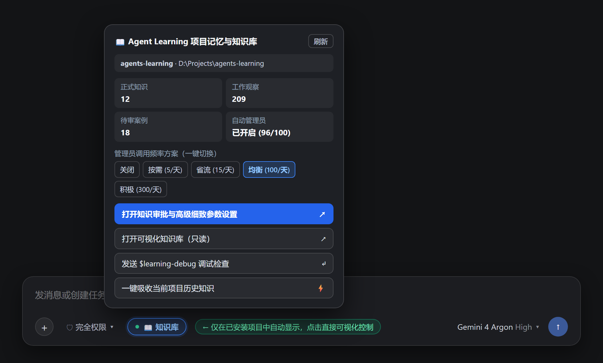
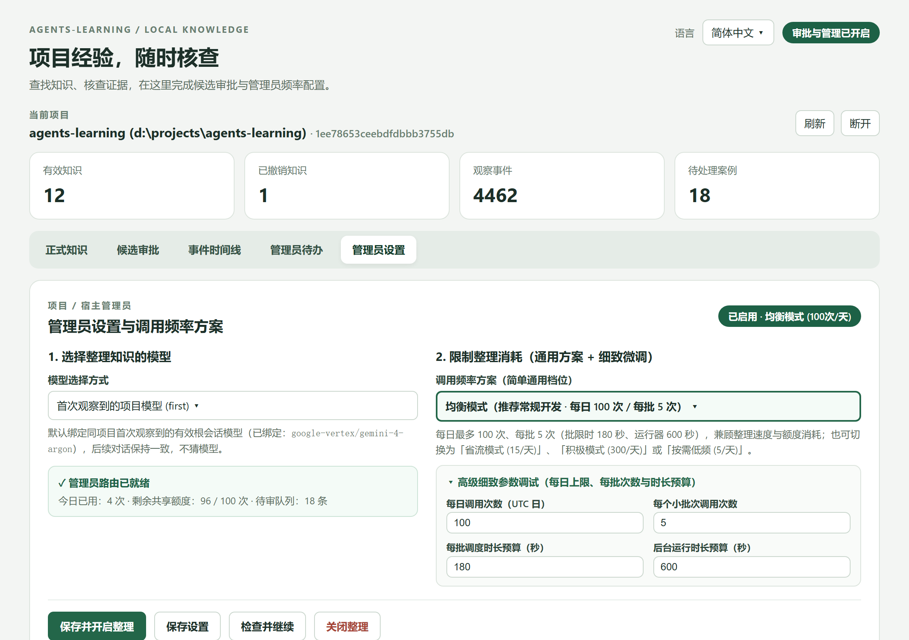
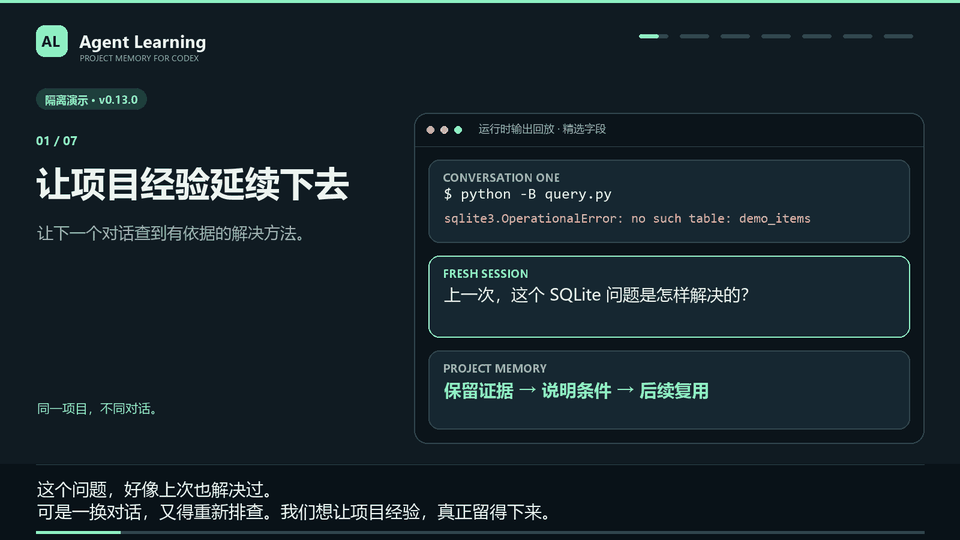
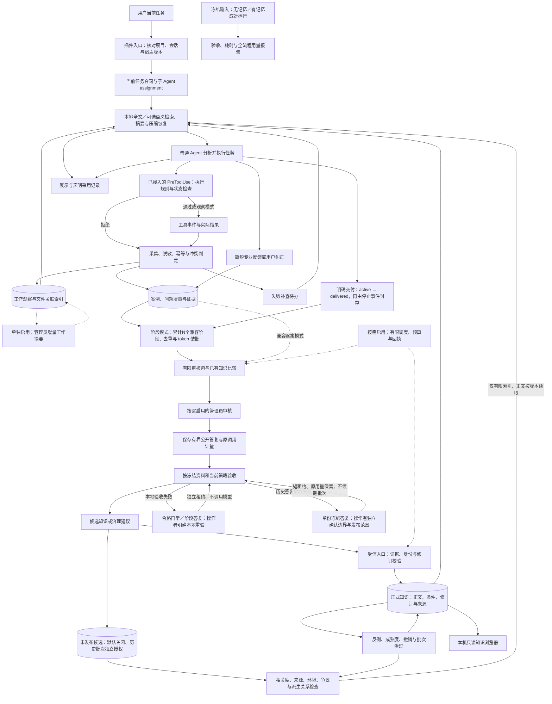
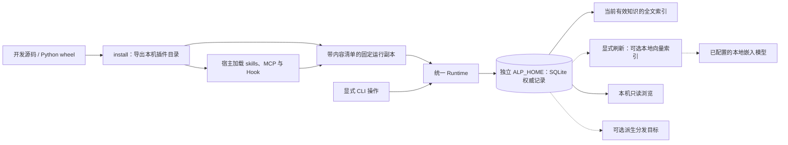

# agents-learning

[简体中文](README.md) | [English](https://github.com/swenbo1-web/agents-learning/blob/main/README.en.md)

[](https://github.com/swenbo1-web/agents-learning/actions/workflows/ci.yml)

**为 Codex、Antigravity 和 DSH (DeepSeek Harness) 提供项目记忆与可视化知识库。**

在受支持事件中记录工具结果和公开工作说明，自动检索相关知识、注入有限摘要，让 Agent 在新对话中继续利用项目经验。需要时再启用管理员整理；你可以在本机浏览器中查看正式知识、来源、修订和审核待办。

**以下使用 `main` 的 v1.4.15 源码版本；原 v1.0.0 发行包不含全部新功能。共用知识库的 Codex、Antigravity、DSH 应一起更新再重新加载，以保持相同的检索和来源检查行为。已有安装先看[版本与共库升级](#当前版本与兼容)。**

[核心能力](#核心能力) · [可视化控制](#可视化控制与知识库按键) · [84 秒演示](#84-秒演示) · [Codex 安装](#在-codex-中安装桌面端与-cli) · [Antigravity 安装](#在-antigravity-中安装原生插件) · [DSH 安装](#在-dsh-中安装deepseek-harness) · [完整架构](#完整架构)

Python **3.10+** · 本地 SQLite · [MIT](LICENSE) · [正式版 v1.0.0](https://github.com/swenbo1-web/agents-learning/releases/tag/v1.0.0)

## 核心能力

| 功能 | 可以做什么 |
|---|---|
| **项目记忆与文件历史** | 跨对话查阅公开需求、分析、工作尝试与文件关联；长公开回复分段保存，保留来源、部分输出与截断标记，不需要先批准成正式知识 |
| **自动记录与错误补查** | 记录可观察的工具结果和公开说明；遇错后在受支持事件中补查经验 |
| **候选参考（可选）** | 项目明确开启后，来源有效且相关的未发布候选最多补充一条索引；拒绝、争议、过时来源停止自动参考，历史批次独立授权 |
| **检索、注入与渐进读取** | 本地全文检索，可选语义混合检索；自动提供有限摘要，Agent 按适用条件判断，再按需读取正文与证据 |
| **直接可视化控制与知识库** | DSH 聊天框按键、Codex 对话控制卡、Antigravity App 侧边面板；按安装项目提供状态、管理员档位与历史归档入口，详细知识及批量审批使用共用本机 WebUI |
| **已有项目历史吸收** | 用户主动导入项目文档、源码和选定的对话历史，保留来源与覆盖报告 |
| **可选管理员与阶段审核** | 用户开启后，每完成1～20个任务／阶段集中整理；按项目 token 预算限制输入和输出预留，保留逐项证据及部分覆盖进度；明确的纯插件状态检查本地暂存，减少单独调用；已有逐案模式和次数预设继续兼容 |
| **知识维护与审核** | 保存适用条件、限制和证据；可用 `learning-review` 打开审批台，支持反例反馈、修订、晋升与撤销 |
| **任务保护与效果评估** | 可选执行范围保护；管理上下文和审核预算，对照评估有／无记忆任务 |
| **共享与安装维护** | 同机、同数据目录、同项目共享知识，切换登录账户保留项目知识；按宿主分别安装，保留配置升级，可选 GitHub 更新提醒 |

**默认工作记录与全文检索由本地程序执行，不额外调用生成模型；被宿主纳入模型输入的知识仍占上下文和输入 token。** 管理员、AI 摘要、语义模型、后台调度和更新检查默认关闭。未配置项目首次在界面确认开启管理员时，默认采用阶段审核及分级自动发布；已有明确设置和逐案审核模式保留。阶段审核可调整频率、token 预算与发布范围。历史吸收需用户主动启动并独立授权；安装与升级不自动开启管理员。跨设备知识同步尚未提供，实际消耗与收益需对照评估。

## 问题检索与压缩交接分开调度（1.4.15）

- **长输入继续核对问题身份**：提示过长或关键标识超限、无法完整核对时，仍停止正式知识与候选的自动问题召回，不通过截取少量关键词绕过身份保护；按需手动查询保持可用。
- **真实压缩单独恢复背景**：真实压缩后，即使问题召回暂不安全，也可检查最多20条交接候选，仅选择最多一条同项目、checkout、会话、Agent、明确任务修订与 assignment 的健康完整公开交接索引；不会扩大这些边界。没有明确任务时不猜测，普通 Antigravity 临时上下文不作为压缩。
- **在原预算内排优先级**：风险提醒和正式知识优先，候选仍使用原补充池。问题查询安全且有明确工作匹配时，最相关记录优先；可用工作位置多于一个时，再为最多一条当前交接预留位置，然后补普通记录。只有一个位置时优先相关记录，无匹配才尝试交接；问题查询不安全时只尝试交接，不补问题匹配。正式知识或候选可能用满预算，不保证交接发出。交接卡使用 `task_handoff` 标识，明确是当前任务背景，不是已验证解法或执行许可；公开陈述仍保留 `reported` 等级。
- **不增加模型调用**：沿用原有600字符补充池和默认2400字符总预算，继续去重、最终来源复核与文件状态检查，不扩大管理员、候选参考或自动发布的默认开关。当前变更不代表真实宿主验收或 token 收益结论。

## 自动工作历史选材与阶段恢复（1.4.14）

- **减少低信息注入**：结构明确、只有路径／字数／哈希及成功标记的写入回执继续保存在工作历史中，但不作为新自动参考；手动搜索仍可查看。相同相关度下优先公开约束、阶段说明与验证观察，有界补查避免回执拥塞。
- **恢复当前阶段**：真实压缩后，可在当前匹配及风险提醒之后补充同一 checkout、会话、Agent、任务修订与 assignment 的完整公开交接索引。普通 Antigravity 临时上下文不视作压缩；公开陈述仍是 reported，不升级为已验证知识。
- **保留正确提醒**：旧版已经展示的回执，其来源或已展示文件发生变化时仍会提醒；完整输出后才登记展示。短“确认／确定／同意”承接当前查询，旧确认词污染退回任务目标，带领域内容的提示仍重新检索。
- **摘要仍有边界**：按查询选择已有原文片段，工具观察明确标记投影截断；完整正文按版本读取。现有600／2400字符预算与来源治理保持有效，不新增生成模型调用。

## 候选参考与审核答复恢复（1.3.0）

- **提前使用线索**：打开“审批与设置 → 管理员设置 → 未发布候选参考”，确认开启。此开关按项目共享、默认关闭，与管理员模型和自动发布设置独立；不开启管理员也能复用已有合格候选。历史卡片上的“允许本批候选参考”只授权该冻结批次，不扫描或整理新资料。
- **有限注入**：正式知识优先。候选每次最多一张400字符索引卡，与工作历史共享原有600字符补充池，全部仍受默认2400字符总预算约束。索引标明未发布、证据等级和按需读取；需要正文时普通Agent使用 `candidate_reference_read`，固定候选与来源版本分页。索引读取不新增生成模型调用，被宿主纳入输入的内容仍消耗token。
- **来源保护**：仅成功保存的待发布候选进入资格检查。用户暂缓、拒绝、缺失或冲突来源、案例修订变化、文件元数据变化、明确不兼容环境及关联撤销／反例均暂停旧正文；已发布候选只映射正式知识，不从候选通道复活。文件检查采用现有size／mtime记录，不声称已校验完整内容或识别所有语义矛盾。
- **纠错与失效提醒**：Agent可用 `candidate_reference_feedback` 对实际展示的版本提出reported疑问，暂停参考；操作者在候选详情中核对并说明原因后处理疑问，再按来源重新判断。拒绝、暂缓、来源变化、发布或撤回参考权限会在后续受支持事件提醒已展示会话；这不保证模型已阅读，也无法抹去此前上下文。
- **防止循环自证**：公开回复保留同任务中可能受候选影响的关联，它不表示确实采用。候选复述不能单独充当自动发布的独立来源；新的工具观察仍需与目标结论相关。同源重复不增加独立验证数量。明确风险来源的工作摘要也暂停自动注入，原始记录保留。
- **审核失败可本地重验**：新版在验收前保存有界、脱敏的公开结构化答复，保留具体拒绝码；不保存模型内部思考或完整运行日志。符合条件的日常／阶段审核可在失败卡点“重新验收已保存答复（不调用模型）”。历史批次使用独立的“验收本批已保存答复”入口，明确授权指定输出；具体权限见下节。验收可能按既有且当前有效的授权发布合格内容，原失败调用、用量和重试锁保留。显式“允许一次重试”仍表示可能重新调用模型。旧版本已清理或缺少必要冻结快照的答复无法据此恢复。

三种宿主共用上述核心；Codex／DSH持续上下文内去重，Antigravity临时消息按其轮次重呈现，压缩恢复重新核对。候选投影查询故障只跳过这一可选通道，身份或任务边界异常仍保留拒绝。升级不自动开启此功能、不重新审核旧案例。

### 流程修复与效率（1.3.1）

- 本地重验成功后，调度及界面按有效验收回执判断；原失败尝试、token和执行耗时仍保留，另显示本地恢复数量。已经验收的调用不能再次打开模型重试资格。
- 旧缺证阶段使用有界轮转；同一轮的比较资料只读取一次。候选来源图复用已检查节点并限制整次工作量，超限暂停该参考通道。
- 已展示候选的文件／环境变化进入持久提醒，小预算未送达时保留；关闭工作历史不关闭来源关联。明确反例的驳回需额外健康观察，失败、运行中或被拒绝的工具不能作为唯一支持。
- 新建发布不能用等价条目绕过撤销、旧修订或未处置疑问；人工批准与自动发布在底层使用相同的来源治理屏障。显式修订、恢复及反例处理保留各自入口。

这些检查控制已知流程边界，不能证明任意自然语言知识正确；实际模型耗时、token节省与任务收益仍需真实任务对照，离线回归不代替宿主验收。

### 历史保存答复恢复（1.4.0）

打开 **审批与设置 → 管理员设置 → 失败审核记录**，选择可用记录的 **验收本批已保存答复（不调用模型）**，填写原因并确认：

1. **限定一份输出**：核对调用、冻结批次、资料版本和公开答复指纹；独立短租约完成本地验收，不扫描资料、不启动模型、不续跑历史整理。
2. **明确处理边界变化**：主动暂停、取消、暂存或账户／治理边界变化需要额外确认。仍在运行的批次不可抢占；来源或比较依据已变化时拒绝复用旧答复，确认不能替代新证据。
3. **结果访问单独保存**：验收生成的准确候选可查看、分批批准；权限绑定候选正文与来源，不给同案例其他候选或模型调用提供权限。再次暂停、取消或边界变化会使旧访问失效，在最近审核记录中可以明确重新确认这份结果的访问，无需再次提取或调用模型。
4. **发布范围不自动扩大**：默认只保存验收结果。只有原调用已获本批带来源参考的自动发布授权、当前发布策略仍匹配，且本次另外确认，才尝试发布合格参考；否则使用候选审批入口。历史来源仍是`reported`，候选注入参考开关另行管理。
5. **回执与计量保留**：重复请求返回原回执，失败验收整体回滚。原模型调用、已记录token、批次预算与重试锁不被改写；没有保存输出或必要快照时显示明确原因，不自动重跑模型。

1.4.0 的离线流程回归（Python 3.10）共2050项：2047通过、3项平台条件跳过，零失败／错误，耗时574.443秒；Python 3.14另有51项专项通过。三宿主隔离导出的安装完整性、模拟Hook、MCP和可视化资源检查通过。测试未启用真实宿主或调用付费模型，不能代替真实任务的效率与质量评估。

### 纯状态检查本地暂存（1.4.1）

- 阶段模式使用本地规则识别明确的 Agent Learning 连接／状态查询，且公开答复仅包含例行状态时，保留原证据并标记“本地暂存，仍有未审核资料”，不单独启动管理员。部分资料已合批审核时，仅余下资料暂存，不算整个阶段审核完成；已有明确补证回执继续显示补证状态。
- 正常阶段优先送审；同执行器的暂存资料仅在剩余预算中有界合批，不挤占正常资料。没有正常可审资料时不会只为状态流水调用模型，阶段频率及 token 上限保持用户设置。
- 管理员设置及三宿主面板单列暂存数量；在管理员页点“检查并继续整理”可主动补审，仍受身份、未知调用锁和预算约束。查看状态本身不排队或调用模型。
- 修复、专业结论、新项目事实、独立案例、反例、异常工具、未知操作或来源截断继续常规审核；后补案例和来源变化会重新判定。纯“继续核对”不能独立证明是状态查询，升级安装等混合阶段也不会据此跳过。

本地判定不调用生成模型；后续合批或主动补审仍可能消耗平台 token。实际节省取决于任务组成，离线模拟不代表真实收益比例。

本版隔离验收：Python 3.10 的审核／发布／恢复流程888项全部通过（235.854秒），Python 3.14 兼容专项140项全部通过（39.119秒），共1028项，无失败或错误；其中含21项本地暂存流程回归。三宿主导出的安装、模拟Hook、MCP与可视化资源验收通过（14.875秒）。未更新现用安装、启用真实宿主或为测试调用付费模型；这些结果不代表真实模型延迟或节省比例。

### 审核发布与恢复修复（1.4.2）

- **公开陈述与工具结果分开**：三宿主的可观察公开文本统一记为 `reported`，完整的旧原生公开文本可在来源检查时兼容读取；不改写历史记录，也不把陈述提升为验证结论。截断、部分输出或身份不明的来源不会因此获得自动发布资格。
- **来源风险贯穿发布与注入**：上游候选被拒绝、暂缓、质疑或失效时，仅依赖其转述的下游候选需要复核，人工批准也不能绕过。已发布的依赖知识保留正文与审计记录，但标记来源冲突、停止自动注入，并向已展示会话排队提醒；新的独立证据仍按实际来源判断。
- **阶段失败可本地恢复**：原始 Stop 与任务交付版本进入有界恢复队列，封存失败后按原边界恢复，不借用后续任务。已完成阶段补证、审核执行中新增案例会进入增量队列；原批仍依据冻结证据验收，已处理修订不重复送审。
- **调度与界面更明确**：调度写入口有界准备新增资料；等待执行器的未启动批次不阻塞其他可用模型。未知调用锁、预算与历史批次授权保持有效。页面分别展示本地封存待恢复、执行器等待和单条候选数；只读刷新不启动审核。
- **DSH 重置隔离旧回调**：原生桥实例使用轨迹代次握手，重置后允许安全复用轮次与工具 ID。明确重置后需重新加载原生桥，以新实例完成 `SessionStart`；缺少代次的旧生产者只兼容初始轨迹，迟到旧回调不会写入新轨迹。

本次本地恢复、来源治理和去重不新增模型调用。迁移保留调用、用量和发布记录，不自动开启管理员、重跑旧审核或授予历史发布权限。共库宿主需一起升级至 schema 25 兼容版本。

1.4.2 隔离验收：Python 3.10 的146个流程测试模块共2,133项，2,130项通过、3项平台相关跳过，耗时623.060秒；Python 3.14另有75项针对性回归通过。三宿主导出分别通过安装完整性、模拟 Hook、MCP 和本机可视化资源检查（合计14.339秒）；这部分覆盖安装交付，未运行全部安装／打包专项套件。测试未更新现用安装、启用真实宿主或调用付费模型，也不代表真实模型延迟与任务收益。

### 阶段相关工具证据（1.4.3）

阶段封存时，本地程序从原任务与原 Stop 时间窗中选择与公开说明有明确标识重合的工具输出，附到已有公开案例。英文技术标识、路径片段与连续四字中文片段可作为选材线索；这种关联不证明结论正确。

- 每阶段最多关联3条完整原始工具观察，总工具载荷最多6,000字符，并受当前字符与 token 准入限制；最多扫描128条近期工具记录。预算不足、部分输出及扫描上限会保留选材说明，不截取日志冒充完整证据。
- 已进入独立故障、恢复或反例案例的操作不重复关联；只有交付／工作摘要投影的记录仍可选。不同任务、会话、子 Agent、派单、宿主代次及原窗口之外的观察不借入。每个操作只选最新观察，沿用原有业务摘要去重。
- 相关工具附在原案例内，不为每次工具调用另建案例，也不追加独立模型请求。更多可见证据可能增加输入 token 或影响原有批次拆分；不保证实际总消耗下降。可选选材失败不阻塞原公开案例，原工作历史仍可查阅。
- `unknown`、`call_completed`、明确成功及来源健康保持原值；管理员只能引用真实案例事件。选材回执不是候选来源，不能把命令输入当输出、把完成当成功，或放宽自动发布。
- 管理员批次详情显示“已关联工具观察”及选材受限提示；“所选案例覆盖完成”不表示所有工具日志都已审核。原阶段交付身份与工具执行时的历史任务状态分别保留。

Codex、DSH 在宿主提供实际工具输出时可参与匹配；Antigravity 当前适配器主要提供完成／错误状态，缺少可观察输出时不会猜测补全。仅影响新版封存的阶段，不自动回填旧案例、重跑已收费审核或续做历史批次。数据库 schema／内部协议保持25，审核资料格式更新为7。

隔离流程回归：Python 3.10 的60个相关审核、发布、来源治理和调度模块共807项全部通过，耗时204.027秒。收尾补齐20阶段窄预算保护后，Python 3.10 的26项工具证据专项、Python 3.14 的75项阶段／预算／资料包／界面专项再次通过。最终三宿主导出通过安装完整性、模拟 Hook、MCP 与本机可视化资源检查（12.507秒）。小型6工具对照中，最多关联3条观察，仍保持1个案例，本地选材平均约9.6毫秒；输入估算随证据增加约777 token，属于本地估算，不是平台用量回执或节省结论。验收未更新现用安装或调用真实模型，实际知识质量与审核收益仍需新版真实任务对照。

### 检索、去重与审核兼容修复（1.4.4）

- **审核查询兼容活动游标**：正式知识及管理员比较资料通过本地全文索引有界召回，再按当前问题评分，不在每次查询时替换 SQLite 函数。准确技术标识有独立召回通道，最多读取128条候选，只展开有限来源。
- **更合理的自动参考**：准确错误码或文件标识可避免被长问句稀释；缺少所问技术标识时，普通界面短语不能替代命中。背景计数与并列版本不自动变成必需条件。正式知识、可选语义检索和管理员比较沿用相同的本地判断；旧检索缓存与策略签名隔离。
- **压缩后重核相关度**：按当前有效问题重新检索，不再仅凭过去展示过就恢复旧知识。没有合格命中时保留空结果；完整展示与来源失效追踪仍保留。
- **长期精确去重**：不再因同标题候选超过32条而阻断合并。按完整业务字段及元数据检查真正的等价风险，保留全部来源；暂缓、拒绝和未解决疑问不能被后续正常记录掩盖。同标题不同内容仍需比较，这不是任意语义改写自动合并。
- **阶段顺序更明确**：新窗口保留本地顺序标记，结合原任务写版本和原 Stop 边界选择资料；时间戳相同也不能借入暂停前或后续阶段的证据。旧窗口使用原任务历史兼容核对，不改写旧事件。

数据库 schema／内部协议仍为25；发布等级、项目开关、历史批次权限及宿主信任要求保持有效。升级不自动开启未发布候选参考，不回填旧审核或增加模型调用。

本次完整离线初检覆盖2,326项，发现的耦合问题已修复。最终副本在 Python 3.10／3.14 各通过179项受影响流程复验，包含初检全部失败用例；三宿主隔离安装、模拟 Hook、MCP 与可视化资源验收通过（13.188秒）。跨平台全量结果以页首 CI 为准，未为测试调用真实模型；这些结果不代表任意任务的检索完整率或净 token 收益。

### 来源累积与极端查询修复（1.4.5）

- **来源多不等于异常**：移除普通正式来源超过64条就使依赖知识失效的判断。使用本地查询核对实际缺失、冲突、拒绝和来源修订；只有真正存在候选依赖的分支消耗血缘图预算。保留全部来源与原证据等级，不删除异常记录、不把历史陈述升级为验证结论。
- **异常记录不挤占首批结果**：自动检索在有界扫描中补取后续候选，跳过不相关或来源不合格项。个别正文／来源JSON损坏时跳过并计数，保留原记录供明确检查；数据库查询中断仍独立报错。耗尽扫描范围时返回范围说明，不把检索范围不足说成模型额度耗尽，也不放开有风险的知识。
- **长问题保留关键身份**：查询裁剪与词元上限不能让错误码或路径门槛悄悄消失。无法完整核对时停止自动注入，仍可手动查阅；续聊、压缩恢复与候选参考沿用同一判断。Windows 路径统一斜杠表达，正式全文索引升至5并自动重建派生投影。
- **审批可恢复**：同标题变体较多时，健康的精确重复仍可合并到现行知识；明确更新目标及拒绝无关变体后可重新核对。原有反例、争议、来源、修订与历史批次授权检查继续有效。
- **语义服务有总时限**：可选本机嵌入请求限制整个请求的耗时，慢速持续返回也能超时并回退本地检索，不另开后台请求或生成模型调用。

数据库 schema／发布协议仍为25，工作历史与可选语义索引仍为1。共库运行端应一起更新，避免新旧程序反复重建不同版本的全文投影；升级不重跑管理员、不删除历史知识、不改变项目发布策略。

本版最终隔离验证覆盖 Python 3.10 的791项检查：790项通过，1项因 Windows 符号链接权限跳过。首轮的一条旧断言仍允许160个标识自动注入，按新版超限需手动查阅的契约更新后，该模块8项复验通过；生产代码未因此改变。Python 3.14另有168项联合检查全部通过。三个宿主的安装完整性、模拟 Hook、MCP 与可视化资源验收通过（13.877秒），模拟数据库 quick_check 正常、外键异常为0。验收没有调用真实模型或更新现用安装；这些结果不代表真实任务收益或所有来源规模下的固定延迟。

### Antigravity 调用窗口诊断与限定兼容（1.4.13）

- **明确 Pre 覆盖缺口**：`PreInvocation` 公开记录恢复失败时保存有界的覆盖原因供诊断；最新 Pre 尚未建立窗口时保留未知，不借用较旧完整 Stop 宣称当前调用已覆盖。状态刷新不重读 transcript，也不调用模型。
- **只兼容已识别的系统临时步**：用户输入之后、当前调用边界附近，仅允许 `source=SYSTEM_SDK`、`type=EPHEMERAL_MESSAGE`、`status=DONE` 的系统临时步骤；新用户、模型或工具步骤不适用，项目、任务、轨迹及调用配对检查保留。公开回复仍不是任务交付或管理员派发。
- **实际恢复待验证**：此前真实检查的工具与 MCP 回执正常，但公开 Pre 窗口未建立；本次补齐诊断与限定兼容，不把尚未实证的原因写成确定根因，也不宣称公开回复采集已恢复。下一次自然工作回合再核对，无需为此重复调用模型。
- **减少面板对升级的占用**：面板子进程使用已校验的项目目录作为工作目录，避免在 Windows 下长期占住待替换的插件目录。旧面板发现安装变化后仍需重新连接，不重放之前的操作。

数据库 schema／内部协议仍为25，索引仍为5／1／1；不回填旧 Stop、不改变管理员或发布策略。

### Antigravity 公开记录与健康诊断（1.4.12）

- **有界补齐公开记录**：仅从原生 Hook 提供的 `transcriptPath` 读取已识别的公开 `prompt/content` 字段，并核对匹配的 `PreInvocation`／`PostInvocation`、项目、会话、轨迹与任务边界；不扫描账户历史，不保存 thinking、工具载荷或未知文本。多根工作区、未知格式或身份不符时保留覆盖未知。
- **回复与交付分别记录**：本次公开回复以 `reported`／部分完成的工作历史提供检索；`PostInvocation` 不制造 `Stop`、任务交付、阶段或管理员派发，也不回填或重放旧 Stop。完整阶段仍需有效任务交付和受支持的真实停止证据。
- **状态表达实际范围**：面板的 `project_recent_capture` 是项目近期采集观察，不表示当前聊天或同一轮已完整覆盖。刷新只查看已存回执，不重读 transcript、不调用模型；Antigravity 自动阶段审核完整链路仍需真实验收。
- **管理员独立入口**：仅使用独立 `agy` CLI。Windows 默认命令先查 PATH，缺失时检查官方 `%LOCALAPPDATA%\agy\bin\agy.exe`；显式命令保持原选择，不以 App、IDE 或 `agentapi` 替代。分别显示启动器、已有协议检查与未核验的认证／模型能力；不自动安装、登录或开启管理员。

数据库 schema／内部发布协议仍为25，索引仍为5／1／1，已有知识、权限及用量保留。原生规则见[官方 Hooks 文档](https://antigravity.google/docs/hooks)，独立审核入口见[官方 Headless 文档](https://antigravity.google/docs/cli/headless/)。

### DSH 工具契约与记录一致性（1.4.11）

- 原生工具桥与 Python 入口按实际工具参数定义补充会话句柄；`learning_status` 等项目级工具保持空参数，不再因自动添加 `context_handle` 而失败。明确传入的错误句柄或未知参数继续报错。
- 工具前置检查、执行与完成记录复用该调用已核对的会话参数，避免前置自动补参、完成记录缺参而制造输入冲突。真正的参数变化仍会标记冲突；成功的兼容恢复也记录完成结果。
- 数据库 schema／协议与既有设置不变。DSH 更新后需重新加载宿主桥；状态工具连通、原聊天绑定、实际文件读取和管理员运行状态分别核对，不以其中一项代替全链路验收。

### DSH 会话握手恢复（1.4.10）

- 宿主丢失首次握手返回、恢复旧聊天或工具先于启动事件到达时，使用同一桥实例取回轨迹令牌。并发请求共用一次恢复，成功后的正常调用不重复握手。
- 恢复握手只核对项目、父子 Agent、宿主代次与轨迹身份，不检索知识、不交付阶段、不触发管理员。知识注入与采集仍由随后正常事件执行；失败会给出提示，用户消息可以重试。
- 已持有的旧令牌不会自动清除或重绑；账户代次变化、明确会话重置及跨项目身份仍拒绝。恢复失败仍阻止无法核对身份的工具执行，不对 shell 或插件工具扩大豁免。
- DSH 需更新安装并重新加载插件／宿主桥。数据库 schema、索引和内部协议不变，与兼容 schema25 的其他宿主共库安装保持兼容；更新不会重跑历史审核或更改管理员与发布设置。

### 跨聊天事件隔离与标识检索优化（1.4.9）

- Antigravity 的原生事件和公开记录按聊天区分，避免不同聊天使用相同执行序号或公开文本时碰撞。旧完整回执仍按原身份复用，不重放已完成副作用；旧待定记录只在能证明跨聊天碰撞、原停止事务未落地且任务边界仍有效时恢复，不把不确定工具结果当作未执行。恢复仅留存宿主本次提供的公开内容，不能还原丢失原文。
- 自动查询带有必需技术标识时，沿完整标识通道有界补召回，不再为凑结果数扫描只有通用词的条目。保留同标识异常来源的后续补查、真正扫描上限和来源保护；手动宽检索及可选语义融合继续可用，缓存策略独立换代。
- 平台与版本使用任务明确的筛选和可识别的项目资料；本机操作系统不等于任务目标环境。未明确目标时，参考知识仍需核对适用条件，不能据此保证任意自然语言问题都零误注入。

数据库 schema、索引与内部协议保持不变。升级不自动清除失败／未知调用锁、不重跑历史审核、不改变发布授权。真实任务的净 token 收益与质量提升仍需独立对照评估。

### 读取失效与重读分页修复（1.4.8）

- `work_memory_read` 对已记录的文件关联增加独立的有界状态核验，最多64条关联；返回的 `file_check.complete/version` 与阅读回执绑定。未展示的第4条及后续关联文件变化也会重新返回正文。核验超限、跨 checkout、缺少工作区或无法读取元数据时仍返回正文，并停止复用旧回执。文件缺失与权限未知分别表达；核验仍是 size／mtime 元数据观察，不是文件内容校验。
- `reread=true` 开启当前 section 的新一轮重读；正常续页只需原 `section`、`expected_revision` 和 `next_offset`，无需每页重复标记。每页仍传该标记也兼容；从中间开始的新轮不能借用前轮覆盖，缺段不视为完整阅读。三宿主的学习技能同步此约定。
- 多文件记录在1024字符预算下优先保留身份、来源状态、风险提示及完整文件核验指纹，文件／来源预览可缩短并标明省略数量；缩短预览不会改变已读指纹。字符预算不等于精确 token 上限。
- 全关联核验仅用于按需读取，不扩大默认检索／注入的文件扫描。只读回执不证明模型已阅读，也不提供任务权限。数据库 schema、索引及发布协议不变。
- 语义截止测试将正常请求预算与故意慢响应分开，并用确定性时钟验证共享绝对截止及连接释放。生产超时配置保持原值。

管理员输入已做合成分解：Codex 指令与输出 schema 没有重复发送，阶段任务和比较资料的现有无损共享保留。单案例约1.3万输入 token 的真实观察不能归因于某一字段；本次未删减审核证据或更改模型、频率及发布策略，也未声称实际 token 降幅。后续有界合批对照需要真实任务数据。

本版最终隔离验证：Python 3.10 共285项检查，284项通过、1项因 Windows 符号链接权限跳过；Python 3.14 的188项全部通过。三宿主安装、MCP、模拟 Hook 和可视化资源验收通过（16.047秒）。未调用真实模型、更新现用安装或重跑历史批次；远端 CI 结果须在后续推送后确认。

### 安装维护与工作历史复用（1.4.7）

- **相同安装无需重复覆盖**：导出内容、解释器、项目绑定和额外文件均一致时返回 `unchanged`，不新增备份，也不要求重新加载或审阅相同 Hook。真正升级仍遵守宿主信任要求。
- **备份移出插件目录**：新旧目录在同卷切换，完整旧副本保存在插件发现目录之外；旧备份需预览固定清单后显式迁移，保留原文件，不自动删除。Codex 与 Antigravity 的「检查接入」显示最多20条轻量目录预览，未核验内容不视为可恢复或可删除。
- **工作历史按需展开**：索引相关但不足时再读取正文；同一连接、可信上下文内已完整返回且未变的 section 给出短回执，需要重新呈现时传 `reread=true`。分页缺段、来源／文件状态变化、压缩、新连接及任务变化均不会沿用旧回执；Antigravity 仅同一有效 invocation 内复用。这不是模型已经阅读或记住内容的证明。
- **摘要采用平衡策略**：`summary_strategy=balanced` 下，纯用户请求与公开说明直接保留可检索原文，不为重新概括而新增模型调用；文件变化、失败、验证、用户更正等增量保留整理入口。`all_windows` 可明确保留原窗口策略。AI 摘要仍默认关闭，管理员开关、模型与发布范围不会被安装器开启；阶段模式优先阶段审核。

数据库 schema、索引与发布协议均不变。新外置安装备份不进入项目历史吸收。上述节省来自本地筛选与避免重复返回；真实任务的 token 与质量收益仍需实测。

本次联合隔离回归：Python 3.10 的404项检查中402项通过、2项因 Windows 符号链接权限跳过；Python 3.14 的87项全部通过。安装专项100项（98通过、2项权限条件跳过）及最新19项补验（18通过、1项权限条件跳过）无失败。三宿主安装、MCP、模拟 Hook 和界面资源验收通过（15.547秒），未调用真实模型。模拟的12,540字符公开交付在原窗口策略中产生6次摘要请求，平衡策略为0次；加入文件变化后为1次，原始记录均保留。这是隔离假模型的请求数对照，不是实测 token 节省率。

### 审核输入与自适应预算（1.4.6）

- **按完整请求装批**：阶段审核按实际外层、案例、诊断与输出 schema 核对预算，移除固定扣减和虚拟空格。小案例可使用较小字符上限；长中文、转义文本和多阶段资料仍逐包核对，不通过放大用户预算强行送审。
- **减少重复输入**：只对完全相同的任务和比较资料使用无损共享表示；有保留键冲突或节省不足时使用原文。原冻结资料、事件、反例、来源与修订保持完整，验收仍核对原始快照。
- **缩短输出格式说明**：阶段外层只允许空候选与空治理提议，逐案结果仍保留全部格式和验收规则。Codex、Antigravity、DSH 使用相同契约。
- **回退不丢案例**：最终超限移出的案例及失去依据的重复项不登记为已送审，保留后续扫描入口；空批不触发模型。复用、未知调用预留、历史批次授权与发布策略继续独立核对。

字符上限、每日额度、输出预留和宿主保守预留保持用户设置；逐案旧模式的固定预留保持兼容。预算估计使用实际 schema 字节并明确标为估算，不冒充平台报告用量。合成短案例的可见正文加 schema 从约10.3KB降至8.5KB；这是输入体积对照，不是实测 token、审核耗时或真实任务收益。升级不重跑历史收费审核，不自动开启管理员或发布。

## 可视化控制与知识库按键

不需要记复杂的后台命令，插件在宿主与本机浏览器中提供直观的可视化控制入口：

| 控制方式 | 适用宿主与入口位置 | 可直接执行的可视化操作 |
|---|---|---|
| **聊天框「📖 知识库」实体按键** | **DSH（DeepSeek Harness）**：仅在已安装绑定的项目聊天框左下角工具栏自动显示，未接入的其他项目自动隐藏 | 查看项目、正式知识、工作观察及待办；打开管理员设置调整阶段频率和 token 预算，或使用兼容逐案模式的次数预设；打开知识审批、只读浏览或历史归档 |
| **Codex 直接控制台与卡片** | **Codex**：完成 `codex-connect` 后，在支持 MCP Apps 的桌面端从对话右侧内容区的“新建标签页”菜单打开 **Agent Learning**；也可直接运行项目控制台。技能 `$learning-panel` 作为兼容入口 | 菜单名称由宿主全局发现，只有已安装并接线的当前项目显示控制按钮。打开、调试和重新连接无需发送聊天消息；确认后设置管理员频率或归档历史。当前没有输入框旁的常驻自定义按键 |
| **对话侧边控制面板** | **支持 UI Extension 的 Antigravity App 2.22+**：完成下方全局 UI 桥登记并启用后，在当前项目会话 **⋮ → Extensions → Agent Learning** 打开 | Sidecar 按钮直接检查接入并提供相同操作；仅连接明确登记的项目安装，未登记项目、多工作区或失效会话不提供可执行内容 |
| **本机可视化 WebUI 控制中心** | **Codex / Antigravity / DSH 共用**（仅监听 `127.0.0.1`，支持简体中文／English 离线切换） | 查看项目名称／路径、正式知识、候选、事件及管理员；按阶段频率、项目每日 token、每批输入和输出预留设置审核，查看覆盖进度；支持批量批准／拒绝／暂缓，兼容旧逐案次数预设 |

**控制按钮与知识按安装项目限制，知识库里已有项目记录不等于安装。** Codex 的 Agent Learning 菜单名称可以全局可见；`codex-connect` 分别接线全局只读入口和当前项目连接，未接入项目只显示安装提示，不展示其他项目的知识或操作。Antigravity 的核心插件保留在项目内，全局 UI 桥只保存用户明确登记的安装位置及指纹，不加载第二套 Hooks、MCP 或知识库。换号、卸载或安装变化会使旧面板失效。普通连接到期后可在界面点击“重新连接”，不重放之前的设置或归档操作。

Codex 侧栏和项目 Actions 直接运行本地界面，不启动模型回合、不自动发送聊天消息或写入模型上下文；直接 UI 的结果仅返回界面。技能启动仍经过模型工具调用。项目控制台不继承任务执行权限，当前 Hook 绑定未核实时显示未知。开启管理员会使用平台额度；**项目 token 预算由同项目的三个宿主合并计账，阶段频率及模型按项目／宿主分别设置**。在 Codex 开启不会同时开启 DSH 或 Antigravity。阶段模式使用详细设置中的阶段和 token 字段；旧次数预设适用于兼容逐案模式，刷新显示已保存设置，变更仍需确认。同一 `ALP_HOME` 的全局总保护继续限制新调用。**历史按钮仅归档默认项目资料，不调用模型、不生成或发布知识**；界面分别显示归档与后续审核。详细审批使用共用本机网页。

面板通过隔离回归、实际固定运行副本和 Edge 模拟宿主桥检查；Codex 宿主目录发现、双项目路由及跨项目拒绝另由实际 App Server 验证，未启动模型回合。真实 Codex／Antigravity 桌面菜单与渲染仍需宿主验收。更新安装后重载连接，旧页面需重新打开。

### 1. 聊天框「📖 知识库」实体按键与快捷控制面板（DSH）



### 2. 本机可视化知识库、候选审批与管理员频率方案（三平台共用）



图中为兼容次数预设示意；1.2.0新增的阶段／token设置见下方说明及实际管理员页面。

### 审核内容、分级发布与错误知识处置（1.1.13）

从控制台点 **审批与设置 → 管理员设置**，三种宿主使用同一本机页面：

1. **审核内容与发布去向**：查看正在进行、最近审核、接下来可审和本地待补证的案例；每项展示来源、审核用途、证据、候选摘要、适用条件及限制。可只读检查候选的发布条件，不调用模型。
2. **选择发布范围**：首次确认开启管理员默认使用分级发布；当前项目、当前宿主分别保存开关和范围。合格的验证操作解法自动发布；有来源的项目事实以未验证参考发布。旧策略和明确关闭设置保留，已有候选不追溯批量发布。
3. **历史归档与整理分开操作**：历史卡分别显示归档、主审、候选和发布数量。点“整理此归档批次”，确认调用与时间上限后，仅审核该批冻结资料；默认5次、180秒，可调整至最多20次、600秒。不重新扫描、不自动续跑。分级策略下可勾选“本批自动发布带来源参考”，随本次调用／时间预算一起确认；不勾选则候选仍待批准。页面关闭不取消已确认的有限后台批次；进度和请求回执保留。
4. **低价值失败先补证**：日常队列中只有原始工具失败、没有恢复结果或公开说明的案例先在本地暂缓，不计模型调用；补入相关成功或说明后重新判断。明确指定案例的人工审核保持可用。

审核卡展示的是公开记录和可观察证据，不是模型内部思考。`reported`、工具成功、候选与正式发布分别显示；工具成功不等于业务结论或用户验收。


#### 分级自动发布与错误知识保护

| 内容 | 自动处理 | 保留的证据边界 |
|---|---|---|
| 验证操作解法 | 当前健康成功证据、完整资料、无回退时发布；符合原规则的同源解法可更新 | `tool_success` 只证明引用工具成功，不等于业务正确或用户验收 |
| 有来源的项目事实 | 管理员提取后自动发布为参考 | `reported`，显示“带来源参考 · 尚未验证”，保留来源、适用范围和限制 |
| 用户主动整理的历史资料 | 对**本次冻结批次**勾选授权后，符合条件的候选自动进入参考知识 | 来源身份和内容指纹可追溯；不自动扫描、不续跑、不推断当前实现正确 |
| 争议、过时依据、被撤销内容或不完整来源 | 保留候选及阻塞原因，转人工比较 | 不自动覆盖、恢复或驳回反例；已有待批候选继续使用批量审批入口 |

发现旧知识错误时，用知识 ID、修订号及实际反例提交反馈：**标记争议 → 暂停自动注入 → 管理员比较证据并提出修订／撤销建议 → 通过明确治理入口执行 → 通知已见过旧版的会话**。原文和修订保留，恢复需明确入口。只报告“可能有误”不会自动删除知识，模型也不能自行驳回反例。未解决反例会拦截相关自动发布；相同内容去重不能绕过撤销，同名但内容不同也转人工。

发布沿用原审核调用和本地事务，不增加一次专门的发布模型调用；重复回调回放回执。运行中关闭发布或改变范围会保留审核候选，按开始时授权与当前设置共同判定。标题／来源／修订检查不能识别所有自然语言矛盾，管理员仍须比较实际资料；参考标识和适用范围不能省略。数据库仍兼容 schema／协议19，本版增加可空策略字段及派生标题索引。

1.1.1 修复历史整理中断后的明确续做入口：工作器租约过期可继续冻结资料，旧账户／治理轮次请求不阻挡当前操作；结果未知的调用仍需核对。一次审核生成的多条候选逐条显示摘要、条件、限制、证据引用及当前审批／发布状态。正常预算暂停保留已完成审核的可读结果，用户暂停、取消或账户边界变化仍按原权限检查。此补丁不改变 schema／协议 19。

1.1.2 将日常待办分为待审核、正在审核、已审核待补证、本地暂缓、等待批准、失败或未知待核对、已跳过和已完成；历史待审数量单独按文本单元显示，原数据库 `pending` 不再当作模型排队次数。三宿主快捷面板显示“待审核”，详细页面可按阶段筛选、聚合同类案例并分页查看成员。聚合保留项目、宿主、任务范围、错误文本与原始来源，仅归一化明确的传输字段，不证明同一根因，不共用验证或发布权限。聚合最多扫描筛选下前2000条，达到上限会提示，逐条视图仍可分页查看全部日常记录。

自动调度优先检查知识反例、有恢复记录或工具成功证据的案例，其次处理公开说明；失败执行器仍遵守退避。已审核待补证的同一案例，在证据、实际比较资料和显式审核上下文均未变化时，不因切换模型再次自动调用；指定案例的明确审核仍可用。新增证据、来源健康或相关知识变化会重新判断，历史批次仍需单独确认。审核规则、证据包格式、输入预算与执行提供方变化仍使复审签名失效；旧回执沿用精确匹配，不猜测旧审核策略。本次不变更 schema／协议19，不清除案例，不调整用户预算。

1.1.3 优化就地阅读与审批：点击候选或正式知识，在当前视口打开详情浮层；长正文、条件和证据仍按需分页，顶部保留关闭与审核入口。关闭后返回原列表位置，保留筛选、页码和其他已选项。单条审批结果直接显示在当前详情中，批量结果使用独立回执浮层；“查看上次审批结果”可再次打开回执，不再强制跳到页尾。支持键盘关闭；提交或加载期间阻止误关闭，网络结果未知时保留原请求回执与重试规则。此界面由三宿主共用，不调用额外模型，不改变批准或发布权限。

### 历史主审续做与增量（1.1.4）

- **重复点击先续审**：同一项目已有未结束主审时，三个宿主入口直接显示原批进度，不重新扫描、不重新归档或调用模型；需要整理时在审批页明确继续本批并确认预算。旧账户、主动暂停及未知调用保留原检查。
- **主审、补证、批准分别显示**：已审核待补证和候选待批准不会永久阻止新增量。用户可在历史卡点击“暂存本批主审”并说明原因，保留原资料和审批，再进入下一批；暂存不解除失败或未知调用的保护。
- **只排入来源增量**：前批主审结束或明确暂存后，再次归档只为新增、变化文件建立主审单元；本次选中的未变化文件仍可作为有限相关上下文，不冒充已经验证。当前增量以文件版本为单位，未实现语义相似自动合并或段落级结论继承。
- **预算遗漏可补扫**：CLI `history-prepare --mode remaining --confirm` 沿用原资料选择与上限，优先读取原先因总字节、文件数或分段上限遗漏的文件。未知格式、单文件超限和目录枚举上限仍需调整范围或上限，覆盖报告会保留；补扫不是自动模型续审。
- **统计分开读取**：管理员状态与历史进度独立加载；历史批次每页3项，可翻页和单独刷新。统计受限时显示暂不可用，保留已读结果，管理员开关和额度不因历史详情失败而消失。查询保护仍然保留。

高级 CLI：`history-prepare --mode incremental --confirm` 检测增量；`history-defer <job_id> --reason "稍后继续旧资料" --confirm` 明确暂存；`--mode full` 显式全量。所有命令按安装说明指定同一 `--home`、`--workspace` 和对应 `--host`。本版保持 schema／内部协议19，未改历史发布权限；已有安装需更新到1.1.4并重新打开页面。

### 打开可视化知识库

调用 `$learning-browser`（或在 DSH 点击「📖 知识库」按键 →「打开可视化知识库（只读）」）打开本机只读知识库，搜索正式知识并查看来源、条件、限制和修订；保持当前项目及安装时的知识目录一致。[终端启动与详细参数](#知识浏览界面)

### 可视化知识审批（main）

调用 `$learning-review`（或在 DSH 点击「📖 知识库」按键 →「打开知识审批与高级细致参数设置」）打开审批台或管理员设置。**打开页面不批准候选、不开启模型**；批准发布和保存并开启管理员分别由用户确认。新用户设置阶段频率及 token 预算；已有逐案模式可继续使用省流、均衡、积极、按需次数预设。知识及证据保留原文。[审批与管理员设置](#可选管理员执行器)

### 阶段集中审核与 token 预算（1.2.2）

从任一宿主打开 **管理员设置 → 阶段集中审核与 token 预算**：

1. 选择阶段审核，设置**每完成1～20个任务／阶段审核一次**。普通 Agent 明确将任务从 `active` 更新为 `delivered` 后，受支持的停止事件封存公开记录；回复结束、重连、重复停止及子 Agent 停止不单独算一个阶段。`delivered` 是 Agent 的交付声明，不等于用户验收。
2. 设置**项目每日 token 预算、每批预估输入上限及输出预留**。未配置项目首次在界面确认开启时默认阶段模式，每1个阶段、每日1,000,000 token、每批预估输入40,000及输出预留4,000；管理员仍须用户开启。已有设置保留原逐案 `legacy` 模式，可在界面主动切换。
3. 同项目／宿主、兼容模型与执行器的阶段合并，逐案保留来源、决定、候选和发布检查。不同模型语义分组等待，不能只看阶段总数判断能否合批；大阶段可分批，未覆盖资料保留进度；有可处理增量时，在已授权 token 和运行时间内继续小批，缺证或超限则暂停。单阶段最多扫描2000条公开来源，超出部分仍可查阅，需要拆分阶段或明确选取历史资料导入。**一次阶段触发不保证固定一次模型调用，也不表示全部材料已审核。**可明确选择立即整理尚未达到频率或部分覆盖的材料。
4. 先用业务证据、比较依赖及有效回执去重，再调用模型；重复记录不充当独立验证，不借用其他案例的成功证据。失败或结果未知保留记录及用量，核对后明确允许一次重试；不自动绕过旧锁。

1.2.2 将逻辑阶段资料起点与执行权限更新分开，保留同一阶段多轮需求及公开回复；首次启用、明确恢复、任务修订与账户边界分别处理。先于任务登记的当前需求以带原始事件引用的 `reported` 请求上下文保存，不改原事件归属或借用工具证据。旧批次回执与用量保留，不自动重跑已收费审核。

近期批次分别显示送审案例、可见证据、执行尝试、候选与自动发布数量，以及批次经过时间、调用处理耗时和宿主上报 token。调用耗时包含启动与本地校验，不能按它推算单条知识耗时；一个批次可处理多个案例、每个案例可产生多条候选。阶段较大时仍按输入和运行预算分批；只记录现有回执，不新增统计模型调用。

1.2.1 对未就绪材料按有界分页推进，避免前页缺证挡住后页可审内容；真实补证会重新唤醒部分覆盖阶段。完整扫描一轮仍无新增可审材料时暂停，不生成无限空批。主审已覆盖但仍待补证的成员保留可唤醒状态，实际证据变化后重新判断；没有变化不重复花费。

| 用量字段 | 含义 |
|---|---|
| 预估输入 | 本地按可见资料及宿主开销保守估算，用于装批和准入，不是平台实际账单 |
| 未结算预留 | 请求开始前原子预留输入与输出空间；在途、部分上报和结果未知时继续保留 |
| 已上报实际用量 | 平台回执提供的输入／输出 token，本地幂等累计；缓存输入不重复相加，未报告不当作零 |

项目每日 token 由同一知识目录中的 Codex、Antigravity、DSH 管理员及历史审核共用；启用、阶段频率和模型按项目／宿主分别保存。已有全局次数、token 和并发保护仍生效。输出预留与准入估算不是提供方硬计费上限，单次实际用量可能超出估算；界面保留差异。历史归档及主审需每批单独授权，不混入阶段计数或自动续跑。

兼容逐案模式仍提供按需5／天、省流15／天、均衡100／天、积极300／天；对应每批时限为 **150／180／300／600秒**，运行器时限为180／300／600／1200秒。阶段模式以阶段和 token 字段为主要设置，旧次数预设不替代这套预算。

1.2.0候选源码的完整离线回归发现2004项检查（零失败、零错误，7项跳过）；随后最终补丁另通过 Python 3.10 的211项及 Python 3.14 的96项定向检查。三宿主隔离导出、MCP工具与界面资源、模拟 Hook 和共用网页资源验收通过。检查未调用真实模型或修改真实知识库；实际审核耗时、token及知识收益仍须真实任务对照验证。

## 工作方式

**检索经验 → 完成任务 → 记录观察 → 按需整理与审核 → 下次复用。**

普通 Agent 专注当前任务，插件记录可观察的事件；管理员与正式知识发布分别配置。知识是参考资料，工具成功不等于用户验收。触发时序见[宿主差异](#宿主差异与证据边界)，效果通过[真实任务对照评估](#真实任务对照评估)检验。

| 日常使用路径 | 用户需要做什么 | 自动处理到哪一步 |
|---|---|---|
| 记录与复用工作历史 | 完成安装接线，在受支持宿主正常工作 | 可见记录直接进入工作历史，检索无需等待管理员或知识批准 |
| 整理可复用知识 | 首次确认启用管理员及所选发布策略 | 按项目预算小批整理；合格内容按分级策略发布，冲突或缺证才等待后续处理 |
| 吸收旧项目资料 | 主动归档，再确认本次整理预算及参考发布范围 | 只处理冻结批次；不重复扫描、不自动续跑，逐项保留回执 |

知识写入当前 SQLite 后即可检索；可选每日批次与远端同步是归档／分发能力，不是同机复用的前置步骤。管理员采用有限任务运行，不是常驻服务；等待额度、证据或用户确认与程序失败分别查看。

**1.1.14 流程简化：**“待补证”案例在证据、比较资料及审核规则不变时，不因自动发布开关／范围切换而再次调用模型；保留旧的带签名回执，无需重置真实锁。输入预算、提供方、审核规则或真实证据改变仍可触发复核。只有部分或全部来源归属未知的工作摘要按会话范围整理，不再用当前任务标题代指这些来源；请求的任务身份和原始来源仍分别保留。

## 84 秒演示

中文版采用“晓晓”神经网络女声，配合自然口播与同步字幕。

[](https://github.com/swenbo1-web/agents-learning/releases/download/v0.13.0/agents-learning-demo-zh.mp4)

[中文视频（MP4）](https://github.com/swenbo1-web/agents-learning/releases/download/v0.13.0/agents-learning-demo-zh.mp4) · [English video](https://github.com/swenbo1-web/agents-learning/releases/download/v0.13.0/agents-learning-demo-en.mp4) · [中文字幕（SRT）](https://github.com/swenbo1-web/agents-learning/releases/download/v0.13.0/agents-learning-demo-zh.srt)

演示使用实际本机导出、SQLite 工具失败与恢复、全新会话检索结果和只读浏览器截图。Hook 事件通过隔离运行副本模拟，管理员使用确定性候选样例并由受信入口显式发布；Codex 接入步骤按安装指南展示。画面回放真实输出的精选字段，适用条件、来源和修订随知识保留。

## 快速开始

需要 **Git、Python 3.10+** 和支持插件的宿主。默认安装无需 `pip install` 或额外模型 API Key。

**使用独立安装的 Python，不要依赖 Codex 的临时运行环境或插件缓存。** 安装会检查解释器版本及 sqlite3／FTS5／SSL，并默认拒绝已知缓存或临时路径；可用 `install --python "解释器绝对路径"` 指定。仅在明确接受清理后失效风险时使用 `--allow-volatile-python`。已有安装失联见[解释器诊断与修复](#解释器诊断与修复115)。

在终端获取 `main` 源码，只需执行一次；已有源码时进入该目录并核对版本：

```powershell
git clone --branch main --depth 1 https://github.com/swenbo1-web/agents-learning.git
cd agents-learning
```

下面是 **Windows PowerShell** 命令，均在仓库目录执行。选择你使用的宿主即可；使用多个宿主时分别安装对应入口。**三个宿主共用一套插件源码和项目知识库，无需建三份知识库**；保持同一 `ALP_HOME`、配置和项目路径，安装目录分别选择 `--host codex|antigravity|dsh`，不要相互覆盖。需要固定稳定版时，可将克隆命令的 `main` 改为 `v1.0.0`，该版本仅使用下方 Codex／Antigravity 步骤。

## 在 Codex 中安装（桌面端与 CLI）

需要支持 `codex plugin` 的 [Codex CLI](https://learn.chatgpt.com/docs/cli)，使用与桌面端相同的系统用户及 `CODEX_HOME`。

以下使用**默认知识目录**。若已设置 `ALP_HOME` 或 `ALP_CONFIG`，请先完成[自定义目录接线](#codex-自定义知识目录)，仅在安装终端设置变量不足以让 MCP 工具与 Hooks 共库。

```powershell
$learningProject = "D:\Projects\my-project"
$learningPlugin = Join-Path $env:USERPROFILE "agent-learning-plugins/codex"
python -B scripts/learning.py --workspace "$learningProject" install "$learningPlugin" --host codex --hook-mode observe
codex plugin marketplace add "$learningPlugin"
codex plugin add agent-learning@agent-learning-local
python -B scripts/learning.py --workspace "$learningProject" codex-connect --installation "$learningPlugin"
```

**重启 Codex → 确认插件启用并审阅、信任 Hooks → 在目标项目开启新对话。** [官方 CLI 插件命令](https://learn.chatgpt.com/docs/cli/reference#codex-plugin)

将 `$learningProject` 换成已有项目的绝对路径。`codex-connect` 根据安装回执更新当前项目 `.codex/config.toml` 和 `CODEX_HOME/config.toml` 中的相关 MCP 字段，保留其他配置，原文备份到 `CODEX_HOME/agent-learning-backups/`；不修改 Hook 信任、不开启管理员。已有安装先用相同项目 `install "$learningPlugin" --host codex --upgrade` 更新，再执行 `codex-connect`。其他项目使用独立导出目录并分别接线；同一数据目录下的项目知识仍分别管理。

### Codex：点击打开，无需发送技能消息

**原生侧栏：** 更新、接线并重载 MCP 后，在提供 MCP Apps 菜单的桌面端，从对话右侧“新建标签页”→“更多工具…”选择 **Agent Learning**（部分版本直接显示）。全局连接只声明入口，实际操作经当前对话的项目连接校验，不使用“最新对话”猜测身份。连接五分钟到期后直接点击“重新连接”。

**只读检查接线：** 菜单没有出现时先运行；配置正确不等于桌面已完成渲染验收。

```powershell
python -B scripts/learning.py --workspace "$learningProject" codex-connect --installation "$learningPlugin" --check
```

**终端直接打开：** 当前桌面没有菜单时，在目标项目终端运行固定副本；此操作不发送聊天或调用模型。

```powershell
$learningReceipt = Get-Content (Join-Path $learningPlugin "runtime-release.json") -Raw | ConvertFrom-Json
& $learningReceipt.python -B (Join-Path $learningReceipt.runtime_directory "scripts/learning.py") --workspace "$learningProject" codex-panel --installation "$learningPlugin"
```

**可选 Actions：** 仅在宿主提供本地 Environment／Actions 功能时登记：

```powershell
python -B scripts/learning.py --workspace "$learningProject" codex-action --installation "$learningPlugin"
```

登记只新增 `.codex/environments/agent-learning.toml` 及受管清单，保留已有环境、Setup 和 Actions；不会自动选择环境，也不能给缺少这项宿主功能的界面添加顶部按钮。支持该功能时选择此环境，或将返回的 `manual_command` 加到已有环境。[官方 Actions 说明](https://learn.chatgpt.com/docs/environments/local-environment)

自定义知识目录时，在相同 `ALP_HOME`、`ALP_CONFIG` 下登记，或显式传入 `--home` 与 `codex-action --config`，保持与 Hooks／MCP 一致；登记会固定这些路径。**核心更新后重新执行登记命令**；移除按钮使用同一命令加 `--remove`，不会删除知识或原环境配置。

Actions 控制台仅监听 `127.0.0.1`，私有访问码由程序直接交给浏览器，不输出到对话；关闭运行它的集成终端会停止页面服务。打开、刷新和查看设置不调用生成模型，保存并开启管理员仍需用户确认。原生侧栏是否显示受桌面端功能支持影响；CLI 可使用 Actions 返回的命令或原有技能。

## 在 Antigravity 中安装（原生插件）

将第一行改为你的**已有项目绝对路径**：

```powershell
$learningProject = "D:\Projects\my-project"
$learningPlugin = Join-Path $learningProject ".agents/plugins/agent-learning"
python -B scripts/learning.py --workspace "$learningProject" install "$learningPlugin" --host antigravity --hook-mode observe
```

**重载支持原生插件的 Antigravity 项目 → 确认核心组件启用 → 开启新对话。** 此步安装 Hooks、MCP 和技能，**不会自动添加 App 可视化按钮**；App 用户继续完成下一节。IDE 核心安装无需独立 `agy`。[官方插件说明](https://antigravity.google/docs/plugins/)

### Antigravity App：添加可视化面板

以下按 **Antigravity App 2.23** 的设置入口描述；其他版本需支持 Sidecar／UI Extension。App 的 Sidecar 从**全局目录**发现，需单独执行 `install-ui` **并显式启用**；只安装项目核心不会出现按钮。已有核心安装请先在上述安装命令中加 `--upgrade`，再执行；旧核心缺少桥接能力时会拒绝登记：

```powershell
$learningUI = Join-Path $env:USERPROFILE ".gemini/config/plugins/agent-learning-ui"
python -B scripts/learning.py install-ui "$learningUI" --installation "$learningPlugin"
```

**在 App 自定义组件设置中启用 `agent-learning-ui/control`，重载后从会话 ⋮ → Extensions → Agent Learning 打开。** 该组件默认未启用；命令不修改宿主设置、不启用管理员模型。需要手动配置时，将 `sidecars.agent-learning-ui/control.enabled` 设为 `true`，保留其他已有配置。[官方 Sidecar 发现与启用说明](https://antigravity.google/docs/sidecars/)

宿主必须能运行 `node` 并为 Sidecar 挂载其 `sidecar_sdk`。App 可提供自己的 Node shim，不一概要求另外安装独立 Node.js；若组件未启动，先核对宿主运行入口和 SDK 挂载，不向项目中复制另一套运行端。

UI 桥启动时不调用模型、不扫描项目、不打开知识数据库。仅在当前工作区精确匹配已登记安装时连接该项目的固定运行副本；**项目隔离由工作区、项目标识和访问校验共同保证，不能单凭安装目录判断**。面板的“检查接入”可检查安装、目录、版本与管理员预算；UI 接通不代表当前会话的 Hook／MCP 已验证，后者仍需 `learning-debug` 核对。

已有全局 UI 桥时，用 `install-ui "$learningUI" --installation "$learningPlugin" --upgrade` 添加项目或在核心更新后刷新指纹；支持多次 `--installation`。取消登记使用同一命令再加 `--remove`；不会卸载项目核心或删除知识。暂存和旧版备份位于插件发现目录之外的 `config/agent-learning-ui-installations/`，避免被宿主重复加载。独立 IDE／CLI 不支持 Sidecar 时，用技能打开本机知识库。

<details>
<summary>Antigravity CLI 用户：再执行一步</summary>

需要支持 `agy plugin` 的 CLI。在同一终端继续执行：

```powershell
agy plugin install "$learningPlugin"
```

CLI 会复制插件；安装后重新启动 CLI。以后更新导出目录时，需要重新运行 `agy plugin install`，再重新加载。[宿主差异和升级说明](#安装与维护参考)

</details>

## 在 DSH 中安装（DeepSeek Harness）

需要支持插件 Bundle 的 DSH 和可用的 **pnpm**。导出后安装到实际使用的 profile；下面以 Web profile 为例，使用 TUI 等其他 profile 时修改第一行：

```powershell
$learningProfile = "web"
$learningProject = "D:\Projects\my-project"
$learningPlugin = Join-Path $env:USERPROFILE "agent-learning-plugins/dsh"
python -B scripts/learning.py --workspace "$learningProject" install "$learningPlugin" --host dsh --hook-mode observe
dsh plugin --profile "$learningProfile" add "$learningPlugin"
```

**重新启动同一个 DSH profile → 在目标项目开启新对话。** 完整 Bundle 会加载宿主事件桥接、聊天框左下角的「📖 知识库」实体按键（仅在已绑定的目标项目中显示）、技能、命令、Hooks 与 MCP；仅手动挂接 MCP／Hooks 不包含完整原生接入。升级先使用同宿主 `install --upgrade`，再更新该 profile 中的插件。[DSH CLI](https://github.com/deepseek-ai/deepseek-harness/tree/main/apps/cli)

<details>
<summary>DSH 可选宿主兼容与委派设置（默认关闭）</summary>

四个宿主模块随标准 Bundle 安装，由主入口统一加载。需要时，在所用 profile 的 `agent-learning` 插件条目中设置以下 **config 值**，再重载该插件；不要修改导出目录或固定运行副本。下面不是新增插件条目，也不是 Python 的 `config.json`：

```yaml
extensions:
  googleThinking: true       # 为选中的 Google / Vertex Gemini 4 请求适配旧预算字段
  messagesCompat: false      # DeepSeek Messages 中移除工具回复旁的空文本块
  netTune: false             # 按请求放宽传输层等待，不修改全局 dispatcher
  thinkingLanguage: 'off'    # 可选 zh-CN，仅对已识别 DeepSeek 路由提供中文说明偏好
  delegation:
    enabled: false
    provider: ''             # 留空继承模型；指定时必须同时提供 model
    model: ''
    maxAgents: 2
```

这些开关默认均关闭，不开启管理员或调用模型。提示规则及请求补丁只作用于安装回执绑定的项目，无法确认项目或请求来源时保持原样；未绑定的动态安装不能使用这些补丁。委派仍受用户任务和宿主工具权限约束，不固定供应商。请求修改只针对可识别的 JSON POST；其他请求保持原样。网络选项保留宿主代理、TLS、自定义 dispatcher 和取消信号，不延长模型调用预算或关闭 SDK 的空闲超时。卸载／热重载后停止旧补丁。

若旧版曾单独挂载这几个模块，改用主入口的 `extensions`，避免重复挂载。覆盖升级会接管内容一致或已知旧版的同名脚本，并在 `adopted_extra_files` 中报告，原目录仍完整备份；不认识的自定义脚本会保留并停止升级，需先比较后明确处理冲突，不要删除知识库。

</details>

## 安装是否成功

在目标项目开启新对话，点击 DSH 左下角「📖 知识库」按键、选择 Codex 输入框技能菜单的 **Agent Learning 调试**，或发送：

> 使用 `$learning-debug` 检查当前项目的插件接入。

应显示目标项目、宿主、知识目录，以及本轮句柄绑定状态；没有句柄时按诊断提示检查 Hooks，不猜测其他会话。

<details>
<summary>技能暂未显示时，手动检查</summary>

发送：「用 learning_status 确认当前项目、宿主和知识数据目录，再用本轮 Hook 提供的 context_handle 调用 session_context，确认 context_bound=true。没有句柄或绑定失败时报告原因，不猜测其他会话。」

</details>

通过后说明你的任务目标，即可开始使用。初始知识库为空是正常现象；**仅出现 MCP 工具，不代表 Hooks 已接通**。

默认知识目录在 Windows 为 `%LOCALAPPDATA%\AgentLearning`，在 macOS／Linux 为 `~/.local/share/agent-learning`。同一设备、同一系统用户、同一数据目录、同一项目下可以共用知识。Antigravity 绑定导出时的项目；Codex 按当前项目事件接入，DSH 可固定或动态选择项目。自定义目录时，Hooks 与 MCP 必须一致，详见[共用知识](#共用知识升级与管理员)。

安装目录已存在时，请使用[覆盖更新](#覆盖更新已有安装)。无法连接时先看[常见问题](#常见问题)。macOS／Linux 命令见[其他系统](#macoslinux-安装)。

## 安装后怎么用

在目标项目的新对话中使用可视化按键、选择技能，或直接发送下面的话：

| 想做什么 | 直接使用 |
|---|---|
| 打开项目快捷控制面板 | Codex 从会话插件侧栏或 **Actions → Agent Learning** 直接打开，技能 `$learning-panel` 兼容；Antigravity App 在当前会话 **Extensions → Agent Learning** 打开；DSH 点击「📖 知识库」。仅已绑定安装项目提供可执行按钮 |
| 检查接入、当前任务和管理员状态 | DSH 点击「📖 知识库」按键查看实时状态；Codex 输入框技能菜单选择 **Agent Learning 调试**，或发送「使用 `$learning-debug` 检查当前项目」 |
| 日常任务复用项目经验 | 直接说明任务；插件在支持的事件中检索和记录，Agent 按需补查 |
| 查看详细知识库 | DSH 点击「📖 知识库」→「打开可视化知识库（只读）」，或发送「使用 `$learning-browser` 打开当前项目知识库」 |
| 审批候选知识 | DSH 点击「📖 知识库」→「打开知识审批与高级细致参数设置」，或发送「使用 `$learning-review` 打开知识审批台」；在页面查看证据，再批准、拒绝或暂缓 |
| 设置管理员与审核频率 | 打开「管理员设置」，选择模型、每N个完成阶段及项目 token 预算；已有逐案模式仍可使用省流／均衡／积极／按需次数预设 |
| 吸收已有项目历史 | DSH 点击「📖 知识库」→「一键吸收当前项目历史知识」，或发送「使用 `$learning-history` 吸收当前项目选定资料，先说明范围和整理预算」 |

安装不会自动调用管理员模型或扫描历史。日常记录、知识候选和正式发布分别处理；新项目知识库为空是正常现象。[管理员与用量](#可选管理员执行器) · [历史吸收](#为已有项目吸收历史)

**正常对话接续：** 公开需求和最终说明先成为工作记忆；新对话可检索，未指定问题时可获得同项目、同工作目录的近期交接索引，不继承旧任务权限。管理员设置中可另行勾选「整理会话摘要」，保存后按项目预算和全局保护整理有限阶段窗口；无需 Agent 先登记任务，摘要保持 `model_reported`，不会发布正式知识。中止或不完整输出不当成完成交付。

**管理员没有运行时：** 在管理员设置中查看派发阶段和原因，例如无新增内容、等待工具结果、CLI 不可用、模型未就绪、共享预算不足、启动失败冷却或上一调用结果未知。「已派发」与「工作器已启动」「模型已启动」分别显示。管理员当前使用独立平台 CLI，Antigravity 日常插件接入无需 `agy`，但自动管理员需要可用的 `agy`；不会直接占用已打开聊天里的模型连接。

## 使用与配置

| 想做什么 | 从这里开始 |
|---|---|
| 先体验本地知识库 | [快速体验](#快速体验源码) |
| 查找经验、展开正文 | [语义混合检索](#语义混合检索)、[手动处理问题](#手动处理一个问题) |
| 打开可视化知识库 | [知识浏览器](#知识浏览界面) |
| 在页面审批知识候选 | [可视化知识审批](#可视化知识审批main)，或调用 `$learning-review` |
| 更新插件、处理宿主差异 | [安装与维护参考](#安装与维护参考) |
| 为已有项目吸收文档与历史 | [用户主动历史吸收](#为已有项目吸收历史) |
| 启用管理员整理 | [管理员执行器](#可选管理员执行器) |
| 查询过去的工作与文件历史 | [工作观察、文件关联与渐进读取](#工作观察文件关联与渐进读取) |
| 设置工具执行边界 | [任务范围与执行保护](#任务范围与执行保护) |
| 评估实际收益 | [真实任务对照评估](#真实任务对照评估) |

## 常见问题

| 问题 | 处理方法 |
|---|---|
| `python` 或 `codex` 找不到 | 配置 PATH；Python 需 3.10+。PowerShell 可用 `& "C:\你的Python目录\python.exe"` 替换命令开头的 `python` |
| 能直接安装 GitHub 仓库吗？ | 先运行本机导出命令；源码里的入口是模板，导出会绑定本机解释器与固定运行路径 |
| 已有导出目录，再安装时报错 | 使用对应宿主的 `--upgrade`；不要删除知识目录或跨宿主覆盖 |
| 有知识工具，没有本轮句柄 | 检查插件启用与 Hook 信任，重新加载并开新对话；仅能查询知识不代表 Hook 已连接 |
| 自定义目录后知识查不到或句柄绑定失败 | 核对 Hooks 与 MCP 的 `ALP_HOME`，以及自定义 `ALP_CONFIG`；完成[Codex 自定义目录接线](#codex-自定义知识目录)后重启并开新对话 |
| DSH 安装不被识别 | 确认使用 `main` 源码；v1.0.0 发行包只有 Codex／Antigravity |
| Codex 桌面端看不到插件 | 核对同一系统用户、`CODEX_HOME` 和插件源，重启后检查 `codex plugin list --json` |
| 云端 Codex 对话也会触发吗？ | 这些 Hooks 面向本地编排的桌面端／CLI；云端编排的对话即使在本地执行工具，也不能据此获得本地 Hook 接入 |
| 两个设备可以直接共用数据库吗？ | 当前 SQLite 共库限同一台机器；跨设备同步仍需单独设计 |

## 快速体验（源码）

<details>
<summary>不安装宿主，先体验本地知识库</summary>

使用上述安装步骤获取的当前源码，在仓库目录运行以下命令，可先查看本地状态与知识浏览器。这里的 `--workspace .` 仅用于体验源码仓库；正式接入请指定自己的项目路径。

```sh
python -B scripts/learning.py --help
python -B scripts/learning.py --home build/local/demo-data --workspace . status
python -B scripts/learning.py --home build/local/demo-data --workspace . browser --open
```

第一次 `status` 登记项目并创建独立数据库，初始知识为空；浏览器只读取已经存在的项目。按上方对应宿主的步骤接入：Codex／Antigravity 可使用 v1.0.0 源码或 wheel，DSH 使用 `main` 源码。查看[工作历史](#工作观察文件关联与渐进读取)、[语义混合检索](#语义混合检索)、[知识浏览界面](#知识浏览界面)、[真实任务对照评估](#真实任务对照评估)或[完整架构](#完整架构)。

</details>

## 项目是怎样形成的

这个项目源于我们对 AI 参与长期项目的一组实际问题的思考：更换对话、压缩上下文后，之前解决问题的经验怎样保留下来？不同 Agent 怎样复用这些经验？工具反复报错时，怎样减少重复排查？已经过时或存在错误的知识，又怎样及时纠正？

最初，我们希望建立一个结构化知识库，让 Agent 遇到问题时先查已有经验，再结合当前需求和环境进行分析。随着讨论深入，我们发现，知识的检索、采集、整理和维护也需要明确的流程，否则仍然容易遗漏，还会增加当前任务的负担。

因此，我们借鉴工程复盘、知识库管理和事件驱动自动化的思路，逐步形成了一套分工明确的架构：**普通 Agent 专注任务，插件辅助检索和记录，管理员负责整理，经过校验的知识再供后续任务使用。**

这里的持续学习通过项目知识的积累和复用实现。插件记录可观察的消息、工具事件和结果，结合简短专业反馈形成经验；这些记录不包含模型内部思考。

## 我们怎样解决关键问题

| 项目中的问题 | 处理方式 |
|---|---|
| 经验停留在单次对话里 | 在独立的本地知识库保存项目事实、操作经验和解决方案，跨对话继续检索 |
| 同类错误反复排查 | 在任务开始、上下文恢复和工具失败后的受支持事件中检索相关知识，结合当前任务提供有限摘要 |
| 经验记录干扰当前任务 | Hook 采集工具事件与结果，专业问题可用简短反馈补充，普通 Agent 无需为每次操作生成复盘文档 |
| 历史方案被错误套用 | 保存适用条件、限制、来源与修订，支持来源变化提醒、撤销和反例复核 |
| 整理和上下文消耗不断增加 | 管理员增量审核，有界检索、按需分页，并分别管理调用次数、并发和上报用量 |
| 自动化越过当前任务范围 | 启用执行保护后，对已接入的调用核对任务身份、状态和显式执行许可，知识只提供参考 |

目标是减少重复劳动和无关上下文，让 Agent 更有效地使用已有经验。知识展示、声明采用和工具观察分别记录，用户验收需要独立确认。任务评估工具可接收外部执行器上报的用量与成本；尚未取得本项目真实任务对照数据，因此不宣称净节省比例或质量提升百分比。

## 适用范围

适合需要长期维护、频繁使用工具，并由多个对话或多个 Agent 接力完成的项目，例如软件开发、故障排查、测试验证、数据处理和实验流程。项目上下文、专业经验和工具操作知识可以共同维护，各领域的有效性仍需要自己的证据与验收方法。

目前源码提供 **Codex、Antigravity 与 DSH** 三种接入，通过规则、技能、MCP、Hook 和同一运行核心协同工作。v1.0.0 发行包包含前两种；DSH 使用 `main`。宿主事件能力与验收范围分别核对，Antigravity 差异见[宿主差异与证据边界](#宿主差异与证据边界)；其他 Agent 环境仍需要各自的宿主适配。

本地存储优先，知识按项目管理。安装不会开启管理员、后台调度、自动发布或远端服务；首次界面确认启用管理员时默认建议分级发布，已有项目设置保留。

## 完整架构

### 总流程



主任务、知识检索和经验整理各自推进。普通任务交付不等待后台整理完成；工具失败先登记补查，在下一次受支持的提示、恢复或工具前置事件中检索。管理员模型调用、自动发布与知识批次分别配置，流程图中的节点不表示默认全部开启。

**流程状态的核对原则：** 原模型调用和计量是账本；本地验收回执表示知识是否已被接受，两者分别展示。重复事件与来源复述不增加独立验证。关闭工作历史只影响可选索引，不关闭候选来源关联和发布保护。人工与自动发布均需经过撤销和反例检查，恢复旧知识使用显式治理入口。阶段扫描按有限批次轮转，暂时缺证的旧阶段不会永久挡住后续已补证阶段。

### 角色与职责

| 参与者 | 负责什么 | 权限与交接 |
|---|---|---|
| 用户／受信本地操作者 | 明确任务，设置执行规则，启用可选能力，发布和治理知识 | 通过各自显式入口执行；宿主 Hook 信任由用户审阅 |
| 普通 Agent | 分析与交付任务，查询知识与工作历史，补充必要反馈和采用声明 | 11 个 MCP 工具；绑定当前会话／assignment，资料不能增加执行权限 |
| 插件运行时 | 核对身份与版本，检索、采集、持久化、检查已接入的执行边界 | 使用确定的程序规则；只访问可观察的事件与结果 |
| 管理员 Agent／执行器 | 根据证据与已有知识提出候选和治理建议；另行启用后整理工作摘要 | 管理员 MCP 共 16 个工具，不提供发布／撤销工具；自动调用默认关闭 |
| 可选调度器 | 推进审核、知识批次和状态分发的持久待办 | 阶段频率、token、时间及全局保护；兼容逐案次数预算，启用后才参与流程 |

Rules 和 skills 提供协作约定，Runtime 与启用执行保护的 Hook 检查已接入调用的任务状态、授权动作和资源范围。保护覆盖插件入口，任意本地 Shell 和数据库访问仍取决于宿主与操作系统权限。

### 部署与存储关系



开发源码、导出插件、固定运行副本和真实数据库分别维护。导出的 Hook 与 MCP 指向同一固定副本；发布清单记录版本、内部协议和文件摘要。SQLite 保存事件、任务、工作观察、正式知识和回执；知识索引与工作索引分别维护，远端副本属于派生能力，当前 Runtime 使用本地资料。

同一项目、同一数据目录可跨登录账户保留知识。确认换号后，宿主适配器或操作者发送边界通知，使旧连接、句柄和管理员回写失效；当前桌面换号通知仍需要显式接线。

### 八个模块与代码映射

| 模块 | 职责与边界 | 关键源码／资源 |
|---|---|---|
| 1. 插件接入与协议 | 统一 CLI、MCP、Hook 和技能入口，导出与升级固定运行副本，诊断并显式修复解释器，核对版本、内容及角色权限 | [install.py](agent_learning/install.py)、[install_update.py](agent_learning/install_update.py)、[installation_health.py](agent_learning/installation_health.py)、[installation_repair.py](agent_learning/installation_repair.py)、[software_updates.py](agent_learning/software_updates.py)、[release.py](agent_learning/release.py)、[mcp.py](agent_learning/mcp.py)、[cli.py](agent_learning/cli.py)、[hooks](hooks/hooks.json)、[skills](skills/) |
| 2. 任务与执行控制 | 保存任务合同与版本，绑定父子 Agent，核对受信许可、状态、动作和余额；知识不能签发权限 | [task_control.py](agent_learning/task_control.py)、[execution.py](agent_learning/execution.py)、[assignments.py](agent_learning/assignments.py) |
| 3. 知识存储与索引 | SQLite 保存正式知识、修订与证据来源；全文与可选向量均为可重建派生索引 | [knowledge_store.py](agent_learning/knowledge_store.py)、[knowledge_index.py](agent_learning/knowledge_index.py)、[semantic_retrieval.py](agent_learning/semantic_retrieval.py) |
| 4. 检索与上下文管理 | 正式知识与工作索引分别检索，共享摘要预算；按需分页、展示台账、失效通知、压缩恢复与失败补查 | [knowledge_context.py](agent_learning/knowledge_context.py)、[context_storage.py](agent_learning/context_storage.py)、[knowledge_output.py](agent_learning/knowledge_output.py)、[work_memory.py](agent_learning/work_memory.py)、[knowledge_browser.py](agent_learning/knowledge_browser.py) |
| 5. 事件、证据与案例采集 | 记录可观察事件，投影工作观察及文件关系；用户专用历史吸收保存版本化来源和独立案例 | [event_capture.py](agent_learning/event_capture.py)、[work_memory.py](agent_learning/work_memory.py)、[work_files.py](agent_learning/work_files.py)、[case_store.py](agent_learning/case_store.py)、[history_sources.py](agent_learning/history_sources.py)、[history_import.py](agent_learning/history_import.py)、[runtime.py](agent_learning/runtime.py) |
| 6. 管理员知识治理 | 有限审核包、宿主模型路由、增量调用及回执；可选工作摘要复用执行器和预算，独立于知识候选与治理 | [review_packet.py](agent_learning/review_packet.py)、[admin.py](agent_learning/admin.py)、[work_summaries.py](agent_learning/work_summaries.py)、[admin_routing.py](agent_learning/admin_routing.py)、[admin_providers.py](agent_learning/admin_providers.py)、[admin_queue.py](agent_learning/admin_queue.py)、[admin_lifecycle.py](agent_learning/admin_lifecycle.py)、[admin_decisions.py](agent_learning/admin_decisions.py)、[admin_governance.py](agent_learning/admin_governance.py) |
| 7. 知识发布与版本治理 | 通过受信入口发布、更新、撤销、恢复和晋升；保存批次清单、安全回退与可选分发状态 | [knowledge_lifecycle.py](agent_learning/knowledge_lifecycle.py)、[publication_state.py](agent_learning/publication_state.py)、[knowledge_releases.py](agent_learning/knowledge_releases.py)、[knowledge_sync.py](agent_learning/knowledge_sync.py)、[hindsight.py](agent_learning/hindsight.py) |
| 8. 后台调度、预算与效果评估 | 持久待办、调用预算、知识展示与采用记录，以及独立的成对任务评估 | [scheduler.py](agent_learning/scheduler.py)、[admin_usage.py](agent_learning/admin_usage.py)、[learning_evaluation.py](agent_learning/learning_evaluation.py)、[task_evaluation.py](agent_learning/task_evaluation.py) |

[runtime.py](agent_learning/runtime.py) 组合八个模块，统一项目、会话、账户边界与数据库事务。模块共用版本和数据契约，在同一运行端协作。

宿主会话边界在 [host_sessions.py](agent_learning/host_sessions.py)，原生事件适配在 [antigravity.py](agent_learning/antigravity.py) 与 [dsh.py](agent_learning/dsh.py)；Antigravity 与 DSH 的独立资源分别位于 [host_resources/antigravity](host_resources/antigravity/) 与 [host_resources/dsh](host_resources/dsh/)。三种安装 profile 使用同一知识、检索和治理核心。

### 各模块怎样运行

**1. 插件接入与协议。** CLI 提供显式本地操作，MCP 提供按角色划分的工具，Hook 接收宿主事件，skills 描述工作方式。首次 `install` 校验资源并原子导出；`--upgrade` 校验旧安装，保留备份后切换目录。固定运行副本在入口核对内容身份。可选后台版本检查只读取 GitHub Release 元数据，不参与知识审核或执行授权。MCP 连接通过可信句柄绑定会话，参数无法提升角色。

**2. 任务与执行控制。** 当前任务保存目标、范围和状态，以合同修订、状态写版本及执行轮次区分变化。子 Agent 的 assignment 固定派发时的父任务快照。执行保护核对显式许可、动作、路径、预算与时效；更换任务或暂停后，旧许可不能支持新操作。

**3. 知识存储与索引。** SQLite 保存正式正文、修订、证据来源和动作回执。知识分类涵盖项目、专业、操作及混合问题，用途区分事实、具体解法和可复用方法。全文索引只投影当前有效知识；读取正文和来源时使用同一数据库快照。

**4. 检索与上下文管理。** 根据当前问题和任务中的明确筛选条件规划查询，有界召回后检查匹配与来源状态。默认共享总预算 2400 字符：正式知识最多三张卡优先，工作历史最多三条索引、最多占其中 600 字符，只用剩余空间。完整条件放不下时标记 `read_required`，标识卡仍保留文件变化提醒；MCP 检索与读取按同一 checkout 核对已记录的 size／mtime 元数据，这不是文件内容校验。知识正文与工作摘要／证据分别按修订分页，展示台账跟踪变更。真实压缩时，安全查询先保留最相关工作匹配；有多个工作位置时再预留最多一条严格同任务交接，其余位置补普通记录。仅一个位置时有匹配则优先匹配，无匹配才尝试交接；不安全查询只尝试交接。交接最多检查20条候选并最终复核健康和身份，不靠旧展示恢复正文；总预算不足时可不输出交接。

**5. 事件、证据与案例采集。** 从工具前后事件、交付声明和简短反馈形成问题增量；为有价值的可见事件建立工作观察及文件关系，普通读取仅辅助文件关联。相同回调去重，矛盾输入或工具名保留冲突，迟到回调按原任务与宿主边界归属。命令恢复关联要求明确的完整脚本／测试目标，公共运行器、同名脚本或部分词重合不足以证明相关。工具成功、协议完成和陈述分别表达，均不自动代表用户验收；索引生成不调用模型。

**6. 管理员知识治理。** 阶段模式在真实交付后累计阶段，按频率与执行器语义冻结有界审核批次，逐项比较已有知识和候选，输出独立证据、条件、限制及决定；旧逐案模式保留。有效回执和新增材料参与去重，缺证和未覆盖分别保留。发布逐项核对用户策略和来源，验证操作解法与带来源参考保留各自证据等级；专业结论、方法论、反例处置和其他治理继续使用对应受信入口。

**7. 知识发布与版本治理。** 发布前核对候选依据、身份、来源和目标修订，相同请求幂等返回回执。正式知识支持更新、撤销、显式恢复、反例处理和成熟度晋升。知识批次保存确定的条目清单与差异；批次回退不会覆盖较新正文或复活已撤销知识。

**8. 后台调度、预算与效果评估。** 持久待办由有界 `tick`／`run` 推进；启用后在受支持事件中唤醒短时运行器。阶段审核按实际请求动态预留 token，项目跨宿主共用用量、全局保护及并发仍有效；兼容逐案模式保留次数限额。批次和运行器共享截止时间，未知用量继续预留。效果区分展示、采用声明和实际结果；全天离线定时唤醒仍需宿主或外部环境支持。

### 贯穿流程的数据契约

| 数据 | 核心内容 | 为什么保留 |
|---|---|---|
| 项目与会话身份 | 项目范围、`context_handle`、Agent 身份、`host_epoch` | 查询与写入归属明确，换号后旧连接失效 |
| 任务与 assignment | `task_id`、`revision`、`write_version`、`execution_epoch`、目标与范围 | 区分合同、状态和执行轮次，避免旧任务回写混入新任务 |
| 事件与操作 | 事件引用、工具调用标识、输入摘要、结果、任务快照与冲突状态 | 支持可追溯证据、幂等回调及来源健康检查 |
| 工作观察与文件关系 | `memory_id`、修订、来源版本、checkout、相对路径、关系及可见覆盖 | 查到未发布的历史工作；文件提示、摘要和执行归属分别表达 |
| 问题与案例 | 问题 ID／修订、事件引用、专业反馈及潜在恢复关联 | 把分散观察整理成可审核的问题增量 |
| 候选与知识 | 标题、正文、分类、用途、适用条件、限制、证据等级与 metadata | 让检索与采用依据条件，来源仍可复核 |
| 修订与治理状态 | 知识 ID／修订、有效状态、成熟度、来源版本、动作与批次回执 | 区分正文变化、来源变化、发布状态和历史操作 |
| 预算与效果记录 | 调用预留、已知／未知用量、展示方式与采用声明 | 控制增量整理消耗，保留效果观察的证据边界 |

候选字段中的 metadata 可记录 `tool`、`tool_version`、`error_code`、`environment` 和 `verification`；未知值保持未知。正式知识的有效状态、正文修订、证据等级和成熟度分别维护，不能用其中一个推断其他状态。

### 自动化怎样减少遗漏

下表为 Codex 事件链。Antigravity 使用独立事件适配，详见[能力差异](#宿主差异与证据边界)。

| 触发点 | 插件处理 | 保留的边界 |
|---|---|---|
| `SessionStart`／`UserPromptSubmit` | 绑定身份、检索当前相关知识、恢复任务与通知 | 匹配不足不注入；短续聊可以复用未变化的查询计划 |
| `SubagentStart` | 创建独立身份与 assignment，查询对应任务知识 | 需要可靠 Agent ID；独立 MCP 连接生命周期依赖宿主接线 |
| `PreToolUse` | 检查已覆盖的执行规则，发送失效提醒、待补查结果及明确文件目标的少量历史索引 | 默认观察模式；文件资料不扩大权限，不猜任意 Shell 的全部目标 |
| `PostToolUse` | 保存结果与来源状态，生成工作观察和文件关系，登记失败补查 | 不把协议完成或无关命令当成已解决问题；默认不调用模型归纳 |
| MCP 查询与反馈 | 登记绑定会话实际返回的知识，补充问题和采用声明 | 未绑定查询不猜会话；展示不等于模型阅读 |
| `Stop`／`SessionStart` 的后台唤醒 | 配置允许时推进增量审核、批次与分发 | 有界运行，无变化跳过；不保证宿主未运行时自动唤醒 |
| 知识修订、撤销或来源变化 | 保存版本变化，在后续受支持事件中通知已展示会话 | 预算不足的完整提醒留待后续，不能删除模型内部旧内容 |

这些机制让检索和事件记录更少依赖 Agent 手动记住每一步。专业判断仍由 Agent 结合当前需求、环境和证据完成，发布校验也不能证明任意自然语言结论正确。

## 安装与维护参考

首次使用只需完成上方安装与连接检查。以下说明用于其他系统、升级、共库和进阶接入。

### macOS／Linux 安装

用 `python3` 和实际绝对路径替换 Windows 示例。以下仍在源码仓库目录执行，按宿主选择对应代码块；自定义目录时也需核对 Hooks 与 MCP 的接线。

Antigravity：

```sh
learning_project="/absolute/path/to/my-project"
python3 -B scripts/learning.py --workspace "$learning_project" install "$learning_project/.agents/plugins/agent-learning" --host antigravity --hook-mode observe
```

Codex：

```sh
learning_plugin="$HOME/agent-learning-plugins/codex"
python3 -B scripts/learning.py install "$learning_plugin" --host codex --hook-mode observe
codex plugin marketplace add "$learning_plugin"
codex plugin add agent-learning@agent-learning-local
```

DSH（`main` 源码）：

```sh
learning_profile="web" # 改为实际使用的 DSH profile
learning_project="/absolute/path/to/my-project"
learning_plugin="$HOME/agent-learning-plugins/dsh"
python3 -B scripts/learning.py --workspace "$learning_project" install "$learning_plugin" --host dsh --hook-mode observe
dsh plugin --profile "$learning_profile" add "$learning_plugin"
```

导出后仍需按上方步骤重新加载宿主、审阅 Hook 信任并检查新会话。可选 Python 包入口：`python -B -m pip install .` 后，把 `scripts/learning.py` 替换为 `-m agent_learning.cli`。不要移动或删除已绑定的 Python 解释器、导出目录和固定运行副本；其他机器请重新导出。

### 宿主差异与证据边界

| 流程 | Codex | Antigravity 当前适配 |
|---|---|---|
| 自动注入 | 用户提示、会话开始与恢复事件 | `PreInvocation`，使用已登记目标、近期查询和真实错误 |
| 当前用户提示 | 使用受支持 Hook 的 prompt | 原生公开字段，或经匹配调用和项目边界核对的 `transcriptPath` 公开用户字段；缺失时用 `task_update` 登记目标 |
| 公开回复 | 按宿主实际提供的公开输出保存 | 匹配的 `PostInvocation` 可保存有限公开回复为部分工作历史；不据此推断任务交付 |
| 上下文投递 | 保留展示状态并避免重复正文 | 每次调用从缓存重新渲染有限 `ephemeralMessage`；不重复计为新命中 |
| 工具观察 | 按实际响应区分结果 | `PostToolUse.error` 非空为失败，空值只表示 `call_completed` |
| 工具保护 | 已接入的执行规则与受信许可 | 默认 observe 无前置 Hook；enforce 检查通过返回 `ask`，拒绝返回 `deny` |
| 停止 | 按已上报任务与公开交付消息处理 | `Stop` 记录停止；`fullyIdle=false` 不结束后台任务，true 也不代表用户验收 |
| 压缩、子 Agent、登录变化 | 使用受支持事件及显式入口 | 不伪造等价事件；编号歧义需受信重置，换号使用显式 CLI 通知 |
| 管理员 | 可选 Codex CLI 审核执行器与单独 admin 接口 | 需独立 `agy` CLI；App／IDE／`agentapi` 不替代受限审核协议，完整自动阶段审核仍待真实验收；默认关闭 |

原生事件按[官方 Hooks 契约](https://antigravity.google/docs/hooks)处理。没有最终退出码、输出和后台终态时，不生成 `tool_success`，不能据此满足要求该等级的自动发布；简短反馈维持 `reported` 等级。默认观察模式的孤儿 Post 事件没有可信前置任务归属，案例保持未关联，仅将错误用于补查。PreInvocation 的重复摘要仍占模型上下文，缓存减少的是重复检索，不代表已测得 token 净节省。

`transcriptPath` 仅用于当前受信调用的有界公开记录恢复，需核对宿主提供的会话目录和已识别格式；不读取内部思考、工具内容、其他聊天或旧停止记录。调用完成、公开回复可检索、阶段交付与管理员审核分别判断。面板的近期采集观察可能来自项目不同调用，不能合并声称同一轮已完整覆盖。

公开事件没有可靠的新用户提示边界时，不能自动确认当前用户要求是否替换了旧任务。worker 需在新的目标或范围变化时及时 `task_update`；执行保护核对已登记合同及受信许可，不表示已经核验每次原生用户提示的授权。Antigravity 安装忽略继承环境中的 `ALP_CONTEXT_HANDLE`，每次有状态请求使用当前 Hook 的显式句柄。

多工作区事件必须挂载已绑定项目；工具路径用于验证其归属，无法归属的记录保持未关联，保护模式拒绝。原生工具不套用 Codex 参数；例如 `run_command` 仍属于命令执行，不能通过把规则标为读取来绕过只读保护。

### 显式保护、重置与换号

需要启用执行规则时，从受信终端更新安装：

```powershell
$learningProject = "D:\Projects\my-project"
$learningPlugin = Join-Path $learningProject ".agents/plugins/agent-learning"
python -B scripts/learning.py install "$learningPlugin" --host antigravity --upgrade --hook-mode enforce
```

enforce 不返回自动 `allow`，不设置 `permissionOverrides`；仍需要已有 `execution-approve` 入口签发当前任务的精确许可，规则中的工具名和参数字段必须与原生调用一致。Antigravity 的审批等会话操作需在 CLI 子命令前加 `--host antigravity`；`--conversation` 填原生 `conversationId`，CLI 自行添加宿主命名空间。`ask` 会遵循宿主已有审批设置；宿主 Deny 合成、超时、进程被终止和坏 JSON 的实际行为尚未完成真实宿主验收，因此当前不能承诺所有故障都被宿主硬阻断。

编号回退、复用或矛盾输入没有可靠轨迹 ID 时，不猜新执行身份。通过受信终端重置指定原生会话：

```powershell
python -B scripts/learning.py --workspace "D:\Projects\my-project" antigravity-session-reset --conversation "原生conversationId"
# 确认实际换号后通知对应宿主
python -B scripts/learning.py --workspace "D:\Projects\my-project" --host antigravity account-changed --notification-id "本次通知的稳定ID"
```

重置暂停当前任务、失效旧句柄和许可；后续 Hook 重新绑定，再显式恢复任务并重新审批。这是 CLI 专用入口，不开放给普通 MCP 工具。无法鉴别的迟到回调不增强证据，默认保护拒绝歧义轨迹。换号通知需由实际使用者或可信宿主来源提供，插件不读取登录凭证，也不自动侦测 Antigravity 换号。

### 共用知识、升级与管理员

0.14.1 修正原生事件身份：模型名称仅作诊断；真实输入变化参与冲突判定，事件正文继续脱敏。如果同一会话已有 0.14.0 回执，升级后先用上方 `antigravity-session-reset` 入口重置该会话，再恢复任务并重新批准执行。旧摘要无法可靠反推真实输入，因此不自动重放旧事件；知识和来源记录继续保留。

多个宿主使用同一 `ALP_HOME`／`--home`，且工作区映射到同一项目时，共用知识、候选、来源和治理队列；不复制一套知识算法或默认启动第二个管理员。会话 ID 加宿主命名空间；一个宿主换号不使另一个宿主的 worker 失效，但会让共享治理执行器的旧调用失效，保留未知用量等待核对。

默认目录相同时可共库；自定义目录时，Antigravity／DSH 使用显式 `--home PATH` 导出，Codex 按[自定义目录接线](#codex-自定义知识目录)配置宿主与 MCP。后续浏览、管理员和手动命令也使用该目录。若使用 `ALP_CONFIG`，相关进程也必须选择同一配置文件。安装导出目前绑定默认宿主实例，其他实例身份仅供受信 Runtime 命令使用。

可用单独的管理员接口人工整理案例，或按对应宿主配置 CLI 自动知识审核；DSH 需要 `main` 源码。native admin skill 只是操作说明，默认 MCP 仍是 worker；具体开启方法见[管理员执行器](#可选管理员执行器)。自动审核、后台调度、发布和远端服务继续默认关闭；本地 SQLite 共享限于同一台机器，跨设备共享仍需独立同步设计。

当前 `main` v1.4.15 使用数据库 schema **25**、内部发布协议 **25**；知识全文索引为 **5**；工作索引与可选语义索引仍为 **1**。1.3.0 使用21、1.3.1 使用22、1.4.0 使用23、1.4.1 使用24；本次将自动问题检索与严格同任务的真实压缩交接恢复分开调度，保留原知识、任务、权限、预算与用量。公开回复采集恢复仍待自然回合验证，公开回复不自动变成阶段交付或管理员审核。原 v1.0.0 下载包使用 schema／协议15，1.1.14 使用19。升级前停止共库运行端并备份外部知识数据库，将 Codex、Antigravity、DSH 的所有共库安装更新到兼容 schema25 的版本，再重新加载；旧运行端不能打开 schema25。

Antigravity／DSH 升级使用各自的 `--host` 与 `--upgrade`；省略工作区和数据路径会保留原绑定，显式修改会同时更新 Hook／MCP。Codex 自定义 MCP 入口需按下节同步新运行路径。升级保留旧导出和固定副本，不覆盖外部知识与配置；宿主有缓存时需要重新加载／安装并审阅新入口。多个宿主可复用同一固定运行 release，但需分别更新各自的安装目录。

与旧安装共用数据时，先停止相关运行端、备份数据库，并把所有访问同一知识库的安装都更新到相同兼容版本，再重新加载宿主。只更新部分安装时，包含1.4.1在内的 schema24及更早运行端会拒绝 schema25；保留旧导出目录不能让旧程序读取已经迁移的新数据库。

### Codex 自定义知识目录

<details>
<summary>使用 D 盘知识库或自定义 ALP_HOME／ALP_CONFIG 时展开</summary>

**当前 Codex 安装导出不自动绑定 `--home`，也不自动向 MCP 转发 `ALP_HOME`／`ALP_CONFIG`。** 默认目录安装无需下面的配置；自定义目录需把 Hooks 和工具进程都接到同一路径。[Codex MCP 配置说明](https://learn.chatgpt.com/docs/extend/mcp)

1. 为启动 Codex 的宿主环境设置 `ALP_HOME`。Windows PowerShell 示例（替换为你的实际路径）：

   ```powershell
   $learningHome = "D:\AgentLearning"
   [Environment]::SetEnvironmentVariable("ALP_HOME", $learningHome, "User")
   $env:ALP_HOME = $learningHome
   ```

   macOS／Linux 需在启动宿主的环境中设置同一变量；仅在一个终端 `export` 不会修改已运行的桌面进程。若使用 `ALP_CONFIG`，也以同样方式配置它。

2. 导出安装后执行自动接线，显式沿用同一知识目录和当前项目安装：

   ```powershell
   python -B scripts/learning.py --home "$learningHome" --workspace "$learningProject" codex-connect --installation "$learningPlugin"
   ```

   命令把同一 `ALP_HOME`／`ALP_CONFIG` 写入项目和全局 MCP 进程环境，不把单个项目的面板绑定到全局连接。使用自定义 `CODEX_HOME` 时传入 `--codex-home PATH`；配置采用无法安全合并的内联结构或同名入口并非本插件时会保留原文并报错。知识目录放在源码、导出和固定运行副本之外。

3. 完全退出并重新启动 Codex，在目标项目新开对话，执行上方[连接检查](#安装是否成功)。升级后按新安装回执同步解释器与脚本路径，再重载；知识目录保持原值。

</details>

### 安装契约与 MCP 入口

`install` 先验证资源，在临时目录完成复制后原子发布。MCP 和 Hook 均指向同一份固定运行副本，不依赖导出目录或宿主缓存中的另一份代码。发布清单记录版本、协议和逐文件摘要，入口核对内容一致性；这不是数字签名或操作系统权限隔离。导出不会更改既有 Codex 配置；上面的 `codex plugin` 命令才向宿主登记并安装。

固定运行副本默认位于 Windows 的 `%LOCALAPPDATA%\AgentLearning\runtime-releases` 或 POSIX 的 `~/.local/share/agent-learning/runtime-releases`。保留这个目录和对应解释器；移动导出源不影响已生成的运行入口。运行目录可通过 `install --runtime-store PATH` 或 `ALP_RUNTIME_STORE` 指定，不随临时 `ALP_HOME` 改变。

默认知识目录是其父级数据容器；安装可以创建其中的 `runtime-releases`，但不创建知识数据库、不读取或修改已有数据库和配置。除这个直接保留子目录及其中经过校验的固定来源外，知识目录与源码、导出目录、运行目录的危险重叠仍会被拒绝。

需要在配置损坏时也拒绝覆盖工具调用，导出时显式使用 `install PATH --hook-mode enforce`，将保护模式写入可信入口。`--hook-mode observe` 固定观察模式；省略时依据当前有效配置。更换入口命令后需由宿主重新审阅 Hook 信任。

源码中的 `.mcp.json` 是模板，安装副本会将路径渲染为实际绝对路径。本机已用隔离配置验证 Codex 原生加载与安装命令，未改当前用户的插件配置。

标准 wheel 包含导出资源，也支持 `python -m agent_learning.cli` 入口。运行时、CLI 和 MCP 均使用 UTF-8；无需把中文请求转义成 ASCII 来绕过系统编码。

### 覆盖更新已有安装

取得新版源码或解压新版发布包后，从新版入口执行（Antigravity 使用其原导出目录及 `--host antigravity`）：

```powershell
$learningPlugin = Join-Path $env:USERPROFILE "agent-learning-plugins/codex"
python -B scripts/learning.py install "$learningPlugin" --host codex --upgrade
# 可选：从原目录 runtime-release.json 取得 release_id，校验预期的旧安装
python -B scripts/learning.py install "$learningPlugin" --host codex --upgrade --expected-release-id OLD_RELEASE_ID
```

升级先核对原目录的插件身份、固定副本、MCP／Hook 路径和管理文件摘要，再准备完整新版。省略 `--runtime-store` 和 `--hook-mode` 时沿用旧值。管理文件已改动、额外文件与新版路径冲突、目标是源码／固定副本、出现链接或目录内含 `runtime.sqlite3` 等知识数据库时拒绝覆盖。外部 `ALP_HOME` 与 `ALP_CONFIG` 不被读取或修改；知识数据库应保持在导出目录之外。额外个人文件和空目录会保留，不纳入插件管理文件。

真正更新的回执给出 `backup_directory` 和新旧 `release_id`；旧导出目录完整保留在插件发现目录之外的同卷 `agent-learning-installations/<安装身份>/backups/`，旧固定运行副本也保留。内容与绑定完全相同时返回 `unchanged`，不生成新备份。目标锁和快照检测并发改动，切换失败尝试恢复原目录。切换有短暂目录间隙；进程硬退出可能留锁或备份，需要人工核对回执、目标及 `.alp-install-*.lock` 后恢复，安装器不自动抢锁或删除备份。不支持通过此入口降级。

旧版遗留目录可先预览，再使用本次 `plan_id` 显式迁移：

```powershell
python -B scripts/learning.py installation-backups --installation "$learningPlugin" --limit 128
python -B scripts/learning.py relocate-installation-backups --installation "$learningPlugin" --limit 128 --plan-id "上一步的plan_id" --confirm
```

完整预览只读核验版本、项目／知识绑定、受管理文件与额外文件，并冻结当前页清单；未验证、异常或活跃入口仍引用的目录不会迁移。迁移保留全部内容，失败尽量回滚；不修改知识库、现用安装或宿主配置。`--keep` 只为本页提供最近可恢复版本的保留建议，**不会执行删除**；目录太多时分批重新预览。DSH 使用同一 CLI 维护入口。界面轻量预览不哈希运行副本、不签发迁移许可。


更新源目录后重启 Codex，使插件缓存重新加载，并重新审阅变化后的 Hook 信任。已运行的 MCP 仍可能使用旧副本，文件更新回执不代表当前进程已切换。若宿主仍沿用旧缓存，按宿主的插件安装入口重新加载该本地目录。[官方本地插件更新说明](https://developers.openai.com/plugins/build/plugins)

### 解释器诊断与修复（1.1.5）

插件记录的是安装时选择的 Python 绝对路径。清理缓存、移动虚拟环境或卸载 Python 后，MCP、Hook 和面板都可能无法启动；没有运行中的解释器时，插件也无法自己显示故障页面。先用一套**仍可运行的独立 Python**执行新版源码入口：

```powershell
python -B scripts/learning.py installation-check --installation "$learningPlugin"
python -B scripts/learning.py repair-python --installation "$learningPlugin" --python "独立Python的绝对路径" --confirm
```

`installation-check` 验证安装摘要、解释器是否存在、版本和必要标准库；`repair_needed` 退出码为 1，不读取知识库、不调用模型、不修改配置。`healthy` 不代表桌面菜单或当前会话 Hooks 已验收。未知缓存位置不能保证全部识别。

`repair-python` 支持 Codex、Antigravity、DSH，自动核对回执里的宿主。它只原子替换导出目录的 Python 启动文件，保留固定运行版本、项目／知识目录、Hook 模式、DSH 多项目绑定和额外个人文件，并保留完整旧目录备份；不升级版本、不改固定副本、不读取数据库。被修改的管理文件、错误预期版本或并发更改会阻止替换。重复执行不再次写入。**正常 `install --upgrade` 默认沿用原解释器，不会因本次安装器由宿主缓存 Python 运行而改绑。** 原解释器失效或属于已知缓存时须明确用 `--python` 选择替代解释器。

**修复后刷新宿主接线：** Codex 项目安装执行下列命令；`--repair-python` 仅允许接管已验证的旧 Agent Learning Python 连接，不覆盖其他程序或其他项目。已有 Actions 再运行 `codex-action`。全局导出未绑定项目时，使用原来已经绑定该项目的导出目录接线，不新增项目。

```powershell
python -B scripts/learning.py --workspace "$learningProject" codex-connect --installation "$learningPlugin" --repair-python
python -B scripts/learning.py --workspace "$learningProject" codex-action --installation "$learningPlugin"
```

Antigravity 核心修复后，已有 UI 桥用 `install-ui --upgrade` 刷新登记指纹；CLI 的复制安装需重新安装导出目录。DSH 同样刷新实际使用的 profile 安装。然后重载宿主；按提示重新审阅变化后的 Hook 路径。以上步骤不会开启管理员、历史吸收或自动发布。当前数据库 schema／内部协议为23，所有共库运行端必须一起更新。

### 从 GitHub 自动检查版本

版本检查读取公开 Release 元数据，检查结果与知识数据库分开保存。显式命令不初始化 Runtime：

```powershell
python -B scripts/learning.py update-check --force
python -B scripts/learning.py update-status
```

`update-status` 只读缓存，不访问网络，也不创建数据库。`update-check` 可在自动检查关闭时手动运行；`--force` 跳过常规间隔，仍遵守服务端限流。请求失败会返回 `state=error` 或 `rate_limited`，不能据此判断已经是最新版；命令成功输出状态 JSON 时退出码为 0，配置或本地读写异常才退出 1。

要启用自动检查，在自己的配置中加入：

```json
"software_updates": {
  "enabled": true,
  "repository": "swenbo1-web/agents-learning",
  "channel": "stable",
  "interval_seconds": 86400,
  "timeout_seconds": 3
}
```

Codex 主会话 `SessionStart(startup/resume)` 在事件事务外预留检查，由独立短进程访问 GitHub；后续启动／恢复及用户提示事件读取缓存提醒。压缩、清空和子 Agent 不派发检查。Antigravity 的新鲜 `PreInvocation` 在本地检查间隔及通知台账，后台网络请求使用独立短进程。默认每天按间隔检查，同一数据目录按仓库和通道共用缓存、短租约与进程锁，知识注入不等待网络。失败会退避，响应大小受限，支持 ETag/304；超时约束 socket 与响应读取，操作系统 DNS 不属于严格进程总时长限制。

提醒包含有界发布标题／说明，并询问是否更新。同版本提醒按交付渠道去重：Codex 使用 `systemMessage`；Antigravity 使用独立 `ephemeralMessage` 提供给 Agent 转述，不能称为原生弹窗或用户已经阅读。原生重复事件不重放旧更新提示。首次检查完成后的结果在下一受支持事件显示，关闭宿主时不会主动通知。

```powershell
python -B scripts/learning.py update-notice
python -B scripts/learning.py update-choice snooze --snooze-seconds 86400
python -B scripts/learning.py update-choice ignore --version 0.16.0
python -B scripts/learning.py update-choice reset
```

`update-notice` 只读通知状态，暂缓和忽略按准确版本跨宿主共用；`reset` 明确允许再次提醒。指定版本应是实际缓存的新版，上方版本号仅示例。`update-choice` 不下载、安装、开启历史吸收或初始化知识数据库。自动检查仍默认关闭；未开启检查的旧用户不会被远程强制提醒。

`prerelease` 通道包含测试版，`stable` 排除测试版。仅比较最近 20 条 Release 中的合格语义版本；不把提交、普通标签或尚未发布的开发版本当成更新。`ahead` 表示本地版本比检查到的发布版本新。检查只连接官方 GitHub API，不读登录令牌、不下载或执行代码、不自动替换安装；新版通过上面的显式覆盖命令安装。[GitHub Release API](https://docs.github.com/en/rest/releases/releases)

### MCP 工具与角色

也可以单独启动 stdio MCP 服务：

```powershell
python scripts/learning.py --workspace "D:\Projects\my-project" serve --role worker
python scripts/learning.py --workspace "D:\Projects\my-project" serve --role admin
```

| 身份 | MCP 工具 |
|---|---|
| 普通 Agent（11 个） | `candidate_reference_read`、`candidate_reference_feedback`、`knowledge_search`、`knowledge_read`、`work_memory_search`、`work_memory_read`、`session_context`、`task_update`、`case_feedback`、`knowledge_use`、`learning_status` |
| 管理员（16 个） | 上述工具，以及 `problem_list`、`review_packet`、`submit_candidate`、`review_list`、`propose_governance` |

MCP 不暴露发布或撤销工具。角色由启动入口指定，工具参数不能提升角色。技能位于 [learning-worker](skills/learning-worker/SKILL.md) 和 [learning-admin](skills/learning-admin/SKILL.md)。

这些权限限制覆盖本服务的入口。同一操作系统账户下的任意 Shell 和本地数据库访问，不属于 MCP 角色隔离保证；需要宿主权限与账户隔离配合。

### 会话身份与压缩恢复

以下是 Codex 的会话接线；Antigravity 每次有状态请求使用当前 Hook 的显式句柄，详见[宿主差异](#宿主差异与证据边界)。`SessionStart` 和 `UserPromptSubmit` 注入 `context_handle=...`。普通 Agent 首次调用 `session_context(context_handle=...)`，或直接在 `task_update`／`case_feedback` 传这个句柄；之后当前 MCP 连接固定绑定该句柄，`conversation_id` 可省略。传入其他会话或句柄会被拒绝。写入身份和业务更新在同一事务内复核，失败不会留下错误项目绑定。

压缩后用 `session_context` 恢复任务、revision、write_version、状态和执行准备情况，无需重新总结历史。没有可信句柄时只能查询项目知识和项目状态，不能猜最近会话或登记任意会话。受信本地操作者可使用 `session-bind --conversation ID` 登记明确身份，再用 `serve --context-handle HANDLE` 启动绑定服务。手动 CLI 的 `task`／`feedback` 仍是显式本地操作入口。

`SubagentStart` 有可靠 `agent_id` 时，子 Agent 获得独立句柄、知识展示状态和固定 assignment，绑定派发时的父任务 ID、revision、状态版本与执行轮次。父任务改变后，旧反馈仍记入原任务，旧 assignment 不能使用新许可；`session_context` 同时返回派发任务和当前父任务，不能覆盖父任务。无可靠 ID 或升级前无 assignment 的子身份不猜归属，需要新的子 Agent 身份重新派发。若宿主让父子 Agent 共用一个已绑定的 MCP 连接，子 Agent 需要单独的绑定连接；当前不声称已验收宿主的父子 MCP 连接生命周期。

### Codex／ChatGPT 登录账户切换

同一项目、同一数据目录继续共享正式知识和历史证据，不按登录账户分库。换号通知推进本地 `host_epoch`，旧连接、旧句柄和旧管理员回写失效；新连接通过下一次 Hook 或明确的 `session-bind` 重新绑定。任务历史和每日调用计数不会清零，未确定结果的旧调用不会自动重试，已运行的项目命令也不会被当作重新执行的理由。

受信宿主适配器或操作者在确认切换后调用：

```powershell
python scripts/learning.py account-changed --notification-id "unique-login-event-id"
```

可用唯一通知 ID 去重，省略时每次调用均视为一次新边界。所有通知方必须指向相同 `ALP_HOME`／`--home`。这个入口不读取、保存或修改登录 token，不执行登录、退出或额度重置。

**当前没有自动订阅桌面端换号。** 官方 app-server 提供 `account/updated` 和登录完成通知，但普通插件不能据此假定已经接入桌面应用的内部通知通道。适配器应依据自己拥有的登录生命周期发出边界通知；仅比较 `authMode`／套餐不能识别同模式下的 A→B 换号，也不依赖 `auth.json` 修改时间。[官方 app-server 账户接口](https://learn.chatgpt.com/docs/app-server)

## 工作观察、文件关联与渐进读取

**工作历史现在可以先被查到，再决定是否整理成正式知识。** 默认由程序为文件修改、工具失败、验证结果、公开工作说明和用户更正建立有限观察索引；普通读取只辅助文件关联，不逐次调用模型写摘要。已记录的观察、候选和正式知识分别保存，工具成功也不代表专业结论正确或用户验收。

### 先索引，再详情，再可见证据

| 入口 | 返回什么 | 边界 |
|---|---|---|
| `work_memory_search` | 工作标题、有限摘要、ID／修订、来源状态与文件关系 | 默认 3000 个 JSON 正文字符；无句柄时只查询项目索引，不猜会话 |
| `work_memory_read` | 分页读取 `summary` 或 `evidence` | MCP 必须绑定准确 `context_handle`；续页沿用 `expected_revision`、section 和偏移 |
| 自动上下文 | 当前相关工作或明确目标文件的少量历史索引 | 与知识共享预算；展示不表示模型阅读、采用或执行授权 |

知识失效提醒、任务边界和相关正式知识优先。默认总注入预算仍是 **2400 字符**；工作索引仅使用其中剩余的 **最多 600 字符、最多三条**。资料标记 `read_required`，需要完整经过时再读取。Codex 按任务、子 Agent assignment、上下文轮次和来源状态去重，压缩后恢复；Antigravity 的临时上下文在后续 invocation 重新呈现。

真实压缩的工作历史调度与问题召回分开：安全查询有明确匹配时先保留最相关记录；有多个工作位置时为最多一条当前交接预留位置，其余再补普通记录。仅一个位置时有匹配则优先匹配，无匹配才尝试交接；不安全查询只尝试交接。交接最多扫描20条候选，严格核对同项目、checkout、会话、Agent、任务修订与 assignment，并最终复核完整性和来源健康；卡片的 `task_handoff` 只表示背景，不表示解法或许可。没有明确任务不猜测，预算被正式知识或候选占满时不保证输出；普通 Antigravity 临时 invocation 不触发此恢复。

CLI 也支持本地受信操作。以下命令在源码目录运行，使用实际项目路径及搜索返回的 ID／修订：

```powershell
python -B scripts/learning.py --workspace "D:\Projects\my-project" work-search "导入错误"
python -B scripts/learning.py --workspace "D:\Projects\my-project" work-search --file-path "src/example.py" --max-chars 3000
python -B scripts/learning.py --workspace "D:\Projects\my-project" work-read MEMORY_ID --section summary
python -B scripts/learning.py --workspace "D:\Projects\my-project" work-read MEMORY_ID --section evidence --expected-revision 1 --max-chars 6000
```

Antigravity 命令在子命令前加 `--host antigravity`，并沿用安装的数据目录。分页使用返回的 `next_offset`，同时保留本条实际修订；来源变化和文件状态变化会在后续有空间的上下文中提示。证据是已保存的脱敏可见投影，不能恢复已截断原文，也不读取模型内部思考。

### 文件关联与两平台时序

文件身份包含项目、checkout 和规范化相对路径；读取目标、修改目标及其他明确关系分别表示。支持结构化工具参数、`apply_patch` 文件标头及有限的单文件读取命令，不解析任意 Shell 来声称识别所有文件。路径按实际 cwd／子目录解释，目录链接不能把目标扩大到工作区之外。

Codex 在有明确目标参数的 `PreToolUse` 提供索引。Antigravity 在新鲜的工具后置事件保存目标，后续 `PreInvocation` 才可注入相关历史；这类提示标记 **`task_affinity=context_only`**。它只绑定当前上下文检索范围，不把无任务归属的操作事件补成执行证据；任务变化、换号或原生重置使旧提示失效，不能承诺首次读取前已经注入。

文件版本保留可观察的 stat／版本线索，**mtime 不是内容哈希**，未知内容一致性仍保持未知。相对上次展示的文件状态变化也会提醒，包括文件回到较旧状态；它不会直接撤销相关通用知识。

### 默认配置与可选 AI 摘要

以下是默认工作历史配置，可并入自己的外部配置文件；管理员、自动发布及后台调度继续默认关闭：

```json
{
  "work_memory": {
    "enabled": true,
    "automatic_context": true,
    "max_context_chars": 600,
    "max_items": 3,
    "summary_enabled": false,
    "summary_strategy": "balanced",
    "summary_min_events": 2,
    "summary_max_events": 12
  }
}
```

设 `automatic_context=false` 可保留手动查询而关闭工作索引注入。AI 工作摘要需要在管理员设置中勾选「整理会话摘要」（按项目／宿主保存），或配置 `summary_enabled=true`，并开启对应项目／宿主的[管理员执行器](#可选管理员执行器)，不会只因安装插件就调用模型。默认 `summary_strategy=balanced`：只有纯公开说明／普通用户请求时直接复用原文，不新增 AI 摘要窗口；有实际增量时优先选入，并保留有限相关公开上下文。`all_windows` 显式选择原窗口策略。符合策略的默认至少两条新增工作记录才启动有界窗口，单窗口最多十二条；不要求显式 task，未绑定任务的工具保留原归属。已接受或判定无需摘要的窗口会在本地续排下一窗口，最后不足两条的尾段也可继续处理；实际调用仍受项目日额度、全局保护和运行时限约束，达到上限保留待办。开关或账户版本变化使未启动窗口重新核对，未知调用不自动重试。原始工作记录在未整理前仍可检索。

AI 摘要标记 `model_reported`，只概括可见尝试、结果、公开说明及未确认事项，不产生知识候选或治理动作。需要正式解法时仍经过独立知识审核和发布流程。

### 为已经采集的旧事件补建索引

```powershell
python -B scripts/learning.py --workspace "D:\Projects\my-project" work-rebuild --limit 100
```

该显式入口分阶段处理当前项目数据库里已有事件和已保存的工作摘要，返回 `scanned`、`indexed` 与 `next_cursor`；有下一页时通过 `--cursor` 原样传回游标，旧事件游标保持兼容。工作区必须明确提供，旧事件无法确认 checkout 时跳过，不能猜归属。它不扫描整个项目、读取未选择的聊天目录、重新调用模型生成摘要或恢复历史执行许可。安装前的项目资料仍使用下方由用户主动唤醒的历史吸收功能。

## 为已有项目吸收历史

安装回执提供“开始／稍后”的可选入口，安装和升级均不扫描项目。用户可明确调用 `$learning-history`，或由本地操作者使用下列命令。读取和运行必须提供明确的项目路径及 `--confirm`；普通与管理员 MCP 没有历史启动工具。

```powershell
# 三宿主共用核心；Antigravity／DSH 分别加 --host antigravity／dsh，保持原安装的 --home
python -B scripts/learning.py --workspace "D:\Projects\your-project" history-prepare --confirm
# 回执给出 job_id；默认只将冻结素材归档为 reported 案例，无模型调用
python -B scripts/learning.py --workspace "D:\Projects\your-project" history-run JOB_ID --confirm
python -B scripts/learning.py --workspace "D:\Projects\your-project" history-status --job-id JOB_ID
python -B scripts/learning.py --workspace "D:\Projects\your-project" history-sources JOB_ID --section pending
python -B scripts/learning.py --workspace "D:\Projects\your-project" history-cases JOB_ID --limit 20
```

项目文档、Agent 总结、源码、配置及未提交文本均可扫描；允许文本完整分段，文档优先。默认上限为 2000 文件、单文件 2 MiB、总读取 32 MiB 和 16384 片段，额外来源共用总预算。凭证、依赖、构建、缓存和插件副本排除；二进制及未知格式登记未解析。覆盖报告保留排除、超限及变化来源，归档完成不表示管理员已审阅或知识已发布。

额外资料由用户明确选择，可重复使用 `--conversation-file PATH` 和 `--artifact-dir DIR`；不得自动扩大到账户历史根。标准 messages JSON／JSONL 和已识别的公开宿主记录使用版本解析器，未知结构明确留待处理。原生 transcript 不能保证全部旧聊天可用，模型内部 reasoning／thinking／analysis 不保存。文件内容作为资料，不执行其中代码、指令或旧授权。

```powershell
python -B scripts/learning.py --workspace "D:\Projects\your-project" history-prepare --confirm --conversation-file "D:\Exports\history.json" --artifact-dir "D:\Exports\project-artifacts"
# 仅在用户明确允许模型整理时使用；需已配置并认证的对应 CLI 执行器
python -B scripts/learning.py --workspace "D:\Projects\your-project" history-run JOB_ID --confirm --allow-review --max-calls 2 --max-seconds 180
python -B scripts/learning.py --workspace "D:\Projects\your-project" history-pause JOB_ID
python -B scripts/learning.py --workspace "D:\Projects\your-project" history-cancel JOB_ID
python -B scripts/learning.py --workspace "D:\Projects\your-project" history-skip
```

扫描和内容去重不调用模型；`--allow-review` 允许本次有限执行，并不打开日常管理员开关，仍遵守全局调用、用量和并发额度。Codex、Antigravity、DSH 均支持自己的 CLI 审核执行器或人工管理员。执行器选择与模型模式见[管理员执行器](#可选管理员执行器)；历史批次没有明确源会话，`current` 必须取得同项目、同宿主下唯一有效的活跃根模型标识，有不同模型或没有观察时停止，需用户选择 `fixed` 或 `default`。用 `history-cases JOB_ID` 分页取得准确案例 ID，再通过 `packet`／`review_packet` 提出候选。默认只生成候选；已开启分级发布时，本次 `history-run --confirm --allow-review --auto-reference` 可授权程序发布有来源参考，保留 `reported`，不延续到下一次运行。

日常管理员的界面开启、较宽日预算和 `admin-drain` 都不会启动历史批次。当前 `main` 显式历史运行默认最多 **10 次调用／600 秒**，开始或续跑前应先说明本次预算；上方 `--max-calls 2 --max-seconds 180` 是明确选择较小预算的示例，仍会遵守。用户可按需调整，所有历史调用仍受项目日预算和全局保护限制。默认 `first` 可以使用本项目／宿主／账户轮次已绑定的首次有效模型；尚未绑定时等待，不猜模型。

**`main` 的历史整理增强，原 v1.0.0 发行包不包含：**优先处理项目说明、Agent 总结、备忘等文档，保留来源顺序；主审核只在已批准归档中加入有限相关资料，原证据优先使用输入预算。每个历史模型调用最多生成 **5 条**独立候选，保存各自引用、适用条件和限制，不承诺固定产量。兼容逐案审核及工作摘要保留原有契约，阶段模式另按独立案例返回多候选。历史陈述保持 `reported`，只有本批显式授权后才可自动发布合格的带来源参考。

进度分别记录归档覆盖、实际主审核、未触及与待补证单元、候选以及正式发布。**归档完成 ≠ 审核完成 ≠ 正式发布。** 仅作为相关参考的资料不算该来源已审核；一次主审核生成多条候选也只计一次主审核。人工提候选不会自动制造“审阅完成”回执；候选和发布成果单独计数，均不证明整个来源已经理解或问题已解决。用户可调用 `$learning-review`，在[可视化审批台](#可视化知识审批main)查看完整候选与证据，再选择批准发布、拒绝或暂缓。

来源版本、片段定位和处理回执保存在独立知识容器。重复素材复用归档及有效审核回执；文件更新形成新版本。暂停、取消、预算不足、重启、普通续聊和跨日额度恢复都不会自动续做。用户明确再次运行 `history-run JOB_ID --confirm --allow-review --max-calls N --max-seconds S`，才在本次授权预算内继续剩余审核；不需要重新准备未变化资料，取消后需重新准备。已发布知识不会因取消吸收而撤销。`history-jobs`／`history-status` 区分读取覆盖、案例、候选、调用和正式发布。

`--confirm` 是显式操作约定，不能独立鉴别人类身份；任意本地 Shell／数据库权限仍取决于宿主及操作系统。安装更新的批准与历史吸收的批准分别处理。

## 当前版本与兼容

**当前源码版本为1.4.15，数据库 schema／内部发布协议为25。** 提供阶段集中审核、动态 token 预留、增量去重、逐项回执和历史保存答复的独立本地验收；本次分离自动问题检索与真实压缩后的同任务背景恢复，不改变证据、预算、发布和调度授权。公开回复采集恢复及完整 Antigravity 自动阶段审核仍需真实验收，单次公开回复不能替代阶段交付。首次显式界面开启的未配置项目默认阶段模式，旧配置保留。知识全文索引为 **5**；工作索引与可选语义索引仍为 **1**。原1.0.0发行包使用 schema／协议15，不含全部新功能；更新源码不等于发布新的下载 Release。迁移保留知识、来源和用量，未知旧事件不会变成完整历史。更新前备份外部数据库并更新全部共库宿主至兼容 schema25的版本；旧运行端拒绝新库，安装目录备份不替代数据库备份。安装与升级不会自动开启管理员。

以下为历次版本变更，描述各版本发布时的状态：

0.16.0 增加双平台自动知识审核执行器、项目／宿主启用策略、当前模型观察和不可变调用计划。数据库升至 schema **14**，内部发布协议 **14**；全文索引 **4**、语义索引 **1** 不变。自动调用及自动发布仍默认关闭；这项审核整理知识，不代表业务产品已经验收。共享数据库的所有安装须更新至 0.16.0 并重载。历史材料、正式知识及保守用量记录保留；新源码不等于已发布 GitHub Release。

0.15.0 新增用户主动启动的全项目历史吸收、来源版本与独立批次，支持两宿主共享归档和有限管理员整理；补齐两平台版本说明提醒、稍后／忽略及渠道交付去重。数据库升至 schema **13**，内部发布协议 **13**；全文索引 **4**、语义索引 **1** 不变。迁移保留现有知识，旧运行端不能打开 schema 13；安装备份仍不代替外部数据库备份。源码变化尚未发布新下载 Release，用户版本检查只认实际 GitHub Release。

0.14.2 修复 Antigravity 默认安装时知识容器与 `runtime-releases` 的路径冲突，支持从已校验的默认固定副本再次导出或迁移运行目录。数据库 schema 12、全文索引 4、语义索引 1、内部发布协议 12 均保持不变。已有安装按原宿主覆盖升级；默认数据目录与已有知识不迁移。公开下载仍为 0.13.0。

0.14.1 修复原生事件去重、输入冲突、会话重置、故障重试及安装路径检查，并稳定 Windows 浏览器对拒绝请求的响应。数据库 schema 12、全文索引 4、语义索引 1 不变；内部发布协议升至 12，旧原生会话回执需通过受信重置重新绑定。本次在 GitHub 更新源码，公开下载仍为 0.13.0。

0.14.0 新增 Antigravity 原生安装与事件适配，共用 SQLite 和知识治理。数据库升至 schema 12，增加宿主实例、原生轨迹、回执及无任务故障待办；全文索引 4、语义索引 1 不变，内部发布协议升至 11。旧 Codex 会话和知识迁移后保留，旧运行端不能打开 schema 12 数据库。升级前可用现有 `backup` 入口保留数据库副本；安装目录备份不会备份外部知识库。0.14 系列暂未发布下载附件。

0.13.0 增加已有导出目录的显式覆盖升级和可选 GitHub Release 后台版本检查，默认不启用网络检查。数据库 schema 11、全文索引 4、语义索引 1 不变；内部发布协议升至 10，安装更新生成新的固定运行副本。可验证并升级使用同类清单的历史导出，不执行旧代码，不覆盖真实数据目录。后台任务统一从绑定的脚本入口启动，避免当前项目的同名包抢先导入。0.13.0 公开测试版同时包含下面的 0.12.0 新增能力。

0.12.0 增加可选本地语义混合检索、本机只读知识浏览器和任务对照评估工具。数据库 schema 仍为 11，全文索引仍为 4，可选语义索引为 1；当时内部发布协议升至 9。向量索引按项目、知识修订及模型配置派生，默认关闭；查询不自动构建索引或下载模型。浏览器与文件评估入口不初始化 Runtime、不升级数据库。0.12.0 未单独发布，相关能力包含在 0.13.0 测试版中。

0.11.0 修复整合审查发现的执行范围、工具证据、账户隔离、知识检索与管理员计量问题。数据库升级到 schema 11，在事务内增加全量脱敏业务证据摘要；旧截短资料无法恢复的摘要保持未知，保留事件、知识 ID 和历史回执。全文索引版本为 4，内部发布协议为 8，不能将新旧运行文件混用；旧运行端不能打开版本 11 数据库。旧 scope 执行许可缺少冻结路径台账时须通过受信入口重新审批。常见凭证脱敏不能保证抹除已经存在的副本。

0.11.1 补齐工具名称缺失时的证据边界：同一操作保存首次明确名称，后续缺名保持未知，明确不同名称使该操作及旧成功来源失效；旧空名称台账只使用完整历史事件补充依据，不猜截短名称。完全相同的历史回调重放若确认已有名称矛盾，追加一次标为 legacy_name_conflict 的派生观察，保留原事件并推进来源版本，后续重放保持幂等。数据库 schema、全文索引和内部发布协议保持上述版本。

## 项目入口与目录

本仓库维护八模块整合后的源码与 Git 历史。项目显示名称为 `agents-learning`，Python 包名为 `agent_learning`，插件和 CLI 名为 `agent-learning`。

开发仓库保存源码、配置示例、技能和检查代码；`install` 生成的导出目录与固定运行副本用于安装。实际知识库位于独立的数据目录（默认位置及覆盖方式见下节），不随开发项目复制，也不写入仓库。现有安装入口不会因开发目录改变而自动切换；更新运行副本须重新导出，并由宿主审阅对应入口。

本项目开发生成物统一保存在仓库内：临时源码、验收与演示数据用 `build/local/`，发布包用 `dist/`。二者均受 Git 忽略，且不作为历史知识吸收来源；不再创建仓库外的旧版本开发副本。安装验收须按 [AGENTS.md](AGENTS.md) 使用隔离源码及兄弟输出目录，保留安装器的路径保护。此约定针对插件开发产物，用户实际知识库与宿主安装位置仍按各自配置选择。

## 语义混合检索

默认使用 SQLite 全文索引，不需要嵌入服务。需要补充同义表述和不同用词的经验时，可以配置本机已运行的 Ollama 与已安装的本地嵌入模型：

```json
{"retrieval":{"semantic":{"enabled":true,"provider":"ollama","url":"http://127.0.0.1:11434","model":"embeddinggemma"}}}
```

把配置合并到独立数据目录的 `config.json`，或通过 `ALP_CONFIG` 指定自己的文件，保留现有管理员和任务设置。模型名称须对应本机已有模型。插件使用 [Ollama 的 `/api/embed` 接口](https://docs.ollama.com/api/embed)，不自动安装服务、下载模型或调用文本生成模型。仅允许 HTTP 回环地址，不使用代理或跟随重定向。

```sh
python -B scripts/learning.py --workspace . semantic-status
python -B scripts/learning.py --workspace . semantic-refresh --limit 100
python -B scripts/learning.py --workspace . search "之前类似的导入故障是怎么排查的"
```

`semantic-status` 只看索引完整度。`semantic-refresh` 显式对当前有效知识生成向量，默认每次最多 100 条、每批 16 条；仍有 `pending` 时继续增量刷新。正文修订、撤销或模型配置变化后，旧向量不能支持对应的新知识。模型名称不变但本地模型被替换时，执行 `semantic-refresh --rebuild`，之后按 `pending` 继续刷新。

查询把有界全文候选与余弦相似候选用 RRF 融合，返回 `match.method`、`semantic_score`、`semantic_rank` 与 `fusion_method`。相似度不能证明结论正确。自动注入继续检查精确筛选、有效修订、来源健康和匹配门槛；启用语义后，自动结果须覆盖查询中的错误码、版本、路径及 C++／C# 等精确标识，服务降级也保留此检查。知识不能提供执行许可。完整条件和摘要预算沿用现有协议。

服务离线、响应异常或索引在查询间变化时回退到全文检索，返回 `retrieval` 诊断。临时故障最少冷却五秒，后续受支持事件可以重试，通知链继续运行。查询不隐式刷新整库。向量扫描默认最多 2000 条、候选最多 32 条，超出范围标记 `scan_truncated`；当前为有界线性扫描，没有全库 ANN 保证。启用嵌入增加本机计算和首次查询延迟，是否更快需要实测。

## 知识浏览界面

技能入口：`$learning-browser` 只读浏览；`$learning-review` 打开候选审批或管理员设置。终端示例使用实际项目、知识目录及宿主：

```powershell
python -B scripts/learning.py --workspace "D:\Projects\my-project" --home "D:\AgentLearning" --host codex browser --review --open --language zh-CN
```

管理员设置用 `--admin-control`，可与 `--review` 同开；Antigravity／DSH 使用对应 `--host`，英文界面用 `--language en`。安装用户通过技能使用已安装固定入口，无需查找源码。界面词典离线内置；[translate.js 离线模式](https://translate.zvo.cn/4076.html)仍可能对未覆盖动态文本请求翻译服务，因此当前不加载外部翻译脚本，不发送知识内容。

```sh
python -B scripts/learning.py --workspace . browser --open
```

按现有 `--home`／`ALP_HOME` 定位数据库，按已登记 workspace 选择项目；可用 `--project-id ID` 明确选择已有项目。默认随机端口，`--port N` 可指定端口。命令显示本机地址和临时访问码；`--open` 使用 URL fragment 传递访问码，页面立即清除 fragment，访问码仅留在页面内存。终端保持运行，`Ctrl+C` 结束服务。

界面提供知识文本搜索、分类与状态筛选、正文／条件分页、修订与撤销历史、来源健康、事件时间线和管理员待办。浏览查询不调用嵌入模型，固定当前项目并使用只读 SQLite 快照；正文续页固定修订，不混拼新版本。没有知识时显示空视图。

浏览器只监听 `127.0.0.1`，校验访问码、Host 和 Origin。默认页面只读，不发布或撤销知识，不执行任务或启动管理员；不创建项目、迁移数据库或登记模型展示。旧 schema 数据库需先通过显式运行端操作升级。这是临时本机浏览入口，跨设备共享仍需独立的同步与服务设计。

`main` 的 `browser --review` 是单独开启的[可视化知识审批](#可视化知识审批main)模式：展示候选完整内容、条件、限制、证据与发布检查，用户可单条或按固定选中清单批准发布、拒绝、暂缓。每次操作核对候选和来源版本，显示逐条回执；重复点击不会重复发布。历史整理因调用预算暂停，不影响用户明确批准已生成候选；主动取消和身份失效仍按各自状态检查。审批不会自动启动模型、继续历史整理或授予任务执行权限。

`browser --admin-control` 独立开放管理员设置，可与审批模式同时使用。只有用户保存并开启才允许模型整理，页面读取和预算设置本身不调用模型。三种访问码分别限定浏览、审批和管理员控制，不写入知识库或日志；管理员模型、待办、项目预算与全局保护说明见[管理员执行器](#可选管理员执行器)。

## 真实任务对照评估

评估独立于真实知识数据库。先冻结任务提示、数据集和验收方法，固定模型版本／参数、环境与知识快照，再比较 `no_memory` 与 `with_memory`。每个任务至少两次重复，执行顺序按固定 seed 交替。

仓库提供[可执行测试示例](examples/evaluation/task-spec.synthetic.json)：

```sh
python -B -c "from pathlib import Path; Path('build/local/evaluation').mkdir(parents=True, exist_ok=True)"
python -B scripts/learning.py evaluation-protocol --spec examples/evaluation/task-spec.synthetic.json --output build/local/evaluation/protocol.json
python -B scripts/learning.py evaluation-run --protocol build/local/evaluation/protocol.json --adapter examples/evaluation/adapter.synthetic.json --output build/local/evaluation/results.jsonl --timeout-seconds 30
python -B scripts/learning.py evaluation-report --protocol build/local/evaluation/protocol.json --records build/local/evaluation/results.jsonl --output build/local/evaluation/report.json
```

示例执行器使用 PATH 中的 `python`；按环境可把 adapter 的 `argv[0]` 改为实际 Python 路径。示例标记 `synthetic_template`，只验证执行链，不产生真实对照结论，未知 token 保持 `null`。输出文件必须不存在。

真实评估另写 `real_protocol` 任务说明和 `real_adapter` 配置。adapter 的 `argv` 是明确命令，`argv_path_indices` 指出相对 adapter 文件解析的文件参数，`knowledge_snapshot_path` 指定匹配协议 SHA-256 的冻结快照。`evaluation-run` 显式执行此命令，可能产生其中模型的费用；插件不选择模型，也不自动发起评估。执行器按 stdin 中的冻结条件初始化数据集、运行同一提示与验收检查，stdout 输出观测 JSON。也可从外部执行器导入兼容 JSONL 记录。

每次运行分配独立 workspace、`ALP_HOME`、`CODEX_HOME` 和用户／SDK 数据目录。无记忆组不提供快照，有记忆组接收私有副本；执行器负责实际模型接线、数据集重置和关闭其他记忆入口。这是输入隔离，执行器仍具有当前系统用户权限。声明指纹用于一致性检查，不认证执行真实性。

报告包含验收通过／失败／未知、完整任务耗时、检索 p50／p95 与命中观察，以及 `worker`、`admin`、`retrieval`、`model_other` 四项用量。失败与超时保留，退出码为零不代表验收。未知或部分用量不按零计算；费用须相同币种并声明 `scope="all_calls"`，建库开销由执行器分摊到管理员用量和成本。缺对、条件冲突、synthetic、验收或用量缺失禁用相应完整比较，成对子集只作描述。报告不自动证明因果、统计显著性或净节省。

## 本地运行

在仓库目录运行以下命令。示例中的 `python` 应指向实际的 Python 3.10+ 解释器。

```bash
git clone https://github.com/swenbo1-web/agents-learning.git
cd agents-learning
python scripts/learning.py status
```

需要指定项目工作区时：

```powershell
python scripts/learning.py --workspace "D:\Projects\my-project" status
```

默认数据位置为 Windows 的 `%LOCALAPPDATA%\AgentLearning`，或 POSIX 的 `~/.local/share/agent-learning`。使用 `--home PATH` 指定独立数据目录；使用 `--workspace PATH` 指定项目范围。

使用自定义配置时，复制 [config.example.json](config.example.json)，再通过 `ALP_CONFIG` 指向该 JSON 文件。例如在 PowerShell 中：

```powershell
Copy-Item -LiteralPath .\config.example.json -Destination .\config.local.json
$env:ALP_CONFIG = (Resolve-Path .\config.local.json).Path
python scripts/learning.py status
```

配置文件与状态库分离。不要在配置文件写入 API 密钥；可选 Hindsight 从配置指定的环境变量读取密钥。

## 手动处理一个问题

下面的示例只记录明确任务和问题，不运行项目主流程：

```powershell
python scripts/learning.py --workspace "D:\Projects\my-project" task --conversation demo --goal "分析某工具错误，不修改项目"
python scripts/learning.py --workspace "D:\Projects\my-project" feedback --conversation demo --summary "工具错误再次出现，尚未解决" --category operation
python scripts/learning.py --workspace "D:\Projects\my-project" problems
```

用返回的真实问题 ID 读取 `packet PROBLEM_ID`。管理员依据该包整理候选 JSON，再调用 `propose FILE`。候选字段如下：

| 字段 | 含义 |
|---|---|
| `problem_id`、`problem_revision` | 问题标识字符串及审核依据的整数版本 |
| `title`、`content` | 标题和正文字符串 |
| `category` | `operation`、`professional`、`project`、`mixed` 或 `unknown` |
| `applicability`、`limitations` | 适用条件与限制字符串 |
| `evidence_refs` | 实际事件 ID 字符串列表 |
| `validation_level` | `reported` 或 `tool_success` |
| `metadata`（可选） | `tool`、`tool_version`、`error_code`、`environment`、`verification` 字符串；未知时省略或留空 |
| `knowledge_kind`（可选） | `fact`（事实）、`solution`（具体解法）、`pattern`（可复用方法），默认 `solution` |

`reported` 表示有记录的陈述，不代表已经验证。`tool_success` 要求引用明确完成且成功的 `PostToolUse` 事件，只能支持具体工具的成功结果。标准 MCP 的 `isError:false` 记为 `call_completed`，仅表示调用协议完成，不能单独支持 `tool_success`。退出码为零不能单独证明专业根因、玩法结果或用户验收。

受信操作者使用 `publish CANDIDATE_ID` 发布，使用 `revoke KNOWLEDGE_ID --expected-revision N` 撤销。Runtime 检查证据引用、来源版本和允许的验证范围；它不能证明任意自然语言结论正确。知识审核状态与产品验收状态分别表达。

默认发布创建新条目，同名但适用范围不同的知识可以并存。相同正文、适用条件、限制、分类、用途和证据等级复用当前条目，并持久化每个来源候选、问题修订和证据引用；新增来源不制造正文修订。更新已有知识必须指定 `publish CANDIDATE_ID --knowledge-id KNOWLEDGE_ID --expected-revision N`；版本不符或条目已撤销时拒绝首次更新，不能仅凭标题覆盖。更新后若与另一个有效 ID 完全重复，会拒绝并提示已有条目。

每个候选只有一个发布回执。默认重试或使用原目标/CAS 参数重试显式更新时，直接返回第一次发布结果，不再次校验证据或推进版本；回执中的 `published` 表示历史发布已经完成，当前可用性用 `read` 核对。旧候选不能回滚较新知识，也不能复活已撤销知识。变更目标需提交新的候选。迁移仅恢复有明确对应依据的历史回执；对应目标无法确定时保留 `legacy_unresolved`，阻止自动重发并等待复核新候选。

显式恢复使用 `restore KNOWLEDGE_ID --expected-revision N`，只允许恢复末版、核对当前至少一份完整有效来源，并检查有效知识重复；可附 `--expected-generation N`。涉及未决或因撤销关闭的反例时，另需具体 `--reason` 与新的 `--event-ref` 支持：历史来源、反例自身、已绑定其他知识的观察不能作为恢复依据。恢复同版后重新打开原 revoked 反例，保留 dismissed/revised，不宣称反例已经解决。恢复保留原正文修订并降为 candidate。

发布、修订、附加来源、撤销、恢复和晋升保存统一生命周期动作及状态版本。撤销／恢复可传 `--request-id`，同一参数重试回放历史结果，不再次变更状态；原请求 ID 改参数会被拒绝。无请求 ID 会生成新 ID，响应给出该 ID。`knowledge-actions` 列有限摘要，`knowledge-action REQUEST_ID` 读取理由、状态和回执。历史发布回执继续保留；记录中的执行者类别不提供操作系统身份认证。

使用 `search QUERY` 查询当前已发布内容，使用 `read KNOWLEDGE_ID` 读取条目。撤销后不再返回该知识；当前对话在下一次提示或已覆盖的工具前置事件收到版本失效提示。这不能保证从模型内部删除已经读过的内容。

`knowledge_search` 的 `filters`、CLI 的 `search QUERY --filters JSON` 可按 `category`、`knowledge_kind` 及 metadata 中的已知字段精确筛选，未知筛选字段省略。自动检索可使用任务 scope 中明确的 `knowledge_filters` metadata 字段，不把允许工具或执行规则当成筛选依据。自动注入最多三条摘要，保留分类、条目 ID、适用条件、证据等级与当前来源状态；条件无法放入预算时退回 `read_required` 标识卡。匹配不足或来源冲突、拒绝、缺失时不自动注入。

MCP `knowledge_search` 默认返回最多 6000 个 JSON 正文字符的预览，`max_chars` 可设 512～20000，不展开完整正文或全部证据；返回 `match`、`summary_only`、`truncated` 和 `omitted_count`。条件或限制被裁剪时返回 `read_required=true`。`knowledge_read` 默认预算为 12000，可设 1024～50000；`section=content|applicability|limitations` 选择正文、适用条件或限制，默认 content。所选字段按字符 `offset` 分页，续页保持 section 并传 `next_offset` 与上一页 `revision` 作为 `expected_revision`，防止跨修订拼接；返回 section_length。预算足够时适用条件和限制完整返回，fields_truncated 中的字段可分别分页读取。来源只展示有限摘要，省略来源有标记。这些预算不包含 MCP 协议外壳及协议返回的 `structuredContent` 副本，不是精确 token 限制。CLI 与内部 Runtime 的 `search/read` 保留全文和证据接口。

Hook 先使用完整适用条件与限制核对输出预算，无法完整容纳时只给带 read_required 的标识卡。自动检索先读取最多128条全文候选，先筛相关度与来源健康；不够时最多补取至4页、512条全文候选，再取最多五项供上下文选择。可选语义候选另受现有扫描预算限制。异常来源不会单独占死首批结果，真实缺失或冲突仍不自动注入。多页与扫描上限通过 recall_diagnostics 说明；这个召回上界不保证找出所有更后位置的有效知识。手动检索的 limit 仍为 1～10。

搜索和读取可以传当前 `context_handle`，连接绑定后登记实际返回的知识卡或正文页；未绑定查询只读取项目知识，不猜会话归属。父/子 Agent 的展示台账分别保存。`source_version` 与实际展示状态同快照返回，读完后发生的变化不会被误记为已经通知。

“继续”等短回复沿用查询；任务、知识、来源版本及预算不变时复用查询计划，不重复检索。评分使用末尾8000字符，但身份门槛另扫描最多65536字符原文；续聊保留有界原文及超限状态，缓存签名包含被裁剪输入的指纹。自动检索缓存随来源健康版本失效；负结果随新知识发布失效，扫描耗尽的结果不作为完整缺席缓存。放不下的卡可以后续补发。压缩恢复按当前有效问题重新检索，不凭历史展示恢复旧知识；当前集合保留最近32项，历史展示由独立台账追踪。切换任务或账户会重置当前集合和查询计划，同时保留历史失效追踪与项目共享知识。

正文与 `sources`、`evidence` 在同一 SQLite 快照中读取。`source_health` 可为 `valid`、`conflicted`、`denied` 或 `missing`；`current_tool_success` 表示当前引用中仍有可信的工具成功观察，`problem_changed` 单独提示来源问题已有新证据。历史 `validation_level` 不随回调变化改写，冲突由管理员复核，存储层不自动撤销专业结论。

全文投影只包含当前有效知识，支持 C++、C#、C、R、中文单字与二元片段，并检索限制条件。技术标识同时保留整体和组件，Windows路径统一为斜杠表达；最多128个评分词元，中文双字优先并抑制常见请求修饰词。完整身份无法在扫描或128个标识预算内表示时，只允许手动召回；无标识的超长语义被裁剪时也暂停自动注入。异常查询返回有界 query_diagnostics，普通查询不额外携带这组说明。FTS召回后优先查询覆盖率，每个词只取最高字段权重，避免重复字段刷分，以ID打破并列。返回的 match 说明分数、覆盖率、最多12个命中词与自动注入资格；分数不是概率。单字符查询保留手动召回，不自动注入。排名不使用其他项目或历史知识的词频。

缓存仅保存 ID/修订组合，每次读取核对 active、筛选条件与词元交集；返回的 generation、正文与来源属于同一快照。项目变化通过自身 generation 失效旧缓存，不清空其他项目缓存；全局缓存最多保留 256 份。缓存和计数在读快照结束后写入，派生写入被锁住时可跳过，不阻断已完成的查询。Hook 检索不持写锁，最终状态提交重新核对宿主身份、任务/assignment、上下文版本、有效修订及来源版本。

全部已展示知识的来源状态由版本化台账追踪；问题版本、证据关联、操作冲突/拒绝或新增来源在同一事务内提升受影响知识的来源版本。Hook 每次最多处理 16 条撤销和 16 条来源变化，只有完整通知放入输出后才推进状态，预算不足或超批次数量留给后续事件；近期八份状态仅作兼容摘要。程序输出不等于模型已阅读，也不能清除模型内部旧内容。

实际工具失败会登记绑定任务合同与宿主版本的补查，每个任务合同、Agent 和宿主版本最多处理三个不同错误签名；重复回调、插件自身工具或无可验证任务不会触发。下一次续聊、恢复或工具前置事件进行本地检索；普通新提示优先查询当前问题，旧故障留到后续事件。预算不足时缓存有限引用，后续补发不重新搜索。晚到的旧任务失败不会混入新任务，子 Agent 按固定 assignment 处理。补查不调用管理员模型，也不新增执行权限。

## 按需存储维护

以下命令只在迁移、故障诊断或人工维护时使用，不加入每个任务的固定流程：

```powershell
python -B scripts/learning.py doctor
$learningBackup = Join-Path $env:USERPROFILE "agent-learning-backups/agent-learning-2026-10-12.sqlite3"
python -B scripts/learning.py backup "$learningBackup"
python -B scripts/learning.py rebuild-index
```

上方使用默认知识目录。自定义目录时给每条命令添加与安装一致的 `--home PATH`；备份目标也应改为自己的新文件路径。

`doctor` 检查数据库与发布/来源/索引关系，返回异常计数；`backup` 使用 SQLite 在线备份，目标必须是新文件；`rebuild-index` 在写事务内从有效正文重建投影并清缓存。索引可重建，正文、历史、回执和来源属于权威数据，重建索引不能修复缺失的原始证据。打开旧数据库前可先用原运行端做在线备份；本插件不自动覆盖数据库或执行备份还原。

使用正式知识后发现反例，可在 `case_feedback` 中关联 `knowledge_id`，形成待审问题；反馈本身不直接撤销知识。

同一对话开始真正的新任务时，使用 `task --new-task` 或 `task_update(new_task=true)`。已有任务的 MCP 更新必须传 `expected_task_id` 和 `expected_write_version`；仅比较 `expected_revision` 不能保护状态写入或新任务 revision 重用，因此不再接受旧的单字段更新。显式本地 CLI 可以省略并发条件；提供条件时也必须成对传入。目标或范围改变才增加 `revision`，每次实际状态/目标/执行边界变化增加 `write_version`，回执在同一事务内读取。

省略 `status` 保留状态；暂停、取消或已交付任务恢复需明确 `resume=true`／`--resume`，并不会恢复过期执行许可。父 Agent 的 `case_feedback` 同时传 `expected_task_id` 与 `expected_task_revision`，避免压缩前的反馈写进新任务。子反馈使用固定 assignment。合同快照与事件时点状态分别保存，后续交付不改写早期案例；管理员也不会因此重复预检未变的素材。

历史案例依据自己的任务快照审核，后续任务不提供历史执行权限。MCP 和 Hook 共用项目身份：仓库子目录使用仓库根目录，已登记工作区的普通子目录沿用该工作区；会话跨到不同项目时给出身份冲突。多目录共享知识可显式配置 `project_aliases`，不自动合并不同仓库。

普通 Agent 将明确任务更新为 `delivered` 后，下一次 `Stop` 按该次 delivered 的 `write_version` 保存交付结果，并附有限工具结果及对应前置记录。同轮重复 Stop 不重复采集；明确恢复后再次交付，追加到该合同已有案例，保留首次结果。旧交付轮次仅在 Stop 与历史状态均有明确依据时迁移。此记录只代表已报告交付，不证明专业结论或用户验收。`capture_deliveries=false` 可关闭该采集；专业问题继续用 `case_feedback` 简短补充，无需生成复盘文档。

## 案例采集与证据

工具返回先检查明确失败，再判断成功、协议完成或运行中；零退出码和会话 ID 不能覆盖失败标记。前后回调及同一操作的多份回调明确提供不同输入或工具名时记为冲突，即使响应相同也保存新证据并使旧成功来源失效。首次缺名不会永久绕过名称比较，后续缺名也不被当成名称矛盾；名称台账保存首次明确值。相同回调保持幂等，旧记录只有完整内容可比时才确认重放。完整脱敏输入签名和业务摘要独立存储，旧截短输入或名称不猜。事件预算优先保留退出码、失败标记、错误码和冲突信息，其余日志保留首尾并标记截短。

潜在恢复需要同一身份、任务和宿主版本，并有相同明确资源或相同非空命令；只共享工作目录或执行无关 pwd 不构成恢复。已冲突、拒绝或缺少当前成功依据的历史恢复仍保留记录，但不能遮蔽后续相关成功。潜在恢复不等于已确认修复或用户验收。

失败案例关联该操作的前置记录与结果，保留实际命令。潜在后续成功限定任务、Agent、assignment、宿主轮次，并比较已知动作目标；修复命令可以不同，明确不同文件或资源不自动串联。已有案例审核后仍可补充真实新证据。`problem_events.role` 区分 observation、attempt、failure、conflict、potential_recovery、delivery、feedback；`status` 表示治理状态，`resolution_status` 为 open 或 recovery_observed，后者不等于修复验证通过。同类问题按确定的摘要身份归并，语义聚类仍由管理员判断。

`case_feedback` / CLI `feedback --idempotency-key KEY` 支持持久回执。同一次请求重试沿用原键和参数，返回首次结果，不增加事件或案例版本；同键不同参数拒绝。不同实际发生使用新键，省略键兼容旧入口且不保证重试去重。回执按项目、会话、Agent 和宿主版本隔离。

知识反例传 `knowledge_id`、`knowledge_revision`、`feedback_kind=counterexample`，必须引用本项目真实修订；兼容旧请求未传修订时绑定当前有效版并返回明确修订，已撤销或历史版应显式引用。反例独立关联对应知识修订并推进来源变化版本；`pending_counterexample_count` / `feedback_status=pending_counterexample` 会出现在知识响应和后续 Hook 提醒中。案例 reviewed、生成候选、发布新知识或挂接等价来源都不清除反例。准确修订被受信治理更新、撤销或依据额外真实证据明确驳回后才处置；新证据会重新打开反例。

## 任务范围与执行保护

`scope` 的已知字段会检查类型；项目附加字段仍可保存，但不提供权限：

| 字段 | 类型与含义 |
|---|---|
| `mode` | `analysis`、`read_only`、`implementation`、`execute` |
| `allowed_tools`、`allowed_paths`、`allowed_actions` | 字符串数组；动作是 `read/write/execute/network`，显式空数组限制为零 |
| `budget` | `{remaining: 非负数或null, unit: 可选字符串}`，0 阻止执行，null 表示未知 |
| `stop_conditions`、`verification` | 字符串数组，保存停止条件和验收要求，尚不自动解释任意自然语言条件 |

保护模式要求受信操作者或宿主先签发规则；普通 Agent 更新任务不能给自己签发许可。操作者将规则保存为 JSON 文件，并用当前任务回执中的真实 ID 和 write_version 调用：

```powershell
python scripts/learning.py --workspace "D:\Projects\my-project" execution-approve --conversation demo --expected-task-id "真实任务ID" --expected-write-version 1 --rules "D:\Policies\read-only.json"
```

规则文件示例（工具名和参数字段必须对应接入宿主的真实契约）：

```json
{
  "mode": "read_only",
  "allowed_tools": ["Read"],
  "tool_rules": {"Read": {"action": "read", "path_fields": ["file_path"]}},
  "allowed_paths": ["Docs"],
  "budget": {"remaining": null}
}
```

审批时固定 workspace 和许可资源根；工具资源相对实际 cwd 解析，再与固定根、任务 scope 和 assignment 范围取交集。缺少字段、越界、含 `..` 或符号链接逃逸时拒绝。有限的结构字段检查不能证明任意工具的全部副作用；任意 Shell 在只读模式下拒绝，不靠解析命令猜权限。FPS 等项目的 UE/PIE/训练动作需要项目适配器声明，不硬编码进通用插件。

新用户消息使旧执行轮次失效，完全匹配的“继续／继续吧／接着／continue／go on”仅保留已有范围，不扩大许可；无需额外模型分类。重复带同一 turn_id 的消息不重复失效。`Interrupt` 暂停父任务而非取消；清空上下文也暂停，压缩恢复保留现有版本。任务修正、规则替换和换号会失效旧许可，普通 Agent 不能靠恢复状态绕过。保护模式对其他新消息保守要求受信入口重新确认；自动接线需宿主适配器支持，目前 CLI 是可用的手动入口。

`PreToolUse` 记录许可决定，`PostToolUse` 记录观察结果，二者分别保存。已拒绝却收到完成、同一操作有矛盾终态等回调标为 conflict，不能晋升为 `tool_success`；这是异常回调处理，不代表真实宿主已经出现这类回调。明确的 Pre 绑定保留晚到结果；无 Pre 且无 assignment 的结果保持无任务归属。当前仍不能撤回已运行的外部命令，也没有完整执行租约。余额仅消费第八模块/宿主提供的快照，尚未实现原子扣费或动态资金预算。

受信审批同时冻结规则、task 和已有 assignment 范围中的实际路径根；检查时按这些根取交集，目录链接后续重定向不能扩大权限。审批后同范围子任务继承父冻结根，缺少冻结依据的其他子范围和旧策略须重新审批。内部冻结台账不能通过用户规则或任务字段签发。

## 可选管理员执行器

**Codex 的 ChatGPT HTTP 审核预设（1.1.6）：** 若已使用 ChatGPT 登录，但隔离审核器的默认连接超时，可在当前项目显式执行 `admin-configure --enabled on --codex-http`，沿用安装时的 `--home`、`--workspace` 和 `--host codex`。此操作仅更换本项目的审核启动命令，不立即调用模型，保留模型模式、项目预算、工具禁用和未知调用保护。它使用固定的 OpenAI 第一方 HTTP 端点及 CLI 自己的登录状态，不复制令牌、不导入其他宿主设置；不适用于自定义网关或 API Key 路由，也不保证解决所有超时。恢复默认命令可通过原有 `--command-file` 指定 `["codex"]`。

**默认关闭，用户自行开启。** 管理员自动审核知识来源、条件和候选，不替用户验收产品或执行项目任务。审核在独立进程中进行：Codex／Antigravity 使用平台 CLI，DSH 使用受限的平台 SDK 入口；不需要长期保留一个管理员聊天。人工整理仍可使用独立管理员 MCP。

`main` 推荐通过 `$learning-review` 打开管理员设置，或执行：

```powershell
python -B scripts/learning.py --workspace "D:\Projects\my-project" --host codex browser --admin-control --open --language zh-CN
```

保持原安装的 `--home`，Antigravity／DSH 改用对应 `--host`。页面打开时不调用模型；选择设置并点击「保存并开启」后，才允许处理该项目／宿主的日常待办。`--review` 可同时加上以提供知识审批，两种决定分别确认。模型与预算持久保存，重开页面不需要再次开启；关闭管理员只阻止新调用，当前在途审核按原规则回写。界面切换模型必须先等在途审核完成。

CLI 也可显式配置。`--provider host` 使用对应宿主的审核入口；首次设置默认模式为 **`first`**，后续省略路由参数保留已有选择：

```powershell
# Codex
python -B scripts/learning.py --workspace "D:\Projects\my-project" --host codex admin-configure --enabled on --provider host --model-mode first
python -B scripts/learning.py --workspace "D:\Projects\my-project" --host codex admin-status
# Antigravity
python -B scripts/learning.py --workspace "D:\Projects\my-project" --host antigravity admin-configure --enabled on --provider host --model-mode first
python -B scripts/learning.py --workspace "D:\Projects\my-project" --host antigravity admin-status
# DSH（main 源码）
python -B scripts/learning.py --workspace "D:\Projects\my-project" --host dsh admin-configure --enabled on --provider host --model-mode first
python -B scripts/learning.py --workspace "D:\Projects\my-project" --host dsh admin-status
```

`admin-status` 不调用模型，显示生效策略、准备状态、等待原因和近期调用；加 `--conversation "原生会话ID"` 可核对指定根会话。自定义安装的数据目录须继续传原来的 `--home PATH`；宿主实例不同须保持对应 `--host-instance`。关闭时把配置命令的 `--enabled on` 改为 `off`。

**Antigravity 审核需要独立 `agy` CLI。** App 或 IDE 已能聊天不代表独立执行器已安装；`agentapi` 只负责原生会话操作，不替代空工具初始化及结构化审核协议。按[官方安装说明](https://antigravity.google/docs/getting-started?tab=cli)安装后，Windows 默认命令优先查 PATH，再检查官方 `%LOCALAPPDATA%\agy\bin\agy.exe`；明确配置的路径或参数不被替换。状态中的启动器可用、已有协议检查和认证／模型真实可用分别表达；刷新不启动探测或模型。未检查显示未知，平台认证仍由官方 CLI 管理，插件不代为登录或静默换模型。

| 模型模式 | 选择依据 | 不可用时 |
|---|---|---|
| `first`（新默认） | 同项目、同宿主实例、同账户轮次首次有效根会话观察，原子绑定模型标识；后续对话保留绑定 | 尚无有效观察时等待；换号后需要新轮次的有效观察，不猜模型 |
| `current` | Codex Hook 的 `model`、Antigravity 的 `modelName` 或 DSH 的 `requestContext/model`，仅使用同项目、同宿主、同实例、同轮次的根会话观察 | 没有观察、模型歧义或执行器不属于观察宿主时不调用，不猜模型 |
| `fixed` | 用户明确提供 `--model MODEL_ID` | 该平台不能使用此模型时失败，不静默换模型 |
| `default` | 独立 CLI 的默认选择；DSH 为 SDK 中明确保存的默认 provider/model | 不承诺等于桌面当前模型；Codex 审核跳过用户配置，DSH 未保存默认选择时拒绝调用 |

`first` 不随之后的新对话自动切换模型；Codex、Antigravity、DSH 分别绑定各自宿主的标识。使用 `current` 时，后台仍需确定准确源会话，历史批次要求唯一有效模型标识。需固定模型时使用 `--model-mode fixed --model "该平台可用的模型ID"`，需 CLI 默认选择时用 `--model-mode default`。CLI 参数仍保留显式项目及宿主；CLI 直接改变路由沿用原有在途失效规则，界面则要求先等待完成。

本机平台需要已有有效认证；图形界面登录不等于对应 CLI／SDK 已认证。Python Runtime 不处理凭证；DSH 由平台 SDK 读取本机平台设置及认证，审核入口禁止保存、删除和刷新写回凭证，不自动登录。调用使用该平台账户，额度及费用由平台决定。DSH 的 `first/current/fixed` 要求准确的 `PROVIDER/MODEL` 标识，缺失时等待或报告原因。自定义 CLI 路径可通过 `--command-file FILE` 提供可信 JSON 参数数组，不放令牌或模型选项。[Codex 非交互模式](https://learn.chatgpt.com/docs/non-interactive-mode) · [Antigravity Headless](https://antigravity.google/docs/cli/headless/)

启用后，Codex／DSH `Stop` 或 Antigravity 的 `fullyIdle=true` 停止事件按策略预留派发，普通任务不等待模型。默认使用有限 `admin-drain`，按日常待办连续推进小批；已启用调度器的安装沿用其有界调度。没有可审增量、模型来源无法确认、审核在途、未知结果或额度耗尽时停止，后续受支持事件可继续符合条件的待办。不是退出软件后的离线常驻服务。手动命令同样带目标项目及宿主：

```powershell
python -B scripts/learning.py --workspace "D:\Projects\my-project" --host codex admin-once
python -B scripts/learning.py --workspace "D:\Projects\my-project" --host codex admin-batch
python -B scripts/learning.py --workspace "D:\Projects\my-project" --host codex admin-drain
python -B scripts/learning.py --workspace "D:\Projects\my-project" --host codex reviews --problem CASE_ID
```

Antigravity 将上方 `--host codex` 改为 `--host antigravity`，DSH 改为 `--host dsh`。可用 `admin-once --problem ID` 限定问题。历史整理仍须独立的 `history-run --confirm --allow-review`，开启日常审核不会启动历史吸收。

审核入口在临时目录接收有限审核包，以结构化输出返回候选，并设置 `ALP_DISABLED=1` 避免插件递归。Codex 跳过用户配置和 execpolicy 规则，关闭支持的 Hooks、应用、插件、命令及多 Agent 能力，使用只读沙箱；只读不等于全部工具为零。Antigravity 使用空工具 Agent，确认 `init.tools=[]` 和 `permission_mode=request-review` 后才发送审核材料；严格核对终态，丢弃 thinking 和中途文本流。DSH 使用固定 SDK 模块白名单，只进行一次无工具的模型请求，不创建 Agent 或加载项目 Hooks、技能、规则及动态插件；`--probe` 仅检查 SDK 接口，不初始化平台设置、认证或模型。

**DSH profile 配置：** 更新后的原生桥从当前已加载宿主取得合并后的白名单模型配置，以专属子进程环境传递；不按 Desktop／Web 顺序猜配置，不将配置正文写入知识库或审核材料。执行计划冻结目录及摘要，启动前核对同一快照。独立终端或旧桥没有这份环境时报告 `dsh_profile_unavailable`，可更新并重载原生插件，或在受信配置的 `admin.dsh_profile` 指定私有 JSON 快照绝对路径。模型仍按项目的 `first/current/fixed/default` 策略选择。宿主重载后的配置需由后续桥事件重新传递；已启动工作器不会实时追踪宿主内存变化。

审核器只清除 `compat` 中已知且为空的字典默认值，覆盖路由、`models` 和 `modelOverrides`；保留显式兼容开关与非空／未知字段。无效配置会报告失败，不通过整块删除配置或重新挂载来改变请求语义。源 profile 和平台设置保持原样。

同项目在多个 DSH profile 中使用时，原生会话通过受信配置建立不可变来源绑定；SDK 日常审核在排队和启动前都核对该来源，模型名称相同也不能跨 profile 取用服务配置。旧 DSH 案例没有绑定时显示 `dsh_profile_source_unbound`，等该原生会话后续受信事件补齐；不匹配显示 `dsh_profile_source_mismatch`。普通记录和检索不依赖管理员配置就绪；用户明确启动的历史批次及非 DSH 来源的显式跨平台模型策略保留原有入口。

<details>
<summary>DSH 独立终端的显式配置快照</summary>

私有 JSON 文件放在源码仓库之外；配置内容由用户从实际宿主设置核对，不填入审核证据：

```json
{
  "version": 1,
  "profile_directory": "C:/Users/you/.dsh/profiles/web",
  "entries": [
    {"name": "@deepseek-ai/dsh-agent-default-model", "config": {"provider": "deepseek-official", "model": "YOUR_MODEL_ID"}},
    {"name": "@deepseek-ai/dsh-llm-deepseek", "config": {}}
  ]
}
```

在原有 `ALP_CONFIG` 的 `admin.dsh_profile` 中填该文件绝对路径；默认空字符串使用原生桥环境。显式快照中 settings／credentials 的 `path`、`dshHome` 如有设置，须为绝对路径；原生桥会按原宿主工作目录自动规范，避免读取审核临时目录。环境快照最多 16000 字符，显式文件最多 1 MiB，超限拒绝而不截断。这里只接收固定 SDK 白名单配置，不加载文件指定的插件或执行代码。

</details>

Antigravity CLI 仍可能加载受信全局 Hooks、规则或插件；空工具初始化不能证明这些组件没有执行。管理员参数不提供完整操作系统隔离。需要更严格的运行边界时使用独立受控环境；真实 `agy` 加载及模型调用仍待验收。

配置示例 `admin.auto_publish` 保持 `false`；安装与升级不启动模型。首次在可视化界面确认启用管理员时，未配置项目默认分级自动发布；界面可关闭或选择原有“仅验证操作解法”策略。已有明确开关和原策略不会自动扩大，开关及范围按项目／宿主保存。只影响后续获授权审核，不批量发布已有候选；历史参考仍需逐次批次授权。

### 管理员设置加载与重试（1.1.12）

管理员页面先读取基本设置，再单独读取队列、审核记录、失败恢复与历史进度。某一区域查询超限时，其他区域和已读取的基本设置仍可使用；该区域会标明错误并提供“重试此区域”，保留旧数据时显示其读取时间。基本设置连续读取失败会退避并在三次后暂停自动刷新，可点“重新读取基本设置”恢复。页面不会通过重试读取来重新提交审批、启用管理员或重放模型调用。

SQLite 查询保护仍生效；详细区域数据量过大时仍可能超限。升级后请关闭旧管理页，从插件入口重新打开，以加载新版页面与运行进程。

### 网页提示与自动工作记录（1.1.11）

- 查询超限、数据库暂不可读、页面连接失效等提示使用网页选择的中文或 English，已显示的提示可随语言切换刷新；兼容旧运行端的英文错误，接口仍保留诊断原文与状态码。
- 管理员状态保持5秒刷新；历史批次未运行时每30秒检查，运行时保持5秒检查，手动刷新立即生效。同一页的在途读取合并，过期响应不覆盖新页；查询保护上限保持原值。这是减少重复读取，不能保证所有大数据视图都不会超限。
- 工具完成回调省略输入时，按同一操作、会话、任务、执行轮次、派单和执行者核对已记录的前置输入，补记遗漏的测试／构建观察。明确提供的输入和存在歧义的输入不猜测；分类来源可追溯，工具结果仍按实际回执表达。
- 自动摘要窗口在具有完整、可用的公开消息分段时使用分段，避免同时送审同一消息的父摘要；原始观察仍可检索，缺段或截断时保留父摘要。工作记录与摘要分别入索引，正式候选和自动发布沿用既有证据与授权要求。

### 启动与检索边界补修（1.1.10）

首次初始化在设置WAL前使用跨进程锁串行进入，有限等待后可重试；正常只读重开不拿初始化锁。损坏的可丢弃初始化回执可重建，不重建权威记录或修改账户epoch。版本清单不再将TOML多行示例当作声明，过深或无效清单视为未知；多版本、范围和Markdown标记不误判为单个固定版本。中文路径、文件名及配置键也保留原文字面身份，不参与术语翻译。

### 适用性、跨语言与启动效率（1.1.9）

- 自动注入前读取项目根目录有限清单，跳过明确不兼容的项目版本快照；清单冲突、未声明版本或范围条件保留未知，不猜测兼容性。手动查询和正文保留，压缩恢复也重新检查版本。此检查不等于完整依赖兼容性验证。
- 默认全文检索补充有限的中英文技术术语映射，正式知识与工作历史共用召回和评分；不增加模型调用、不自动开启语义服务、不扩大注入预算。工作历史优先呈现结果、用户更正及明确约束，普通历史提问作为后备，仍可手动查询。它不是通用翻译或完整语义检索。
- 已完成初始化且结构与索引版本一致的数据库采用只读启动路径，避免每个Hook重复争抢迁移写锁；升级、结构变化或新宿主首次登记仍需受控写入。初始化回执为可丢弃缓存，不替代权威数据或权限校验。
- 管理员token继续从平台已上报的usage由本地程序记账，不让模型另写用量报告；未上报用量仍是未知，预留不等于实际计费。当前主对话的完整token只有宿主提供时才能记录。

### 工作历史注入相关性（1.1.8）

用户提问仍正常归档，但本轮注入排除当前提问及其公开消息分段，不把刚提交的内容当成历史经验重复注回。工作历史的纯文本自动召回检查有效词覆盖；弱关键词重合保留给手动检索，不直接占用自动注入预算。明确文件关联、来源变化通知和旧历史的按需查询继续使用各自入口。此改动不调用额外模型，工作索引版本仍为1。

### 单次审核时间保护（1.1.7）

日常调度、直接批次与历史续审共用审核启动检查：剩余时间必须容纳完整的 `timeout_seconds`（受项目 `max_run_seconds` 上限约束），才会预留并启动模型；执行器准备完毕后再次核对。时间不足返回 `batch_time_exhausted`／`insufficient_call_window`，保留待办，未启动的调用不占调用额度。后台本轮停止处理该项目，后续事件可唤醒新运行器；界面显示“剩余时间不足”，不计为模型失败或要求重新审批。批次、调度或历史总时限应大于单次审核时限并留出准备时间，否则应增加本轮时间或降低单次时限。已提交但结果未知的旧调用继续保留记录，修复不会自动重试。

### 采集覆盖与审核恢复

在可视化知识库的 **管理员设置 → 采集覆盖与流程恢复** 查看已记录会话数、最近事件、失败尝试及历史批次。汇总数量不证明当前聊天已接通；安装或更新后，已有聊天需重载并核对下一次受支持事件。文件历史吸收不自动包含未选择的对话历史。

- **允许一次重试**：核对原因并确认后，只开放一次再审资格；保留原失败状态、未知消费和日额度记录。按钮本身不调用模型；后续事件或明确唤醒可能使用平台额度。
- **仅重新确认访问**：为换号前已归档、已完成或因预算暂停的批次重新确认访问，不扫描文件、不启动历史模型审核、不批准候选发布。用户主动暂停或取消的批次仍须使用其原有恢复入口。历史审核预算与项目每日额度分别确认。
- 默认 `codex` 审核命令优先使用宿主提供的 `CODEX_CLI_PATH`；明确配置的可执行文件路径保持优先。执行快照同时核对实际启动器，CLI 或模型可用不等于账户模型请求已验收。结构化失败只保留固定原因码，不保存提供方错误原文或凭证。

审核快照与调用预留在同一事务完成，模型调用在事务外执行。同一项目的模型预留在事务内互斥，全局并发默认为 1。调用持久经历 reserved → launch_intent → started → 终态，启动意图在创建进程前提交；超时、换号或启动窗口崩溃按未知保留额度。判断全局预算之前安全回收全部项目的过期预留，严格启动意图前的记录或明确未启动的进程可以释放；遗留活动记录不能证明未启动，升级后按 orphaned_unknown 处理。不会按进程名称杀其他任务。

审核决定与调用计量分开保存：`reviews` / 管理员 `review_list` 可查看理由、结构化缺证项、候选和提议引用。候选对应 candidate_ready，缺证对应 awaiting_evidence，生成提议对应 proposal_ready；与案例是否恢复、产品是否验收独立。精确复用同时检查业务证据及实际比较知识、候选、反例目标、来源健康和审核策略；失败或未知调用不复用为成功决定。自身证据产生的候选不形成再次审核循环，新相关资料才可能复审。发布或候选变化先唤醒有界比较，实际审核签名不变则不调用模型。

审核结果写入前及最终提交边界，在同一事务重核案例、宿主、租约、实际比较资料及冻结的执行器／模型策略。界面关闭只阻止后续准入，不改变已在途调用的路由；CLI 直接改模型、改路由启用状态或换号仍按原边界拒绝旧回写，保留实际终态与用量。未知调用核对后，可由受信入口运行 `admin-retry CALL_ID --reason "已核对的原因"` 明确允许一次再审，原记录和额度保留。重复许可不会产生无限重试。截短证据会标明限制并阻止自动发布。

调度器、批次、单次审核与调用认领贯穿同一个 expected_epoch，并在认领事务内复核；换号前启动的执行器不能在新账户版本下重新认领。并发数、每日上报用量门槛和单次预留的变化只影响准入，不改变同一资料的审核语义签名。长日志去重比较投影前的完整脱敏业务摘要，保留嵌套业务 ID；仅顶层传输身份被排除。完整可见事件不重复发送摘要，旧截短事件缺少摘要时不能跨事件推定相同。

直接 MCP / CLI 取包同样使用一致快照。整包按实际管理员提示、任务、证据与比较材料计算预算，完整可容纳的 41 条事件可审核，不再固定丢弃第 41 条。单页最多读取 512 条，事件展示必要归属、角色及当前 health；比较资料只使用剩余空间。预算不足明确返回 incomplete、omitted_count、omission_reasons 和有限 missing_refs，不完整材料仍不自动调用模型。

管理员可用 `review_packet(problem_id, offset, expected_revision, max_chars, section)` 或 `packet ID --offset N --expected-revision R --max-chars N` 分页；续页必须沿用同一问题 revision，素材变化则重读。大任务完整 JSON 使用 `section=task`；反例的准确历史知识必读，不依赖关键词重合，即使已撤销仍可查。目标放不下时明确 target_omitted 和 incomplete，可使用 `section=target` / `--section target` 分页。若单条证据本身放不下，按返回的预算提示增加 max_chars；不得反复读取无进展的页。分页材料及当前健康状态不等于新的独立验证。

管理员用量按项目独立统计；同一项目的 Codex、Antigravity、DSH、历史审核与可选工作摘要共用项目账本，不因换对话、宿主或登录账户清零。阶段模式以项目每日 token 为主额度，项目调用次数作为诊断信息；原逐案模式未配置时继承每日100次等原有默认值，显式旧每日5次仍保留。已有 `ALP_HOME` 次数、token及并发上限继续作为全局总保护。日额度按 UTC 重置（北京时间08:00），准入同时检查项目预算、全局保护与共享并发。

设置页中的档位、每日次数、每批次数、每批时长和运行器时长只修改当前项目；展开「所有项目的全局保护」可单独确认调整每日总上限，使用独立作用域及版本，保存不会开启管理员或启动审核。各进程在实际准入和批次边界重新读取生效值。降低预算不删除既有用量或取消已启动调用，也不使同一材料的审核结果失效。预检和精确去重不消耗调用次数；明确未启动不占已用次数，已启动失败和未知结果保守计账，不自动退款或重试。

项目主卡显示本项目的预算占用、有效审核结论、失败尝试及剩余额度；全局汇总放在独立区域，不能把其他项目的用量当成本项目。启动次数只证明审核进程已启动，未上报的 token 用量显示未知；一次审核可生成多个候选，候选数量不等于调用次数。旧调用记录已有项目归属，无需重新生成或导入。

升级到 schema25 会失效旧宿主连接和治理执行器；更新并重载全部共库宿主后，使用新会话事件重新绑定。知识、项目归属与旧用量保留，升级时尚未确认完成的审核保留为未知，不自动重试。

`admin-once` 一次最多扫描十个待审请求；阶段模式的一个请求可以包含多个独立案例。`admin-batch` 的兼容默认值为扫描40个请求、最多5次调用／180秒；项目预设或自定义设置优先。`admin-drain` 在同一租约下执行小批，默认总预算600秒、共享并发1；实际时限还受外层调度器限制。阶段频率不是每批调用次数保证，token准入和时间窗口不足时保留未覆盖资料。空队列、未知调用、错误或额度不足会停止；执行失败保留冷却，清理及数据库收尾可能略超预算。

管理员 MCP 的 `propose_governance` 只能提出 publish/update/attach/revoke/dismiss_counterexample，不能执行。受信操作者用 `governance-propose FILE` 提交 JSON、`governance-execute PROPOSAL_ID` 执行：校验案例及目标修订、证据和宿主边界，治理变更与幂等回执同事务提交。update 必须产生真实新修订，等价内容应 attach；发布不同知识不处置旧反例。模型输出中的 proposal 同样只作为提议。

安装配置中 `auto_publish` 默认关闭；首次界面启用管理员的建议策略及兼容行为见上方“分级发布”。选择原有“仅验证操作解法”时，只有无截短且具备真实工具成功证据的 `operation/solution` 日常候选可自动新建；更新／附加来源还要求目标当前也是 `operation/solution`，且具有同来源案例或同 checkout、同写入文件的关联，没有未处置反例。候选必须实际引用健康成功事件：晚于最近失败，不早于最近关联写入；不能借用审核包内未引用的新成功来支撑旧证据。同文件关联仍需管理员判断是否属于同一解法，工具成功不证明专业结论正确。分级策略额外允许有来源的项目事实及本批明确授权的历史资料以未验证参考发布。普通工作摘要继续独立索引，不自动变成正式解法；日常专业结论、方法论、反例处置和其他治理仍需明确确认。

发布谱系保存在 `knowledge_sources`，不会改写案例原本针对的知识修订。案例可随新证据继续更新当前知识；明确反馈与反例始终保留准确的历史目标。已有短期发布回填数据按来源关系兼容读取，不批量移动反例目标或重写原始证据。

项目 `max_calls_per_day` 在兼容逐案模式限制次数，在阶段模式作为诊断值；全局次数保护仍有效。`max_input_chars` 限制输入字符，`timeout_seconds` 限制单次时间；小批和运行器时限继续保护所有模式。阶段审核另用每批输入估算、输出预留及项目每日 token 准入，按实际回执结算；它们不是提供方严格 token 或货币上限。关闭或失败保留待处理记录。后台日志超过1 MiB后轮换，Windows活动句柄可延迟轮换。Antigravity 协议流保留读取及输出边界；Codex日志受超时约束而非磁盘硬上限。清理保证直属进程，CLI后代仍需宿主级约束。

是否降低消耗，需要结合实际调用和任务结果衡量。

`status` 提供检索次数、命中次数、注入条目次数、管理员状态、全局预算、调度等待原因和 `knowledge_sync_dirty` 数量；检索统计含自动注入和管理员查询。累计检索计数是运行观察，不作为计费账本。知识采用与用量完整度见第八模块。

真实付费模型调用与宿主端 Hook 启用须单独验收；本地离线检查不代表这两项已通过。

## 第七模块：成熟度与知识发布批次

`maturity` 与 active、正文 revision、validation_level 分别表达。`knowledge-maturity ID --expected-revision N` 给出当前 candidate/stable、资格及缺项；`knowledge-promote ID --expected-revision N --request-id REQUEST` 由受信入口晋升，不暴露到普通或管理员 MCP。当前默认规则仅允许 operation/solution：至少两个独立任务（同任务的重复案例不增加次数；无任务时按独立对话）、每份来源仍有真实工具成功且合同有效、来源无变化或冲突、无未决或原撤销反例。professional/pattern 需要专门验证规则，当前不会仅凭工具成功晋升。

Stable 认证绑定正文、来源与反例状态，变化后 effective maturity 返回 candidate；新修订、附加来源、撤销／恢复需重新晋升。读取、MCP 有限预览与 Hook 摘要显示成熟度，已展示知识的成熟度变化通过现有通知链提示。历史认证不证明产品已由用户验收。

`knowledge-release-prepare` 保存紧凑清单，引用 ID、正文修订、来源／生命周期版本、成熟度、健康和摘要哈希，不复制正文或日志。`knowledge-release-commit RELEASE_ID` 在同一事务内重核有效知识全集、来源快照和父批次，变化则拒绝并要求重新准备。完成批次不可改写，重复提交回放结果；`knowledge-releases` 和 `knowledge-release ID --offset N --limit N` 分页读取摘要及 added/updated/removed 差异。

`knowledge-daily-release` 将准备／提交组合成显式的一步入口，有变化才发布，无变化跳过，也不新增管理员模型调用。操作者可显式调用，也可启用第八模块的 `scheduler.auto_release` 安排正式知识批次；不会将候选自动转为正式知识。

`knowledge-release-rollback ID --expected-head CURRENT --request-id REQUEST` 只回退分发清单：历史目标必须仍为当前有效修订、来源有效且无反例，保存新的回退批次；不会复活撤销知识、倒退正文或撤销后来新增知识。当前 Runtime 检索仍使用本地 active，批次指针尚未作为检索可见性过滤器。知识批次与 `release.py` 管理的软件运行副本分别维护。

## 可选 Hindsight

默认使用本地 SQLite 全文检索，可启用本地语义混合检索。Hindsight 是可选的已发布知识同步目标，不是本地记录成功的前提，也不会自动成为 Codex 内置资料库。

启用前须配置 URL、Bank 和密钥环境变量，并在 Hindsight 端预先设置相应的 chunks 命名策略。默认 `strategy` 为 `alp_chunks`；每次新客户端写入前实际核对目标策略。旧配置里的 `chunks_strategy_verified` 不作为验证依据。

```powershell
python scripts/learning.py --workspace "D:\Projects\my-project" sync
```

同步不将候选案例自动晋升为正式知识。适配器会只读核对目标 Bank 的 chunks 命名策略，并要求关闭自动综合，避免同步意外触发额外分析；它不修改 Bank 配置。

同步失败与本地保存状态分开记录；本地仍可使用。崩溃后过期租约清除并标为远端未知，迟到结果单独留回执，不能覆盖待核对状态。`sync --retry OPERATION_ID` 显式重试：确定尚未发送的预检失败不消耗实际发送次数；未知写入先对账，最多三次实际尝试。后续 not_sent 失败不能清除此前 unknown，原目标配置变化也不能自动迁到新 Bank。

单次、批次和调度分发保留同一个宿主 epoch，认领事务与网络派发前复核。请求已经运行时发生换号，确认只记为 late 回执，队列保持 blocked/unknown 待对账；不能声称取消了远端已接收的写入。

同步载荷含正文修订、来源状态版本、成熟度、健康／反例摘要和 active 状态；完整来源参与摘要哈希，输出只携带有限引用。来源／处置变化由程序登记增量，同一知识、修订和目标的确定未发送旧状态可被新状态替代，未知操作仍保留对账。旧版失效记录与新版有效记录分别发送。远端文档按不可变状态摘要区分，不使用本地回执声称远端恰好一次。

`sync --backfill` 补入各知识末版（含撤销状态）并同步一项，相同目标和状态不重复排队。`sync-list` / `sync-read OPERATION_ID` 提供有界操作 ID、目标摘要、次数、诊断和回执；`sync-batch --max-items N --max-seconds S` 只处理 pending，blocked 不自动重试。预算限制新操作并收紧 HTTP 超时，不保证强制取消已在运行的请求。调整连接超时不改变目标身份；目标变化须显式回填或实际新状态变更。成功响应只保留核实字段。当前没有常驻分发进程，本地撤销不删除远端旧副本，Runtime 尚未接入远端 recall。

## 自动化的实际边界

- 注入量由 `injection_max_chars` 限制，事件投影由 `event_max_chars` 限制；这些是字符限制。
- 宿主 Hook 的 `additionalContextLimit` 使用近似 token 阈值，当前设为 2500；它与上述字符预算单位不同。显著提高注入字符预算时应核对宿主预览行为，具体机制见 [官方 Hook 说明](https://learn.chatgpt.com/docs/hooks)。
- `enforce_task_policy` 默认关闭。启用保护时，项目工具必须有当前受信执行策略并满足状态、动作、资源与余额限制；普通学习 MCP 工具可用于恢复状态，不能签发许可。已确认保护模式的 `PreToolUse` 遇输入、配置、发布或数据库故障会拒绝；坏配置且未固定模式时只能报告保护未知。
- Hook 未被信任、进程无法启动、宿主超时、Hosted WebSearch 或未再触发 `PreToolUse` 的 `write_stdin`，不在上述拒绝保证内。当前不停止外部已运行的工具进程。[官方 Hook 覆盖说明](https://learn.chatgpt.com/docs/hooks)
- 子 Agent 知识展示按可靠 `agent_id` 分开；无该字段的工具事件不能保证及时通知仅对子 Agent 展示的知识撤销，读取正文仍核对当前有效版本。
- 任务目标或授权未知时，不推断为全权执行。用户修正后，以最新任务版本为准。
- 知识内容中的命令不能获得执行权限。项目主流程、UE、PIE、训练和用户验收遵守项目自身约定。
- 技能和检索提示属于软约束。证据引用、版本与服务角色可由程序校验；任意专业结论和全部模型遗漏不能由本工具保证。
- 不为经验留痕自动生成项目复盘文件，也不重写现有项目文档。

## 第八模块：调度、准入预算与效果回执

`scheduler.enabled` 默认关闭。启用后，`Stop` 和 `SessionStart` 检查持久待办；有近期可执行工作才派发独立有限 runner，同一数据目录只有一个所属调度执行器。待办按项目及 admin/release/sync 合并，保存 `next_due`、等待原因、租约、最近执行与有限摘要，不复制案例或日志。项目轮转和全局调用并发限制减少单项目挤占。

`scheduler-tick` 执行一轮，`scheduler-run` 在 `max_run_seconds` 内继续处理后续批次。单批达到调用上限后保存下一次执行时间；日额度不足等下一 UTC 周期，未变缺证等材料变化，未知调用及 blocked 同步仍待显式核对。启动失败采用有限退避。runner 退出后待办继续保留，后续 Hook 或显式命令可以续跑；本插件没有安装操作系统定时服务，不能保证退出后全天离线唤醒。

```powershell
python scripts/learning.py --workspace "D:\Projects\my-project" scheduler-status
python scripts/learning.py --workspace "D:\Projects\my-project" scheduler-tick --max-jobs 3 --max-seconds 60
python scripts/learning.py --workspace "D:\Projects\my-project" scheduler-run --all --max-seconds 300
```

`--all` 仅处理同一数据目录已经登记的项目。`scheduler.auto_release` 默认关闭，启用后按 `release_interval_seconds` 打包已正式知识；无变化跳过，容量不足保留诊断。`scheduler.sync_enabled` 默认关闭，并且必须同时启用 Hindsight 才分发。调度不替代治理授权，不执行管理员提出的撤销、修改或反例处置。

管理员预算独立于普通任务余额快照和批次时长。`admin.max_concurrent_calls` 默认1；全局 `admin.max_reported_tokens_per_day` 默认null，配置后仍作为总保护。阶段模式按完整请求估算输入及输出预留并原子占用；兼容逐案模式沿用 `token_reservation_per_call`。实际输入和输出由平台回执结算，缓存输入不重复相加；未知或部分上报保留预留，已知超量不因失败、重试或换号清零。预估、未结算预留和已上报实际量分别显示；单次可超过估算，本地账本不代表订阅余额或货币账单。

调用用量区分 complete/partial/unknown，流式累计与最近16条诊断预览分开；预览裁剪不丢累计。统计同时跟踪 started/completed/failed/cancelled；仍未报告、失败或终态矛盾的 turn 不会因为另一轮完成而被视为完整。未知终态即使见到部分完成日志也保留预留。读取和行长仍有界，超过读取边界时标 partial；缺失不当零。用量观察追加幂等记录，空补量不覆盖已有数字，矛盾报告保留冲突和保守消费量，不将不同累计快照重复求和。原始临时调用日志不作为长期知识正文保存。

普通 Agent 真正使用已展示知识时，可调用 `knowledge_use` 提供准确知识修订、任务 ID/revision/write_version、幂等键和可选 `operation_id`。Runtime核句柄、当前任务或assignment、宿主版本及实际展示；关联操作必须有同边界的Pre记录，且展示发生在该操作之前。采用声明保持 reported，操作结果与来源健康查询时重算；成功后来转冲突或知识撤销会反映在观察中，不增加执行权限，也不要求复盘文档。

`learning-effects --days 30` 或 `status.learning_effects` 返回窗口内声明采用和首次唯一展示数，区分 Hook/MCP；动态操作与来源状态仅统计最近200个声明，显示样本量及截断。重复展示按准确任务版本、Agent、宿主、知识修订和方式去重，窗口使用首次展示时间。展示不表示阅读，声明采用不证明因果，工具成功不证明专业结论正确或用户验收；普通任务总用量未接入前，不能声称净节省百分比。

## CLI 入口

用 `python scripts/learning.py --help` 查看实际参数。全局参数 `--home`、`--workspace` 放在子命令之前。

| 子命令 | 用途 |
|---|---|
| `status` | 读取运行状态 |
| `update-check`、`update-status` | 有界检查 GitHub Release，或只读缓存版本状态 |
| `update-notice`、`update-choice` | 查看版本提醒状态，或明确暂缓、忽略、重置提醒 |
| `history-prepare`、`history-run` | 用户显式有限归档／整理；分级策略下可逐次授权 `--auto-reference` |
| `history-status`、`history-jobs`、`history-sources`、`history-cases` | 查看来源覆盖、进度、消耗及分页来源／案例清单，不启动吸收 |
| `history-pause`、`history-cancel`、`history-skip` | 暂停、取消或记录首次稍后选择 |
| `learning-effects`、`knowledge-use` | 时间窗效果观察及准确任务下的简短采用声明 |
| `scheduler-status`、`scheduler-tick`、`scheduler-run` | 持久待办状态、有界单轮和有界续跑 |
| `session-bind` | 受信本地入口登记明确会话／子 Agent，返回可验证句柄 |
| `account-changed` | 通知登录边界变化，使旧连接失效；支持通知 ID 去重 |
| `task` | 保存明确任务，支持任务ID与write_version并发检查、`--new-task` 和 `--resume` |
| `execution-approve` | 受信本地入口为当前任务签发结构执行规则，不在 MCP 暴露 |
| `feedback` | 反馈问题及结果，支持重复 `--event-ref` |
| `problems`、`packet` | 列出问题、读取审核包 |
| `propose` | 提交结构化候选 JSON |
| `publish`、`revoke`、`restore` | 本地受信发布、撤销与显式恢复入口 |
| `knowledge-actions`、`knowledge-action` | 查询生命周期动作与幂等回执 |
| `knowledge-maturity`、`knowledge-promote` | 检查成熟度及按确定性门槛晋升 |
| `knowledge-release-prepare`、`knowledge-release-commit`、`knowledge-daily-release` | 准备、复查及提交知识批次，无变更跳过 |
| `knowledge-releases`、`knowledge-release`、`knowledge-release-rollback` | 查询知识清单、差异与安全回退 |
| `doctor`、`backup`、`rebuild-index` | 按需存储检查、在线备份和派生索引重建 |
| `semantic-status`、`semantic-refresh` | 查看向量完整度、显式增量刷新或重建 |
| `browser` | 默认只读；`--review` 开启候选审批，`--admin-control` 开启管理员设置，`--language zh-CN\|en` 选择界面语言（main） |
| `codex-action`、`codex-panel` | 显式登记项目顶部 Actions，或从已绑定项目直接运行本机控制台；不发送技能消息 |
| `install-ui` | 登记 Antigravity 全局纯 UI 桥，项目核心与知识目录保留原位置 |
| `evaluation-protocol`、`evaluation-run`、`evaluation-report` | 冻结成对实验、运行显式执行器、导入并汇总观测 |
| `search`、`read` | 查询和读取正式知识 |
| `work-search`、`work-read` | 检索工作历史轻索引，按修订分页读取摘要或可见证据 |
| `work-rebuild` | 显式为已有事件及工作摘要有界重建索引；必须指定工作区，不扫描项目 |
| `admin-once`、`admin-batch`、`admin-drain` | 单次审核、有限小批、连续处理日常待办的有界运行器 |
| `admin-configure`、`admin-status` | 显式设置当前项目／宿主审核策略，或只读检查执行器、模型准备状态及近期调用 |
| `reviews`、`admin-retry` | 查询持久回执、明确允许一次失败或未知调用再审 |
| `history-response-recheck` | 明确验收一份历史保存答复或重新确认结果访问；需版本、批次指纹与原因，不调用模型 |
| `governance-propose`、`governance-execute` | 提出治理建议、通过受信入口执行并保存回执 |
| `sync`、`sync-list`、`sync-read`、`sync-batch` | 可选状态分发、对账与有限批次 |
| `serve` | 启动指定角色的 MCP 服务 |
| `install` | `--host codex\|antigravity\|dsh` 选择安装；`--upgrade` 核对同宿主导出并保留完整备份 |
| `installation-check`、`repair-python` | 只读诊断安装与解释器；显式确认后更换启动解释器，保留固定版本与旧目录备份 |
| `antigravity-session-reset`、`dsh-session-reset` | 受信终端重置指定原生轨迹，暂停任务并失效旧句柄及执行许可 |

## main 证据关联与审核恢复修复（2026-10-17）

代码清理与运行优化：删除无用导入、中间赋值及被后续覆盖的旧界面翻译；同次检索复用正文匹配结果，摘录仅转换一次正文大小写，管理员扫描一次状态生成审核／补证两份签名。检索结果、签名内容、权限与兼容版本保持不变，未据此宣称整体任务速度或 token 收益。重复构建 wheel 时重建自有资源子树，避免已删除的技能残留进入新包。

修复 Linux Python／虚拟环境解释器软链接被可视化安装误拒绝的问题，保留原始解释器启动路径；安装目录和工作区的链接保护不变。Windows 验收按规范化路径比较，并为共享 CI 的进程启动保留有限等待。完整隔离回归 **1721 项：1717 通过、4 项平台条件跳过，零失败与错误**；最终界面、安装包与控制台 **90 项专项复验全部通过**，168 个 Python 文件通过 Python 3.10 语法检查。真实安装、知识库和模型调用未参与本轮检查。

DSH 审核器为 Gemini 4 的 Google 路由增加进程内参数兼容：在平台 settings 合并后，仅处理实际选中的模型，省略旧 SDK 不兼容的 thinking 参数；不改平台配置、其他模型或首次／当前／固定模型选择。供应商错误保留有限阶段、原因码和已观察用量；明确的参数不兼容会等待配置修正，避免换案例连续失败。`reported_turns=0` 仅表示没有解析到用量报告，不能据此判断未发送请求或零消耗。

管理员额度等待与执行器故障冷却分别计算；提高额度或切换健康执行器后重新检查，不沿用旧的次日等待。本轮运行时限按项目跨批次、跨宿主累计。schema 17→18 升级保留当前有效账户的模型绑定与未完成摘要窗口，失效旧执行器；严格确认未启动的预留回收为 `not_started`，其他在途结果继续保留未知。

DSH 面板只在显式绑定的安装项目显示，拒绝嵌套 checkout 和其他逻辑项目。设置携带页面显示版本、固定请求 ID 与安装身份；旧页面提交需刷新，超时后查询原请求回执。同项目 Codex／Antigravity 面板首次启用统一等待首次有效模型。

**旧失败不会随升级自动清除。** 修复并更新实际运行副本后，先核对案例的当前修订、审核用途、模型和预算，再使用 `admin-retry CALL_ID --reason "已核对失败原因"` 明确允许一次新尝试；旧记录和原额度保留。先验收单个案例，再有界恢复剩余待办。历史吸收使用原批次入口；工作摘要还需有效窗口，不能通过新建案例绕过未知结果保护。

上述管理员与 DSH 修复通过完整隔离回归 **1635 项：1632 通过、3 项平台条件跳过，零失败与错误**，耗时 432.103 秒；160 个 Python 文件通过 Python 3.10 语法解析，DSH 三个 JavaScript 入口通过语法检查。另用本机实际 DSH SDK 和模拟配置验证 Gemini 4 的 settings 合并与安全初始化，在模型请求前终止，配置文件保持不变。真实宿主重载、真实模型试审和旧失败恢复尚需单独执行；本轮未修改真实安装、知识库或调用付费模型。

修复同名脚本／公共命令词误关联恢复、操作解法覆盖其他知识类别、旧成功引用支撑新修订，以及发布回填改变历史审核指纹的问题。发布谱系与原始反馈目标分开保存，已有来源案例可继续更新当前知识，反例仍绑定准确历史修订。

满额等待补证窗口为新资料预留位置，冻结后按原时间顺序提供，并报告未纳入的旧来源；跨宿主调度冻结、复核并执行实际选中的宿主。root 结束／恢复不清除子 Agent 或已确认后台运行。DSH 的终止信号优先于后台 ID；小预算知识卡与手动读取保留当前 checkout 的文件变化提醒。

本次隔离快照整库回归 **1542 项：1539 通过、3 项 Windows 符号链接条件跳过，零失败与错误**，耗时 432.173 秒；其后边界修订执行 **244 项专项复验全部通过**，含安装／MCP 接线。后续多 profile 来源绑定与 Windows 短路径修复另完成 **241 项增量检查全部通过**；152 个 Python 文件通过 Python 3.10 语法解析，DSH 两个入口通过 Node.js 语法检查。Windows CI 暴露的 8.3 短路径／长路径误判已真实复现并补回归；进程启动集成检查保留有限等待，避免将共享 CI 的启动耗时误当作逻辑失败。模型使用假执行器；官方 SDK 只作接口探测，未启用真实 Hooks、修改真实知识库或调用付费模型。

版本与数据库 schema／内部协议保持 `1.0.0`／`18`／`18`，默认开关不变。源码推送不会更新已安装副本；使用 `main` 的同宿主覆盖升级后重载连接。DSH 原生桥同步升级，以提供准确的当前 profile 配置。

## main 会话连续性与管理员修复（2026-10-16）

普通需求与公开长回复进入工作历史，长消息有界分段；检索先考虑相关度，再提供有限索引。Codex 补齐 fork 会话启动，Antigravity 按可选公开字段与完成状态采集，DSH 补齐用户轮次与最终公开文本；不会读取模型内部思考，也不会把不完整输出当作交付。

可选 AI 摘要不再要求先创建 task；冻结窗口完成或判定无需摘要后，只在本地续排一个下一窗口，继续受共享预算约束。修复开关切换后未启动窗口卡住、重复工作器误释放派发，以及 Windows npm 启动器问题。界面区分派发预留、工作器认领与模型进程启动，启动失败会退避；DSH 使用固定白名单 SDK 审核入口，不沿用其 CLI 不支持的参数。

Windows／Python 3.12 完整隔离回归 **1493 项：1490 通过、3 项平台条件跳过，零失败与错误**，耗时 420.115 秒，`ResourceWarning` 作为错误检查。另有 11 项实际 Edge／本机服务／隔离 SQLite 界面检查通过，145 个 Python 文件通过 Python 3.10 语法解析；DSH 真实 SDK 仅执行接口探测。上述检查不启用真实 Hooks、不调用付费模型、不修改真实项目知识库；三端桌面加载与真实模型执行仍需分别验收。

## 1.0.0 检查状态（2026-10-13）

本轮 Windows／Python 3.12.14 完整隔离回归发现 **1194 项：1191 通过、3 项平台相关跳过，零失败与错误**，耗时 284.893 秒；`ResourceWarning` 作为错误检查。**109 个 Python 文件**通过 Python 3.10 语法解析。

本轮离线回归覆盖 wheel 双平台资源、固定运行入口、MCP／Hook 接线与覆盖升级。schema 14→15 升级保持已有知识、任务和审核记录；派生采集／上下文／摘要排队失败的保护回归确认原记录、正式知识提醒与执行拒绝保持有效。

v1.0.0 的 [Windows／Linux × Python 3.10／3.12 四组 CI](https://github.com/swenbo1-web/agents-learning/actions/runs/38414895022) 全部通过，每组执行 1194 项检查并构建 wheel；Windows 每组跳过 1 项，Linux 每组跳过 2 项。本机未启用真实 Hooks、调用真实模型、启动常驻服务或修改用户配置／知识数据库。

新增验收覆盖工作观察、轻索引、身份绑定分页、共享注入预算、来源及文件变化、压缩恢复、子 Agent 边界、Antigravity 文件提示、管理员摘要与迁移兼容。真实宿主加载、模型调用及认证需要独立验收；离线结果不证明 token、耗时或质量收益。

### DSH (DeepSeek Harness) 宿主适配与 1.0.0 功能复核

本轮新增 DSH (`--host dsh`) 宿主适配后，Windows 完整隔离回归发现 **1207 项：1203 通过、4 项平台相关跳过，零失败与错误**，耗时 292.822 秒；`ResourceWarning` 作为错误检查。**114 个 Python 文件**通过 Python 3.10 语法解析，DSH Host 桥接入口通过 Node.js ESM 语法检查。

新增保护覆盖 DSH Bundle／Hook／MCP 导出与覆盖升级、三宿主共用固定运行副本与跨宿主覆盖拒绝、DSH 1.0.0 工作观察（`file_change`、`tool_failure`、`user_correction`、`public_summary`）、`pwsh` 退出码与后台任务状态识别、孤儿 `PostToolUse` 文件历史提示（`task_affinity=context_only`）与 `dsh-session-reset`、DSH 管理员模型路由（`current`／`fixed`／`default`）与增量工作摘要（`work_summaries`）、以及 `dsh-session-jsonl` 历史吸收与 `ReasoningBlock` 剔除。检查均在 `build/local/` 隔离目录完成，未启用真实宿主 Hooks、调用付费模型或修改用户配置。

### 简介与可用性复核

本次 82 项隔离专项检查：81 通过、1 项因 Windows 符号链接权限跳过，无失败；另有 4 个 CLI 烟测通过。覆盖知识浏览器、双平台安装协议、wheel、固定 MCP／Hook 入口和覆盖升级。说明与插件简介更新后，再复核 52 项打包／安装／升级检查：51 通过、1 项跳过，无失败。中英文链接锚点、代码围栏和折叠标签检查通过。

此次仅更新说明与展示元数据，运行逻辑、数据结构及功能开关不变。真实宿主回调与模型体验未在本轮执行。

<details>
<summary>历史版本与验收记录（0.16.0 及更早）</summary>

## 0.16.0 检查状态（2026-10-13）

Windows、Python 3.12.14 下完整隔离回归发现 **1109 项：1107 通过、2 项因平台条件跳过，零失败或错误**，运行 267.923 秒；将 ResourceWarning 视为错误运行。99 个 Python 文件通过 Python 3.10 语法解析，wheel 与源码分发包包含新增管理员模块及两宿主资源，固定副本入口、覆盖升级与 MCP／Hook 链检查通过。

新增保护覆盖项目／宿主策略、模型来源与账户轮次、同模型跨会话去重、未知调用不被模型切换绕过、策略变化拒绝回写、历史单次审核、缺 CLI 零预留、后台宿主实例、AG 初始化前不发送资料、唯一终态及累计用量、轨迹重置后旧模型失效，以及未就绪调度不空转。检查仅使用临时数据和假执行器，没有开启真实管理员、Hooks、付费模型或修改用户配置。真实 Codex／Antigravity 模型调用、认证和 Antigravity 宿主加载仍需另行验收；语法解析不替代实际 Python 3.10 和其他系统运行。

## 0.15.0 检查状态（2026-10-13）

Windows 本地完整隔离回归发现 **1028 项：1026 通过、2 项因平台条件跳过，零失败或错误**。全部 Python 模块通过 Python 3.10 语法解析。两平台导出／覆盖升级、固定副本入口、wheel 与源码分发资源已核对，新增显式历史技能均通过结构校验。

代表性试用覆盖：明确选择项目及额外来源→冻结脱敏版本→归档 reported 案例→人工管理员候选→受信发布→另一宿主检索。保护检查覆盖日常队列排除、暂停／取消／换号回写、全局及单次预算、未知调用不自动重试、来源／案例分页、时间戳、正文及定位一致性、脱敏标记分段、schema 12→13 迁移回滚和 Windows 长路径安装。

更新提醒检查使用模拟 Release 和隔离缓存，验证两个渠道、首次结果延迟、重复事件、通知选择及并发；软件检查和选择命令不初始化知识数据库。首次完整回归发现的 Windows 资源长路径及并发测试 Mock 污染已修复，以上为修复后的完整结果。

检查未使用真实项目历史、知识数据库或模型，未启用用户真实 Hooks、修改登录／插件配置或启动常驻服务。当前没有本版本线上 CI、真实宿主通知展示或原生 Antigravity 管理员模型验收结果；下方 0.14 系列 CI 是历史基线。本次交付为本地源码提交，尚未发布 GitHub Release。

## 可用性检查（2026-10-12）

- **0.14.2 完整 CI**：[Windows／Linux × Python 3.10／3.12 四组合](https://github.com/swenbo1-web/agents-learning/actions/runs/38265866100)的完整回归与 wheel 构建全部通过，每组发现 915 项；Windows 各跳过 1 项，Linux 各跳过 2 项，无失败或错误。
- **0.14.1 基线**：[Windows／Linux × Python 3.10／3.12 四组合 CI](https://github.com/swenbo1-web/agents-learning/actions/runs/38158096094)全部通过，每组发现 911 项，含平台跳过项。
- **0.14.2 安装复核**：79 项相关保护回归中 78 项通过、1 项因 Windows 符号链接权限跳过。新增四项覆盖真实默认 CLI 路径、已有数据库与配置保留、固定副本重新导出和运行目录迁移、危险路径拒绝。检查使用隔离配置和数据目录。
- **验收范围**：未启用真实 Hooks 或付费模型；本机没有 `agy` CLI，真实 Antigravity 加载、权限合成、超时和异步终态仍需宿主验收。

<details>
<summary>此前版本的详细检查记录</summary>

## 0.14.1 复核与检查状态（2026-10-12）

Windows／Python 3.12.14 下完整离线回归发现 **910 项：909 项通过，1 项跳过，零失败、零错误**，耗时 234.445 秒。跳过项是 Windows 创建真实符号链接所需权限；模拟链接边界检查仍通过。相比 0.14.0 新增 12 项保护回归，覆盖模型诊断字段的幂等、真实输入变化与脱敏分离、旧原生回执重置、错误宿主重置拒绝、无任务故障的重试冷却与投递预算、安装路径及拒绝请求体处理。

Antigravity 适配 62 项、安装 14 项、知识浏览器 21 项专项通过。Windows 浏览器拒绝请求的连接中断已在同样的 700 次请求探针中确认：修复前 10 次中断，修复后零中断；请求仍被拒绝。91 个 Python 文件通过 Python 3.10 语法检查，中英文安装章节与围栏检查通过。全套包含 wheel 双宿主导出、实际固定脚本 Hook→中文句柄→MCP 接线、CLI 和数据库迁移保护。

首次 Linux CI 确认了平台诊断差异：路径的祖先是普通文件时，POSIX 会在路径核验阶段提前拒绝，Windows 则进入目录检查后拒绝。回归改为核对 `ContractError`、目录未切换与用户文件完整保留，拒绝策略不变。

后续 Windows CI 发现旧分页用例的“等长事件”没有固定时间戳精度：后一条完整事件可能比首页稍长，程序会正确返回 `pagination_blocked` 和 `required_chars`。已固定等长用例的时间字段，并新增按提示提高预算后无损恢复分页的保护回归；审核包专项 13 项通过，当前全套检查总数为 911 项，未改变分页算法或证据预算。

检查使用临时数据目录、假服务及隔离入口，没有启用真实宿主 Hooks、调用付费模型或修改用户插件配置。实际 Python 3.10 与 Linux 的结果以该次 GitHub CI 为准；真实 Antigravity 的权限合成、超时和异步终态仍待宿主验收。该轮验收时公开下载附件为 0.13.0，双宿主能力通过当时源码安装。

## 0.14.0 双宿主检查状态（2026-10-12）

Windows、Python 3.12.14 下完整离线检查发现 **897 项**，1 项因平台符号链接权限跳过。同步 schema 12／宿主安装契约的旧断言后，177 项相关复验通过。最后一次全套中，浏览器拒绝写请求的一项出现 Windows 本地连接中断 `10053`；随后整个浏览器 20 项复验全部通过，未调整拒绝策略或隐藏失败。

追加环境句柄隔离保护后，当前共 **898 项**检查；对应 CLI、MCP、会话、双宿主安装及 wheel 的 61 项专项全部通过，最后新增项不包含在前述 897 项全套计数中。覆盖跨会话句柄、跨宿主同名会话、换号和重置竞态、旧停止回调、共享治理派发、临时故障补查、瞬时摘要复用、撤销通知、旧 schema 迁移与回滚、跨宿主覆盖拒绝及安装保留数据。

实际导出入口在临时工作区完成原生 Hook → UTF-8 中文句柄 → MCP stdio → 对应任务写入；enforce 畸形输入返回 deny，默认观察包不包含 PreToolUse。wheel 包含两套资源并能分别导出。90 个 Python 文件通过 Python 3.10 语法检查；未在真实 Python 3.10 或其他系统运行。技能头字段与资源静态核对完成，skill-creator 辅助校验器因缺少 PyYAML 未运行成功，未修改用户依赖环境。

本轮未启用真实 Antigravity／Codex Hooks，未调用真实模型、嵌入、Hindsight 或后台服务，未修改用户配置与真实知识数据库。原生宿主加载、消息寿命、工具名称、权限合成和超时行为仍需实际宿主验收；不据离线结果宣称 token 或质量收益。

## 0.13.0 检查状态（2026-10-11）

Windows、Python 3.12.14 下全套发现 **814 项检查：813 项通过，1 项跳过，零失败、零错误**，运行耗时 200.517 秒。新增 78 项覆盖安装 24、GitHub 版本检查 35、跨模块接线 19；跳过项因 Windows 无创建真实符号链接权限，独立模拟 junction 标记的拒绝检查通过。覆盖旧安装身份、额外文件、并发快照、切换失败恢复、保留备份、防降级、协议异常、缓存损坏、限流、ETag/304、租约去重、关闭后的后台取消和固定脚本入口。既有八模块、wheel、MCP／Hook 与隔离 Codex 插件检查继续通过；wheel 资源脚本的后台入口实际运行通过。

84 个 Python 文件通过 Python 3.10 语法检查；初次本地验收未运行实际 Python 3.10 或其他操作系统。使用 Git 历史中的真实 0.11.1 文件纯数据重建旧导出，协议 8、`hook_mode=None` 覆盖升级成功，未执行旧代码。发布前临时目录的真实 GitHub API 检查成功，正确返回本地 0.13.0 比当时公开 0.11.1 新的 `ahead` 状态，未创建知识数据库。

发布时的跨平台 CI 发现并修复了 Python 3.10 严格查询解析对空查询的兼容问题。新增回归同时覆盖合法空查询和非法非空查询，浏览器专项 20 项全部通过；全套检查因此增加到 815 项，各平台实际通过与跳过情况以 CI 和 Release 说明为准。

上述本地验收未覆盖用户实际安装、启用真实 Hook、修改用户配置、调用模型或开启常驻服务。自动检查默认关闭，宿主实际重载需另外验收。发布检查的线上结果可通过首页 CI 徽章和 Release 说明查看。

## 0.12.0 历史检查状态（2026-10-11）

Windows、Python 3.12.14 下 **736 项离线回归全套通过**，零失败、零错误、零跳过，耗时 166.081 秒。在原 649 项基础上增加 87 项：语义检索 30、知识浏览 19、任务评估 26、跨模块接线 12。覆盖向量损坏与重建、修订／撤销、精确标识、来源健康、并发索引刷新、模型离线回退、跨进程冷却、待发结果失效、只读访问与项目隔离、评估缺失／异常及全成本边界。wheel 和导出副本包含三个新模块，既有安装、MCP、Hook 和八模块检查继续通过。

79 个 Python 文件通过 Python 3.10 语法检查；本轮未在实际 Python 3.10 或其他操作系统运行。临时数据库配合本地假嵌入服务验证检索；实际 Edge 页面点击验证连接、详情、条件、时间线、管理员待办与断开，无页面运行错误。CLI 测试示例完成协议生成、四次隔离执行、JSONL 导入和报告，未创建真实 Runtime 数据目录；synthetic 数据的真实比较资格保持关闭。

本轮未调用真实嵌入／付费模型，未启用真实宿主 Hook、管理员或远端服务，未修改用户插件配置。尚无真实任务的净 token、时间或质量收益数据；当前新增能力与既有 0.11.1 的线上 CI 证据分别表达。

## 0.11.1 历史检查状态（2026-10-11）

649 项离线回归全套通过，零失败、零错误、零跳过，耗时 128.382 秒；本轮在 0.11.0 的 640 项基础上增加 9 项工具名称保护回归。覆盖首次缺名、Post-only、后续缺名、旧 NULL 台账、完整历史双名的重放收敛、三种历史事件键/摘要兼容、极小预算、来源失效、幂等和账户迟到；独立审查复验历史矛盾不能支持新 tool_success 候选。原十项审查修复及八模块、CLI/MCP、安装导出和 Windows 编码检查继续通过，包含路径根冻结、调度和同步换号竞态、完整条件分页、长查询、恢复关联、业务摘要、保守计量及 schema10→11 回滚。检查使用临时 SQLite、内存审核器与受控进程，不代表真实模型或服务验收。

本轮本机运行环境为 Windows、Python 3.12.14、Codex CLI 0.152.1；原生插件目录加载与安装只使用隔离 CODEX_HOME。71 个 Python 文件通过 Python 3.10 语法检查。本机未运行实际 Python 3.10、Linux 或 macOS 回归。已发布 0.11.1 的 [GitHub Actions 四组合检查](https://github.com/swenbo1-web/agents-learning/actions/runs/38135716974) 对 Windows/Linux 与 Python 3.10/3.12 的回归和 wheel 构建均成功：每组发现 649 项，Windows 各跳过 1 项需 Codex CLI 的原生加载检查，Linux 各跳过该项和 Windows 专用 Hook 检查（共 2 项）。CI 不代替本机原生接入或真实桌面宿主验收。

配置示例与运行默认值一致，技能原有头字段及必需内容静态核对通过；辅助 `quick_validate.py` 因当前解释器缺少 PyYAML 未运行成功，未为此修改用户环境。

持久语义聚类、professional/pattern 专门验证、全天服务唤醒、普通任务用量与货币账单自动接入仍未实现；0.12.0 的成对评估通过显式执行器上报任务用量与费用观测。当前 Stable、发布、调度和效果观察使用上述明确规则。

真实桌面 Hook 信任、账户事件自动接线、父子 MCP 连接生命周期和项目主流程仍待宿主验收。当前测试不修改 FPS 项目、不执行登录切换、不启用真实模型，也不改当前用户插件配置。

</details>

</details>

## 开源与发布

项目采用 [MIT 许可证](LICENSE)。源码、wheel、导出插件和固定运行副本保留同一份授权文件。

公开仓库：[swenbo1-web/agents-learning](https://github.com/swenbo1-web/agents-learning)。[1.0.0 第一正式版](https://github.com/swenbo1-web/agents-learning/releases/tag/v1.0.0)提供源码、wheel 与校验文件；[0.13.0](https://github.com/swenbo1-web/agents-learning/releases/tag/v0.13.0)和首次公开版 0.11.1 保留为历史测试版。`install` 生成的本机插件目录包含解释器和固定运行副本的绝对路径，其他机器应根据自己的路径重新导出。CI 只做隔离离线检查，不启用真实 Hooks、模型、后台服务或 Hindsight。

后续文档更新在仓库 `main` 发布，中英文版本分别为本文件与 [README.en.md](https://github.com/swenbo1-web/agents-learning/blob/main/README.en.md)。测试版标签和附件对应其原发布提交，语言入口和最新架构说明以仓库文档为准。

## 反馈与贡献

通过 [Issues](https://github.com/swenbo1-web/agents-learning/issues/new/choose) 提交可复现的问题、使用建议或功能需求。问题报告请提供插件版本、操作系统、Python 和对应 Codex／Antigravity 版本、复现步骤和必要的脱敏输出，不上传真实知识数据库或凭据。

欢迎改进中英文说明、补充安装与跨平台复现、贡献检索案例及真实任务对照评估。提交代码前阅读 [AGENTS.md](AGENTS.md)，使用临时数据目录运行与改动对应的离线检查，并在 Pull Request 说明改动、验证方式及兼容影响。真实任务评估需要包含任务验收和普通 Agent、管理员、检索的完整用量；当前尚无足够数据支持 token、耗时或质量提升比例。

觉得项目有用，可以 Star 或分享[英文介绍](https://github.com/swenbo1-web/agents-learning/blob/main/README.en.md)和[第一正式版](https://github.com/swenbo1-web/agents-learning/releases/tag/v1.0.0)。
